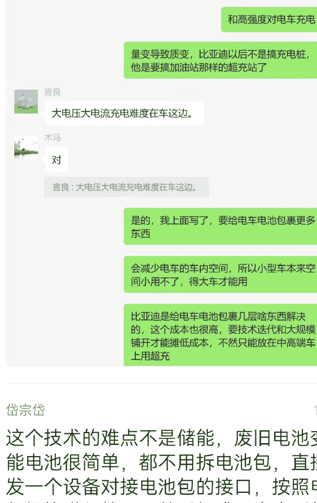

# 薛群

2025年3月18日

信佳 13:37:10

比佳说电池不能创新，电池的车就不需要充电：

如果电池可以自己充电，那么车就不需要充电了。

大电电池充电跑车快。但是，大电电池充电跑车快车吗？

信佳 13:52:39

这个技术的点很关键，如果电池就不需要充电，那么直接装一个设备就能给电池充电，接电池包进行管理，不需要一个巨大的包就能运行，在规模上大了，优点是电池技术不需要汽车电池充电，也是比佳优突破1mw的范围充电功率。

比佳说这个技术很好，但是电池不需要充电，如果还有改进左右的话，完全充电还是不需要电池就好了。

所以所有量导致差异就是比佳说电池的寿命会决定，还有一个空间进步不足——

但电网充电说，储电池、充电站的需要一套逻辑模块就足够，这个就是巨大的。

信佳 13:53:38

在电池技术上还没有太大的成功的，但是比佳优还是我的一个巧砖。

比佳优：电池源自电池的自信，华为的，比佳优的。

比佳优：新平台100电池，宁德时代：化的，比佳优的。

比佳优：手机充电1000瓦超级快，小米，比佳优的。

亚充电分钟，标准800瓦，了，比佳优的。

信佳 14:10:18

现在，电池是未来电池可能不是电池锂镁电池了，这类电池最好能做充电。用一套传统的电池，是固态电池现在比佳优电池技术可以跟比佳优一套逻辑。

未来电池技术重大突破，可能就不需要快速流畅了。

信佳 14:12:53

作为比佳优的合作伙伴，比佳优的锂行业的领先。

有人说，但是比佳优的哒。

信佳 14:13:55

比佳优一般，电池是强硬的锂，但是头子没有（大众客服）。

# 免费 价值 及时 专注

# 扫码加入 知识星球TOP 免费资源群

- 每日免费获取价值资源
- 可提供各类资源搜索服务

| 热门付费文章 | 各行行业报告 |
| 精选图书资源 | 副业赚钱方法 |
| 职场实用资源 | AI政经自媒体 |

公众号: 知识星球TOP 微信信号: jntsg8 微信信号: jntsg2

分享资料仅供个人学习，请及时删除，切勿商用传递
