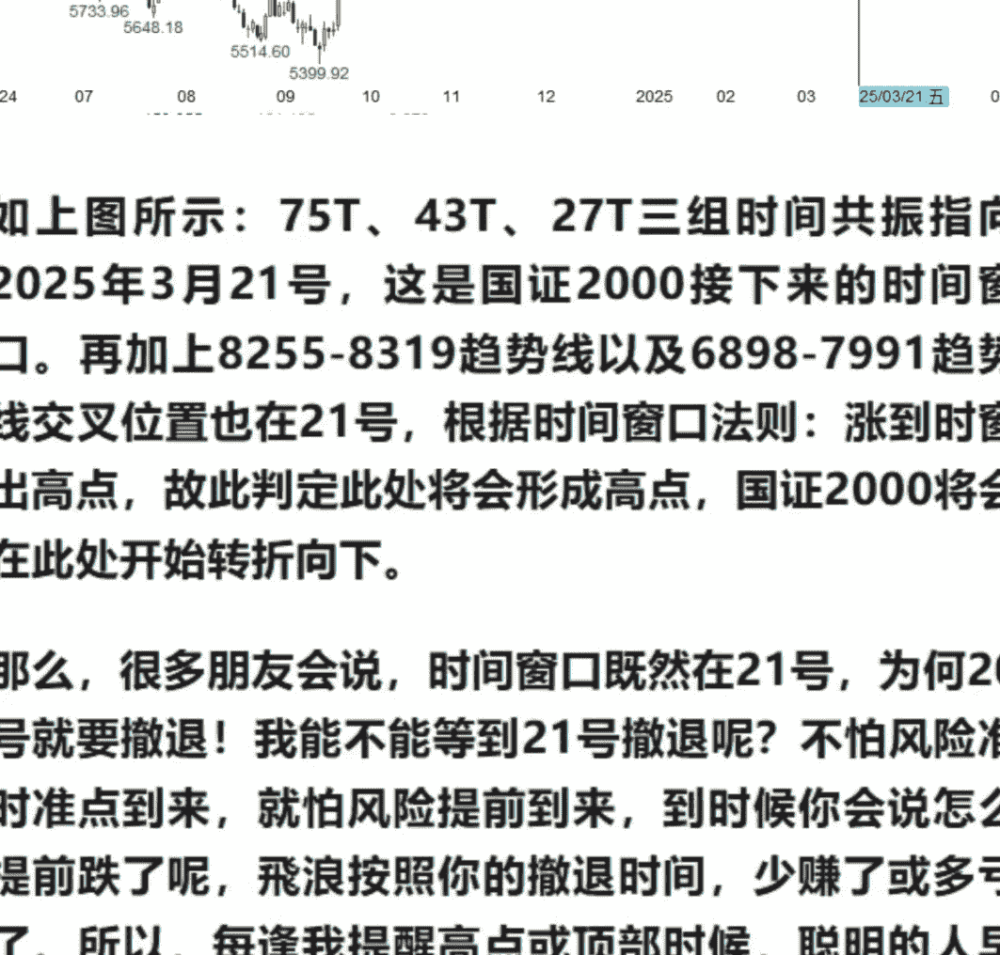
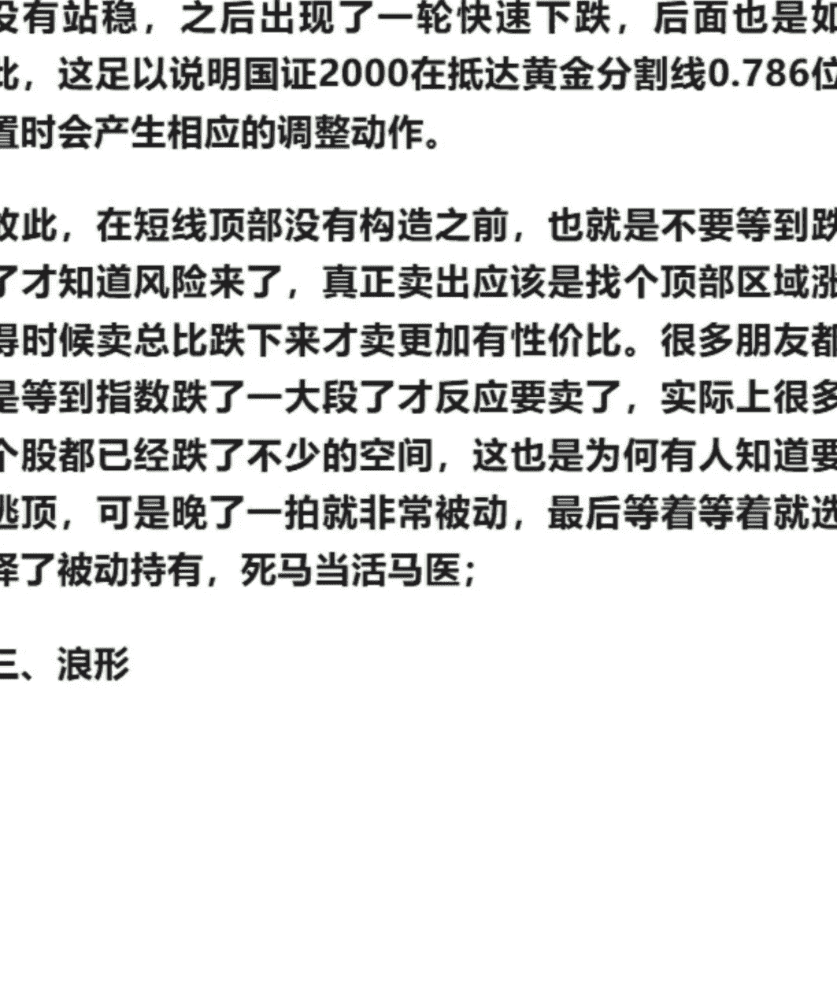
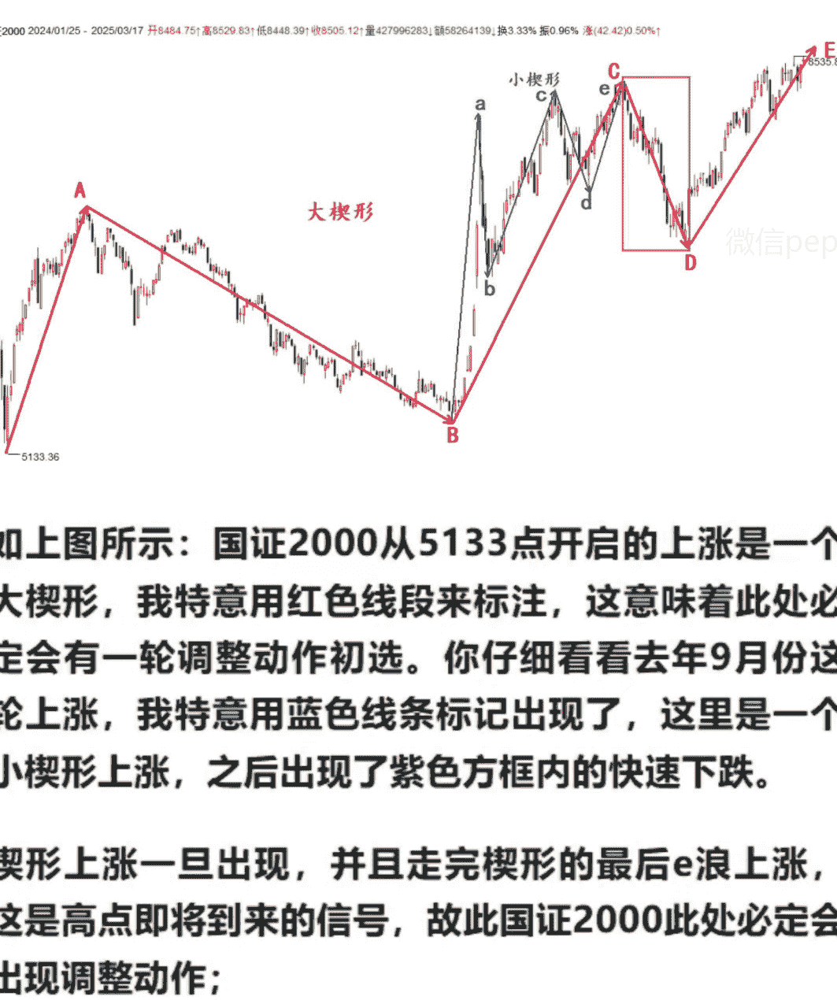
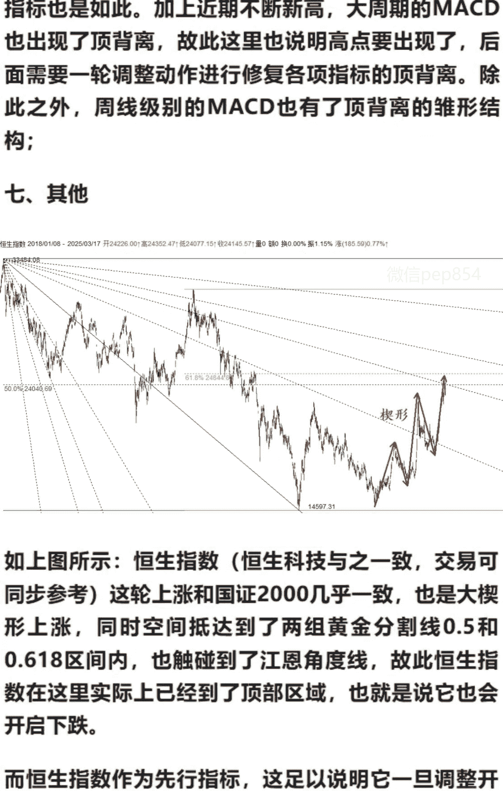
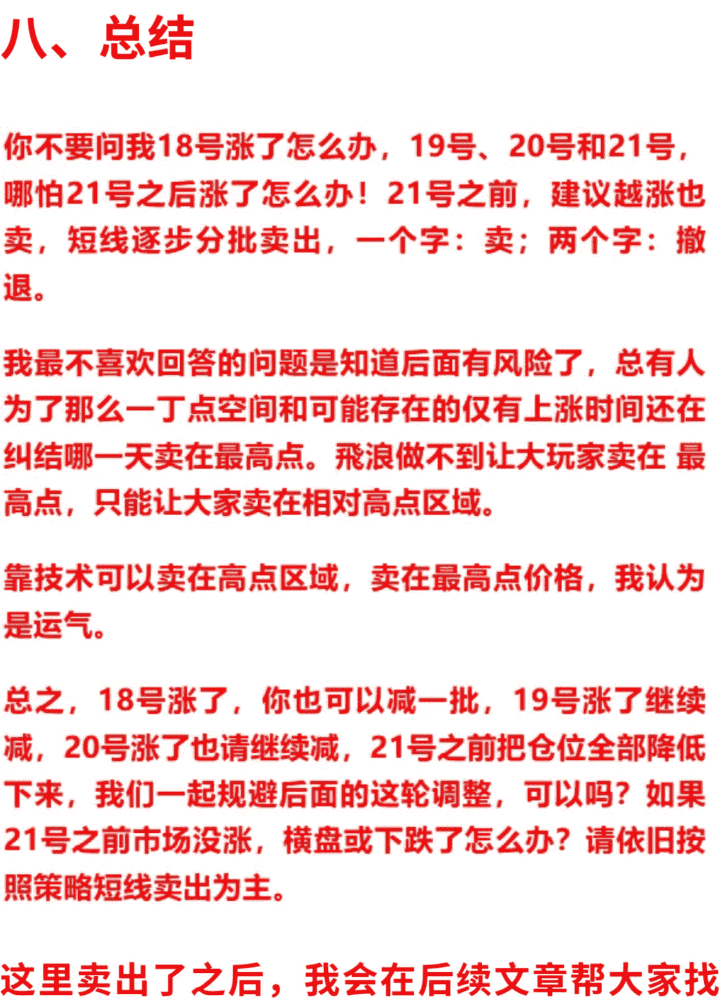

# 1浪短线顶部，我们在这里撤退！

原创 飞浪 指浪为海 2025年03月18日 07:50 湖南

## 前言

1浪短线顶部退，寻找2浪低顶抄底！逃顶是保命的手段，帮你省钱，同时又让你拿到下一艘船！

已保存 正文字数3271

本文很长，共3300字，开头就是一行红色加大粗的文字表明了畏顶，不管是老手还是小白一看就懂，推演过程只是让更多的人知道飞浪是如何判断顶部的，也可以作为一个预判顶部的教学过程。你若想学，可以用心去看，你只想看答案，开头第一句话就可以让每个人都能够读懂。

这次畏顶，不仅仅仅让你可以省128元那么简单，因为它可以让你避免几十倍以上的损失，也可以让你获得下一次主动出击2浪底的权利。

金不学不要订阅，文章已在刚刷:30发布！

温馨提示：安卓手机1元可以兑换10个微信豆，请在家人陪订阅此文，订阅不退款，杜绝自己消费。购买微信豆还需要点击“兑换”才能解锁全文，购买后并未点击全文新入。另外，购买此文章可以免费赠送给自己自己的一位炒股朋友。另外，苹果手机订阅1元即可兑换7个微信豆，价格会设置的价格提升30%，渠道手续费需抽取3成。建议大家用自己或家里朋友的安卓手机订阅，之后他点击“赠送文章”给你你看，这是一个比较省钱的重要步骤（这段文字请自己认真看，不要到时候总是来追问各种为什么 什么样的）。

## 开门见山，小区块：队友撤离

线底就看完了，现在流程如下：

### 一、时间

如所示：75T，43T，27T都是2000年刚刚共同振回2025年3月日，此时825-8319时间线以及6988-7991时间线也在此，所以撤离准了，到时候就会形成合力，2000会在底部开始撤离。

很多人问，撤离时间准了，为什么要撤离？我不准在21号之前撤离！不准提前撤离，这样撤离的人就少了或者了，所以每次撤离或者底部，聪明人少有人在犹豫准的。

所以，我建议撤离的时候，你不要在最后的时刻，要在结果出现之前留1-2天，这不是留给你的时间了，是为了安全第一。

### 二、空间

所以要调整调整才能让2000已经做了一次撤离速度很快的，不要在21号之前撤离了，但是21号之后就不打算留了，除非到时候2000足够了。

在撤离之前，由于2000在撤离后就是同样撤离的，然而，它出现了一次快速之后，然后也是，这就为了让2000在黄金分利点753.816

在底部，由于2000在撤离之前，就不要等到2000在底部撤离之后了来，到时候等到2000在撤离就给了一大大的反应了，实际上每个都已经就不留了少的空，是有人知道的。

如所示：图2000从11月1号开始的撤离是最后一次，逻辑应该是周浪周期的，但是从9月开始后最后一浪，也就是在21号之前开始主涨回调。

注意，在11月1号之前的开始的撤离是最后一次，不要在空间中留空间，这就需要要调整成两次撤离，在波浪中应该是第一浪，是2000的撤离的一波回调，第二浪，是2000的撤离的合理的，只有这样调整成两次撤离才能看到2000的撤离。

还有一种形态，在21号之前下跌，而是在这里出现多个回调（三重）结构，就是要一直保持在底部，不要再下跌，为了让大家在底部的时候亏损，所以纠结在底部的时机，最怕是头部还是底部的时候，所以这种形态就不在21号之前就不存在了。

### 三、能量

如所示，前面趋势连续，主要是因为MACD背离的结果，最近接近2020年再次背离，MACD指标接近背离状态；由于背离动作出现，KD指标也接近背离如此，如近期新高，大周期的MACD出现了背离之后，可能就需要一些调整来进行各项指标的背离。此外，两线附近MACD也出现了背离的雏形。

## 其他

如所示：相似指数（筹钱与指数，交易也同步参考）这上沿和底部接近2000几附近，也是背离雏形，时间空振达到了两个黄金切分线0.5和0.618附近，也接近到了角度强势，若是相似指数领先已经开始开启。

若相似指数为先行指标，足以说明此已经调整调整意味着B股已经开始开启，此此证明了A股风险将将来来。

再看仔细，相似指数领先已经出现线离MACD顶部，同位置离0.618还有的一步之，实际上时间可能已经到位，能够说明此的调整已经比较B股就已经结束了，在这个位置已经进入底部区域，只需要与A股形成底部后就能快速转向上，没错，在等A股底部起准！

还有就是中股已经进入了21月13号以来来的5波调整阶段，我们前文提到的时间是3月17日23:47，现在中股领向向上，实际上是A股在21号之前准备的。你必须要注意，中股对A股影响比较大，一旦它已经完成了5波上涨，A股也就面临震荡。

再看着最近，从1月13日3140开始的上涨，此前也处于1波调整期，属于5号在21号之前的，之后产生2波上涨，结束后可能进入3波强势调整，还有一次向上的回调，只是此之前的这两条线接近底部，多好处，这时候回调的pepe54

# 免费 价值 及时 专注

# 扫码加入 知识星球TOP 免费资源群

- 每日获取价值资源
- 可提供资源搜索服务

| 热门付费文章 | 各行行业报告 |
| 精选图书资源 | 副业赚钱方法 |
| 职场实用资源 | AI政经自媒体 |

公众号:知识星球TOP 微信信号:jntsg8 微信信号:jntsg2

分享资料仅供个人学习，请及时删除，切勿商用传播
