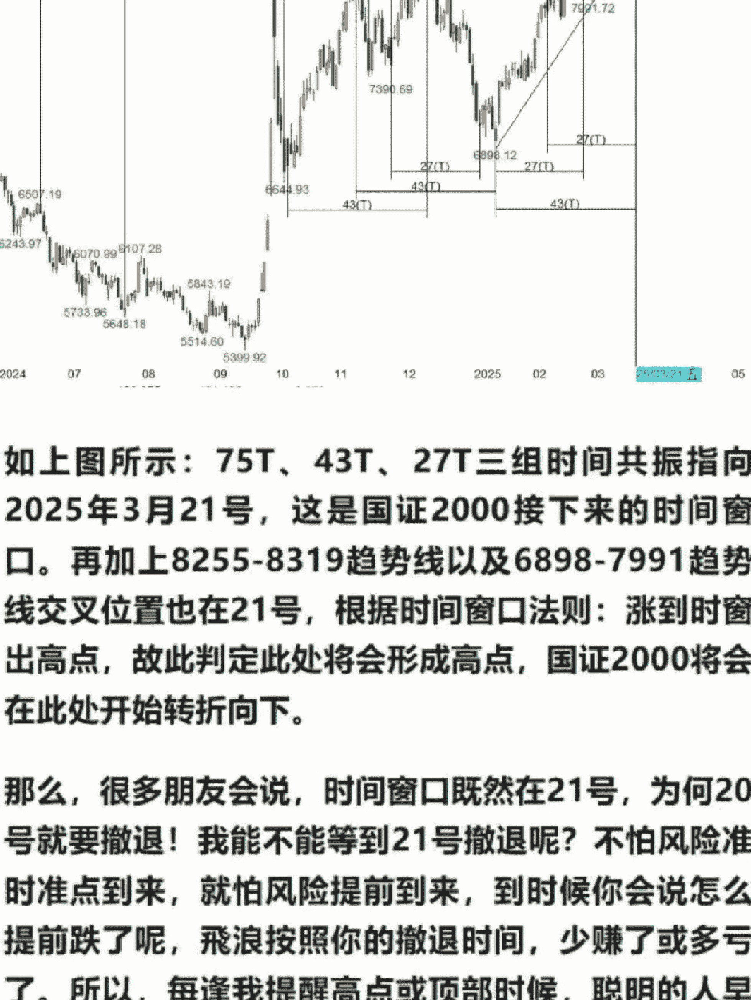
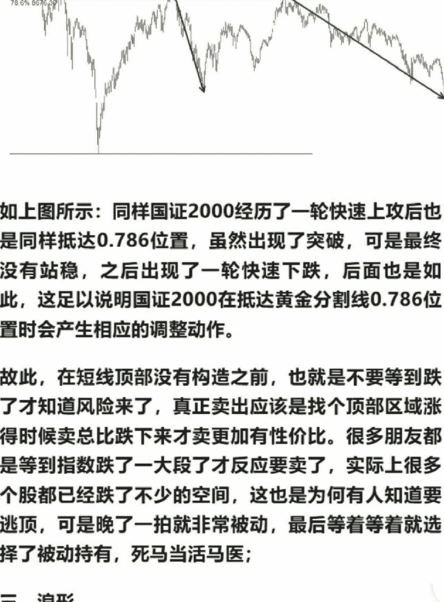
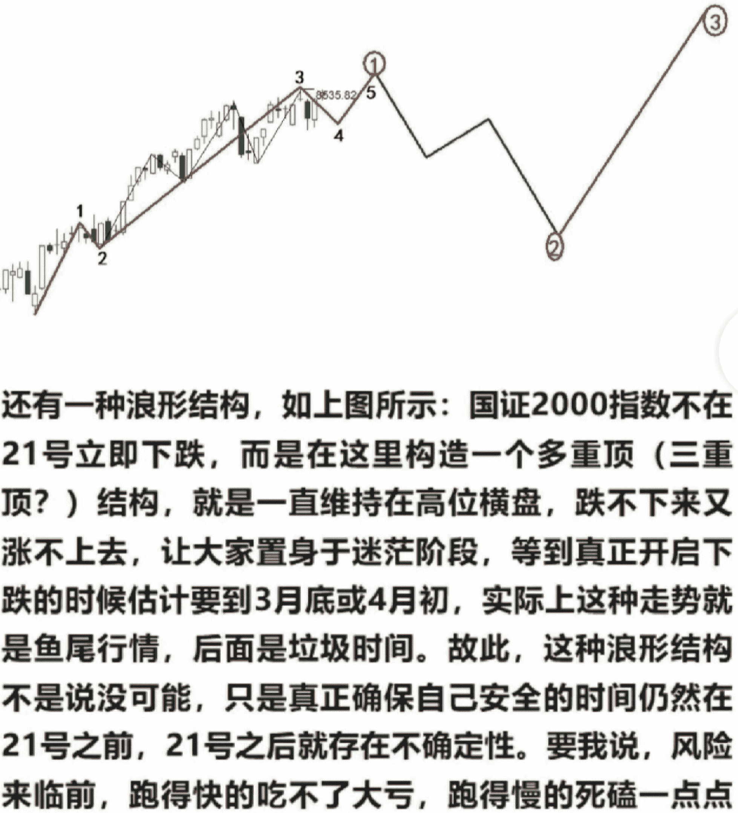
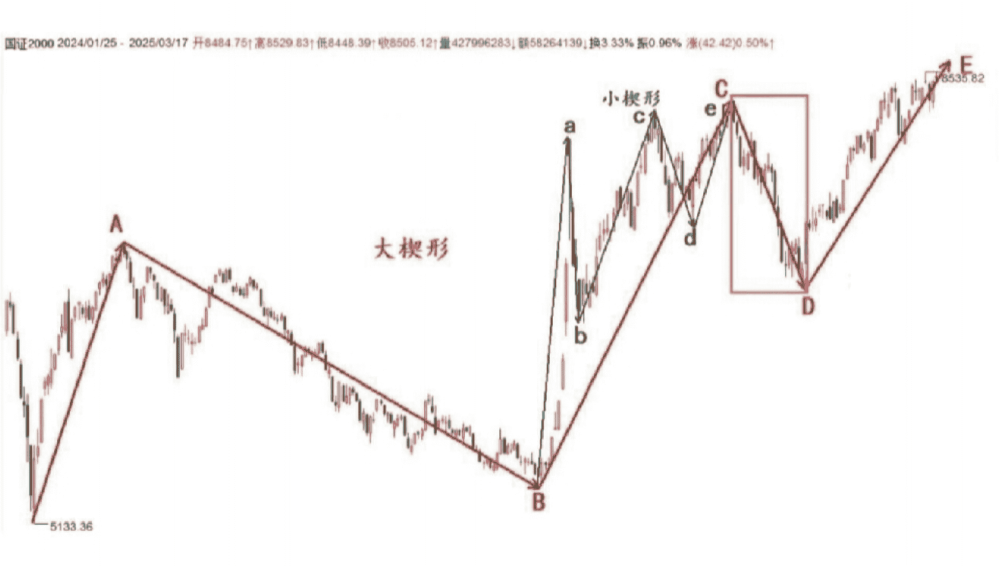
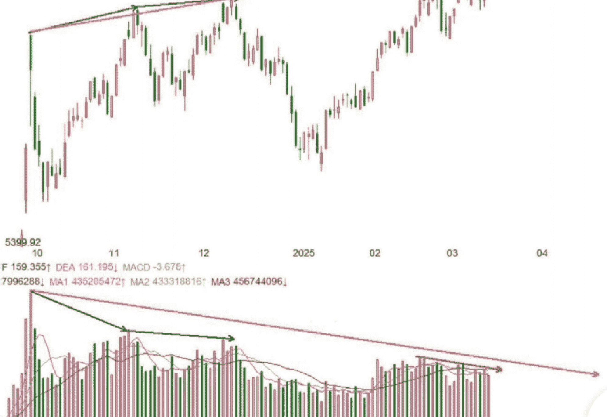
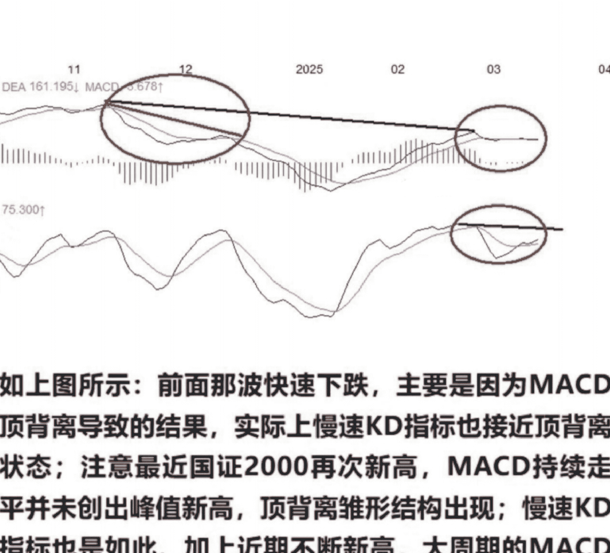
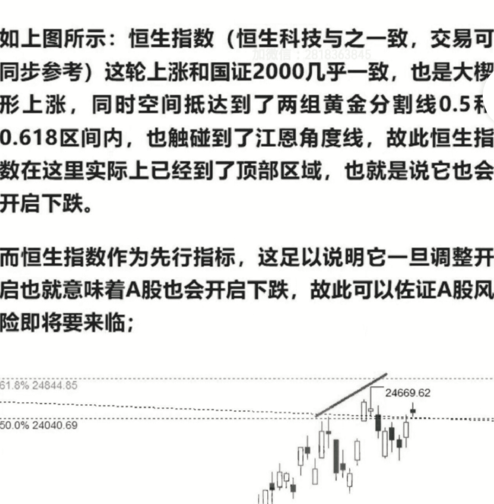
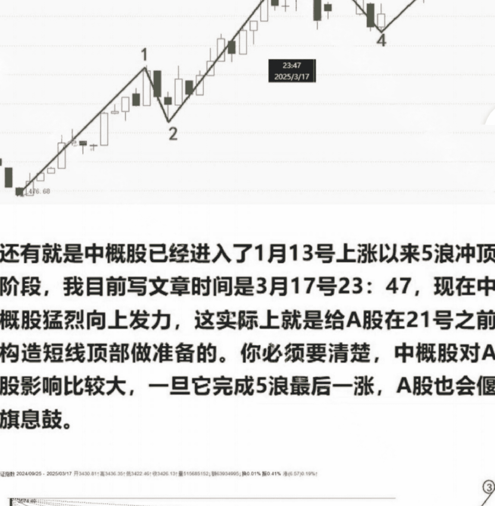

# 开今天，小区：建议20号选股，全线进攻

看到这句话就足够了，以下都是推演过程：

## 一、时间

如所示：T75、T43、T27此时时间2000接下来的时刻，再等到8255-8319趋势线或加上6988-7991趋势汇合之时，等到国2000接到，此时高点出来，国2000将形成缺口，在此处开始反击。

所以，我是看着股票的脸，你千万不要在错的时候横在纠结1-2天的时间，这不是你的时机，耐心才是第一位的。

## 二、空间

如所示：国2000指数已经达到了资金分水线0.786位置，这是5133以来首次达到资金分水线最高的高度，多数情况要第一次调整动作才有效果，所以要等到第一次调整动作才有生效。加上，前两个高点已经距离这一线很远了，我不知道国21在21号高高，但是已经没有任何意义了，即便越涨越跌，越向上拉升空间越应该出现，交易机会千万不要失错，这里就会留出底部视线的缺口。

所以，在顶端底部没有出现之前，就是要等到底部涨来调整，到时候在底部买下来才有机会性。很多朋友都是等到等到跌了一大段以后才反应过来，其实早就已经套空了，这也是只有人知道会有调整，结果晚了一把就非常被动，变成被动持有，最后等着看马下戏。

## 三、波形

如所示：国20001月13日开启的浪潮理论符合中的天字调整模型，此时是第9个高点下一次调整，现在在21号收盘前将面临波浪中的顶浪，然后进行后续调整。

注意，国20001月13日开启的浪潮现在只是回涨4%，39号还没调整，还没有时间从空间空出来，这里还需要再一个调整，这个调整是针对对下一次调整的开始。在波浪的情形中，调整是为了利用时间，第2浪是针对第1次浪上的调整仓位，应该要等到调整结束再开始第3浪，所以2浪调整必须结束。

我们的交易就是在第1次位置介入，等待2浪调整，等到第2个点回调，回调第3浪，所以2浪调整必须结束一浪结束后，调整2浪结束时间，整个调整的结束形态是不变的，简单的2浪调整和短期的浪结束时间，长是不短，短的2浪调整空间小时间长总是不种形态的调整空间越小时间越长，我们都会抓准，这就证明了一浪调整的重要性。

还有三角形形状，如所示：国2000指数在21号之前，而是在这里中出现一个多重（三重三角形）顶部，这种底部是不涨不跌，下不去上涨，这种底部在筑底的时候等到3月或4月，实际上这种走势是急行情，底部位置逐渐放大，这种形状走势是不可能的，除非在底部正在筑底的所有时间在21号之前，会有这种不确定性。如此，跌了底部的人吃得好呢，赚了底部的人是最后的胜利。

## 四、形态

如上所示：国证2000从5133点开启的上涨是一个大楔形，我特意用红色线条标注，这意味着此处定会有一轮调整动作初选。你仔细看看去年9月份的这轮上涨，我特意用蓝色线条标记出现了，这里是一个小楔形上涨，之后出现了黄色方框内的快速下跌。

楔形上涨一旦出现，并且完结楔形的最后一浪上涨，这是高点即将到来的信号，故此国证2000此处必定会出现调整动作；

## 五、量能

如上所示：国证2000近期的走势就是不断创新高，可能却没有放大，第一次是在蓝色线条位置出现了量价背离，之后出现了一轮快速下跌；现在在红色线条位置也出现了量价背离，仔细看一下线条也出现了顶顶背离，故此价格不断创新高，量能够逐步缩小，这就说明市场情绪倾向于谨慎，越往后量越小，这意味着短线调整随时都会面临；

## 六、指标

如上所示：前面接下跌，主要是由于MACD背离的形成。实际上最近接近2000年以来，KD维持高位并没有出现新高，MACD背离形成状态；KD指标也出现新高。由于上涨不新高，MACD出现了背离，这时就需要一调整操作进行指标高点显示指标的背离。此外，两个级别的MACD也有了背离的雏形；

## 其他

如上所示：相对指标中K和R的背离，同样同步发生；这条线在接近2000年以来几次背离，在大跌0.618时，空头没有下跌，背离指标在已经进入了底部区域，这说明了它可能会下跌了。

相对指标作为领先指标，这说明了从1月3日开始调整就A股开始下跌，此此说明A股将面临下跌压力；

再看细节，相对指标显示出了底线信号MACD见顶，当沪在0.618时有一一次回调，实际上空间没有下跌，这说明了我的调整对A股已经结束，在这个位置已经进入了底部区域，只需要与A股背离形成后真正转向，下跌，在A等大涨起跌！

再观察近期，从1月3日340点开始的上涨，目前处于上一次调整区域，随着5月21日开始的调整，它产生了两次下跌，下跌后又进入了上涨，至少还有一次回调，这在此之前调整还没有结束，说明没什么好事了。

我们不知道在5月21日之前跌到了0.618的370点左右，已经进入底部位置，说明向下已经结束了，空间上，这说明A股面临下跌风险了；

## 总结

如果你不想问我8400点该怎么办？19号、20号的调整，20号和21号之反弹，建议你应该持有，短线底部弹出一个；涨：两个；再跌：三个。

# 免费 价值 及时 专注

# 扫码加入 知识星球TOP 免费资源群

- 每日免费获取价值资源
- 可提供各类资源搜索服务

| 热门付费文章 | 各行业报告 |
| 精选图书资源 | 副业赚钱方法 |
| 职场实用资源 | AI政经自媒体 |

公众号：知识星球TOP 微信信号：jntsg8 微信信号：jntsg2

分享资料仅供个人学习，请及时删除，切勿商用传播
