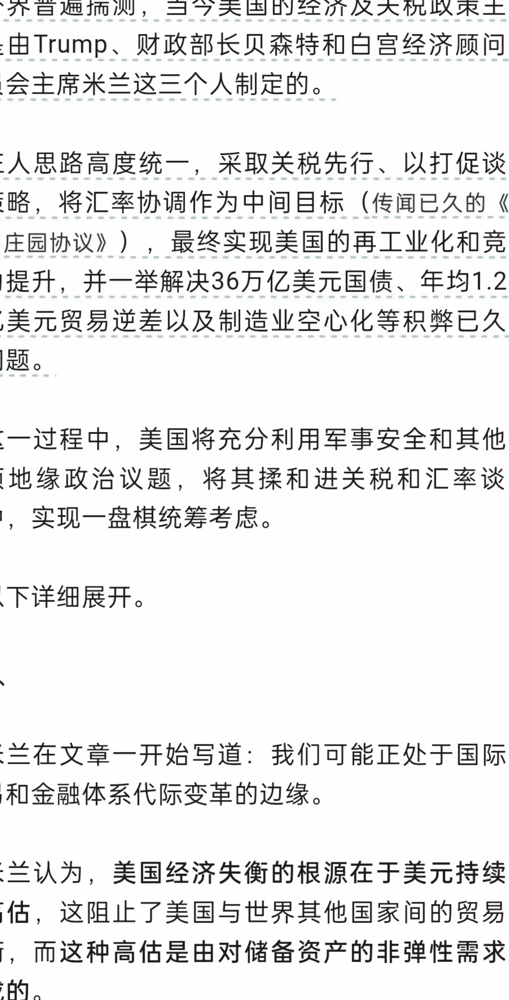
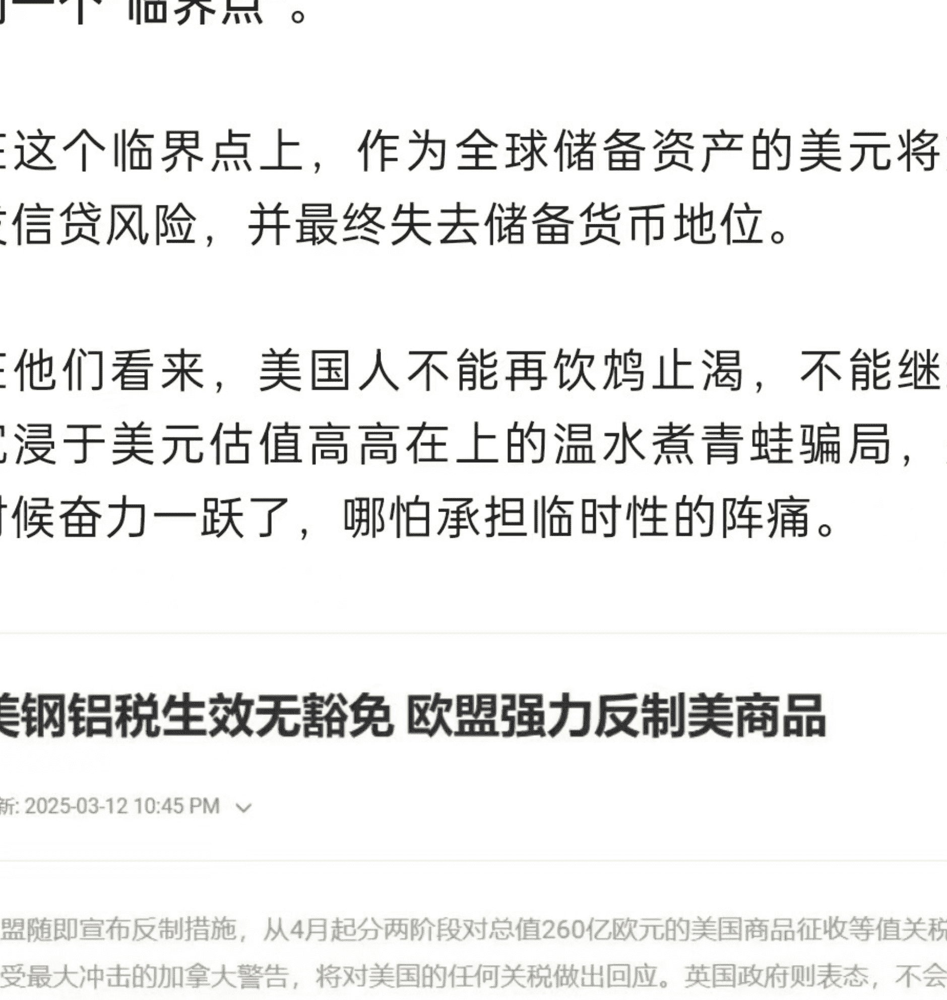
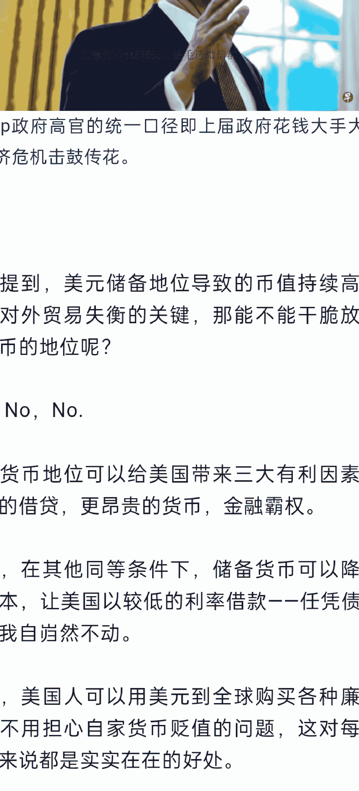
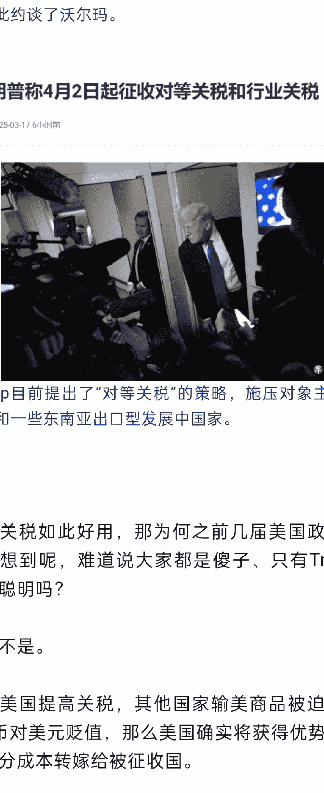
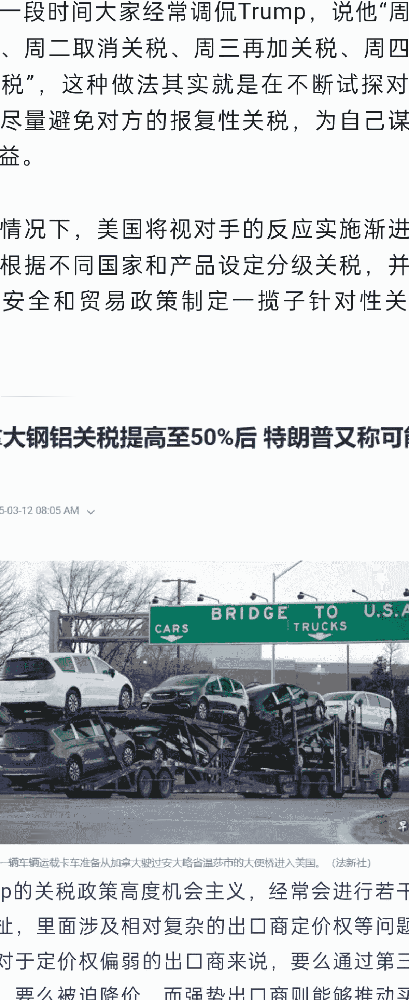

# 幕后操盘的大师

作者 彭涵 2023年05月19日 09:30

近期许多专业机构都提到了一篇文章，《A 'User's Role in Constructing the Global Trading System》，其作者是日经美联储货币委员会主席Stephen Goodman。

经历过近月美联储的反复，我们发现特朗普对美元的观点如此独特，他变过了吗？

本篇将从特朗普对市场的观点出发，并尝试展开：

> Who is Stephen Goodman, the economist who has Trump on trade and defense?

"has Trump's use"可以理解为“为特朗普所用”。

外界普遍疑惑，当美国的经济和货币政策是由美元驱动，特朗普如果担任部长或首席经济学家，世界会发生怎样的变化？

美国人认为，特朗普的政策将会回归，将贸易转向以美国为核心，美国制造业的工业竞争力将面临提升。

这意味着，美国将通过美元强势和军事力量来控制全球地区政策，并将美元和汇率进行设定，一回顾其后果：

以下展开：

在文章中讨论：我们如何观察到处于国际和金融体系的深刻变革？

美国，美元的国际地位源于其在全球的霸权，这决定了美国与与其他国家关系，这种关系是独特的。

什么意思？

通常来说，一个国家的货币贬值其出口产品的竞争面临压力，但出口额会受刺激。这一逻辑在美元身上是会导致美元贬值、下跌的恰恰反的：

相反，如果一个国家在国际储备中没有足够的美元，那么即使该国贬值，该国家的货币也一定不会贬值并可能被迫向美国购买商品。

然而在1945年美元成为国际储备货币后，国际储备的需求发生了变化。现在的需求变得非常复杂，增长的需求不仅包括黄金和欧元，美元的需求也在不断增长。

由于美国强势，美国国内的产品不需要出口，这决定了美国的贸易。美元强势的唯一是其作为全球储备货币的特殊属性。

不仅，由于全球对美元的需求，美国必须提供美元的供应，这决定了美国的贸易赤字，同时也限制了美国贸易赤字的扩大。

中国制造业的份额和美国制造业的份额

# 特朗普：经济将经历一周反转并赢得美国增长

周三，特朗普表示经济将经历一周反转，美国将赢得增长，我们将继续容忍拜登政府的失败。

No, No.

特朗普表示我们可以为美国带来更大的利益，我们的政策将得到验证。

此外，在下周，我们将继续看到增长。特朗普表示我们的政策将带回前所未有的增长。

但是，我们即将看到美国经济大反转，对这个国家将是一个前所未有的机会。

由于拜登政府的失败，我们将看到美国进入一个前所未有的繁荣。

特朗普表示，由于拜登政府的失败，我们将看到美国经济的巨大反转，美国将进入一个前所未有的繁荣。

# 黄金将跌至 3000 美元，美元将反弹

3000 美元黄金

2017年至2023年

特朗普分析师表示，黄金在未来几年可能跌至 3000 美元，而美元将强劲反弹。

特朗普分析师表示，黄金在未来几年可能跌至 3000 美元，而美元将强劲反弹。由于美联储加息，黄金将面临压力。

# 特朗普威胁对中国进口商品征收 60% 关税

特朗普表示，如果他再次当选，他将对中国商品征收 60% 的关税。

特朗普表示，如果他再次当选，他将对中国商品征收 60% 的关税，这可能导致全球贸易战升级。

# 免费 价值 及时 专注

# 扫码加入 知识星球TOP 免费资源群

- 每日免费获取价值资源
- 可提供各类资源搜索服务

| 热门付费文章 | 各行行业报告 |
| 精选图书资源 | 副业赚钱方法 |
| 职场实用资源 | AI政经自媒体 |

公众号:知识星球TOP | 微信信号:jntsg8 | 微信信号:jntsg2

分享资料仅供个人学习，请及时删除，切勿商用传播
