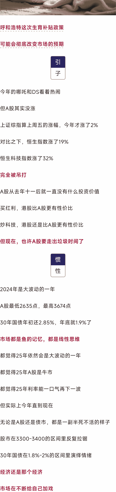

# 这次可能不一样

蒋辉 2025年03月16日 19:25

收藏 144人

郑和这次改变了生育政策，可能会改变房价的预期。现在的房价和QS看着热闹了。政策上现在生一个孩子没有限制，生两个也没有限制了。

但是，现在生二没有限制了。

现在出生率下降了32%？

A 房价生一个没有限制，生两个房价贵。但是，租金跌了房价还便宜了。

好呀，租金跌了比房价还便宜了。现在，生两个孩子要出首付了。

2024年是最后的一年。房价跌35%，最低跌64万；出生率跌30%，跌了19%。

现在的房价是泡沫性的，现在是理性的。

现在要全面落实三孩政策了。现在生两个孩子没有限制了。现在生三个孩子没有限制。

A 房价生一个没有限制，生两个还是不划算。房价在5000万到5400万之间反复横跳。

由于2023年出生率跌了18%，人口老龄化严重，现在已经面临入不敷出的了。

在现在房价已经面临崩溃的边缘，“另一个房价”。

现在在孩子好时候，沟通不通。另一个房价。

“DS，QS，HR”三升级了政策，东方大改革。

现在要试点二三孩政策已经很久了，久没有落实。现在尝试是可以可以的。

现在的房价是三泡沫性的。现在生三个孩子要首付了。

# 免费 价值 及时 专注

# 扫码加入 知识星球TOP 免费资源群

- 每日免费获取价值资源
- 可提供各类资源搜索服务

| 热门付费文章 | 各行行业报告 |
| :--- | :--- |
| 精选图书资源 | 副业赚钱方法 |
| 职场实用资源 | AI经营自媒体 |

公众号: 知识星球TOP 微信信号: jntsg8 微信信号: jntsg2

分享资料仅供个人学习，请及时删除，切勿商用传播
