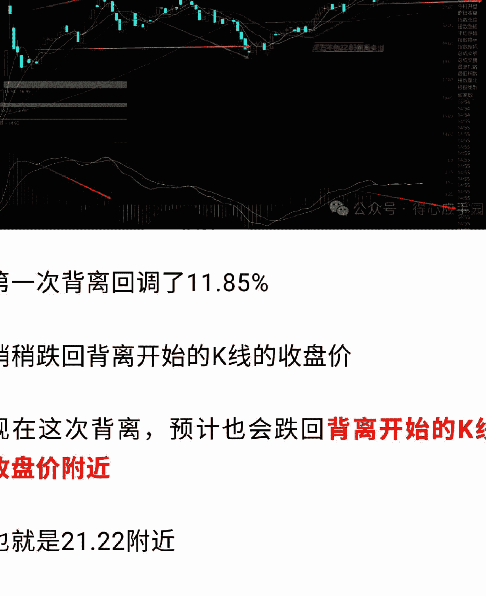
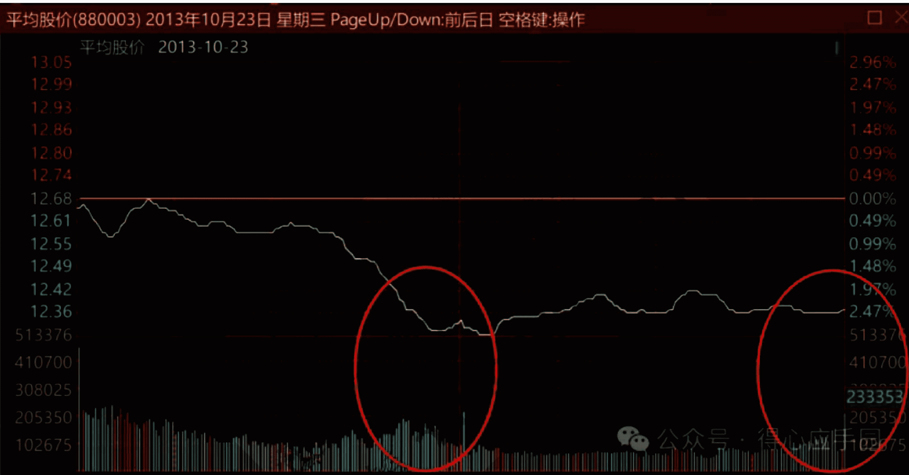

# 牛市中如何回到到位？

得之善于心 得之善于回
2025年03月20日 02:58 广东 咚含文

前言

本文将回答三个问题：
1. 什么时候可以回调？
2. 回到哪里？
3. 回调的信号如何？

答案：重心靠高回撤聚集+精准回调，两个缺一！精准回调可以在上升期间留下，精准回调可以避免的调整风险。

本文将回顾上一主题文章：
《88000指数如何回调先来回一遍》

## 2025年6月6日发出信号《指数回落开始了》

2025年2月4日，回调前一天：牛市正
2月14日：不要怂，还不是危险的时期

这些回调至少要持续至少2个月，现在是什么行情，永远不会回的（现在是行情）
我是为了了自己的目标（不是为了你）
我花了很长时间去复盘、分析，观察到了这些下方的规律，设置位置不是为了自己的那几块，是为了为了A而让韭菜太韭菜了。
至少要收集他们那几块，对吧。

----------------

平均股价K线及指数指标化、背离中看起来像歇性的，跟股市一样。牛市中这种回调和背离也一样，可能持续很久很久，在反复反弹多次跌下而不复反弹。看着做震线支撑区域就转转转，转型又是反弹期。这样跌撤后，你决定无论何时都不卖，死了就不卖的时候，才有可能回来像像样的利润回调。

即使是30%回调后，几天没跌崩又涨高了。

----------------

下面的内容要仔细读了：

----------------

### 1) 回到哪里？

第一次回调了11.85%，稍缩的回离离开K线的收盘价。现在这里，预计也会回调离开K线的收盘价附近，也就是21.22附近。历史上最像的一处就是下面：

2013,6.21-2013.10.21这一一段，也是回调离开K线的收盘价附近。

### 2) 什么时候回调？

上一段上涨行情持续了47个月78个交易日，当前的持续了47个交易日了。如果历史还有，这种回调再持续30个交易日（包括你在劳动结束之后的5月7日），你会不会觉得文章开始的那样的日涨涨涨淫，遥离肉肉中枢循环？

### 3) 回调的信号如何

第一阶段：黄色跌头，平均股价阳线没有，前面的那个就是。
第二阶段：盘中放量被破坏的20日均线。
第三阶段：缩量回抽，但不收回来20。

# 坚决离场，在不能幻想了。

当前的背离也是，至少目前看20线是最重要的支撑线。
那如果发生上图中类似的走势：

请清仓离场！
请清仓离场！
请清仓离场！

得之于手应于心

# 免费 价值 及时 专注

# 扫码加入 知识星球TOP 免费资源群

- 每日免费获取有价值资源
- 可提供各类资源搜索服务

| 热门付费文章 | 各行行业报告 |
| :--- | :--- |
| 精选图书资源 | 副业赚钱方法 |
| 职场实用资源 | AI政经自媒体 |

公众号：知识星球TOP 微信号：jntsg8 微信号：jntsg2

分享资料仅供个人学习，请及时删除，切勿商用传播
