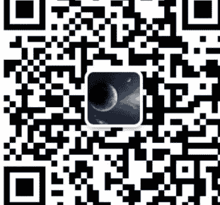

# 南院大王

2025-03-20 09:25

## 易经16豫（上）:运来天地同力

豫。利建侯师。

建侯，是建立诸侯国，行师，是出动军队，押上筹码。

在现代社会，豫卦，是单飞，创业，去开分公司和打开市场，是主动出击，大胆买入，扩张势力范围和影响力，也立即干一场。

什么时候和场域适合这种种格？

象曰：雷出地奋，豫。先王作乐德，殷存于上帝，以配祖享。

本卦上卦为震，震为雷，下卦为坤，坤为地，是雷在大地上轰鸣的盛象。

大地震动，触发万物，先王看到这种场景，制作音乐，歌功顺德，建章立制，高歌迁进，光荣归于上帝，光荣归于祖享。

整个豫卦告诉我们什么？

要顺时而动，人终是大环境的产物。

看到天象和雷声，是我们处世成事的首要条件。

有一个老人在南海边画了一个圈，那就是“雷出地上”，《东方来满眼春》。你看着干就行了，锚住这个方向，中间彼彼沉浮浮，也终能抬头，为容率高。

你明明名校毕业，非不去深圳，要在90年代代表北京四合院，跑到纽约去洗盘子，等08年奥运会回来，被雷声催发的后排同学，何止乃富豪。

同理，换到我们的投资，创业，炒股。

我们炒的是什么？

进群微信：pep458

炒的是兴衰存。

因为愚明人太多，规则又不严密，所以A是全世界最充分博弈的地方。

整体核心规则就一句话：

【来于天地同兮，时去英雄不由】

完全是一门周期和站队的学问，你站对了了周期抓住了主线，阿挪狗狗都顺顺，周张跌跃也能越。

你站错了周期，技术再好也没用，折腾体验越差。

你有盈利，是周期给你的红利。

你最终解赛，又是周期解放了你。

物极必反，否极循环往复，这是天地和市场的共同规律。

几年前的腾讯和阿里，比今天还要赚钱，但是进攻东守，你就是价格腰斩，碰到新闻都能解释为利空，很多板块，年线连跌你挨染奈何，

进群微信：pep458

今年的科技资产，遇到东升西降，你就是怎么都能拉回来，碰到问题都能解释为利好。

巨大的又开始有人入场，因为换了人。

相信大家都有过这种体验害怕打雷雨过后，你来到公园或者森林里去，空气清新，草木芬芳，万物生勃勃，你感觉神清气爽，心情愉悦，觉得无所不能。

那么同样的，在生活和事业中，你也要找找这方向去。

这方向，

大环境，是离火运，民族的伟大复兴；

大环境，进群微信：pep458，是AI和机器人代表的第四次科技革命里；

小环境，是经济向消费转型型的以及自我实现的追求。

普通人要成就就较大的事情，人和不如地利；地利不如天时。

那么，如何在这种场景中，我们应该如何如何把握自己，又不至于迷失呢？

清听下回删。收起

## 免费 价值 及时 专注

## 扫码加入 知识星球TOP 免费资源群

- 每日免费获取有价值资源
- 可提供各类资源搜索服务

◆热门付费文章
◆各行行业报告
◆精选图书资源
◆职业赚钱方法
◆职场实用资源
◆AI政经自媒体

账号:知识星球TOP
微信:jntsg8
微信:jntsg2

分享资料仅供个人学习，请及时删除，切勿商用传播
