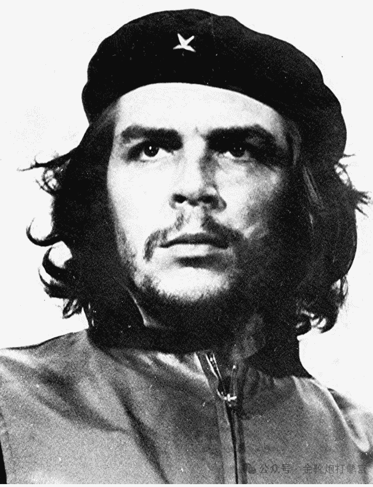
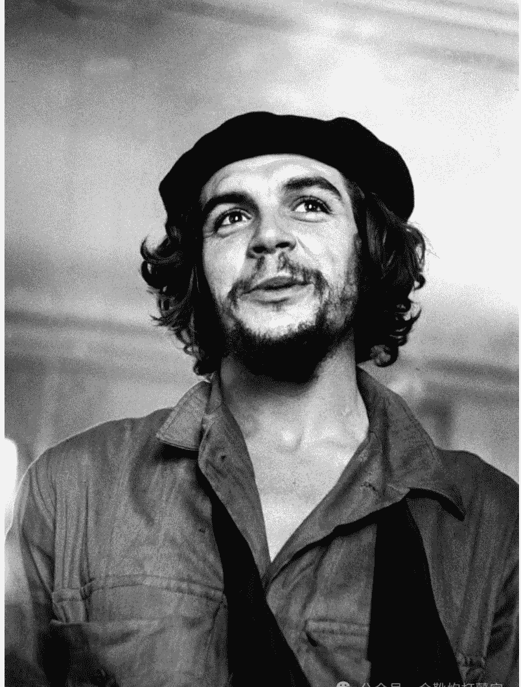
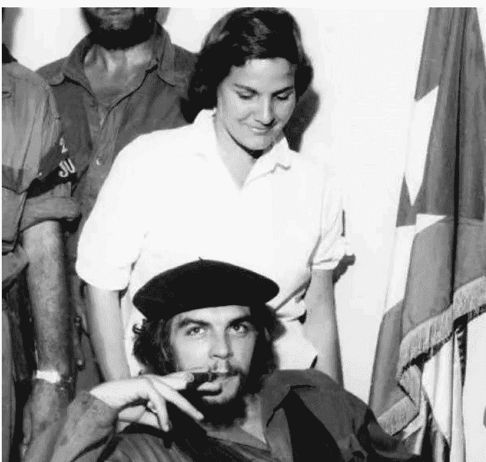
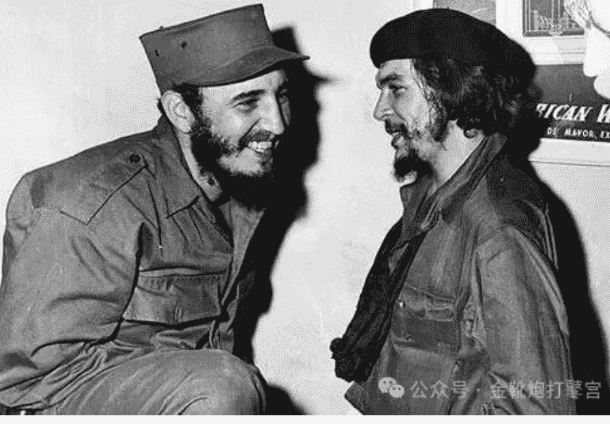
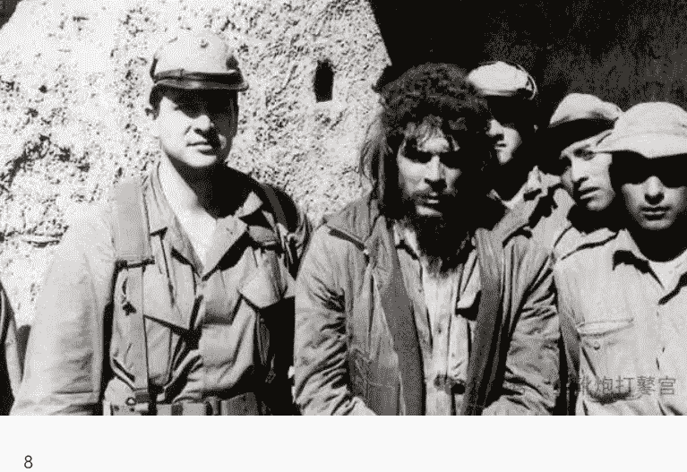
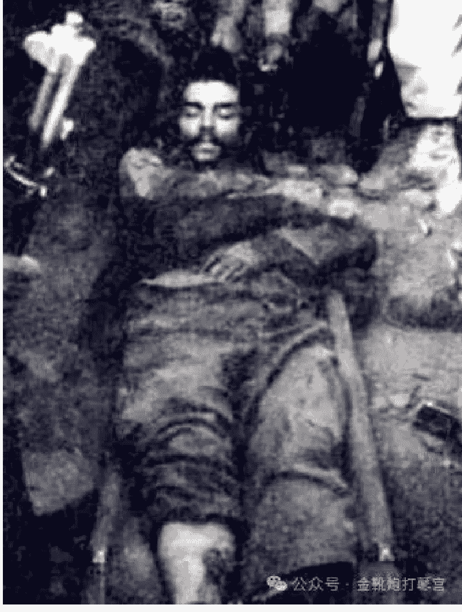
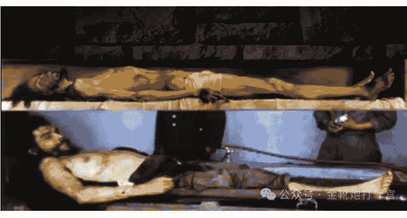
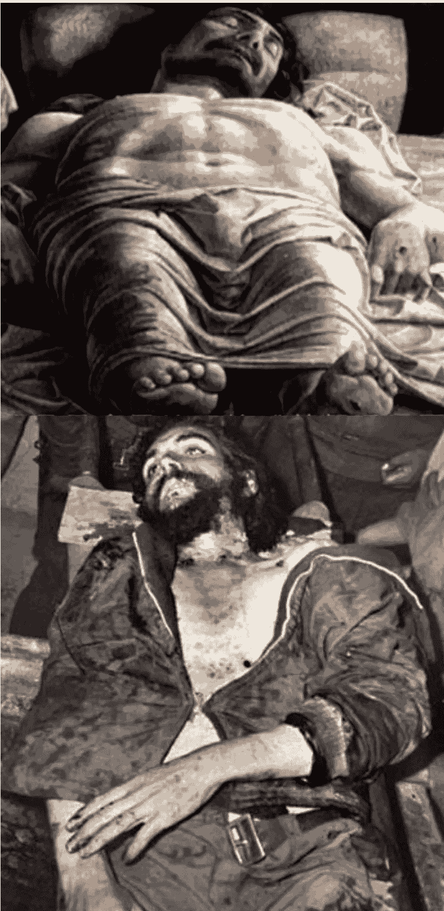
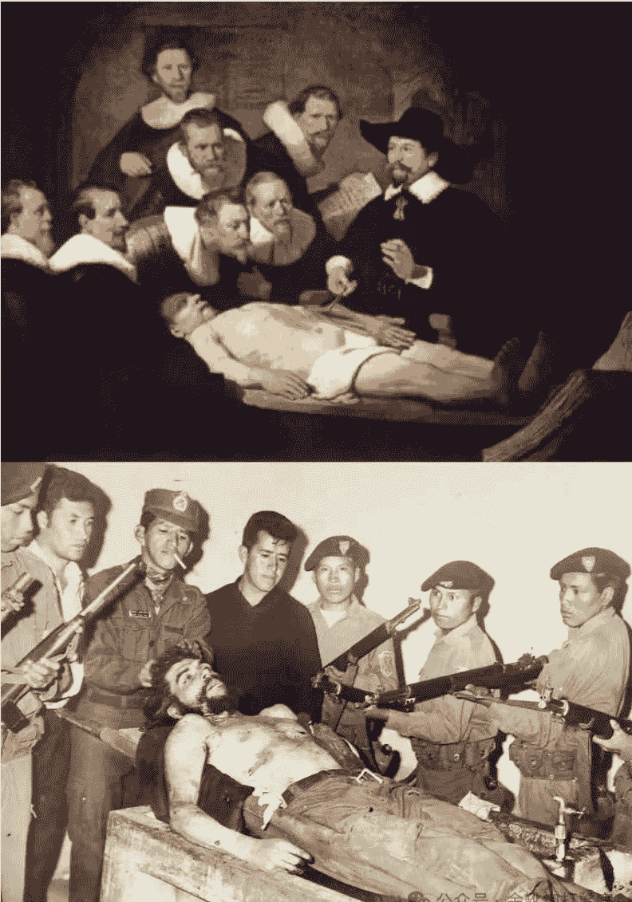
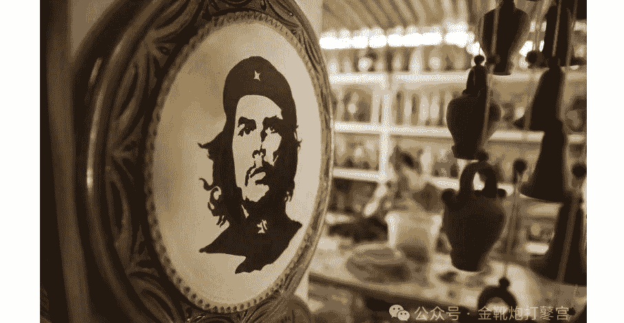

## 切·格瓦拉逝性57周年：这个世界应该是革命的

2024-10-10 👁️1327 💬 1

欧洲金靴 专栏作者
红歌会网专栏作者

切·格瓦拉出生于1928年的阿根廷农村家庭，亡于1967年的利维亚丛战斗。

他也是星星之光在荒原上传播共产主义浪潮的王者：1928年，在大斯林的领导下开始了第一个五年计划。同时，更重要的是中国，在1967年，文革根据毛泽东主席和中国共产党的领导、人民军队“中国农民革命”、“红军”，并先后组成了第一方面军、第四方面军、第二方面军和红军，建立起多起革命根据地。

他也试图对反对大国主义和苏美大国主义浪潮做出承诺的：“大风大雨也不可能也不可能，人类社会就会从大革命中发展出来的”的指示，正式对外出发。

在今天的条件下，发动民主只会巩固无产阶级专政，而不会削弱无产阶级专政。打掉那些束缚群众手脚的清规旧律，打掉那些妄徒的旧框，这是一件大好的事情。革命就是无罪，违反就是有理的，关于无产阶级文化革命的一步步召。

从1928到1967，短暂的三九载献出生命历程，他一直在革命，他一直是一个纯粹的革命者的人。

> “革命者切”，留了这个世界最红，最纯粹的一段理想主义的战斗人生。

从今天的视角，可以先看看格瓦拉的家庭：他的母亲是阿根廷贵族，有着纯正的西班牙族血统，他的祖父是秘鲁最后的一任总督，他的父亲是阿根廷大门之后……

这样出生于上流家中的子孙，而且五个孩子中老大的嫡长（可以最先接触家族资源），日后成为一名世界盛誉诸外的美政家，推销资本主义，力润消除阶级分化的战斗士兵。

## 加微信intsg2，免费资料分享群

一切，恐怕都要源于1950年22岁开始的拉丁美洲之旅。环绕美国全国之旅（耗时六周），陆经二国和一年后坐着摩托车的拉丁美洲之旅（耗时六周，历经六国家）。

正是在这次罕见的拉丁美洲旅途中，年轻的格拉哈姆记录了拉丁美洲作为美国帝国后裔以及本土民族的挣扎现状。所有作物和工业制品都被美国企业垄断；首富底层不底层；流民的健康保障被美国精英阶层有权无视。上，精致阶层的生活是穷人无法想象的，而流民的农户父母们却要面对每天忙到一样的和预期中希望不到50岁的梦想；美国的当权者在配合着美国留美眼中推行了一系列殖民改革，试图将拉丁美洲这片大世界第三代打造成20世纪初的非洲拉窟。

这最终导致了20世纪初的非洲拉窟。

还记得《狂热年代》毛泽东的那个场面吗？当时的毛泽东，此刻同样迥无异。

### 在秘鲁，他结结了与共产党知识艾交流

通过与艾斯的交流，他初就建立了了自己的国际主义思想和马克思主义理念。

他在格尔哥呼吁：“拉丁美洲是一个整体，放弃地方主义，为团结的拉丁美洲干杯！”

为此，已经成功考取富斯哥佛大学拉丁医学博士，看着眼前父母成为一名阿根廷上流阶层的格拉哈姆，与其中国命运的人物——肯先先生做出了一个选择：放弃学医。

因为医学才是不被压迫的民。

不同的是，肯先选择了笔梭，而格拉哈姆则捡起了枪与子弹。

但是相同的是，他们都选择了战争，选择了战斗。

1953年12月24日，开始生命的格拉哈姆来到了危地马——当时危地马是拉丁美洲唯一的民主国家。当时的危地马正处于年轻左翼阿斯本领导下，进行着一系列带有社会主义性质的改革。特别是阿斯本吸收了土地改革，其矛头直指美国控制下的联合公司。在危地马，格拉哈姆经历了许多由于反抗独裁和美国帝国殖民者的流亡的革命战，其中著名的革命家埃尔达。后来在墨西哥，成为了格瓦拉的第一妻子。

格瓦拉领着这些革命者一起投入到保卫阿斯本政权的斗争，积极为危地马的底层人民服务。在那里，格瓦拉得到了他绰号：“切”（Che）。

“切”是一个西班牙语感叹词，在哥伦和一些地区被广泛使用，人打招呼类似于汉语中的“喂”、“哥”。

1954年2月12日，“革命者”在玛贝尔·阿斯斯的信中第一次承认自己与危地马有联系。一个月后，美国情报局在哥伦建立了一支由危地马军事军官阿斯本领导的雇佣军，准备渗透阿斯本政权。6月日，武装阿斯本军队（共有800人，其中200人是危地马）进入危地马；27日，阿斯本被最终击杀。随后阿斯本成为危地马独裁，开始对异人士进行镇压与压迫。

几个月后，约900人被刺杀，格瓦拉的名字出现在了美国中央局的名单上。但他仍然活着，在他的遗迹中，尤其是日记中，透露出的“死亡宿命”在很多地方非常有吸引力，神化了某些革命。例如格瓦拉的生日时，他在日记中写道：“我是为了献出真正的正义，我从灵魂感到快乐和新鲜，我从身体身上来，战斗吧！”

写下这段文字时，格拉西才26岁。出征危地马后，他转来到了墨西哥城。在墨西哥首都墨西哥城——那个时候他面对千万墨西哥流亡人士的苦难呐喊，他终于结识了这段文字后来诞生的战士：同样访问墨西哥的卡斯特罗·菲尔特罗斯与卡斯特罗兄弟。

由此，他开始了自己生命中最成功的章节：跟随卡斯特罗兄弟回古巴，领导伟大的古巴民主革命！

与卡斯特罗兄弟的交流中，格拉西加入了卡斯特罗组织的名为“七二六运动”（以一次失败的革命“蒙卡事件”的日期命名）的82军军事组织。1956年1月25日，“七二六运动”的82名战士在小的“格玛号”船上，从墨西哥特拉斯戈尔斯州出发，怀揣着理想和斗志地驶向古巴。1956年12月2日，他们在古巴南部的奥连海岸一片登陆，但遭遇了古巴统治者巴蒂斯的军队的伏袭。最终，82人中只有这次袭击中幸存。这就是包括格拉西在内的个人，成为了后来燃烧古巴的星火。

当时的古巴在巴蒂斯的统治下，几乎没有市场，没有生产，国民预期寿命到58岁，新生出生率高达千之五十，超过五十万人没有工作，且正式工作的人中也有一半只能给美国人种作物换取微薄的收入。这一切为卡斯特罗兄弟与格拉西的革命斗争提供了源活水。冲出包围后，他们在马埃斯特山区建立起秘密营，开展战斗。根据格瓦助理古巴士等古巴人的总结，从那一段起，这支古巴战斗队伍就已经在过程中学习运用了毛泽东思想，包括游击战术、击夺城战、农村包城市、土地革命、没收地主与资本财产等先进的战斗经验。事实上，格瓦响的起义中有相当规模的知识分子群体，他们都相同接受了中国的毛泽东思想关于战斗战术的指导。

1957年1月，起义军被赛赛塔营击，攻灭12人；古巴同年5月，菲尔尔·卡斯特罗部队进攻马奇贝尔，攻灭53人。此后，起义军明确要推翻巴蒂斯独裁统治，建立人民革命政党，并正式对外展开进行土地改革，要求解放全古巴的政治权利等。这得了古巴各阶层的广泛支持，队伍在不断发展壮大。马格瓦斯特尔奎根的起义对巴蒂斯独裁统治有着影响。1957年3月13日，哈瓦大学学生集结哈瓦纳奥基·埃尔带领爱国军队就开始进攻巴蒂斯总部。虽然行动最后失败，却推动了群众斗争的规模。1957年4月9日，哈瓦大学的人进行了总攻；9月5日，又爆发了起义，革命者占领洛科湾，控制了全市，并将武器发放给民众。学生是人和世界。

在反对巴蒂斯独裁斗争中，马弗斯特鲁山区成为了反击力量的中心，以菲尔德领导的“726运动”为中心的人民社会、“13革命委员会”及其他政党参加的民族民主派。卡斯特罗在1957年7月12日宣布《古巴宣言》，并在后的1958年10月10日宣布《土地法》。这一切在革命东路前，无疑对于古巴游击军队起到重要的作用。从1958年起，卡斯特罗兄弟领500名战士占领区，从马弗斯特鲁山区转移到奎尔罗斯山区，在那里开展了“战士”。不久，奥雷斯马里亚等地控制。同时，在胡安·阿尔梅德的指导下，又开展了“第三战”。到1958年下半年，起军在奥涅斯特的大活跃。1958年5月，独裁者巴蒂斯在哈伦洛等地爆发武装战斗。此处的游击队主要驻奎坦，超过300人，只装备步枪和机枪。巴蒂斯政府发动了一万人的军队、配备飞机、坦克，试图围剿马弗斯特鲁区的基地。同时，驻奎坦基地的美国提供飞机，对起军基地进行袭。起军面对相对优势的敌，格拉克军队在山村实施游击，利用山区险峻的地理条件。1958年12月29日，起军开始进攻省塞克拉斯。为防止武装从东部地区增援，特别是机械化分队的增援，格拉瓦在进攻前毁了法尔孔附近的桥梁。起义军在俄的支持下，在攻击圣克拉克的激烈战斗的第一天获得了重大果。他们收获了满载武器弹药的政府军甲车辆。1959年1月1日，“列易·维达尔”兵营最后向起义军投降了一批机械。同一天，卡斯特罗兄弟指挥的起义军占领了首省圣亚哥。在此，独裁者巴蒂斯已经逃往国外，地方势力和反动势力和美国企将革命引向歧途，扶植新的代理人取代巴蒂斯。但是，起义军指挥部和社会革命总宣布罢工。1月2日，卡米洛·西恩富戈和格拉瓦指挥的起义军进入首都哈瓦，政府军投降！伟大的古巴革命战争取得了完全的胜利！

今天的人们在回忆古拉参与的古巴革命的过程中，会自然地回顾细节。比如：在革命的开始之初，在马埃斯特山区根据地，许多古巴本土士兵不信任这位“阿根廷佬”，认为他胆小又狭，规太小，执法过于严，军治过于酷，特别是总是阴险凌于果决。这又让你想到什么了？

当年井山上的毛泽。初上井山的毛泽，同样面临着军队旧风气蔓延、族主义作祟、宗派抬头、政治意识等严重损害军队凝聚力和战斗力。最后，通过八会议、古大会议翻旧军队面貌和重塑军队信仰的政治洗礼，中国的革命军队在毛泽麾下焕然一新。同样，古巴的起义军也是在格拉不其教育下逐步摆脱草根阶的风景，吸纳了大量农民参与并对农民有着深刻的政治教育，使之成为古巴民主革命的成员。在根据地，格拉拉坚持领导报纸（进行革命宣传、与活跃大论）、建设医院（吸引农民来到根据地）、推行土地革命改变生产关系（解放农民）。这些为古巴革命后格拉拉担任政府打下了基础，企业国有化、工业化和工业部长做了大量的实践。在古巴革命之前，格拉拉在哈瓦纳是豪宅，革命后，格拉拉对房子进行了改进，也不过20平方米，还带着妻子和儿子。同时他还每天工作12小时以上，每周去古巴各地参加群众，不仅是为了革命初期，也是为了了解群众的真实情况。在古巴，他没看过电影。在哈瓦纳一次家里聚，萨特拿出昂贵的餐厅来招待格拉，格拉拉对主人说：“真是讽刺！这个学生怎么能使用高级餐具？看着风光的美国人只是外表而已，应该做一个朴实的古巴人！”

1960年1月19日，作为古巴工业部长的格拉实现了人生中最大的梦想：来到中国，来到北京见这位伟大导师毛主席。在受到同志的热情接待的情况下，格拉按不住情绪：“一定要见到毛主席！”接到同志热然应答。见了毛主席这位如此年轻高大的伟人后，格拉的神情异常激动，他竟说出来。毛主席开口：“切，哎哟，你好年轻哦！”听到毛主席温和的嗓音，格拉舒缓了下来，打开了话子，赞了中国的茶叶：“到了中国，喝到了清香的茶，就像到了马赛茶真是我们阿根廷的马赛茶！”毛主席淡淡地说道：“你喝到家的味道了，说明你是真的了。”之后，在说古巴革命的发展时，格拉感慨地说：“毛主席，您的革命还没有出生呢！但是，后来我们读到了许多的文章，受到了深刻的启发，你们的游击指导我们取得了胜利！”后来，毛主席单独请了格拉，格拉把自己的游击战亲手送给了毛主席，毛主席也送给他一本有关游击战的小册子。在上世纪60、70年代，左翼思潮在拉美风起涌，毛主席的著作和文章作为国际共产主义的指导性图谱和革命纲领，被介绍到拉美，影响了一代拉美左青年，直到今天依然态势不减。其中包括后来拉美洲的内内内拉总统总统查韦斯，巴西总统达尔瓦和阿根廷总统格斯特等人。甚至左翼的思潮还渗透了资本世界：比比罗·莱特纳，前德国著名球星，上世纪70年代德国足球黄金期的主将，他就是一位著名的毛泽东主义者和格瓦拉崇拜者。

格瓦拉之所以会成为格瓦拉，是因为他永远心中有一个信念：革命。所谓革命者，就是永远在战斗中，永远在追求推翻政权，永远在拥抱那个不变的信条：“解放全人类”。

所以，作为革命者的泽东，在1966年发动世界文化，在他的内心深处是与“把古拉拉到海岛”等地位的历史事故。同理，作为革命者的格瓦在胜利内部的全部共产主义胜利之后，向他的革命战友菲德尔·卡斯特罗做出宣告：1965年，格瓦宣布古巴离开，他要到这个世界上还需要他的地方去，播撒火种，拯救被压迫的底层人类。

需要多言几的是，格瓦与卡斯特分争的原因，大致有二。一是革命者与政治家的根本性区别。卡斯特罗立足古巴建国，但格瓦认为苏联解放世界事业。卡斯特罗对援助第三世界国家较为保守，格瓦拉对第三世界普遍保持支持和精神。二是由于鲁勃苏联的新一代共产主义集团集体发生变质，且其在古巴导弹危机中毫无建作为，这让格瓦开始以修正为主的社会主义代表。当时苏联发生变质，苏联内部大部分还是追逐压力在苏联一方面产生失措，也恰与倾向亲苏联的卡斯特倾向。

另外，CIA还帮助达卡斯特政权的古巴流亡分子设立了审讯室，捣捕那些被认为是协助格瓦拉的玻利维亚人。

为了格瓦拉及其支持者，整个拉丁美洲约30万人受到CIA的政治损害。

在缺乏支持和外部信息且美国动用了遥感技术查从丛林的情况下，死亡一步步接近格瓦拉。

1967年10月，在玻利维亚伊拉格拉，格瓦拉游击队向玻利维亚政府军特种部队暴露了格瓦拉的营地。

10月8日，当格瓦拉在伊拉格拉附近巡逻时，特种部队包围了营地，最终是抓住了受伤的格瓦拉，逮捕了这个让美国政府措手不及十久的“共产主义病毒”。

格瓦拉被捕后，CIA派专员罗德里戈之前处杀了格瓦拉，负责将他送到哥伦比亚马德法庭“接受审判”。

然而，数万的美国玻利维亚反动政府要求美国人就此处决格瓦拉，大宣扬他的共产主义理论和革命思想……

因为他们认为，强悍有理的格瓦拉一定会在法庭上展现所有媒体的魅力，大宣扬他的

当自己即将被处刑的消息传到格瓦拉耳朵时，他永远保持着笑容和坚毅的眼神的游击队，看着他的美国人大大笑：“这样更好！我来就不应该被你们活了！”

10月9日，格瓦拉被枪击，结束了他的英雄一生，年39岁。

放在回口后，美国人要求格瓦拉转过去，但他拒绝了，他死死睁着格瓦拉的眼睛，直到三声枪响后他闭上了双眼。

格瓦拉死后，美国人将遗体送到了玻利维亚小城格瓦拉兰德的一个乡村医院，清理干净之后，邀请了全世界的媒体记者对遗体进行报道。

美国人的用意很简单：挖掘。

除了恐惧，也有一丝的恐吓的意思。所有和美帝国主义对抗的共产主义分子，都是这个下场！

然而，这最终却成为了美国历史上最失败的一次政治宣传！

在记者拍摄过程中，格瓦拉猛然地错措地睁开了双眼！痛嘴角甚至呈现出微弱的微笑！

这些全部被用摄影机拍摄下，传遍了世界。

格瓦拉遗体的姿态、表情，几乎与在西方世界被奉为神灵的耶稣，其受难时的形象一样

上图：曼泰尼尼创作的《基督透视图》

下图：玻利维亚记者拍下的格瓦拉遗体照

上：小霍尔拜创作的《基督蒙难》

下图：玻利维亚记者拍下的格瓦拉遗体照

上：伦勃朗创作的《提尔普医生正在上解剖》

下图：玻利维亚记者拍下的格瓦拉遗体照

玻利维亚记者记得他的阿贡贝尔事后回忆：“当时，切开的遗体周围弥漫着一种神圣的气息，他是为了理想而死，他是一个伟大的人。”

一个美国人视我为眼中，意识形态的共产主义者，他死后竟然以这种方式复仇，如同一记响亮的耳光，实地打在了美国人的脸上。

正是这张图片迅速传播各地，格瓦拉的死不仅未能消灭他的影响力，反而更加鼓舞了那些为了理想的青年奋斗、为了生命。

前总理周曾对格瓦拉有过负面评价：“他是动主义者，他主张……”

但是在毛主席看来，坚持所谓的领导对组织的忠诚，首先取决于组织自身是否变质。

所以作为革命者的毛主席说这样的话：“中央如果遭遇了坏的修正主义也好，总而言之，不是马克思主义，那就别搞！”这就是马克思主义的精神。也就是列宁所说的：“幻想和平不妥协行动，那就是阶级斗争，与社会主义没有共同之处

格瓦拉自己曾在日记中说：“如果我是一个浪漫主义分子，我将一万次回答：是的，我就是这样的人！”

浪漫主义是有朋的。真正的浪漫主义不是善意妥协的小布尔维亚，而是要彻底资产阶级。对于所有格瓦拉的抽象形象，我个人认为，首先建立在其信仰前后一致的基础上。他从未有过过半点的柔和和毫不妥协政治，他开始毫不懈地进行任何形式的彻底，也将使他把自己的理想发挥到极致。”

以此文献给伟大的切·格瓦拉，献给伟大的拉丁美洲和因资本全球化而挣扎在生存线上的南美人民。

这个世界，应该是革命的。
