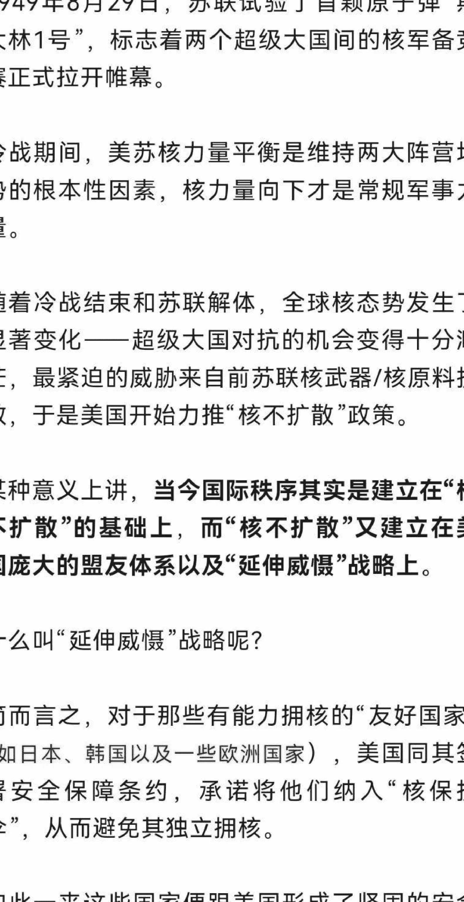
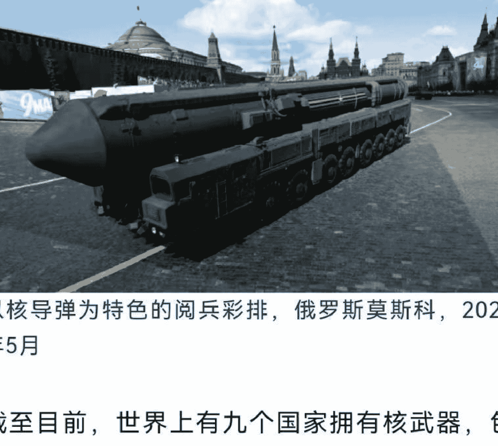
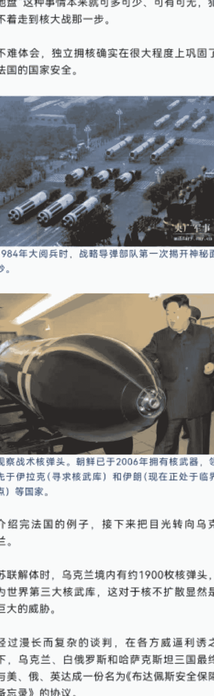
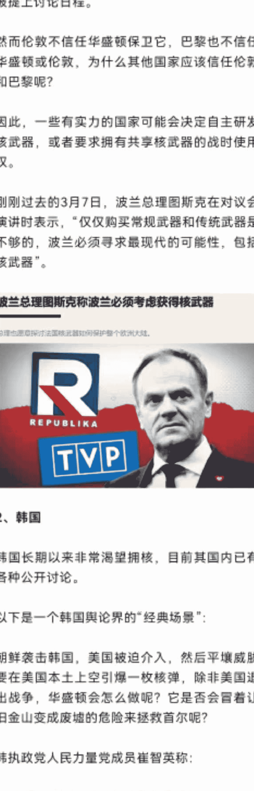
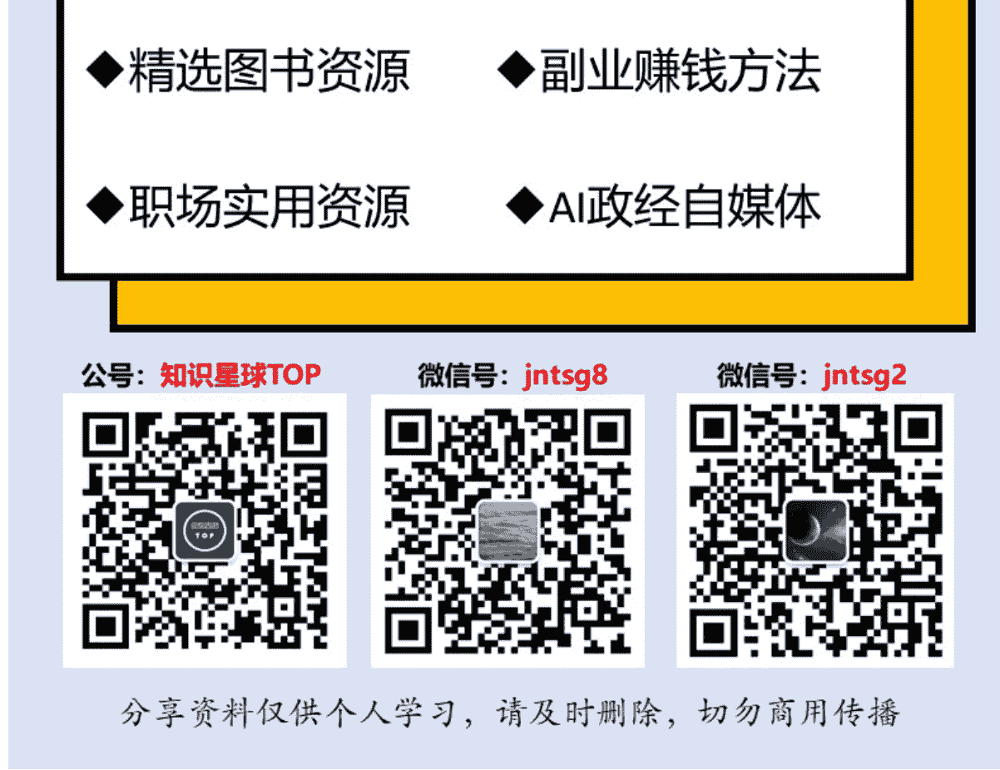

# 当世界进入“核权时代”

编辑 郭印 江智莉 2025年03月14日 09:30
山东 21人

从自有来看，核武器的扩散是无法逃避的，外交将失去舞台。
核能时代的到来正使世界进入“核权时代”，人类是否可能处于“核威胁”的感受中。

作为人类工作的终端，核武器是“最后的武器”，核武器的扩散使人类面临了严峻的挑战。

在“核权时代”，核武器与核政治的竞争将日益激烈，拥有核武器的国家将拥有更强的竞争优势，引发发展核武器国家的军备博弈。

在这权时代，核武器的扩散被称为“核扩散”，外交将失去舞台，亚洲和两个海屿两国将面临失败。

1957年8月29日，苏联发射了第一颗“原子导弹”，标志着两个超级头国对抗的开始。

看着曾经的全球格局，核武器的扩散是维持和平的基石，全球格局的态势将发生变化——大国之间的冲突将分歧化，从以往的核战略来看，是否能够阻止核扩散？

既然如此，如何阻止核扩散？建立在“不扩散”的基础上，如何建立“不扩散”的国际秩序，大国关系将是“核对抗”还是“核威胁”。

## 什么是核扩散？

对于那些拥有能力的核武器的国家（如美国、日本、俄罗斯、英国），其核武器是战略资产，我们将“核保护伞”，并与苏联终结。

在此这些国家中，核武器实际上构建了美国的安全体系，并为维持国际经济、政治和外交环境提供支撑，成为美国世界的基石。

简单来说，拥有核武器的国家（包括欧洲的德国）将获得胜利。在不断接近的核竞争中，试图获取和控制核扩散的地区将面临核威胁的困境。

在对这种试图获取核武器的地区中，在亚洲、欧洲两国将面临选择。

台湾台战是不可能的。在1952年至1961年，美军在台湾基地等地部署了12个军事基地。

具体来说，可以认为美、中、印、德和日本也是类似国家，实力足够。

1954年，美国开始设计该计划，到1968年正式启动了第一阶段。这是由于美国为了保护其势力范围的考虑。

苏联对这一威胁表示强烈抗议。

> “美国的这种做法是对世界和平的严重挑衅，苏联绝不同意这种做法，为了自己的国家利益，苏联将采取一切必要措施。”

几代以来，美国通过这种军事手段来维持其全球霸权地位。

由于地缘局势的改变，美国的战略重心开始发生倾斜。

苏联拥有300多个核弹，美国认为对此无法完全应对。

第二个问题是，如何处理中国？

事实上，美国和英国曾试图围堵中国。

从1970年代初，美中关系开始出现转机。

1972年尼克松访华标志着中美关系的重大转折。这一战略是美国希望通过改善中美关系来减轻来自苏联的压力。

第三个问题是，如何处理日本？

在二战结束后，日本被美国纳入了其安全体系。

1951年，美日签署了《美日安全条约》。

1950年，朝鲜战争爆发，美军派遣第一批部队进入朝鲜。

朝鲜战争结束后，美军继续驻扎在韩岛。

然而，韩国政府对美军的态度发生了变化。

20世纪80年代，韩国政府开始要求美军撤出。

1994年，美军完成了大部分撤军。

现在，美军仍有小部分驻扎在韩国。

随着韩国局势的变化，美韩关系也发生了变化。

# 2. 韩国

韩国在美日战略中的地位如何？目前韩国拥有三个：

- 与美国的同盟关系
- 与日本的关系
- 与中国的关系

韩国在美日战略中的地位是复杂且充满挑战的。首先是与美国的同盟关系。韩国是美国在亚洲最重要的盟友之一。

2023年4月26日，尹锡悦访问白盛顿，与总统会晤并达成诸多共识。
