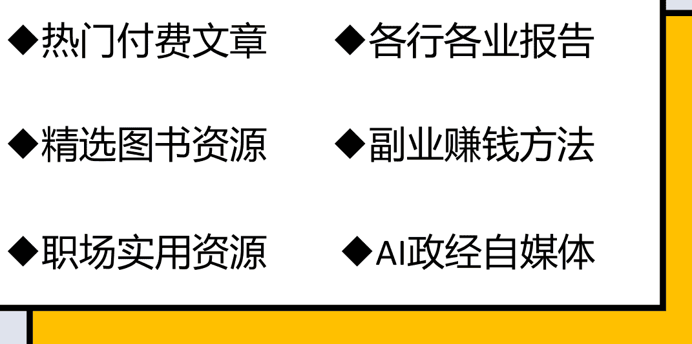

# DeepSeek

## 30个

### 喂饭指令

### 一、内容创作类（5条）

1. 爆款标题生成
- 指令：生成10个吸引眼球的[主题]标题，要求包含数字、情绪词和悬念
- 示例：输入“生成10个关于减肥的爆款标题”

2. 小红书种草文
- 指令：以[身份]的口吻，写一篇[产品]的种草笔记，突出3个使用场景和2个痛点解决解决方案

3. 短视频脚本
- 指令：生成一个[时长]的短视频脚本，包含开场悬念+中间反转+结尾行动号召

4. 公号长文
- 指令：以[风格]写一篇关于[主题]的深度文章，包含3个分论，每个论点配1个案例

5. SEO优化文章
- 指令：围绕关键词[XXX]写一篇1000字文章，密度3%，包含H2/H3标签

### 二、电商运营（5条）

6. 产品描述优化
- 指令：为[产品]写一段吸引人的描述，突出3个卖点，包含1个使用场景

7. 亚马逊评论分析
- 指令：分析以下评论数据，总结出3个用户痛点和2个改进建议

8. 客服话术生成
- 指令：针对[问题],生成5条专业且友好的客服回复话术

9. 促销邮件撰写
- 指令：写一封[节日]促销邮件，包含限时优惠、紧迫感和行动号召

10. 竞品分析报告
- 指令：对比[产品A]和[产品B],列出3个优势、2个劣势1个差异化建议

### 三、知识付费类（5条）

11. 课程大纲设计
- 指令：设计一门[主题]的21天入门课程大纲，包含每天的学习目标和作业

12. 电子书章节生成
- 指令：以[风格]写一篇关于[主题]的电子书章节，包含3个案例和1个行动指南

13. 直播脚本撰写
- 指令：生成一场[时长]的直播脚本，包含开场互动、干货分享和营销环节

14. 社群运营话术
- 指令：为[主题]社群设计7天激活话术，包含欢迎语、每日话题和互动游戏

15. 知识星球内容
- 指令：生成一篇[主题]的星球日报内容，包含1个干货点+1个互动问题

### 四、数据分析类（5条）

16. 销售数据洞察
- 指令：分析以下销售数据，找出3个增长机会和2个风险

17. 用户画像生成
- 指令：根据行为数据，生成[产品]的目标画像

18. 市场趋势预测
- 指令：基于[行业]最新数据，预测未来6个月3个趋势

19. 财务报表解读
- 指令：用通俗语解读财务报表，指出两个关键问题和1个改进建议

20. 竞品定价策略
- 指令：分析[竞品]的定价策略，给出3个优化建议

### 五、编程开发类（5条）

21. 代码注释生成
- 指令：为代码添加详细注释，解释每段功能

22. Bug修复建议
- 指令：分析以下错误，给出3个修复方案

23. API文档生成
- 指令：为以下函数生成标准的API文档，包含参数说明和示例

24. 算法优化建议
- 指令：优化以下算法，使其时间复杂度降低到O(n)

25. 自动化脚本编写
- 指令：写一个Python脚本，实现[功能]自动化

### 六、生活效率类（5条）

26. 旅行计划生成
- 指令：设计一份[地点]的7天旅行计划，包含景点、美食和交通建议

27. 健身计划定制
- 指令：为你定制一份21天减脂计划，包含饮食和运动安排

28. 时间管理方案
- 指令：根据我的日程表，优化时间分配，提升工作效率

29. 理财规划建议
- 指令：基于我的收入和支出，制定一份年度理财计划

30. 学习路径设计
- 指令：为你设计一份[技能]的3个月学习路径，包含每周目标

# 免费 价值 及时 专注

# 扫码加入 知识星球TOP 免费资源群

- 每日免费获取价值资源
- 可提供各类资源搜索服务

| 热门付费文章 | 各行行业报告 |
| 精选图书资源 | 副业赚钱方法 |
| 职场实用资源 | AI政经自媒体 |

公众号:知识星球TOP 微信号:jntsg8 微信号:jntsg2

分享资料仅供个人学习，请及时删除，切勿商用传播
