# 全球市场每周预测0331-0404——一条鱼
20250330 财金处主理金政通鉴

全球主要资产预测，完美验证：
√ 美股超跌反弹基本完成，新的下跌就要开始了。
√ 重新站上高高速通道，并继续攻击更大的趋势通道，可以继续趋势性多黄金。——进攻3100
√ BTC短期修复，趋势性看普上时的67000；
√ 美元会走强；
√ AH进入全面防御。

2025Q1总体的预测是：
1. 美股整体在1 季度内完成铸顶，概率为98%；
2. 美股见顶转跌后很可能引发美国金融危机；
3. 一旦金融危机爆发，会对所有资产产生负面影响。

设置2道风险控制指标：

## 美元指数回106-高度预警已触发

2. 最迟在出现美元美股美债同步向下苗头已触发

继续验证：
- “美债再次倒挂”。
- 美股、BTC头部结构形成：
- 市场开始宣扬美国需要一次“衰退”。

上周，我们讨论了国际政治博弈对全球金融资产走向的决定性作用，表现为全球板块轮动，因此，虽然上周AH比较弱，但因为“空美股加空密集多黄金”的策略持续验证，上周我们继续创造了新高。这种情况很可能仍持续相当一段时间时间：当“FED起了屠刀，暴风前夜”，与其等着接刀，为什么不去“春天的热带雨林呢？

下周4月就开始了，我们也将发布《2025Q2》和《新货币战争》，周我们会分享一下预览：我们从一条鱼开始。

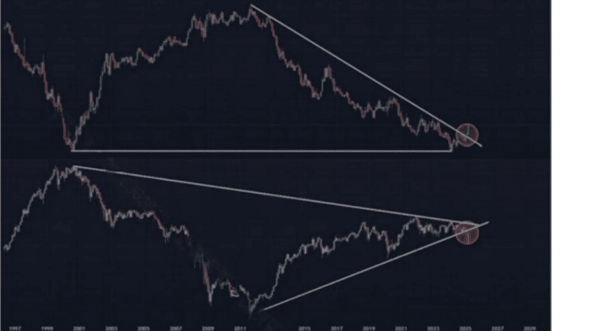

加微信ints2，免费进阶分享群

## 一条鱼

“50余次3000点保卫我们对美股百年长牛非常有胆，尤其是其中的科技股，比如七姐妹。以费城半导体指数为例，自2009年至今，涨了30倍”。

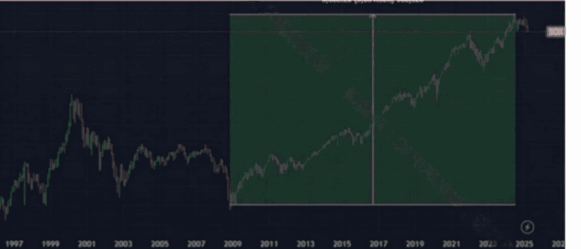

容易令人忽略的是，从1971年美元与黄金脱钩至上周，黄金累计的涨幅是超过美股SPX的:

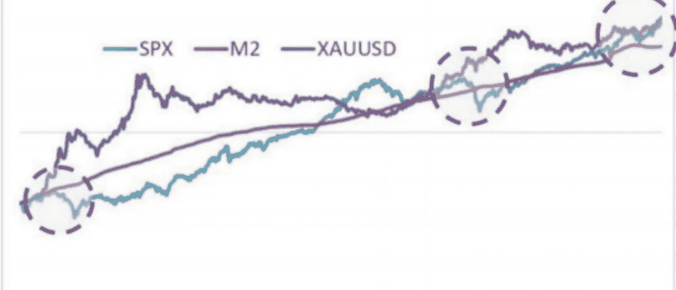

历史上，SPX与GOLD基本上是此消彼长的。但现在，他们纠缠在一起。我们放大一点，先看“一条鱼”的下半身，也即SPX/GOLD:

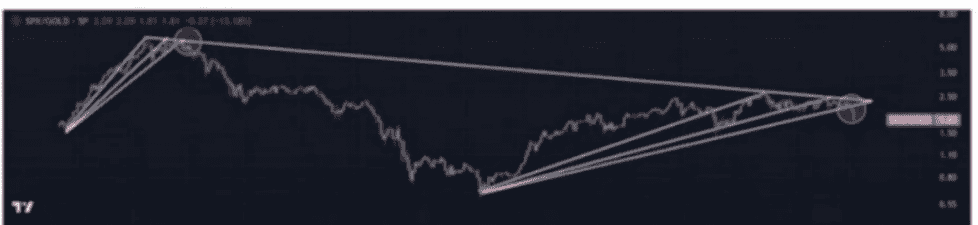

然后我们来看“一条鱼”的上半身，费城半导体指数与矿业指数的变化:

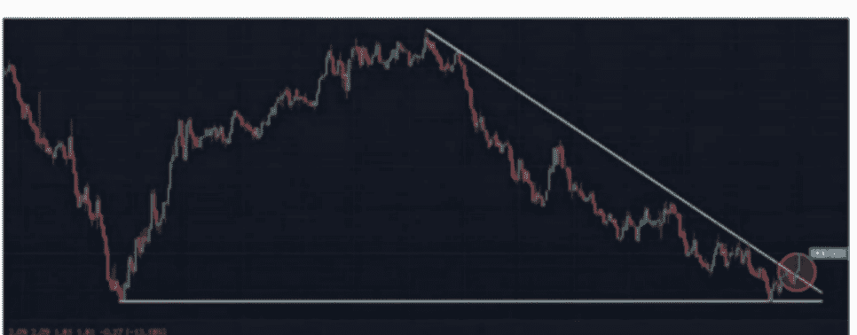

容易被人忽略的是，在2000年至2011年，矿业指数整整领先了费城半导体指数10年。

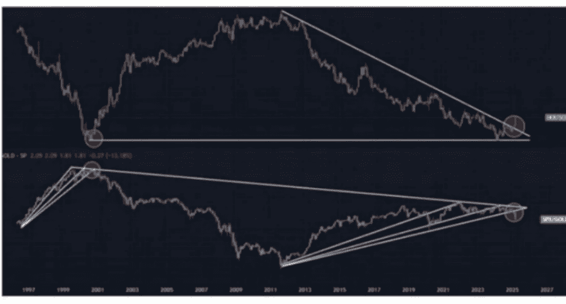

这条鱼用25年张开张血盆大口，这正是习惯性线性思维的可怕之处——一会落在鱼的嘴巴里；而研究的乐趣是可以反过来吃到一条大鱼。

## 二、全球主要资产跟踪

### (一)美股
继续看好。我们将《2025Q2》推演本轮美股下跌走势。

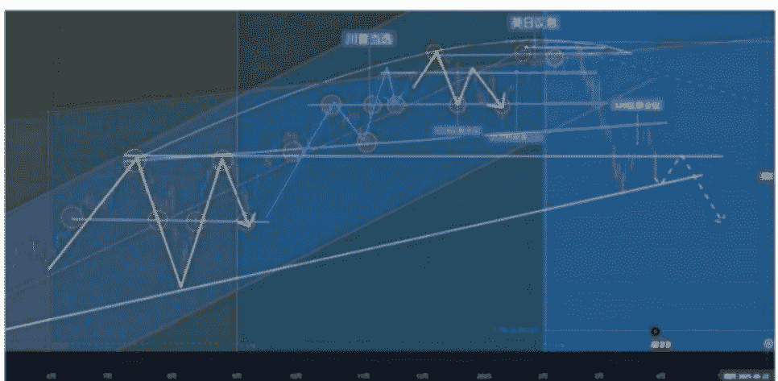

#### I.标普500：日线级别
复合头部形成，破破线第一段幅度区间内，出现超跌反弹、盘整。

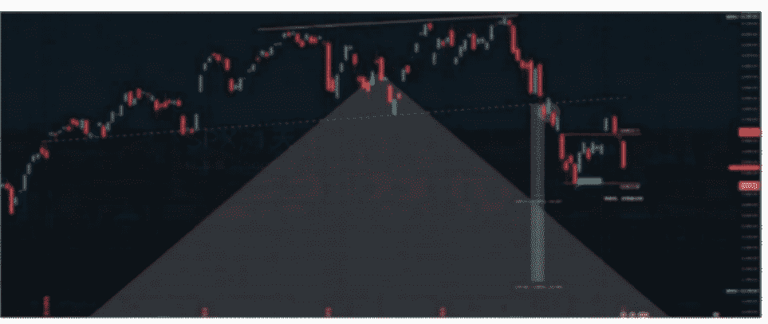

上周突破盘整力压力，3/27再次跌破，等待3/31确认反弹失败。确认后下跌加速，第一段涨幅目标5475。反弹未触及颈线，再次确认头部，空单单加加码。

短期支撑：5521、5504.65
破低5504.65，加速下跌

#### 2.纳斯达克指数：日线级别
上升楔形头部形成，日线级别破颈线，第一段涨幅目标18064，跌幅满足未出现有效反弹。进入第二段跌幅后，出现超跌反弹、盘整。

上周突破盘整压力，3/27再次跌破，等待3/31确认反弹失败。确认后下跌加速，第一段跌幅目标16595。
短期支撑：17303、17238.24
破低17238.24，加速下跌。

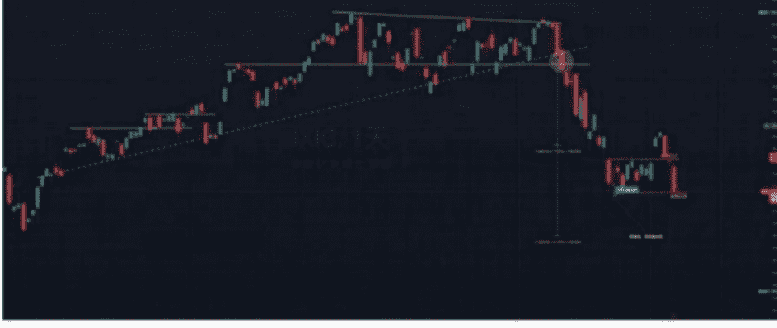

#### 3.道琼斯指数：日线级别
日线级别头部成型，破颈线有效后，出现弱反弹。上周反弹突破颈线，3/28再次跌破，等待4/1确认。一旦确认反弹失败，参与反弹转空头，下跌加速，第一段幅目标38860。
短期支撑：41433.8、40661.77
41433.8跌破，加速下跌测试下支撑。
40661.77跌低，恐慌推动下跌。走势强势道琼斯，即将确认头部，三大股进入空头。道琼斯指数跌破颈线位置为右侧进场，短线止损颈线上沿。

### （二）黄金
站上进攻通道，可以继续趋势多黄金。我们将《新货币战争》推演黄金的中长期走势。

#### 1. 月线级别
(1)上涨区间，两段涨幅满足。月线级别，第一段涨幅满足，回调至区间45.52，第二段涨幅满足，目前突破超涨。
(2)第二段涨幅区间内，用A、B、C划分，可以用A浪预测涨幅满足。如果按三浪划分，C浪超涨。

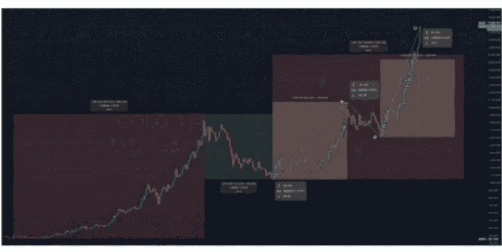

#### 2. 日线级别
复合底型结构，两段涨幅满足，盘整后突破。短线尊重趋势，直至止损信号出现。目前突破到第三段涨幅区间，目标3684。

### （三）BTC
继续看空。

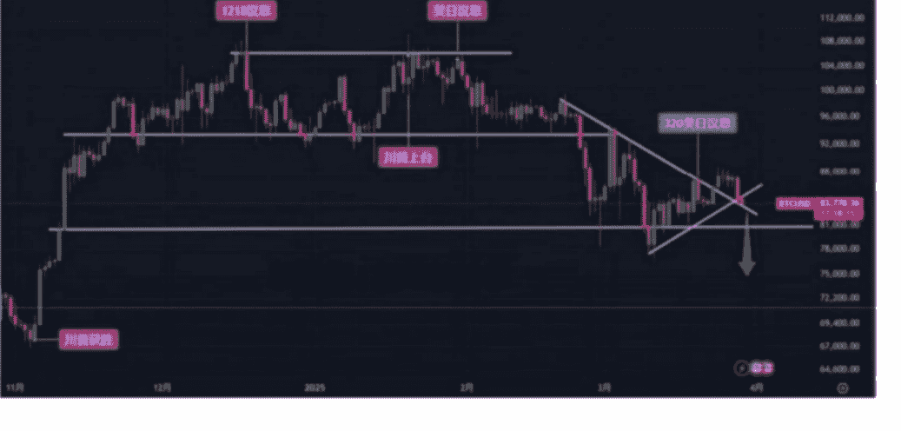

我们将《新货币战争》推演BTC的中长期走势。

#### 1.日线级别：
大型头部成型，有效跌破，一段跌幅满足后超跌反弹。3/28跌破趋势线，3/30不能有效站回趋势反弹结束。中期看跌两段跌幅满足，第二段跌幅目标65242。
短期支撑：79052
破低76555，加速下跌。

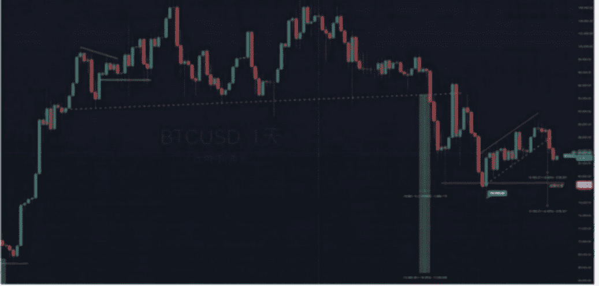

### （四）美元
议息会议后，美日都不加息，美元会震荡并维持强势。

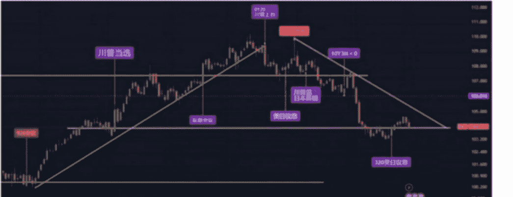

我们将《新货币战争》推演BTC的长期走势。

#### 1.美元指数：日线级别
小头部结构，一段跌幅满足，在第二段跌幅区间内。复合头部结构，一段跌幅基本满足，点103，美元指数低点103.197。
上周美元突破压力107.27，3/28再次跌破，等待回测重要支撑103.4。

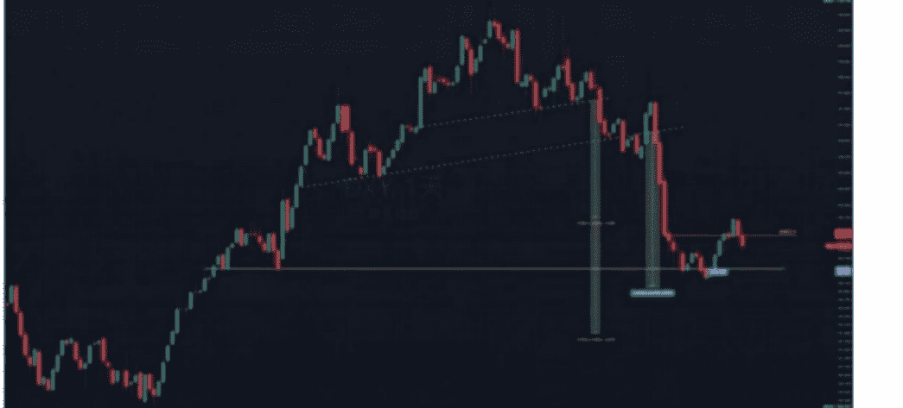

## 三、AH判断

### （一）H
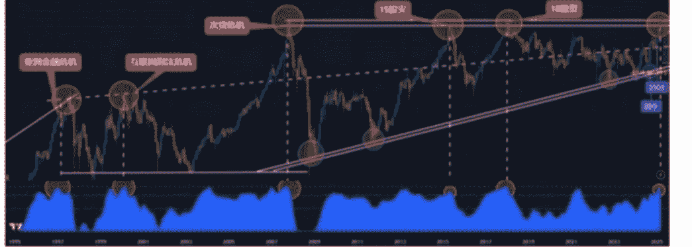

# 亚洲金融危机以来，我们的模型一直是准确的。

1. 恒生指数：日线级别
底型突破，两段涨幅满足。第三段涨幅为短线超买，已回调，短期压力23980。
短线支撑23244.5，上周低点23254.3等恒生指数头部结构成型，可将恒生科技作为前瞻指标。

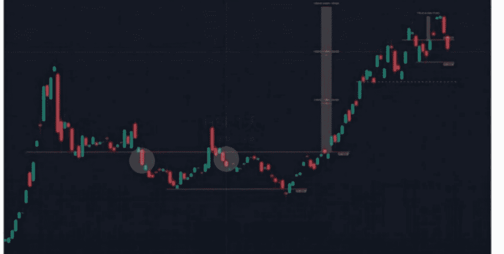

#### 2. 恒生科技指数：日线级别
日线底型结构，三段涨幅满足(日线级别超涨)。指数反弹弱势，未触及最低的压力位5178.29，已开始测试颈线支撑，日线级别头部接近成型。
等待上升形态的破底线确认突破，评估跌幅空间。也是空单进场的机会。

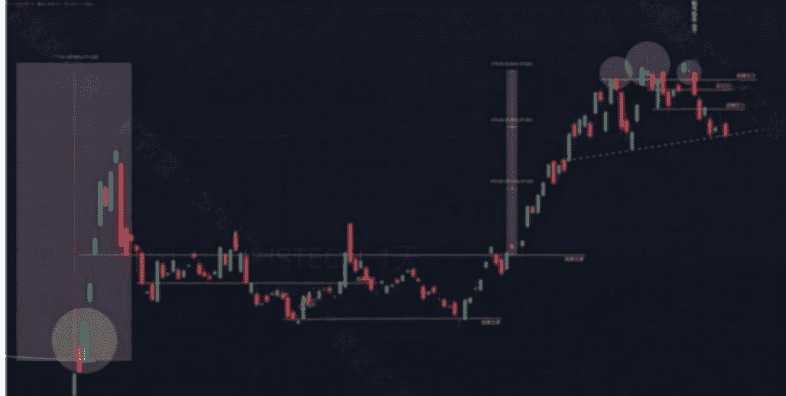

### （二）A
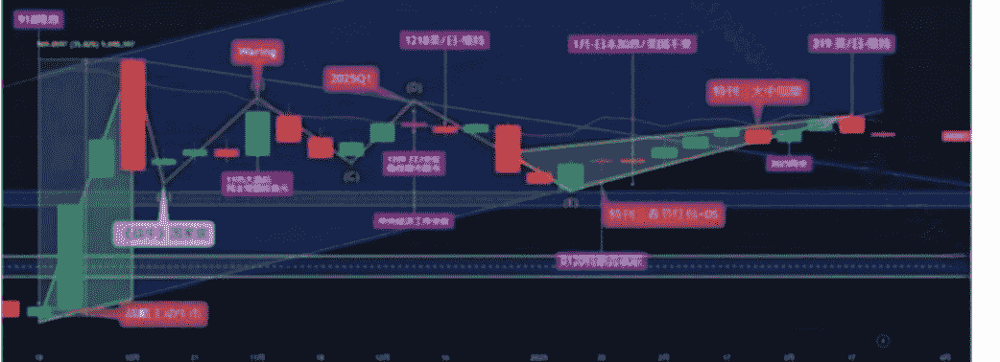

从图中上看第一波：924以来的上升三角形后是调整。
第二波：120以后的上升三角形，现在跌破，意味着调整概率很大；视拉一点，可以看到在当前位置下方道防线，第一波的回撤在了第一道防线上。

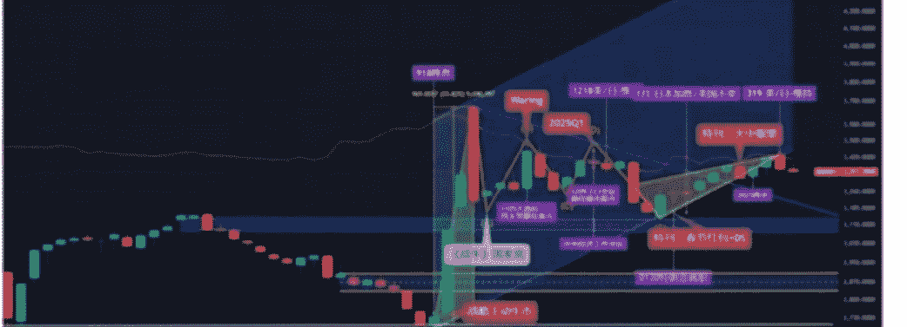

#### 1.上证指数：日线级别
(1)空间维度：24/10回调以来，构筑底型结构，一段涨幅满足。3/14突破又跌破，短期走势偏空。短期支撑3323。
(2)时间维度：如果对称，右侧还有时间窗口(4/16)。
从时间上看，留第二段涨幅已经不多，目前上有压力下支撑，等待压力测试。

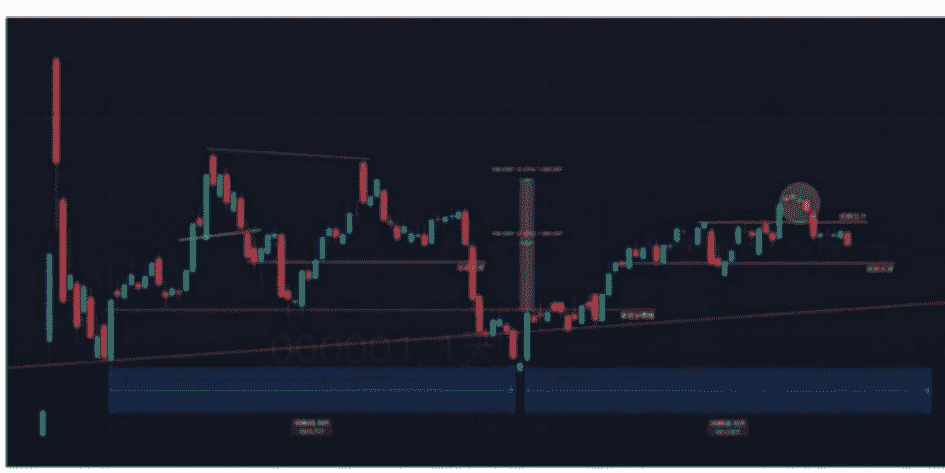

#### 2.上证50：日线级别
24/10回调以来构筑的底型结构较小，这里使用涨幅区间进行测。目前第二段涨幅满足，开始回调头部。本周回压力683震荡，长阳低点2674有效。等待头部右侧成型，强支撑看底部2608.5。短期支撑：2674、2608.5。

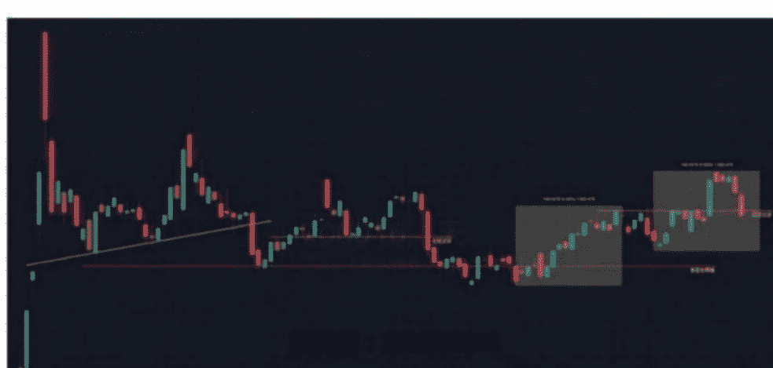

#### 3.沪深300：日线级别
24/10回调以来构筑的底型结构较小，这里使用涨幅区间进行测。目前在第三段涨幅区间内，3855至4083。3/14突破又跌破，短期走势偏空。本周反复测试支撑3914（弱势表现，测试多次破），等待头部右侧成型，强支撑看底部3855。

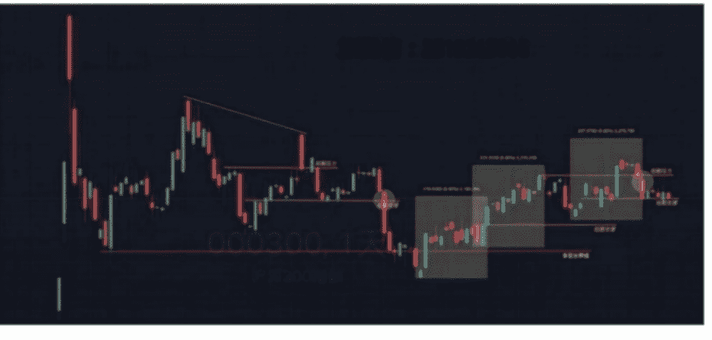

#### 4.中证500：日线级别
24/10回调以来构筑的底型结构，一段涨幅满足，随后开始盘整，三次突破压力6060以失败终，正在构筑头部。等待头部结构成型，压力位6060，支撑位5814。

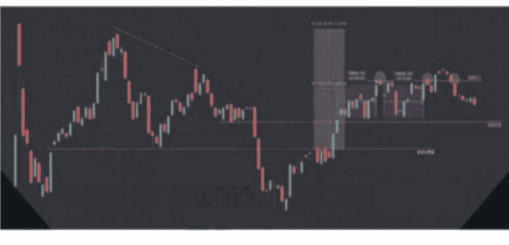

#### 5.创业板指数：日线级别
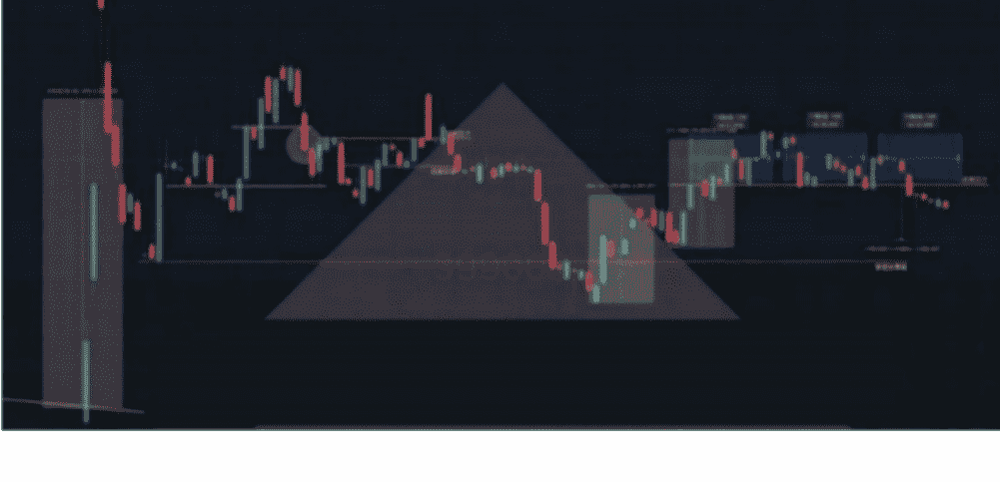

(一）空间维度：
24/10回调以来构筑的底型结构较小，这里使用涨幅区间进行测。目前第二段涨幅满足，开始回调筑头部。3/14突破又跌破，短期走势偏空。上周反抽压力不过压力位，空单进场信号，止损前一根压力线上K线上扬。

（二）时间维度：
走完两段时间对称结构，日线级别变盘突破，目前跌回压力线下，突破失败。

#### 6. 科创50指数：
24/10回调以来下降楔形结构，突破后一段涨幅满足，满足点160.41，指数高点140.36。
上周出现有效的反弹，确认头部成型。破颈空单进场，止损1076，第一段跌幅满足978.7。

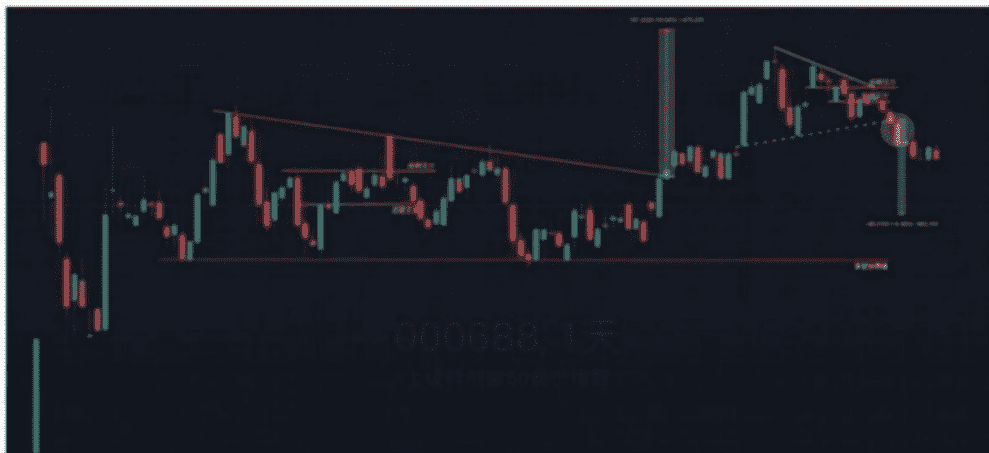

对于订阅的朋友：
1.<研报>长线策略，周期更大，直到《新川普交易》周期结束，月线级别的涨跌都能安处，年线级别的涨跌才能安处；
2.<特刊》已做了更新，全面转防御，效果很理想。

## 四、A-GIX(测试)

A-GIX指标提供的是“每日”交易情绪的动态反馈。

具体跟踪方法：以“情绪趋势”、“情绪监控先导”、“情绪监控”均作为重点观察指标，两条监控指标均设置了上下边界，作为参考；“辅助情绪”做为辅助指标；灰色“均价”线为市场整体价格走势。“情绪趋势”上行力乏力并发生震荡，同时“情绪监控先导”、“情绪监控”发生转折，市场整体强势即将下跌。以下是周情况（下图是纳斯达克）。

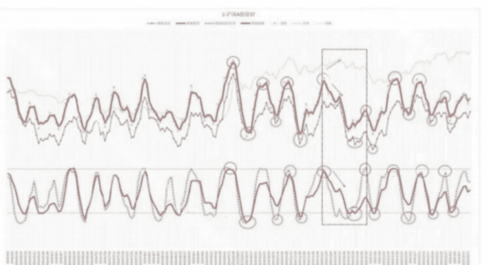

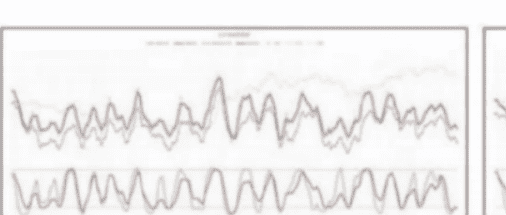

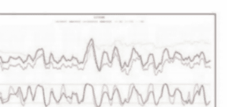

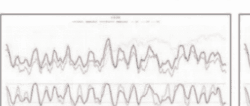

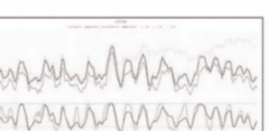

加微信ints2，免费资料分享群

## 周结合判断：坚守防守
指数具备稳稳条件，同时周初保持观察，适时寻找机会。市场周底回升，但收盘数据情绪趋势继续下行，周二继续下行，周三回暖，周四指数回落，周五延续回落。整体走势与上周判断吻合！考虑到目前成交量回落至1.2万的情况，大原则是以防守为主，要防成交量持续萎缩的风险，最大限降低交易损耗；同时也要防止美股的下跌带来的冲击（下图是纳斯达克）。

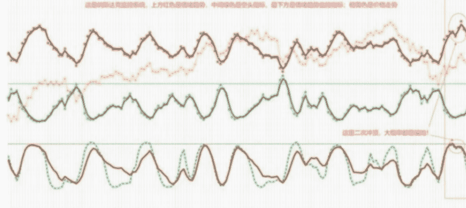/9834ba86e3c9e3149378124af2b985cc_15_1.png

由于指标需要每日动态跟踪，以下仅供验证，不作为交易参考。
1.按照以往经验，二次探底是低吸机会，市场会走出图中红、框线标注的镜像走势，可对手中长标做T；

微信jntsg2 免费进资料分享群

 2.仍然是芯片、软件、云计算等科技板块的低吸。

| 免费 | 价值 | 时 | 专注 |
| --- | --- | --- | --- |

扫码加入 知识星球TOP 免费资源群

- 每日免费获取有价值资源
- 可提供各类资源搜索服务

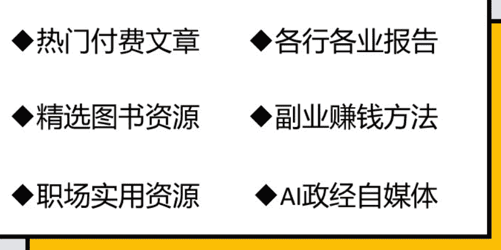

众号：知识星球TOP 微信号：jnt5g8 微信号：jnt5g2

分享资料仅供学习，请及时删除，切勿商用传播

加微信jnt5g2，免费资料分享群
