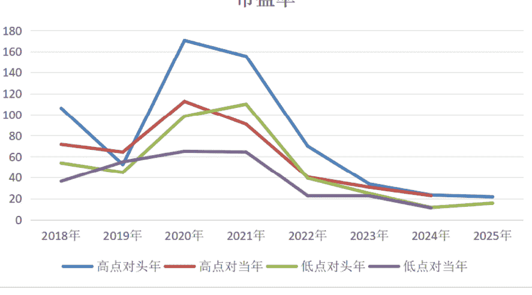
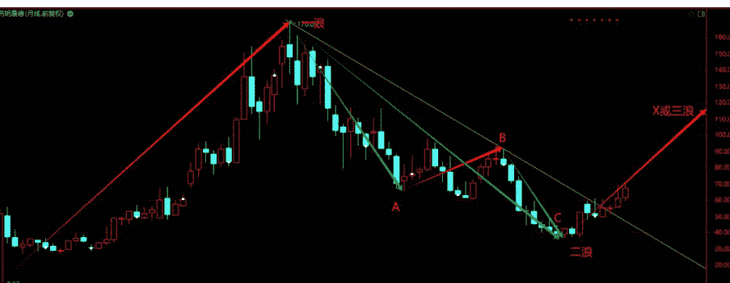

# 2024年年报分析1：龙头是谁龙头

原创 anmin0001 安民Amin0001深度分析 2025年03月25日 07:30 湖北

读者的要求，我们团队对2023年研究的第3家公司《安民分析三（主版）》2024年年报公布后，有各种各样的观点，有公司发展得很好的，有不好的，那么公司到底怎么样呢？前两年若干如何？

我们团队仍然采取的是条条分缕、拆解了、揉碎的研究方法，从定量到定性、定量性的进行了深度的分析和研究。这种分析的优点是一篇文章可以对2023年和2024年的业务、财务等每个环节都有清晰的了解和把握，也可以对我们团队对于中国医药行业这家争议性很大的公司该如何性有着非常清晰的把握和判断；缺点是可能太深入，导致对于某些读者觉得看着看不懂，感兴趣者可以不予理会。

本文分8部分，包括公司基本情况、公司业务分析、财务环节对净利润的影响、影响公司业绩的所有因素及其排序、子公司情况、公司是中国医药特别是生物医药的代表企业、公司2025年将转为增长、公司的市场地位等。

由于数据较多，强烈建议用电脑版微信阅读。本文只是研究，不为建议，亦不为时。股市风险，需审慎考虑。本文不构成任何建议或意见，我们为大家的投资负责，请大家注意投资风险。

## 一、公司基本情况（单位，万元）

| | 2023年 | 2024年 | 增减% | 增量 |
|---|---|---|---|---|
| 营收 | 4034080.69 | 3924133.14 | -2.73 | -109947.5 |
| 股东净利润 | 960674.91 | 945030.84 | -1.63 | -15644.07 |
| 扣持净利润 | 974758.78 | 998810.28 | 2.47 | 24051.5 |
| 经营现金流净额 | 1338618.1 | 1240651.8 | -7.32 | -98039.7 |
| 净资产收益率% | 18.99 | 16.78 | | -2.21 |
| 总资产 | 7366934.93 | 8032582.44 | 9.04 | 665647.51 |
| 净资产 | 551224.39 | 586321.52 | 6.37 | 351026.13 |
| 非经常性收益 | -14083.87 | -53779.44 | 281.85 | -39695.7 |

2024年，公司收入392.41亿元，减少10.99亿元，降幅2.73%，小幅下滑。主要原因为新冠药物的影响。2020年以后，公司收入中相当一部分是新冠用药和器械形成的收入。我们可以追踪公司各年的收入情况：2019年，128.72亿元；2020年，165.31亿元；2021年，229.02亿元；2023年，公司在新冠收入形成高峰，为403.41亿元。那年的收入增长，很大一部分就是新冠用药收入，但数量到底大，公司并没有公布相应数据。2024年，公司收入主要受两个因素的同时影响：一是全球新冠疫情等情况，导致需求突然没有了；2024年，二是因为美国打压中国医药药物。

从收入看，这两个因素导致增速变缓，2024年形成了2.73%的负增长，可公司的业务竞争力相当之强。为什么这么计呢？

A股CXO板块共29家公司，龙头就是我们研究的对象药明康德。29家公司中，前三季度收入10亿以上的只有10家，没有少两个三个亿五三亿的收入，没有进行比较的必要。

收入的前10名中，排第二的是康德化，收入88.17亿元，业内最高123.45亿元，最低120亿。根据三季度的数据计算，2023年第四季度，康德化收入29.78亿，2024年第四季度增速为31.82，最低增速为6.8%；最高为35.28，最高增速为18.49%。而药明康德四季度同比同比增长6.85%，与康德化增长增速差不多。关键的不是这个，康德化利润增速与药明康德相比，完全不在一个水平。

第三名康泰医药，三季度增速为-10.32%，收入50.28亿，增速就低了。第四名是凯莱，第三季度收入增速-35.14%。第五名是九州药业，三季度增速为-13.36%。第六名是瑞博股份，三季度增速为-30.02%，收入21.25亿。第七名是皓元医药，三季度增速为17.65%，收入16.19亿元；第八名华响医药，三季度增速为-15.87%，收入13.35亿。第九名康泰，药石科技，三季度增速为-12.67%，收入12.28亿。其他19家，前三季度增速都在10亿以下。

这10家公司中，有7家公司增速低于药明康德，超出之一的是皓元医药，增长快的是科学药物，仁诺康泰三季度增速76.61%，是多肽生物。2024年，药明康德抗核苷酸收入高，增长了57.2%，跟类生物相似，达到了58亿。至于康德化，总体上的增长与药明康德差不大，即使也不高。另外9家公司有新增行业因素，而药明康德的影响多了一点，就是美国政府、贸易的打压。明确了药明康德取得的成绩非常不容易。

净利润下降了15.6亿，增速为-1.63%。同样横向比较，2019年净利润为18.55亿，2020年为29.60亿，2021年为50.97亿，2023年为96.07亿，今年新冠带来了许多影响。2024年这项业务没有归零，但公司利润仍然达到了94.5亿，同时受到美国的打压。总体上付了双重压力。横向比较，多数公司均比。前10家公司中，博股份三季度利润下降100%，没啥利润。凯莱下降67.86%，泰格医药下降56.72%，九州药业下降34.74%，还有药石科技下降14.45%，远高于药明康德。它们是一个因素，药明康德是两个因素，有美国国的打压。皓蓝医药三季度增长21.31%，因为其主业务是生命科学测试，竞争不够。诺华生物是多肽药物，增速28.9%。非常特殊。康龙化三季度的净利润下降了27.69%，可见业务能力并不如药明康德。根据业绩预告，2023年的扣非利润为15.14亿，2024年为10.75亿，增长29%。药明康德扣非利润增长2.47%，代表业务能力在增强，盈利能力在增强。经营现金流量净额减少了9.80亿，达到了124.07亿，高于利润。自由现金流79.8亿，为历史最高。

## 二、公司业务分析

主营业务现在分为四大块：化学业务、测试业务、生物业务、细胞及基因治疗业务（其他业务）。然后有终止业务，就是卖掉的业务。

### 1. 化学业务（单位，万元）

| 化学业务 | 2023年 | 2024年 | 增速% | 增量 |
|---|---|---|---|---|
| 收入 | 2917148.82 | 2905240.91 | -0.41 | -11907.9 |
| 成本 | 1618417.63 | 1557409.95 | -3.77 | -61007.68 |
| 毛利 | 1298731.19 | 1347830.96 | 3.78 | 49099.77 |
| 毛利率 | 44.52 | 46.39 | | 1.87 |

公司的化学业务，在2022年到2024年，在290亿附近徘徊。主要原因就是新冠药物和美国业务打压。2021年只有140.87亿，其中还有不少新冠药物生态。当新冠药物从一个比较高的收入到断崖式归零后，其他部分必须跟上来，跟住，不让数据明显下降。新冠药物带来的不利影响主要在2023年和2024年表现出来。前面提到的那些下降明显的公司，都没有解决好这个问题，药明康德在这一点上做得很好。好的，当美国业务收入下降之后，其他地区的业务就必须要跟上来，抵消掉那些影响，这样才能平稳过渡。

2024年，化学业务下降了11.90亿，下滑了0.41%，成本下降了6.10亿，毛利增长了4.91亿，毛利率提升1.87个点。药明康德的业务增长了3.36%，毛利增长了40.77万元。这块业务的毛利率从44.52%上升到46.39%，反弹了6.88个点，表明业务竞争力在增强。这块业务的增长，并不容易。

### 2. 测试业务（单位，万元）

| 测试业务 | 2023年 | 2024年 | 增速% | 增量 |
|---|---|---|---|---|
| 收入 | 653966.6 | 560733.81 | -13.29 | -86922.86 |
| 成本 | 402937.68 | 381464.46 | -6.82 | -27973.22 |
| 毛利 | 244658.99 | 185609.35 | -24.11 | -59049.64 |
| 毛利率 | 37.40 | 32.73 | | -4.67 |

测试业务，收入快速下滑，同比减少约900万。成本增速高于收入增速4.44百分点，带动毛利率下滑4.67个点，负面影响毛利6755.35万。毛利下降，同比减少7103.49万元。这部分的数据是准确的。

### 3. 生物业务（单位，万元）

| 生物业务 | 2023年 | 2024年 | 增速% | 增量 |
|---|---|---|---|---|
| 收入 | 255255.4 | 254392.6 | -0.34 | -862.77 |
| 成本 | 152257.14 | 158478.86 | 4.10 | 6240.72 |
| 毛利 | 102998.2 | 95894.77 | -6.90 | -7103.49 |
| 毛利率 | 40.35 | 37.70 | | -2.66 |

生物业务，收入有所下降，同比减少约90万；成本增速高于收入增速4.44百分点，带动毛利率下滑2.66个点，负面影响毛利6755.35万；毛利下滑，同比减少7103.49万元。

### 4. 其他业务（单位，万元）

| 其他业务 | 2023年 | 2024年 | 增速% | 增量 |
|---|---|---|---|---|
| 收入 | 72645.26 | 65070.84 | -10.43 | -7574.42 |
| 成本 | 46693.2 | 45386.15 | -2.80 | -1307.05 |
| 毛利 | 25952.06 | 19684.69 | -24.15 | -6267.37 |
| 毛利率% | 35.72 | 30.25 | | -5.47 |

其他业务，包括细胞和基因治疗业务、国内业务等。这里的数据跟测试业务一样，因为美国公司有细胞和基因治疗业务，所以去年12月此项业务卖了，因此实际数据有变化。我们这里对这项业务进行第一次调整。

### 5. 终止业务（单位，万元）

| 终止业务 | 2023年 | 2024年 | 增速% | 增量 |
|---|---|---|---|---|
| 收入 | 130959.67 | 132364.92 | 1.07 | 1405.25 |
| 成本 | 144108.49 | 153693.12 | 6.65 | 9584.63 |
| 毛利 | -13148.82 | -21328.2 | -62.21 | -8179.38 |
| 毛利率 | -10.04 | -16.11 | | -6.07 |

### 7. 全部业务（单位：万元）

| 全部业务 | 2023年 | 2024年 | 增速% | 增量 |
|---|---|---|---|---|
| 收入 | 4034080.69 | 3924133.14 | -2.73 | -109947.55 |
| 成本 | 2327879.96 | 2296451.51 | -3.22 | -76428.41 |
| 毛利 | 1661166.73 | 1627681.59 | -2.02 | -33509.14 |
| 毛利率% | 41.18 | 41.48 | | 0.30 |

收入小幅下滑，同比减少10.99亿元；成本增速低于收入增速0.49百分点，带动毛利率提升0.30百分点，仅此增加毛利11762.22万元；毛利增速高于收入增速0.71百分点，小幅下滑，同比减少33509.14万元，而且主要是由美国和英国业务形成的，美国业务和英国业务的毛利减少了22404.02万元。剔除这个因素，则毛利下降量为11105.12万元。对于整体毛利达166亿的公司来说，这个影响非常大。可以说，公司扛住了新冠用药在两年内出现断垒和美国国及亚投、国际优势力的联合打击。

## 三、财务环节对公司净利润的影响

### 1. 费用的影响（单位，万元）

| 2023 年 | 2024 年 | 增量 | 影响 |
| ------|---|---|---|
| 税金及附加 | 29747.94 | 30118 | 370.16 | 370.16 |
| 销售费用 | 70147.97 | 74518.8 | 4370.87 | 4370.87 |
| 管理费用 | 287838.08 | 287937.2 | 99.12 | 99.12 |
| 财务费用 | -33211.92 | -37698.3 | -4486.44 | -4486.44 |
| 研发费用 | 144063.04 | 123852.5 | -20210.5 | -20210.5 |
| 小计 | | | 60203.8 | 60203.8 |

投资收益增加了37031.34万，主要是三个方面的影响。一处处置长期股权投资取得的收益，2023年为9526.95万，增加6668.40万，估计是2023年春天收购中国在美国上市的ADC公司时，药持有的股权亦被收购所产生的增值收益。2024年春天，普生生物Genmab，康德瑞通过其子公司药明合联持有普生生物的部分股份；2024年11月8日及10月1日，康德瑞通过两次大宗交易出售药明合联8600万，约占药明合联当前总股的7.17%，累计成交金额约24.26亿元。二是处置其他非流动资产取得的投资收益，今年有64995.33万，去年减少了5761.05万。三是权益法核算的长期股权投资收益，2023年亏损6755.99万，2024年盈利24506.47万，增加31262.46万。

公允价值变动增加了22476.7万，影响因素主要是两个。一是非流动金融资产变动的收益，2023年亏损48241.37万，2024年收益4368.56万，相差52609.93万。二是生物资产，主要是实验粮，价格下跌，今年收益39869.79万，2024年15568.24万，减少了24201.52万。

早前的文中，我们分析过药明康瑞的金融资产等，他们的资产很多，似乎也在通过市场的波动来获取收益。总体上，这部分从长期来看，应该做到基本平衡。

### 3. 营业收支、所得税费用和少数股东损益（单位，万元）

| 2023年 | 2024年 | 增量 | 影响 |
|---|---|---|---|---|
| 营业外收入 | 1659.63 | 2225.48 | 565.85 | 565.85 |
| 营业支出 | 5689.12 | 6261.78 | 572.66 | -572.66 |
| 所得税费用 | 213173.1 | 197207.21 | -15965.89 | 15965.89 |
| 少数股东损益 | 9351.09 | 11743.11 | 2392.02 | -2392.02 |
| 小计 | | | | 13567.06 |

影响的是所得税费用。这四个环节一共增加公司股东利润13567.06万元；经过全部业务和全部财务环节，公司2024年股东净利润同比减少了15644.08万元。

* Note

## 四、影响公司业绩的全因素及其排序

影响公司2024年业绩的因素共21个，其中8个正面影响因素，13个负面影响因素。具体影响大小见下表（单位：万元）。

| 排序 | 正面影响 | 影响额 | 负面影响 | 影响值 | 合计 |
|---|---|---|---|---|--|
| 1 | 化学业务 | 40999.77 | 资产减值 | -10794.91 | |
| 2 | 财务费用 | 44856.64 | 测试业务 | -37196.53 | |
| 3 | 投资收益 | 37031.34 | 二次修正 | -17771 | |
| 4 | 公允价值变动 | 22476.66 | 其他业务 | -15904.88 | |
| 5 | 研发费用 | 20210.54 | 信用减值 | -9917.52 | |
| 6 | 所得税费用 | 2739.93 | 生物学业务 | -7103.49 | |
| 7 | 其他收收 | | 终止业务 | -4633.02 | |
| 8 | 营业外收入 | 565.85 | 销售费用 | -4435.87 | |
| 9 | | | 少数股东损益 | -2392.02 | |
| 10 | | | 营业支出 | -572.66 | |
| 11 | | | 税金及附加 | -370.16 | |
| 12 | | | 资产处置 | -261.34 | |
| 13 | | | 管理费用 | -57.12 | |
| 小计 | | 19296.43 | | -15644.09 |

那我们怎么理解药明康德2024年的经营情况呢？我们用白话逐述一下一年的经营与控制历程：

2024年，受新冠疫情影响业务下降30%左右，加上国内业务和国际机构做压力，国内业务下降，药明德又承受了巨大的压力。测试业务、二次修正、其他业务、生物学业务毛利都有下滑，共计减少毛利8257.92万元。化学业务一项增量为40999.77万元。由于国内业务打压，这些业务出售了英国和美国的细胞及治疗业务和测试业务。这些业务亏损是因为低价出售，当年直接计提损失10794.91万元，信用减值减少9917.52万元。上述减值因素，投资收益增加了37031.34万。
- 公允价值变动增加了22476.7万。
- 财务费用增加了44856.64万。
- 研发费用减少20210.54万。
- 所得税费用减少了15965.89万。
- 少数股东损益减少了2392.02万。
- 营业支出增加了572.66万。
- 营业外收入增加了565.85万。

那我们怎么理解药明德2024年的经营情况呢？我们用白话逐述一下一年的经营与控制历程：

2024年，受新冠疫情影响业务下降30%左右，加上国内业务和国际机构做压力，国内业务下降，药明德又承受了巨大的压力。测试业务、二次修正、其他业务、生物学业务毛利都有下滑，共计减少毛利8257.92万元。化学业务一项增量为40999.77万元。由于国内业务打压，这些业务出售了英国和美国的细胞及治疗业务和测试业务。这些业务亏损是因为低价出售，当年直接计提损失10794.91万元，信用减值减少9917.52万元。上述减值因素，投资收益增加了37031.34万。
- 公允价值变动增加了22476.7万。
- 财务费用增加了44856.64万。
- 研发费用减少20210.54万。
- 所得税费用减少了15965.89万。
- 少数股东损益减少了2392.02万。
- 营业支出增加了572.66万。
- 营业外收入增加了565.85万。

2024年，公司总体表现平稳。表面上看，这部分从长期来看，应该做到基本平衡。

## 五、子公司情况

公司公布了这两家子公司2024年的经营数据：
- 常州合药业净利润5406万。
- 合药香港净利润334亿元。
- 常州合药业2021年净利润为10715.45万，
- 2022年净利润为5038.56万，
- 2023年净利润为6774.16万。

## 六、是中国医药业，特别是生物药业

公司在生物药产业链上：
- 药物发现（分子发现）
- 临床试验到药物开发
- 原料药中间体生产
- 成品生产

目前是中国最大的CDMO龙头，帮助药企进行药物研发和生产。药明德的优势在于：
- 成本比美国低很多。
- 药明德的经营具有优势。
- WuXi业务在美国和英国的细胞及基因治疗业务和测试业务。
- 一旦再次发生卡脖子时，药明德并没有完全不受影响的能力。

## 七、公司2025年将增长

这部分主要讲三个因素：
- 1. 小分子发现环节：2024年成了46万个化合物。
- 2. 工艺研发和生产环节：2024年新增187个分子，总计377个分子，一期试验286个，二期试验80个，三期试验72个。
- 3. 原料方面：2024年泰生产运营。
- 4. 制剂方面：公司持有的瑞威基地，2024年口服制剂，预计2026年运营。
- 5. 药物方面：核苷酸和多肽业务高速增长，2024年收入58.0亿元，同比增长70.1%，2024年订单增加22%。
- 6. 测试业务：2024年CRO助力获得29项临床申请，73个产品上市。
- 7. 生物学业务：2024年非肿瘤业务增长29.9%，其中代谢类、神经学等领域领先。
- 8. 公司业务将恢复，订单增长47%，未来18个月内超过80%。

## 八、公司顶底的市场定位

### 1. 公司上市以来，每年高低点对应的市盈率（单位，倍）

| 市盈率 | 2018年 | 2019年 | 2020年 | 2021年 | 2022年 | 2023年 | 2024年 | 2025年 |
|---|---|---|---|---|---|---|---|---|
| 高点对头 | 106.129 | 52.35 | 170.501 | 155.299 | 69.854 | 33.59 | 23.295 | 21.6 |
| 高点对当年 | 71.553 | 64.242 | 112.630 | 90.811 | 40.289 | 30.628 | 22.733 | |
| 低点对头 | 53.794 | 44.749 | 98.482 | 109.969 | 39.269 | 24.75 | 11.542 | 15.625 |
| 低点对当年 | 36.269 | 54.861 | 64.972 | 64.253 | 22.572 | 22.495 | 11.112 | |

需要说明的是，本文计算非常严格。市盈率=股价/每股收益，高点对当年=高点价格/当年股收益，高点对头=高点价格/每股收益。

### 2. 公司上市以来，每年高低点对应的市净率（单位，倍）

| 市净率 | 2018年 | 2019年 | 2020年 | 2021年 | 2022年 | 2023年 | 2024年 | 2025年 |
|---|---|---|---|---|---|---|---|---|
| 高点对当年 | 20.533 | 6.69 | 18.265 | 14.148 | 9.25 | 6.354 | 4.060 | 3.481 |
| 高点对当年 | 9.144 | 6.882 | 10.261 | 12.025 | 7.622 | 5.338 | 3.664 | |
| 低点对当年 | 10.408 | 5.719 | 10.550 | 10.018 | 5.2 | 4.682 | 2.012 | 2.518 |
| 低点对当年 | 4.635 | 5.877 | 5.919 | 8.509 | 4.27 | 3.92 | 1.791 | |

### 3. 公司上市以来，每年高低点对应的市销率

| 市销率 | 2018年 | 2019年 | 2020年 | 2021年 | 2022年 | 2023年 | 2024年 | 2025年 |
|---|---|---|---|---|---|---|---|---|
| 高点对头 | 16.771 | 12.309 | 24.565 | 27.802 | 15.547 | 7.523 | 5.548 | 5.202 |
| 高点对当年 | 16.825 | 9.256 | 20.163 | 20.211 | 9.023 | 7.294 | 5.475 | |
| 低点对头 | 8.501 | 10.522 | 14.189 | 19.687 | 8.74 | 5.543 | 2.749 | 3.763 |
| 低点对当年 | 8.528 | 7.904 | 11.631 | 14.3 | 5.055 | 5.357 | 2.676 | |

### 4. 公司股价后走势

它是它的月K线图，大家可以看的月线指标，基本都在低位。这这家公司上市以来，除开上市涨停板后的影响（因此每天涨停我们不纳入市盈率、净净率和市销率的计算），月线上只走了两波行情，一涨、一跌，可以理解为一浪、二浪。现在二浪调整已经走完，36.36元是二浪的底。

未来股价估计会走X浪反弹，或者三浪反弹。如走X浪反弹，创造史高可能没有难度，但是可以持有到本轮底部结束。

> (声明：本文万供视野、引导参考，并非准确，亦非荐股。股市有风险，入市需谨慎。本文不构成任何投资建议或意见，我们无力对大家的资损负责，请大家注意投资风险。）

往期分析（点击此处可跳转全部文章）
公司分析16：中国制造领先，头部AI机器人（科创）
投资机会(1):在低位可以增长万倍的行业。怎样有效的投资策略可以
行业趋势(2):关注主，未来有2万倍成长空间
大趋势(3):二浪开启
行业趋势(1):向全球扩张，我们将席扫全球变革的大军

# 9月抄底

大盘分析（一）：为什么大跌后还能大涨，大市最热门板块有哪些？现在是否是机会，底部抄底时机

公司分（十二）：对大麦靠强势的强劲概念+飞机租赁捷科技+成长长：未来大牛（科创版）

2023报告四：大飞机+高股矿+成长性业绩反转+对对手高端成长：未来大牛（主板）

公司分（十三）：对“打的消费消费，有望将未来大盘爆发击中（主板）

2023报告三：大市值供应商，长线逻辑可复制（创业版）

挖掘思路：大盘的筹码争夺

2023报告二：更逻辑靠谱+聚焦行业+聚焦产品+大市值蓝筹可挖掘底）

公司分（十四）：美国科技+中国概念+低位反转+高股矿+成长长：未来大牛可见（科创版）

2023报告一：新能源电力大智能电电双重加持，助推公司高成长

投入建议（通用）：用确定性对抗不确定性

大盘分析（一）：从公司视角看市场筹码的点

对未来风险的警示：市场中，不要错过机会改变你一个生命的大机会

公司分（十四）：——一家龙头核心医药公司，在主队涨（科创版）

底部已是：三只创业性核心医药，未见过利润可超10倍

公司分（七）：——第二只龙头，本报告提供的具有历史性的医药成长龙（中小板）

技术分析（一）：上指数的周线活跃与反转时机研判

23年中报告（一）：公司分（三）：半年报告

板块分析（二）：市场高时候的行情？筹板块的月周周期循环

23年中报告（一）：公司分（二）——后逻辑

公司分（六）：——限一份医药，单季度业绩可能高10倍（创业版）

板块分析（一）：医药行业历史性底部，医药反转机会的板块（主板）

——一家龙头核心医药，有绝对增信可能入的蓝股（主板）

公司分（五）：——确定性高，低位，长期的，医药的军股（创业版）

公司分（三）：——大龙，牛狗，龙头——一家长逻辑的医药研发后公司（主板）

公司分（二）：——一家有牛基因的蓝伯网医药专新公司（科创版）

公司分（一）：——发现一个比较好的医药长成长股（主板）

205 人付费

# 安民分析 64

安民分析·目录

上一篇：龙头公司是全球锂药的物质供应商？龙头二减磷药生产设备单机10000吨

个人观点，仅供参考

# 免费 价值 及时 专注

# 扫码加入 知识星球TOP 免费资源群

- 每日免费获取有价值资源
- 可提供各类资源搜索服务

| 热门付费文章 | 各行行业报告 |
| :--- | :--- |
| 精选图书资源 | 副业挣钱方法 |
| 职场实用资源 | AI政经自媒体 |

公众号: 知识星球TOP | 微信号: jntsg8 | 微信信号: jntsg2

分享资料仅供个人学习，请及时删除，切勿商用传播
