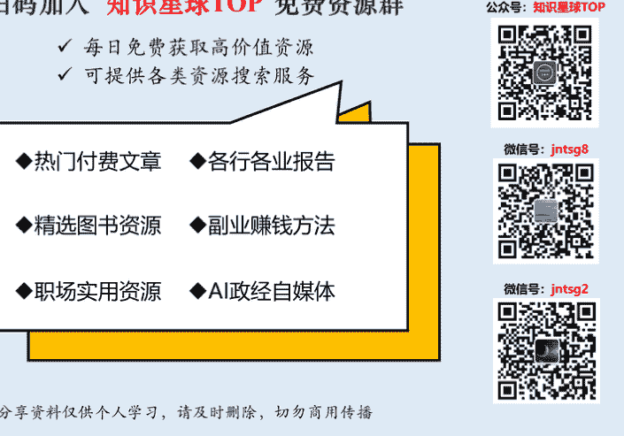
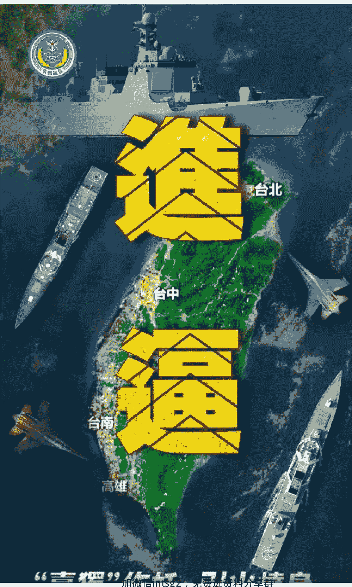
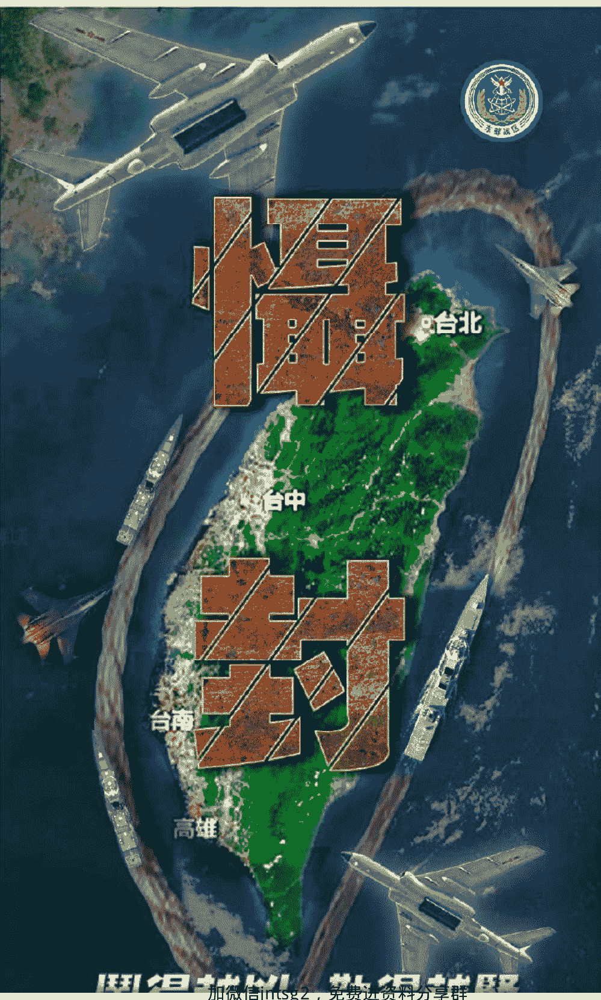
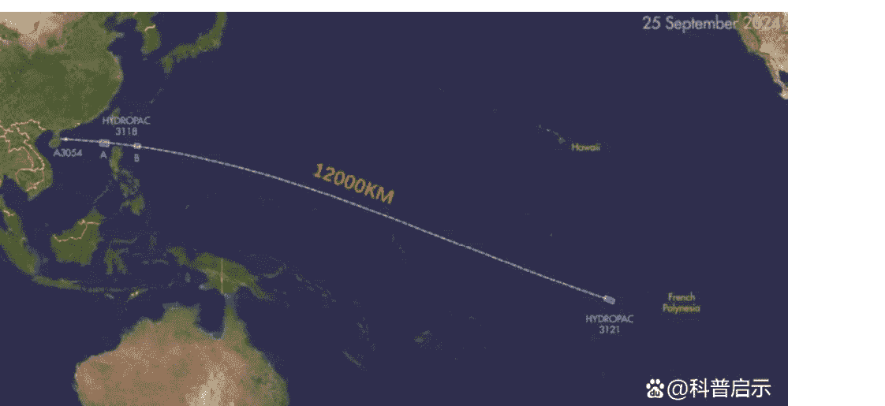
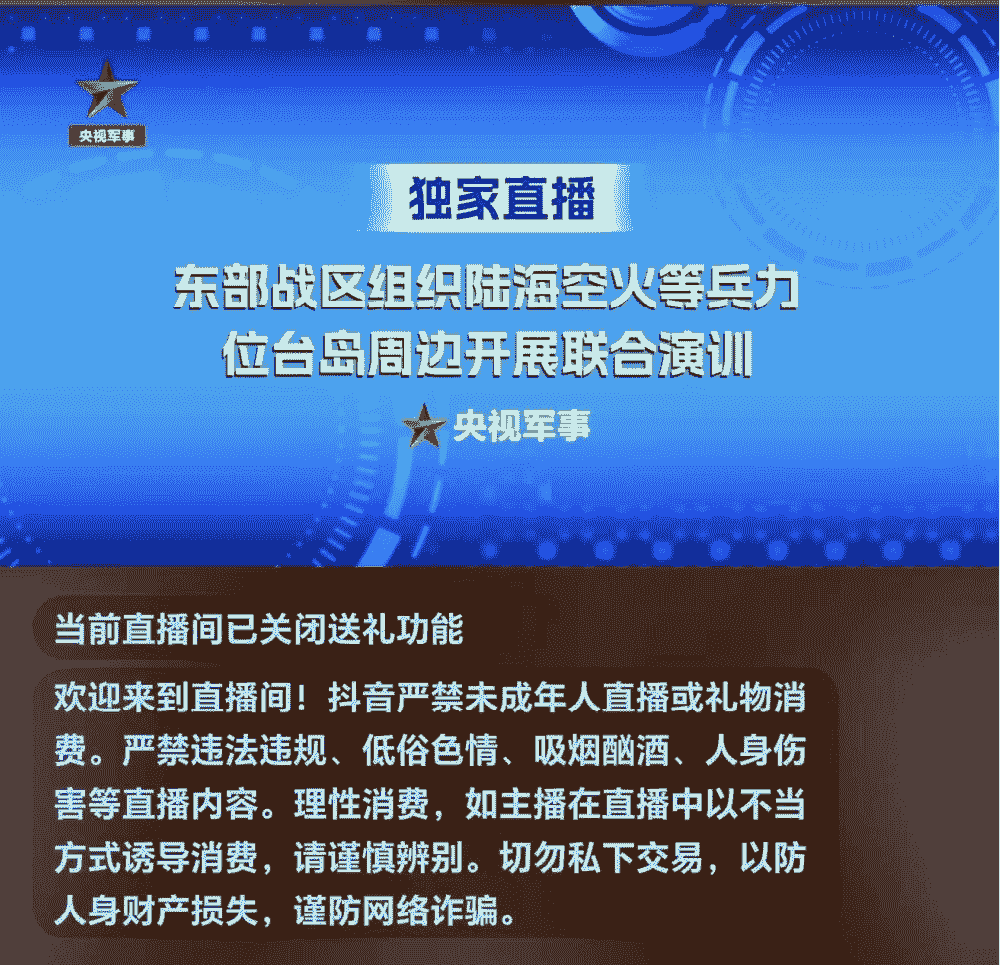

# 今天写事。

# 知道大家都在问今天东部战区的大阵势演，而且还是直播。

# 上午进击，下午实演。

| 免费 | | |
| --- | --- |
| 价值 | 热门付费文章 | 各行行业报告 |
| 及时 | 精选图书资源 | 副业赚钱方法 |
| 专注 | 职场实用资源 | AI财经自媒体 |

加微信jntsg2，免费进资料分享群

## 进
台北
台中

## 逼
台南
高雄

“吉翔” 微信htg2，获取更多军事科学资讯

加微信jntsg2，免费进资料分享群

# 震惊封锁
台北
台中
台南
高雄

加剧封锁msg2，免致筋穷万力竭

看起来，是为了为了回应前几天赖清德的挑衅。

## 1、台军金门实弹演习

根据台军官方通报及媒体披露，台军于2025年3月28日至4月1日在金门本岛及周边岛屿（包括烈屿、胆岛、二离岛等）进行代号为“太武操演”的实弹演习，其中：

- 关键时间：3月28日晨首次开火，演习持续至4月1日
- 具体地点：金门烈屿山海湾及周边6个射击区，最近炮弹落点距离厦门仅4公里
- 装备与目的：使用M41D轻型坦克和火箭炮反登登陆模拟演练，台当局称此为“例行训练”，但未明确回应外界关于演习临时变更地点的质疑

距离厦门4公里，赖清德很挑衅。

所以，今天的军演回应赖清德也是题中应有之意。

直播只是其一，还有两个信号。

一个是我们这次连航母都出动了，部署在台湾东部，拒绝美军用的。

| 行动 | 概要 |
| --- | --- |
| 120E | 125E | 130E | 135E |
| 35N | | | | |
| 30N | | | | |
| 25N | | | | |
| 20N | | | | |
| 120E | 125E | 130E | 135E |
| /1 | |

塔兹沃夫航空母“山东”（舰号“17”）
伦海级导弹护艇（舰号“108”）
吕洋级导弹护艇（舰号“165”）
詹凯级护卫舰（舰号“572”） | 中国海军舰

## 第二个，我们近期就会举行际核导弹的射。

微信jntsg2 免费进资料分享

# 大概是神隐多年的终极杀手锏，专打美国的东风41。

因为远望测量船已经派出去了。

东风-41远望测量船动向：
根据外媒及来源情报分析中国四艘“远望”系列航天测量船（远望3号、5号、6号、7号）于2025年3月底抵达南海、太平洋靶场海域，形成覆盖东太太平洋至马绍尔群岛的监测网络
- 远望3号、6号位于所罗门群岛北部海域
- 远望5号位于法国属波利尼西亚群岛以北
- 远望7号在东南太平洋待命

这种船没有任何武器，派出是为了监控收集导弹数据的，没有攻击性，国际法也保护这种船不被攻击，老美的远望测量船来我们这边我们也不会被攻击。

历史上，我们派出了远望测量船两次，那两次都试射了洲导弹。

——历史上，1980年的580任务中，中国派遣了远望1号、2号及海军、国家海洋局的16艘舰船、4架直升机组成海上测量纵队，为解放军首次向太平洋试射东风洲际导弹提供了全面保障。

——2024年9月25日，中国人民解放军火箭再度派遣远望测量船后，在太平洋相关公海海域成功发射了1发挂载训练模拟弹头的东风-31AG型洲际战略导弹，并准确落入预定海域，射程约12000公里，创下了全球际导弹实际测试中的最远记录。此举也向外界展示了中国核武器的真实可靠度与成熟度，也证明中国并不畏怕任何核化。

加微信jntsg2，免费进资料分享群

第一次是东风5，第二次是东风31，第三次大概是东风41。
——卫星照片显示中国远望测量队再次南下，远望3号、6号、5号队集体前往太平洋，而远望7号在东南太平洋待命。这些迹象表明西方军事观察将聚焦在“东风41”上——这款被称为“全球最恐怖”的战略重器，或将在太平洋上演“终极首秀”。

## 威力惊人
东风41仅需余分钟准备时间，这款威力惊人的导弹便能万里之遥，精准打击敌方目标。此外，东风41型可携带多枚弹头，实现同时对多个目标的打击。配置灵活，可携带多枚弹头，且威力约为25万吨TNT量的弹头。
——台媒报道，为消除外界对洲际导弹不可靠的误解，解放军有充分理由在近期内进行实射，通过“实际行动”展示其对美国的威慑能力。台媒推测解放军可能在半年内再次实射。航母动出了，核武也出了，且动用的是东风41，这种威慑无疑是明确的。所以你再看今天的演练，是不是很激动？

看起来，是为了是为了回应前几天赖清德的挑衅。

## 1、台军金门实弹演习

根据台军官方通报及媒体披露，台军于2025年3月28日至4月1日在金门本岛及周边岛屿（包括烈屿、胆岛、二离岛等）进行代号为“太武操演”的实弹演习，其中：

- 关键时间：3月28日晨首次开火，演习持续至4月1日
- 具体地点：金门烈屿山海湾及周边6个射击区，最近炮弹落点距离厦门仅4公里
- 装备与目的：使用M41D轻型坦克和火箭炮反登登陆模拟演练，台当局称此为“例行训练”，但未明确回应外界关于演习临时变更地点的质疑

距离厦门4公里，赖清德很挑衅。

所以，今天的军演回应赖清德也是题中应有之意。

直播只是其一，还有两个信号。

一个是我们这次连航母都出动了，部署在台湾东部，拒绝美军用的。

| 行动 | 概要 |
| --- | --- |
| 120E | 125E | 130E | 135E |
| 35N | | | | |
| 30N | | | | |
| 25N | | | | |
| 20N | | | | |
| 120E | 125E | 130E | 135E |
| /1 | |

塔兹沃夫航空母“山东”（舰号“17”）
伦海级导弹护艇（舰号“108”）
吕洋级导弹护艇（舰号“165”）
詹凯级护卫舰（舰号“572”） | 中国海军舰

## 第二个，我们近期就会举行际核导弹的射射。

微信jntsg2 免费进资料分享

# 大概是神隐多年的终极杀手锏，专打美国的东风41。

因为远望测量船已经派出去了。

东风-41远望测量船动向：
根据外媒及来源情报分析中国四艘“远望”系列航天测量船（远望3号、5号、6号、7号）于2025年3月底抵达南海、太平洋靶场海域，形成覆盖东太太平洋至马绍尔群岛的监测网络
- 远望3号、6号位于所罗门群岛北部海域
- 远望5号位于法国属波利尼西亚群岛以北
- 远望7号在东南太平洋待命

这种船没有任何武器，派出是为了监控收集导弹数据的，没有攻击性，国际法也保护这种船不被攻击，老美的远望测量船来我们这边我们也不会被攻击。

历史上，我们派出了远望测量船两次，那两次都试射了洲导弹。

——历史上，1980年的580任务中，中国派遣了远望1号、2号及海军、国家海洋局的16艘舰船、4架直升机组成海上测量纵队，为解放军首次向太平洋试射东风洲际导弹提供了全面保障。

——2024年9月25日，中国人民解放军火箭再度派遣远望测量船后，在太平洋相关公海海域成功发射了1发挂载训练模拟弹头的东风-31AG型洲际战略导弹，并准确落入预定海域，射程约12000公里，创下了全球际导弹实际测试中的最远记录。此举也向外界展示了中国核武器的真实可靠度与成熟度，也证明中国并不畏怕任何核化。

加微信jntsg2，免费进资料分享群

第一次是东风5，第二次是东风31，第三次大概是东风41。
——卫星照片显示中国远望测量队再次南下，远望3号、6号、5号队集体前往太平洋，而远望7号在东南太平洋待命。这些迹象表明西方军事观察将聚焦在“东风41”上——这款被称为“全球最恐怖”的战略重器，或将在太平洋上演“终极首秀”。

 威力惊人
东风41仅需余分钟准备时间，这款威力惊人的导弹便能万里之遥，精准打击敌方目标。此外，东风41型可携带多枚弹头，实现同时对多个目标的打击。配置灵活，可携带多枚弹头，且威力约为25万吨TNT量的弹头。
——台媒报道，为消除外界对洲际导弹不可靠的误解，解放军有充分理由在近期内进行实射，通过“实际行动”展示其对美国的威慑能力。台媒推测解放军可能在半年内再次实射。航母动出了，核武也出了，且动用的是东风41，这种威慑无疑是明确的。所以你再看今天的演练，是不是很激动？

但是打住。

这里有第一个疑云。那就是，东部战区的林向阳其实被带走了。是的，受累苗华和卫东。前几天，林向阳就被带走了，还是在家里带走的。而且，还在传其他军大佬也被带走了。目前可以列出一个长名单：
左胜右臂卫东，东部的苗华武营春宁，海军政委袁华智陆军政委秦树桐，东部林向阳火箭军王斌。这七个人，都很久没露了，都在传被带走了。高层持续性高强度地震，而且梧桐必然要用到东部战区和火箭军。这两个军的老大陷入带走传闻，梧桐？是的，这就产生了第一个疑云——东部战区是真的来的？我们是真的吗？真的要梧桐吗？航母核武都动了！——一一串军方大佬陷入传闻中，这能顺利吗？

## 失去军权吗？

别人一直在传我们失去军权，但东部战区竟然能够展开大阵势的，而且还有核武和航母的配合，这意味着海军和火箭照常运行，不受人事变动影响，我们依然指挥的。山东号航母还是南部战区的。动山东号航母，意味着南部战区也接受指挥。现在就是东部战区+南部战区+火箭军，都听从指挥，中基层将士并没有因为上面打架而军心思变依然听从我们指挥。会有人说了，这次演练不是我们指挥的？要侯指挥的呢？不可能的，我们还在位置上，这种容易睁枪火的事肯定是要避免的，因为我们还在位置上，梧桐的成绩就算在我们头上，而不是他和元老们的头上。

之前，是懂得求稳拜登求乱，现在，反而是我们求乱那一边求稳。现在稳下去，对我们来说是慢性死亡，对我们不利。现在乱起来，特别是梧桐掀桌子定于一尊，对我们有利。我们求乱，所以我们求乾纲独断。一句话，他未来如果顺利当成叶剑英，他也会梧桐台湾，不然他不正言顺，他需要卫青、霍那样的功绩证明自己当叶剑英拨乱正是对的，需要用梧桐的胜利捍卫他不被别人反攻倒算。目前前提是，他要能当这个叶剑英，我们要不在位置上。因为国内秩序过度和内乱，他要梧桐必然会亲美派联手，对懂王让步。大白话就是：
——我们近期就想梧桐，而且不懂王让步大妥协。
——他们是未来我们下去后才会梧桐，而且会对懂王做让步大妥协。所以，同样是梧桐的剧本，对苍生百姓却是不同的利。你肯定选择前者，因为你是屁民，你肯定不愿意他们献祭你们这些屁民去接美国泡沫，去换台湾换他们的名正言顺和卫霍之功。

所以，这次军队的行为，必然是出自我们的授权和指挥。而这几方大佬头头都陷入了风波传闻中，我们到底怎么安抚军心并且授权调动成功的？对第一个疑云，你先别急着疑惑沉思，这只是第一个。还有第二个疑云，那就是北京会。北京会已经解除安保，就刚昨天。那么意思是，北京会已经开了？并非如此。看我们的出行时间，我们是3月19日至20日在云南。然后20日之后，就没有露面了，直到3月28我们在北京。从云南到北京有一路程，这七天安保解除。这样看，这七天是我们去开会了。但是，北京会不可能只有我们和元老们开。

## 北京会到底吗？

但是，这七天，只有我们露面的。地方大佬，这七天都在北京或者地方，没有去北京会。这就是第二个疑云。
——北京会有没有开会？不开会干嘛？从3月20日到27日，北京直到3月28日，北京会结束。
——从3月20日到27日，北京到底干嘛？是开会吗？如果是开会的话，其他人没有露面？北京会到底没有？
——北京会到底开了？第二个疑云让人头痛。

当然，我之前说过，我们的军事本是不开会的。不开会是最最好的。但保安难以解释，这七天也难解释。当然，这七天也有一个解释。那就是安抚调动军队。我们去昆明，用意就是两个。对军内是喊话子弟，对昆明实演是火箭军反落。

然后我们回北京，这七天。七天后，军心思稳的军队各方，一个搞出了军演，一个动了航母，一个要射核武。还是那句话，排除指挥，现在明的是东部战区+南部战区+火箭军，并没有因为上面打架而军心思变，依然听从指挥。梧桐需要的，正是三方。东部战区+南部战区+火箭军，正是收台美三大件。可能，这七天不是去开会，我们不会在这个节骨眼上调整难度去赴鸿门宴，而是在关键时刻安抚人心稳的军队。一路看来的瓜友都知道，我们要翻盘绝杀，的确只有梧桐这条路了。

## 梧桐破局，既对外煽王的，对内煽各方的。

这七天后，效果不得不说是显著的。因为东部战区敢军演，因为航母能出动，因为核武实射在准备。这就说明我们成功调动了军队。而且东部战区直播，在低可能的情况下，军队各方没有出错。这不仅是给我们看的，也是给台湾美国的。美国台湾会认为，我们军方高层持续性动荡，下面部队一定人人自危，别说打仗了，兵变就算好了。赖清德最近各种疯狂挑衅，针对我们搞军演还说解放军进就开始第一枪，他的底气不是来自美国的军事保证和军事实力，而是来自我们枪杆子高层动荡，他才这么飞骑脸。结果我们直播了军演。告诉美国台湾，也告诉内部情况的国内各方，军队没有因为高层动荡而变得混乱不堪，依然是能战敢的枪杆子，依然是能朽的枪杆子。这个直播，杀人诛心。

# 东部战区组织陆海空火等兵力位台岛周边开展联合演练央视军事 已关注

当前直播已关闭送礼功能欢迎来到直播间 抖音严禁未成年人直播或礼物消费。严禁违法规、低俗色情、吸烟酗酒、人身伤害等直播内容。理性消费，主播在直播中以不当方式诱导消费，请认清辨别。切勿私下交易，以防人身财产损失，谨防网络诈骗。

加微信intsg2，免费资料分享群

这七天，很可能不是去开会的，而是去安抚军队的。而且我们成功了，并自信直播。这是一个极好的信号。当然上面那个疑云又来了：我们是如何在高层动荡的情况下，成功安抚军队各方的中基层官兵将呢？除了视察云南昆明释放两个信号外，肯定还会有别的动作。

# 不然我们不会神奇7天才做完。

这七天我们的动作如何，只能从以后的新闻来穿透分析，或者等历史材料解密公布。然后，是传的出访的事。传懂王出访，是5月。白宫：特朗普出访行程仍在考虑中 暂无计划。凤凰在线2025-03-31当地时间31日，央视记者获悉，美国白宫回应总统特朗普出访行程仍在考虑中，但还没有具体的计划，会在相关消息公布后提供相关信息。加微信jntsg2，免费资料分享群

月中旬出访。而之前懂王暗示，我们4月访问，然后让我们6月访问美国，用永结之利。懂王现在说月中旬出访，我们也传出了计划。不是去美国，也不是俄罗斯，而是去东南亚。南华早报：将今年度访亚安排在越南、马来西亚和柬埔寨。在东南亚地区对美国政策产生忧的背景下，中国正在努力深化周边国家的关系。前面说过，我们能访问，意味着我们拥有大权，才能顺利出访。一直是视察西南，后面放出出访，这意味着是安全的，是没有问题的。这是好消息。而且，贵州云南视察，其实是去年年底就开始为后续出访做工作。前脚视察完那个广广场，后脚广场发生了不明情况。让捕头先行视察云南，安保是需要的，我们要更加警惕。加微信jntsg2，免费资料分享群

不管如何说，出国访问就是好信号。不管如何说，懂王4月首访落空，毫无疑问是被拒绝了，这也是好信号。这两个是很积极的信号。至少现在大家可以把悬放回去。而且，贵州云南和东南亚视察，其实是可以连在一起看的。是的，出访东南亚前视察贵州云南，这都是配套，为梧桐服务的配套。当然，最好的配套肯定是外访俄罗斯和日本，至于三胖会暗。三胖其实年前就想会日本，不要去，因为是太给日本长脸了，而且安全，让下面人谈就行。比如韩国内乱，尹锡悦李在明一堆破事，没完。还有一个俄罗斯。主要普京实在是太头了，和懂王靠的太近了，而且北京战争5月8日召开，我们5月也得去，所以4月派王毅就行。

## 王毅：中俄永不敌

中国新闻网2025年4月1日北京。王毅的话暗示的就是，中国反对普京和俄美关系，但是反对普京听从美国的挑拔中国。

加微信jntsg2，免费资料分享群

这是我们最后的底线，也是最大的包容了。这说明，三胖不见我们来骑脸，的确给我们触动很多。我们认清了普京已经难以拉回了，认清了普京必然缓俄美关系和懂王一定程度的嫡。不然王毅就会例行的突出那句话，说中俄合作无上限之前的老话。中俄永不敌，证明我们调整了对普京的谈判策略。今晚普京和王毅见面了，看王毅的发挥了。不过预判不出错的话，没几天普京我们也得打电话。。我们要得到普京的承诺保证，也是梧桐太大了，普京一个人带着三胖至日本，这么大的事我们必须和普京亲自聊聊。王毅此行行为我们和普通电的伏笔，希望王毅能搞定普京。总结就是，前不久风急浪高，乃至海啸袭来，大家都觉得步步惊心，觉得大势已去。但是，几天过去了，有了很多积极信号。一个是能放心的出访观察，在加强安保情况下我们敢于出京，乃至准备外访东南亚铺垫，这是积极信号。一个是懂王说的4月份首访中国的计划暂时落空了，这也是很积极的信号。一个是北京安保结束而我们似没有会这场鸿门宴，这个和懂王4月访华计划落空息息相关，我们要我们没去还是要独自赴鸿门宴也顶住亲美派压力不让4月访华，不管如何都是积极的信号。一个我们7天疑似在安抚调动军队，在高层持续性高强度动荡的情况下，在大军乃至火箭头陷入落马传闻的情况下，我们依然成功搞定了东部战区+南部战区+火箭军，凑齐了收台拒绝必须的三大事，搞的军演直播更是杀人诛心，告诉各方我们军权依然紧握！告诉各方军队没有心思变依然能打！这是最积极的信号！