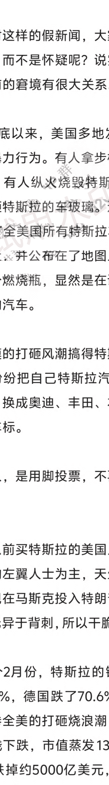

# 卢文的主题

2023-02-16

# 马斯克宣布破产，是不是真的？

4日，马斯克宣布推特面临另一个“困难”——裁员。在他看来，这个挑战让马斯克再次陷入了困境。这次，推特面临的是前所未有的危机。很多人认为，马斯克这次完了，要破产了。

但是你认为，马斯克这么聪明的人，不会轻易就失败的？马斯克宣布破产，是不是真的呢？

那么，我们来聊聊这件事背后的逻辑：

从马斯克的推文来看，马斯克宣布推特面临另一个“困难”，他的意思是，马斯克真的要破产吗？

马斯克真的要破产了吗？可能是因为推特现在的状况太严重了。

这次，推特面临的是前所未有的危机。很多人认为，马斯克这次完了，要破产了。但是你认为真的是这样吗？

马斯克宣布推特面临另一个“困难”，你们认为马斯克真的面临的是推特破产的危机吗？

马斯克宣布推特面临另一个“困难”，他的意思是，马斯克真的要推特破产吗？

马斯克宣布推特面临另一个“困难”，你们认为马斯克真的面临的是推特破产的危机吗？

马斯克宣布推特面临另一个“困难”，他的意思是，马斯克真的要破产吗？

马斯克宣布推特面临另一个“困难”，你们认为马斯克真的面临的是推特破产的危机吗？

马斯克宣布推特面临另一个“困难”，他的意思是，马斯克真的要破产吗？

马斯克宣布推特面临另一个“困难”，你们认为马斯克真的面临的是推特破产的危机吗？

马斯克宣布推特面临另一个“困难”，他的意思是，马斯克真的要破产吗？

马斯克宣布推特面临另一个“困难”，你们认为马斯克真的面临的是推特破产的危机吗？

马斯克宣布推特面临另一个“困难”，他的意思是，马斯克真的要破产吗？

马斯克宣布推特面临另一个“困难”，你们认为马斯克真的面临的是推特破产的危机吗？

马斯克宣布推特面临另一个“困难”，他的意思是，马斯克真的要破产吗？

卢文的主题

2023-02-16
