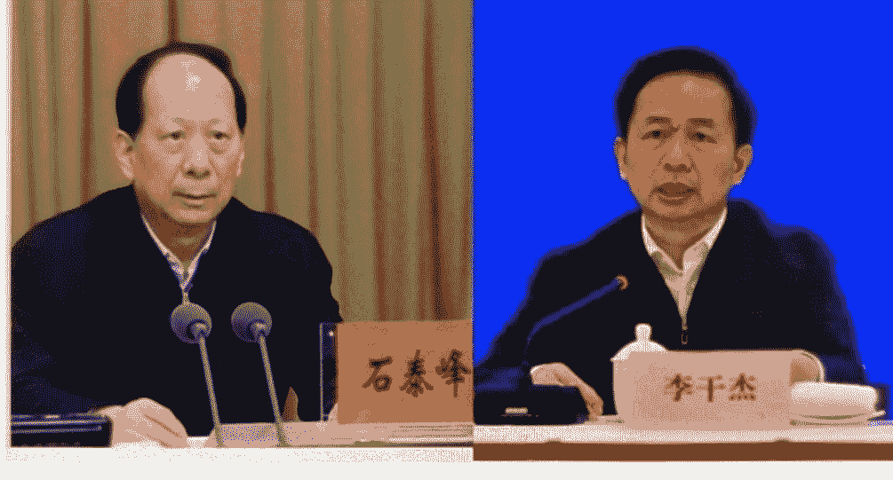

# 《尚互换》

发布于 2025 年 4 月 2日

据悉，统战部部长与中组部长李君进行互换，根据目前的情况分析，可行性非常高，刚结束 3 月政治局会议正好要拟定一批重要官员任免，如即将卸任的上海市長，同步调整应在理之中。

清华出身的李天官，是同为清华出身的陈天推荐的，但李20大上任官时仍遭遇了巨大的阻力，虽然进入了政治局和书记处，但他的中组部长迟迟未能获得任命，二十大后，各省市一把换届，都是陈天到现场任命的，直到两会后的 4 月才卸任中组部长，此后陈天仍然担任中央党委校长和行政学院院长的职务，未把全部的队伍培养职责交付给李天官。

加微信jntsg2，免费资料群

而且，从二十大的书记处的排序来看，第一书记C，第二书记STF，第三书记LGJ，石尚以统战部的身份的位居第二，非常之不合理，之前统战部的部长经常都没有资格进入书记处或者政治局，如十六大的刘延东没入书记处和政治局，如十七大的杜其林、十八大的L、十九大的尤权没入政治局，更是作为前中央党校的副校长，也不适合去管理统战，实际上，是强势的陈天硬把李天官扶上位，抢了石尚的职务，所以石尚想趁机夺回自己的天官之职，逻辑上是很通顺的。

自风波以来，在生死危机面前，梯队建设与意识形态的工作变重，中央党校的校长一直都是政治常委、书记处第一书记兼任，如13的Q、14-15的H、16的Z、17的X、18的L，

到19大后，书记处第一书记WHN未能兼任党校校长，丧失了掌握人才梯队培养的权力，而这个重要信号也在19大后产生了一系列的波澜，宁波帮、上海帮、军工帮、工信帮，WHN周边的政治力量都先后遭遇了惨痛的失血。

加微信jntsg2，免费进资料群

人事权的争夺，往往也会伴随着风血雨，此次北大出身的石若是清华的陈李手中夺回复，不仅仅仅是一个部门的换人那么简单，也标志着中国官员选拔机制将会终结，清华等理工长期主主的时代可能会终结，因此获益的部分山头可能会受到巨大的冲击，党务工作者将会有更多的机会，很多被压制的山西的北大也将迎来一波出头之日。

# 免费 价值 及时 专注

# 扫码加入 知识星球TOP 免费资源群

- 每日免费获取有价值资源
- 可提供各类资源搜索服务

| 热门付费文章 | 各行行业报告 |
| 精选图书资源 | 副业赚钱方法 |
| 职场实用资源 | AI经营自媒体 |

公众号：知识星球TOP 微信号：jtsg8 微信号：jtsg2

分享资料仅供个人学习，请及时删除，切勿商用传播

加微信jtsg2, 免费进资料群
