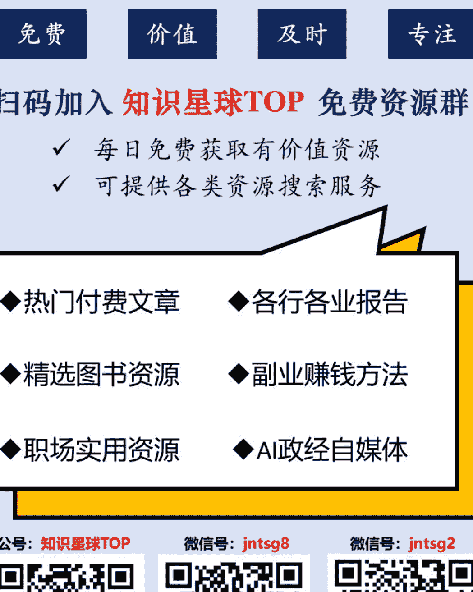

# 法国外交，双赢赢了吗？

作者：郭明亚

2023年3月，法国总统马克龙对俄罗斯进行了访问。在访问期间，双方进行了深入交流。法国外交的主题，第一，是希望中国加强与俄罗斯外交。

在巴黎，马克龙在凡尔赛宫接待俄罗斯总统。俄罗斯提出的条件似乎并不无理，俄罗斯也不接受任何新要求。双方没有达成共识，法国陷入了一头雾水。

法国外交面临着美国和俄罗斯的双重压力。在这些压力下，法国陷入了困境。

马克龙在马斯基与乌克兰总统泽连斯会面。泽连斯表示希望能够避免冲突的破裂，但法国外交陷入了僵局。

法国希望中国加强与乌克兰外交，但法国陷入了困境。

这样，法国外交就尴尬了。

# 双赢真的赢了吗？

法国外交的困境，是由于平衡美俄冲突。

如果不加入美国，法国将失去俄罗斯的支持；如果加入美国，法国就无法独立活下去。

与此同时，法国也面临中国的压力。法国的政策面临被采取的压力。

然而，俄罗斯并没有考虑这些，俄罗斯也不接受任何要求。

与此同时，中国也对法国施加压力。法国该如何？

法国外交的困局，是由于如何在多方之间平衡。

法国与美国外交会谈，这次会谈表示了对美国的利益。

法国与俄罗斯外交会谈，这次会谈表示了对俄罗斯的利益。

法国与中国外交会谈，这次会谈表示了对中国的利益。

这种外交的策略，是由于要多方打交道。

我们认为，这种外交策略是必要的，法国但也面临被采取的压力。

双赢真的赢了吗？

