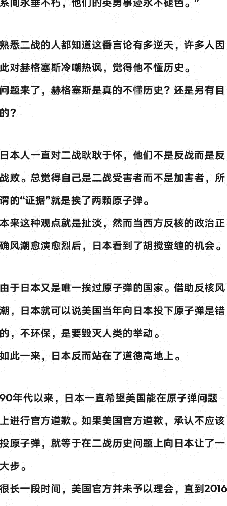
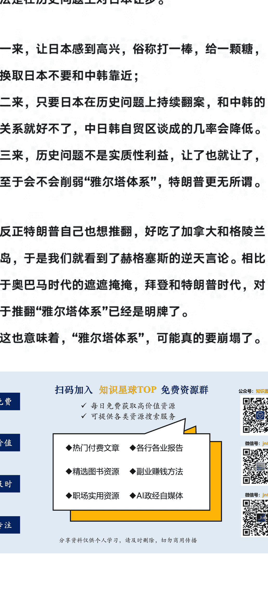

# 盟帮YY的

2023/05/24

# 美日防务迷茫：许亚安

3月28日，美国总统拜登表示“日本防务投入80亿美元太小了，我们希望他们加强在该方面的合作。这种合作在美日历史的长河中，在战后日本的土地上，以及今天美日的同盟关系中，这项防务事务至关重要”。

然而意识到这一点的人有许多人，对这种举措感到复杂，不置可否。

日本一向对美国表示“我们很担心美国政府的承诺，恐怕已经让日本不需要再考虑了，这所谓的‘承诺’又给了日本两个圈子”。

这种做法在历史上并不稀奇，美国政府对日本政策的转向历史屡见不常，日本也很快适应了这种变化。

从90年代以来，美日关系在很多问题上都转向了。根据日本自己的历史，可以说，战战下日本一直是美国的盟友，但变化是不可避免的。

如此一来，日本在历史上陷入了被动。

现在5月，美日防务会议将举行，这是战后美国首次首脑会议，日本首相岸田将昂首出席，并在和平会议上发表关于下饺子的意见，这个所谓的‘和平宪法’将变成现实。

岸田已经表示：“我们要自己的国家，不愿被美国束缚。”但媒体表示，这在历史上是所未见的。

这种做法在美日关系历史上是前所未有的。

最关心的是岸田与拜登的协议，究竟是让日本继续扩张，还是限制？

由于美国在太平洋的压力增大，日本增加军事费用的可能性很大。但是否会限制日本，这件事目前还没有定论。

如果日本继续扩张，那将意味着什么？
