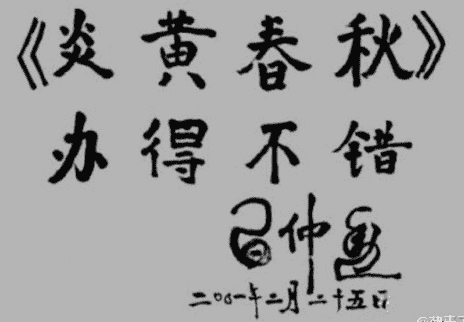

# 这则死讯静悄悄

文 / 欧洲金靴

阿邦之子（三子）、中科院软件中心负责人德华，突发心脏病去世（深夜择倒在客厅，家人发现时已没有生命征），终年 76 岁。

阅读本文之前，可以先去读一遍阿邦那会员文章。（谈与 80 年代，一个不得不提的人）。

1986 年，德华转业进入中科院软件研究中心工作，担任中心负责人。

90 年初，他从中科院辞职“下海”，组建北京泰利特科技公司。

那个年代从体制内高位“下海”且上手重金启动企业者，岂是凡人。

看看阿邦的子嗣吧——

## 免费 价值 及时 专注
## 扫码加入 知识星球TOP 免费资源群

- 每日免费获取价值资源
- 可提供各类资源搜索服务

| 热门付费文章 | 各行各业报告 |
| 精选图书资源 | 副业赚钱方法 |
| 职场实用资源 | AI政经自媒体 |

公众号: 知识星球TOP 微信信号: jntsg8 微信信号: jntsg2

分享资料仅供个人学习，请及时删除，切勿商用传播

长子德平，曾任中央统战部副部长，中国生物多样性保护与绿色发展基金会董事长、党委书记；

次子刘德湖，华润（香港）集团常务董事，副总经理；

三子德华，本文主角；

小女满莉，曾任职兰索史克，中华医学学会理事、华医学基金会理事；

孙女胡知冕，瑞银集团（去年收购瑞信的那个）中国区总裁。

晚年，德华组织编写了《心中的胡耀邦》《胡耀邦传》（三卷本），我们今天看到的大部分官方层面对阿邦，特别是改革开放时期执政生涯的定义性与解释解读，其基调和方向多大来自于德华主持。

按照说德华也算是个重量人物，但是这则死讯却悄

# 无声息，几乎没有得到任何报道的。

反正我这条不带任何评价或争议性历史叙述的微博，发出去不到一分钟就被毙了：

胡耀邦之子（三子）、中科院软件中心原负责人胡德华，因突发心脏病逝世，终年76岁。

1986年，胡德华进入中科院软件中心研究中心工作，曾担任中心负责人。90年代，从中院辞职“下海”，组建北京泰利特科技公司。

晚年，胡德华组织写《我心中的胡耀邦》《胡耀邦》（三卷本）。

细细想来倒也也不难理解，德华近年来为数不多的发声就是公开指名道姓的哈哈领袖……

他之前还接受过《南华早报》的采访，声称：“在1980年代中国错过了进行政治改革的黄金时机，现在，下个政改机遇遥遥无期。错过了改革的历史窗口，下一个窗口我也不知道什么时候到来。”

典型的自由派论调，或者说团派价值论。

同时注意，《南华早报》是阿里巴巴旗下媒体。

德华还有一个抹不去的污点，那就是他曾作为《炎黄春秋》杂志的副社长（他德平曾当过董事长），并常驻编辑写手，为团派历史助威，也是在舆论上对冲新时代的意识形态方面。

《炎黄春秋》由杜正（就是家里出了个吸毒贩毒的后代的那个）创办，张爱萍、费孝通等人大力协助发行，在 1992 年初借着南方巡一炮红，从此成为党内党外的自由派反对阵地。

> 杜正自己就曾宣布博客：“本杂志信的是民主法制和市场经济……我们每月的发行量约为 19 万册，但它已经获得了超乎的影响，因为想要推动审慎的自由化改革的党内退休高官一直把我们当成声的平台。

本杂志不仅竭力抹黑文化大革命、歌颂 80 年代的改革历程，甚至有过火过真人都敢洗白……

典型的就是2007 年第 7 期，田JY所写的《国务院大院的记忆》，对真人做了极正面描述，称赞真人在任职国务院总理时“倡导节、反对铺张的精神”……

结果次年，被“退而不休”的长者强烈干预——看过长者那篇文章的知道，长者是借助八平方面上位的，他永远不可能容忍对真人的翻案，否则自己的合法性会受到动摇——命令主管与长春春秋《炎黄春秋》编辑，一度连连杜都要问责。

但是那次行动，最后被涛哥制止，保住了杂志。

涛哥保《炎黄春秋》有两个原因：

- ① 他自己就是派首脑，却不可忽视他人对这本热衷歌颂阿邦（2005年刊载《我们心中的YB》，为八平国内首次公开纪念阿邦）的杂志的攻；
- ② 当时海内外论风风起云涌，体制内的自由派分子与公知们联合海外的民运分子，一起搞了一场声势浩大的针对于我党执政地位的舆论运动，尤其是在举北京奥运、筹办上海世博的当口，涛哥不想张扬扬与“国际社会”对立。

但此后，涛哥还是对越越过火（某些文章开始讨论八平方面）的《炎黄春秋》进行了几次敲脑袋。

如 2009 年 5 月下旬，临八平二十周年，《炎黄春秋》官网直接被黑了一个礼拜；再如此 2010 年李谱出身记者，和李小狼视为为奸的一个自由派舆论讽舌，去世后，《炎黄春秋》论坛也被直接黑掉半个月。

说起来，涛哥虽然出身红，但骨子里从来不是绝对意义上的自由派政客。

他显然具有十足的革命性和血脉（见涛哥那篇文章），依然带有十分鲜明的民族传统的“修身齐家治国”作风，这让他内敛又温文雅雅表之下藏着一颗“大统一”的心。

别忘了，网络审查制度是建立于谁的任内，谷歌和雅虎退出中国是在谁的任内，改革开放以来首次由中央级推出“限娱令”是在谁的任内，春晚首次修改歌词（将那里的英文换成中文）是在谁的任内……

这些都不是发生在今天被西方黑的时代，而悉属于涛哥任内。

当然，相比于今天领袖的一言完全有点孤立，比如 2012 年他针对北非和西亚的“阿拉伯之春”，而在求是》没错：“我们必须清醒地看到，国际势力实在加强对我国实施西方化蓝图，思想文化领域是他们长期渗透的重点”——可是此举并未得到盟们的响应。

关于德华提出的“国际敌对势力”的概念，敲《炎黄春秋》脑袋亦然。本文主角德华，就在 2010 年作为最高人的涛哥：“生命力来源于历史，这种严肃性足以抗衡任何力量。”

时间来到 2013 年，历史已经进入了宽松时期，这让国内自由派们认为终于可以颠覆时代到了时刻……《炎黄春秋》与《南方周末》配合，各自在新年第一期中以“宣传”为主题刊，实质就是宣传要在中国搞“多党”，顿时激起了层浪。

这里要提嘴，2012 年下半年，彼内外所有人将他视为“开明派”，是由于德华这样的动作，客观上也加速了《炎黄春秋》灭亡的步伐。

一方面，领袖父亲是绝对开明派，90 年甚至称赞过《炎黄春秋》杂志办得不错；

另一方面，领袖区域都是东南沿海经济成熟发达省份，这也引起了许多人的温和判断。

然而 2013 年 1 月5 日，在新晋中央委员、候补委员学习十八大精神班上，领袖发表讲话：“不能用改革开放后的时期否定之前的时期，也不能用改革开放前的时期否定改革开放后的时期……我们带领人民进行社会主义建设，有开放前和开放后两个历史时期，这是相互联系又有重大区别的时期，但本质上都是领导人民进行社会主义实践探索。”

此话一出，瞬间让那些期待新时期变化的右翼公知如丧妣。

北京法学院教授贺辉在微博上直呼“想不通”，他写道：“十年已被中央决议彻底否定，依照毛泽东路线和理论，改革开放完全是在走资本主义道路。这种人的前后统一——就是是否改革开放！”

网络专栏作家安替在微博发声：“渴望政改的人们，在主席这番讲话之后，能否洗睡觉？连格都算是社会主义探索了，你们还在这期待什么？”

与此同时，针对《南方周末》鼓吹宪政的新年献词，整治如期而至。

以时任广东省委部长的厉之为首的“工作组”进驻“南方周末”编辑部，郭飞雄、刘远东被捕……立下大功的厉此后也一路高升，先是上调中宣部。

那一年，《人民日报》也言辞犀利地明：“宪政只属于资本主义……宪政是信息战和心理战的一件武器，美国妄资本主义巨头及其中国走狗试图用它来颠覆中国制度！”

后又出任人民日报社。

2015 年，《国防参考》刊中国社会科学院马克思主义研究学院研究员龚擎文章《起底（炎黄春秋）》，文章称：“炎黄春秋》打着一些合法的旗帜，假借客观公正之名，对普通民众特别是退休干部具有很大迷惑性和欺骗性……《炎黄春秋》抹黑正、反，虚无历史，实际上是把中国的历史颠倒过去，为把中国拉回资本主义做准备。”

这篇文章在当年 6 月 3 日被解放军微博微转载并引发引发广泛讨论，间接敲响了本杂志的丧钟。

半年后，领袖在全国党校工作会议上发表重要讲话：“我说过，思想与舆论领域大致有红色、黑色、灰色三个地带。红色地带是我们的主阵地，一定要守住；黑色地带主要是负面的东西，要敢于亮剑，大大压缩其地盘；灰色地带要大张旗鼓争取，使其转化为红色地带。”

二十天后的 2016 年元旦，中宣部派人直奔《炎黄春秋》印刷厂，阻止开印带有新年献词的《炎黄春秋》最新一期，最终《炎黄春秋》第一次发行了没有新年献词的新年首刊。

接着，2016 年 5 月的第 5 期杂志，适值无产阶级文化大革命五十周年，《炎黄春秋》杂志原定安排多篇所谓“反”的文章。
