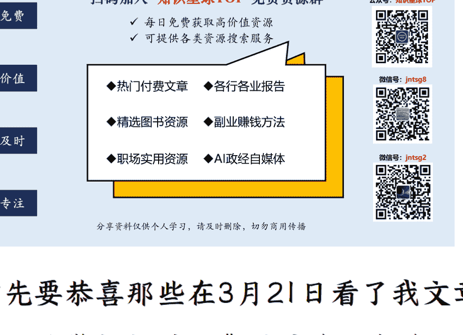
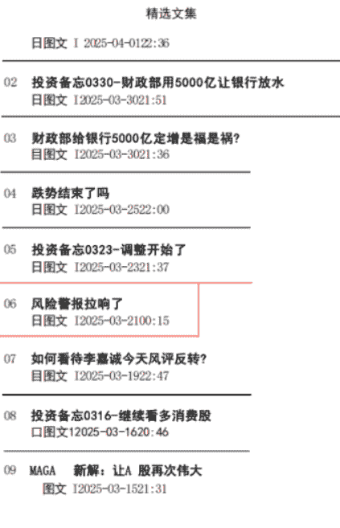

# 莫慌，本月将跃出最佳买点

## 20250405 端宏斌

首先要感谢那些在3月21日看了我的文章《风险警报拉响了》就减仓、轻仓且不着急抄底的朋友，因为从那时开始，港股和A股就一直调整到今天，下周不出意外的话仍然是大跌的结局，所以你以为成功躲过了这一波暴跌。

在文章《跌暴结束了吗》中，我也反复告诉过你，当你想抄底的时候，一定不是底，在底部你是不会想抄底的，相反你时候你想的是回本就清仓户，永远离开这个市场，这时候就是底了。

你要做的，就是在这之前不要太早就把子子弹打光，否则等好机会来了，你手里一分钱都没有，那还玩什么？

微信intsg2，免费进资料群

今天这篇文章我想跟你说点好消息，那就是我判断底的买点在本月，乐观一点大概两周左右就底了，但跌幅比较大。如果出现急跌，那反弹起来也会很快的。你要做的就是别在急跌中割肉，如果你之前已经减仓轻仓，那么急跌的时候就可以便宜买货了。

当前最大的利空就是川普对全世界加关税，但这对我们来说并不是什么坏事，如果川普只对我们加关税，那确实是坏事，但他对所有人无差别开战（连盟都不放），反而就变成好事了，因为川普没有能力单挑全世界，接下来他可能会找个借口认怂的，这是必然的。

咱们跟川普已经这么多年交道，对他的为人处世其实很熟悉了，他最喜欢的套路就是极限许，他认怂起来速度也很快，另外他也是一个欺软怕硬的人，如果你服软，他就来硬硬，他虚张声势的极但如果你强。

川普为什么对普京那么软？川普为什么再不提金三胖？就因为当初金三胖扬言要射击岛屿，得川普主动去求和，从那时候开始，他就再也不碰朝鲜订单，不再去招惹朝鲜人了。

普的策略略白了，非常简单，他先张牙咬爪吼你们，从你们的反应中来判断谁是硬茬，是谁是怂包。如果他意识到你是硬茬，他接下来就绕着你走，不会动碰你这颗钉子。如果他判断你是怂包，你就惨了，他就对你持续施压，看看能从你身上榨出多少油水。当你抱着同归于尽的想法跟他玩的时候，他就会缩回去，因为他发现不值得。

从以上这个角度来看，我们对原产美国的所有进口商品，在现行适用税率基础上加征34%关税，这个操作是非常正确的。这就把球踢到川普脚下，看你怎么怎么办。

贸易战其实和遇到拦路抢劫是一样的，你先不要考虑自己有多少损失，你务必要给对方造成最大的损失，让他知道今天买卖亏了，然后溃徒自就跑了。

主席对此早有判断，他说：时间要打多久，我想我们要不要做决定。过去是由杜鲁门，以后是艾森豪威尔，或者美国的未来的什么总统，由他决定。他们要打多久就打多久。一直打完全胜利。

如果真的按照目前的关税形势少云，美国的通胀率还要上涨，同时美股是彻底完了，一方面是物价暴涨，另一方面资产暴跌，川普的支持率就完了，所以认愁的是川普。等到那时候，港股和A股反弹的速度必然快于美股。

虽说下周大盘肯定是跌，有些板块反而会涨，如农林渔牧，因为中国从美国进口的主要是农产品，这些产品以后进不来了，那当地利好国内农产品价格了。除此之外，内需消费、本土物流，以及银行（国家会拉拉银行市）都是利好，对于科技股和搞出口的当然大利空。

川普这样搞搞，损失最大的盟友们对美们的信心。以前老美之所以那么厉害，主要靠的是盟友们村，他想干哈小弟们都会支持，现在就不一样了，没有了小弟的黑帮老大，何足惧哉？所以《经济学人》杂志的封面变成了“让中国再次伟大”。川普又对“东升西降”踩下了油门。

## 免费 价值 及时 专注

## 扫码加入 知识星球TOP 免费资源群

- 每日免费获取价值资源
- 可提供各类资源搜索服务

◆热门付费文章
◆各行行业报告
◆精选图书资源
◆副业赚钱方法
◆职场实用资源
◆AI经营自媒体

公众号: 知识星球TOP   微信: jntsgg8   微信: jntsgg2

分享资料仅供个人学习，请及时删除，切勿商用传播
