# 全球市场每周预测0407-0411
开启新货币战争的全面关注
20250406 财金处主 金融通鉴

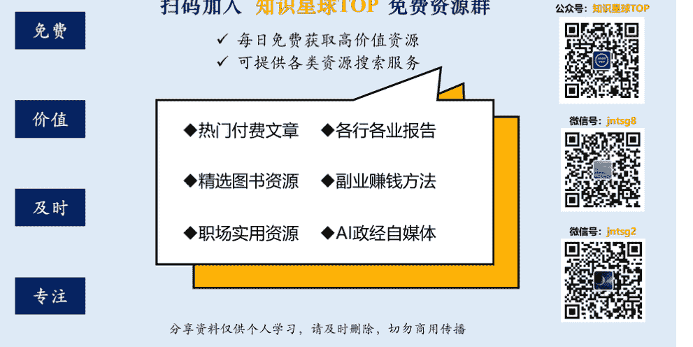

特朗普全面关税落下，美股崩闰，哀鸿遍野，然而，这些在《QI》《Q2》和《新奇普交易》系列研报已预测的清楚明白，对应策略实现集体翻倍，红包炸群。

加微信intsg2, 免费进资料分享群

## 红包炸群

当美股如期见顶，如期暴跌，接下来的，全球资本市场都难以“独善其身”，如果只能在单一市场（比如AH）单一方向（比如持多）。

那么，当泥沙俱下的时候，结果也只有释怀倾倒或者割肉离场。

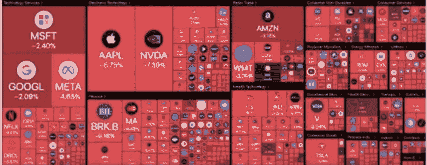

美股红色代表下跌--血流成河但事实上，“危就是机”。因为股票市场的收缩，往往意味着其他金融品类市场存在扩张的机会，即便在股票市场，反向做空也可以得到甚至超出过市暴跌的回报。

学习新的知识和技能并不难，尤其是美股暴跌和潜在的金融危机带来的漫长熊市——与其在暴雨中挣扎，不如去探索“春天的热带雨林”。事实上，国内3000点反复的次数如此之多，大多数国内经验丰富的投资者，锻炼积累的平均水平是高于国际水平的，不为，则者难，而为之，则难者易。

中国资本走向国际，中国的“渡边太郎先生”会成为一个庞大的群体，需要考虑清楚要不要参与。如果要参与，应该早点出发，并且需要做三个准备：

- 一是学习更多的知识，建立全球化的政治金融视野，看懂危机，才能“避危就机；
- 二是逐渐掌握不同的金融工具，做多和做空都能盈利，才能客观观待市场波动，顺势而为；
- 三是从蜻蜓点开始探索、熟悉、操练，逐渐成长为具有现代交易理论和工具的先进投资者。

我们正式步入“黄金狂”，而社群已经大幅领先市场实现了“危就是机”的演。“新货币战争”是进阶版的投研笔记，包括更深入的全球政治博弈分析、高阶金融模型，并且面向汇率、加密、黄金、股票为代表的全球主要金融资产。

| 系列 | 《新货币战争》核心内容 |
|---|---|
| 总论 | 美元什么是？“百年未有之大局” |
| 汇率 | 关税战下一步是汇率，怎么应对呢？ |
| 加密 | 新川普站加密货币的背后逻辑和未来趋势 |
| 黄金 | 黄金3300美元，是山峰还是谷底 |
| 股票 | 货币战争中的，有没有方向应该倾斜和关注？ |

在《2024Q1》以来的6个季度，我们实现了几近100%的准确预测，如今的组合收益已经超过200%，“我们不解读新闻，我们预测新闻”的验证太多的了。

科学有规律，社会有规律，天有天道，人有人道，如是，为什么投资不能找规律呢？唯学研实践，都应该得到应回报。

- 1. 《新货币战争》会给出一个最简单的应对策略。
- 2. 《新货币战争》和《新川普交易》会形成一个组合。
- 3. 对《季报》《新货币战争》《新川普交易》，计划5月（初步计划五一假期）期间进行一次线上讲解。

注：具体参与的资格和时间将在公众号发布。

市场开始热议“全面关税”，但有洞见的观点不多，而我们已经完成了第一阶段的收网。本周，我们分享下开启新货币战争的“全面关税”。

## 全面关税

《QI》发布的时候是24年12月，那时新川普政府还没有明确具体的关税举措，但《QI》已经指出了美股98%的概率要见顶并开启熊市。因此，理解“全面关税”的第一个前提是：没有关税，美股都要开启一轮熊市。事实上，对于主流国家和机构，美国爆发危机是“共识”。

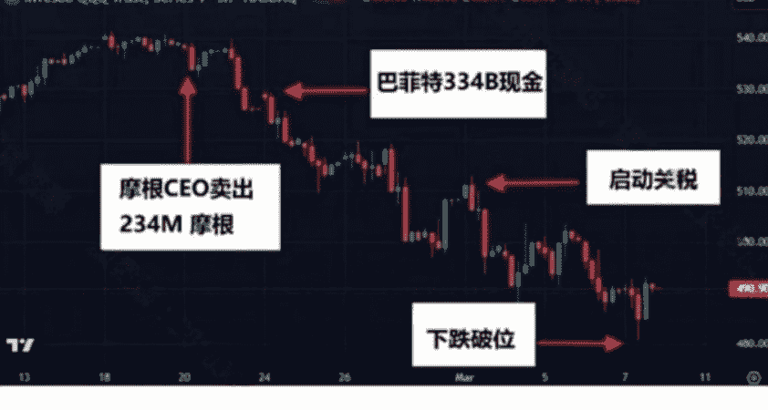

早在2月美股见顶的时候，华尔街头们已经精准完成了套现，我们反复强调“危机是一种蓄意的手段”，就像人们会感冒一样必然，而真正“恐慌”的只有全球韭民。

因此，新川普的“全面关税”，是在美国必然爆发危机的背景下做的应对策略，这显然不是能力不行的表现，实际上是“一掣四蛇”的明智选择：

一，美国爆发危机是系统性问题决定的，既然不能避免，那么就要把危机通过“全面关税”转移到全球；

二，新川普政府受限于FED，没有货币政策控制，也没有所谓的财政政策，全面关税实际是唯一用的策略，也是迫使FED降息的手段；

三，危机确定的情况下，现在不能完全确定的是谁会先倒下，成为幸存者渡危机的“养分”；“全面关税”增加了新川前拥抱(海湖关税同盟)、灾后重建的谈判筹码。

四，在“三”的基础上，驱动美国本土转移，实现制造业向美国普（《新川普交易》）做了详细分析。

《Q2》在2025年3月发布，讨论了“关税稍有不慎，美股崩盘触发金融危机；极端情况下，FED死活不息，政府还不起利，美债信用违约，新川普“无德无能”这名声先于人上。”这个U-1给新川“背锅”的契机，想办法不会错过。”目前，部分预测将其他国家验证。

| 新中国 | 新美国 |
|---|---|
| Dr. Thomas J. | Dr. Thomas J. |
| CHINA PLAYED, THEY PACKED THE ONE THAT CANNOT AVOID | THIS SHOULD BE A PERFECT TIME FOR China to cut Interest Rates to keep the economy from crashing. |
| My Administration has been working very hard to implement some progressive reforms. I have made an Executive Order to de-investigate Chinese companies. | I am making an Executive Order to de-investigate Chinese companies. | U.S. WANTS THE FEDERAL RESERVE TO LOWER RATES. Energy prices are DOWN, and stocks are UP. |
| I am making an Executive Order to de-investigate Chinese companies. | I am making an Executive Order to de-investigate Chinese companies. | I am making an Executive Order to de-investigate Chinese companies. | U.S. WANTS THE FEDERAL RESERVE TO LOWER RATES. Energy prices are DOWN, and stocks are UP. |
| I am making an Executive Order to de-investigate Chinese companies. | I am making an Executive Order to de-investigate Chinese companies. | I am making an Executive Order to de-investigate Chinese companies. We need to be more aggressive. | U.S. WANTS THE FEDERAL RESERVE TO LOWER RATES. Energy prices are DOWN, and stocks are UP. |
| I am making an Executive Order to de-investigate Chinese companies. | I am making an Executive Order to de-investigate Chinese companies. | I am making an Executive Order to de-investigate Chinese companies. I plan to de-investigate Chinese companies. | U.S. WANTS THE FEDERAL RESERVE TO LOWER RATES. Energy prices are DOWN, and stocks are UP. |
| I am making an Executive Order to de-investigate Chinese companies. | I am making an Executive Order to de-investigate Chinese companies. | I am making an Executive Order to de-investigate Chinese companies. | U.S. WANTS THE FEDERAL RESERVE TO LOWER RATES. Energy prices are DOWN, and stocks are UP. |
| I don't want China to “go on” with it. I want them to close the deal. | U.S. WANTS THE FEDERAL RESERVE TO LOWER RATES. Energy prices are DOWN, and stocks are UP. |
| China has to be cut for tariffs. Tariffs might need be considered for a better of inflation. | U.S. WANTS THE FEDERAL RESERVE TO LOWER RATES. Energy prices are DOWN, and stocks are UP. |
| 1. Tariffs are higher than expected and | U.S. WANTS THE FEDERAL RESERVE TO LOWER RATES. Energy prices are DOWN, and stocks are UP. |
| 2. so soon to determine appropriate policy | U.S. WANTS THE FEDERAL RESERVE TO LOWER RATES. Energy prices are DOWN, and stocks are UP. |
| 3. Tariffs could need be well-positioned for what | U.S. WANTS THE FEDERAL RESERVE TO LOWER RATES. Energy prices are DOWN, and stocks are UP. |
| 4. Economic impacts of larger tariffs than expected | U.S. WANTS THE FEDERAL RESERVE TO LOWER RATES. Energy prices are DOWN, and stocks are UP. |
| 5. Must ensure price hikes do not like de-investigate | U.S. WANTS THE FEDERAL RESERVE TO LOWER RATES. Energy prices are DOWN, and stocks are UP. |
| 息动态软化 | FED 死活不降 |

“全面关税”，是大鱼吃小鱼，符合剧本；我们早已在去年BRICS会议上建立了防线，配合我们优先扩大规模。

## 二、全球资产跟踪

（一）美股
全面关税落地，各国表态落地，FED表态落地，接下来的，韭民们完成半路抄底和恐慌接盘；总会有国家加入美国关税同盟，“赢了”，所以，美股要阶段修复。

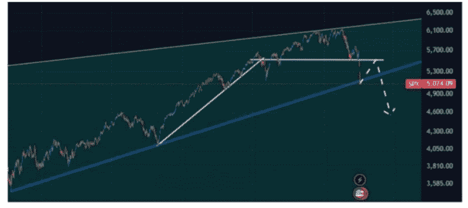

（二）美元
关税落地后，美国持续一段时间的通胀是必然的。美国出口按照金额排序，依次加拿大、墨西哥、中国、德国、英国，这些国家都会降低对美国的进口并实施进口或者国产替代，长期降低对美元的需求。这种“弱美元”的趋势预期，是迫使FED降息的真正压力，这也是FED坚持不息的根本原因。此时，短期内，贸易因关税而需要更多的美元，因此，只要控制货币的FED不降，美元在危机前试图保持坚挺。

（三）黄金
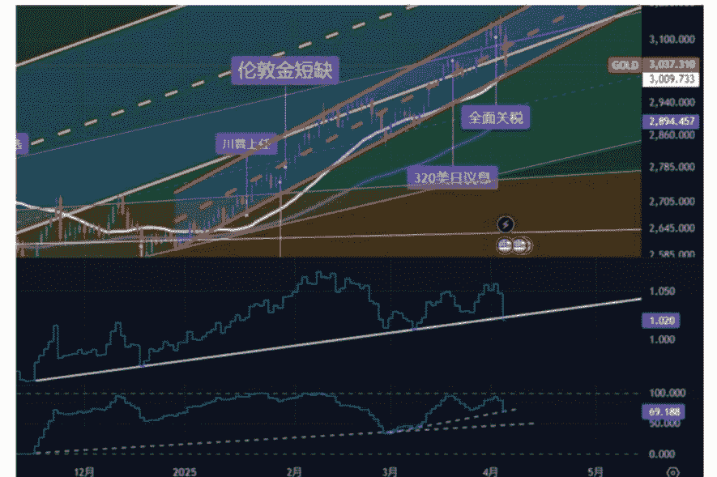

我们在清明节前提醒社群降低对黄金的关注，因为美股暴跌导致恐慌指数VIX走高，所有金融资产出现短期流动性紧张，所有大宗几乎都被被动调整，如所预见，黄金同样被动调整落入关键支撑位。黄金处3000美元以上的高位，很多人会恐高，加上“关税迷雾”状态，如果继续出空恐慌。

（四）加密
作为风险资产，现在风险加大的环境下，加密很难；作为避险资产，那今年已经大幅度输黄金；趋势上，继续看向加密。

## 三、AH判断

跟踪我们的读者，已经很熟悉我们的评估体系了，我们过去几周的预测也充分得到了验证。

在《QI》《Q2》描述的背景趋势下，现在全面关税落地后，美股暴跌的影响会在周一开盘“立竿见影”地传导，而中美开始双边关税升级，意味着GTD要适时“干脆落地”地予以坚决的守护。近期，我们波段仓位的建议是“持币”，因为下周初大概率我们可以期待一个凌厉的深V，可以关注一下机会。

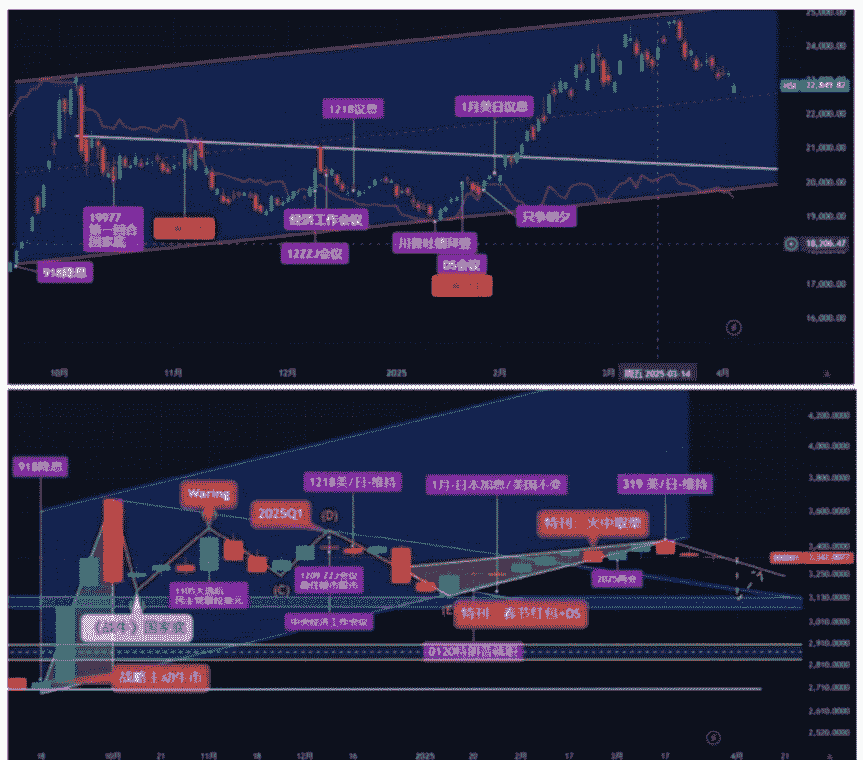

大的宏观背景符合《Q2》预测的趋势，具体路径等GTD设定防御守线后，进一步研判意图。

《2024QI》至今，我们的预测保持在近乎100%的准确率，这个过程，也跟随市场，同步了我们的投资思考：
1. 如果投资是一件锦上添花的事，就不要折腾，选对方向，让他去波动，无非冬去春，考验的是定力；
2. 如果投资是一件充满乐趣的事，要随波逐流，那就要下决心付出更多努力，提高认知，配置就是残酷的。

| 品种 | 累计涨幅 2025年4月日-2025年4月日 |
|---|---|---|
| VIX | -10% | 0% | 30% | 70% |
| 美元 | -11% | -39% |
| 无国指数 | -14% |
| 美股 | -46% |
| 亚豆 | -5% |
| 美油 | -26% |
| 醇 | -28% |
| 粕 | -78% |
| CMX黄金 | -95% |
| 螺铜 | -21% |
| 白银 | -39% |
| 美酒 | -68% |
| 景 | -02% |
| SGX矿 | -27% |
| A50(SGX) | -57% |
| A50期货(USD) | -97% |
| 糖 | -23% |
| 美油 | -09% |
| 铜 | -81% |
| 现期品种 | -26% |
| 油 | -32% |
| 美股 | -59% |
| 棉500 | -11% |
| CMX台指 | -42% |
| 纳斯达克 | -44% |

“全面关税”，是大鱼吃小鱼，符合剧本；我们早已在去年BRICS会议上建立了防线，配合我们优先扩大规模的先手。关税破坏了WTO秩序是一个“避危机”反收割的难机会。

全面关税落地，各国表态落地，FED表态落地，接下来的，韭民们完成半路抄底和恐慌接盘；总会有国家加入美国关税同盟，“赢了”，所以，美股要阶段修复。

## 四、技术分析

（一）美股
1.标普500：日线级别
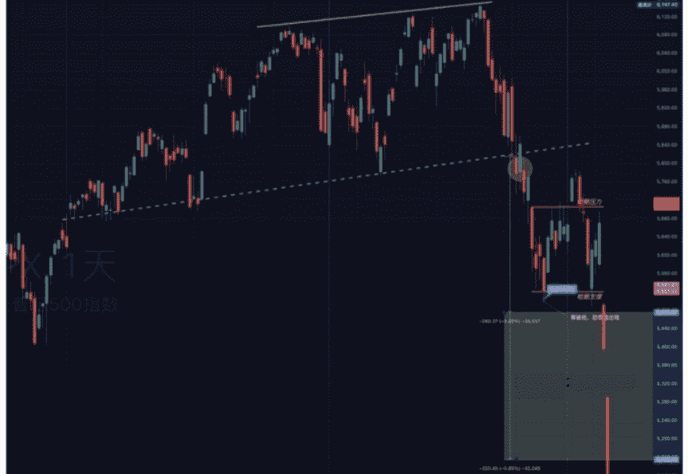
破低5504.65加速下跌，日线级别2段跌幅满足，当前74。从头的规模观察，2段跌幅合理，当前3段跌幅区间，技术角度有反弹的需求，压力155。需要注意，04/02在恐慌情绪下，跌穿了更大头部颈线。虽然日线级别头部达到满足，但更大的头部型正在确认，空间正在展开。

标普500：周线级别等待周线确认跌线的有效性，基准：
(1) 反抽不过颈线
(2) 反抽站上颈线，再次有效破考虑到周线级别因为恐慌直接杀一段跌幅满足并不见，跌幅有两种统计方法，目前使用第二种，具体如下：
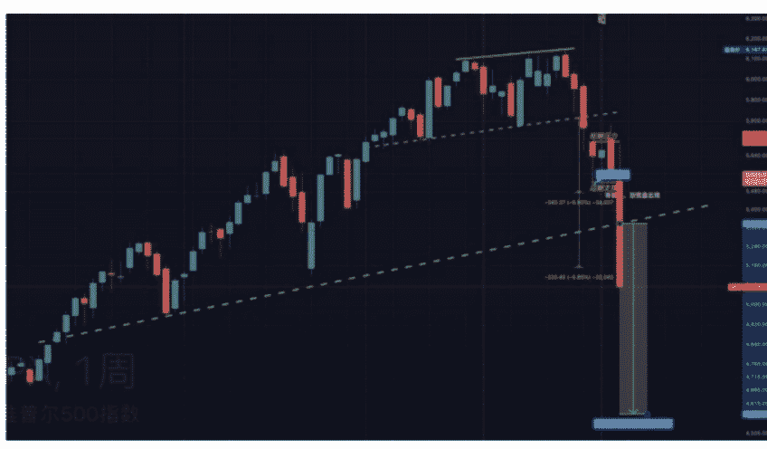
综上：日线级别不追空，周线级别等市场确认空单场场位置。

3.纳斯达克指数：日线级别
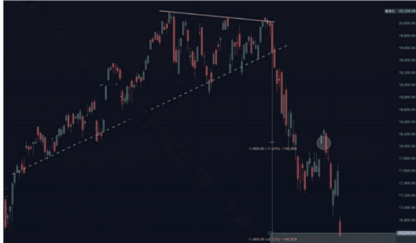
破低17238.24加速下跌，日线级别2段跌幅满足，目前15587点，位于第段跌幅区间，满足点15125.46，从头的规模观察，3段跌幅合理，但不满足（短线不宜空，超跌反弹随之就会出现）。需要注意，04/02在恐慌情绪推动下，跌穿了更大级别的头颈线。虽然日线级别3段幅度接近满足，但更大的头型正在确认，意味着日线级别幅度满足，也许本轮下跌的终点。

4.纳斯达克：周线级别等待周线确认破颈线的有效性，标准：
- (1）反抽不过颈线
- (2）反抽站上颈线，再次有有效破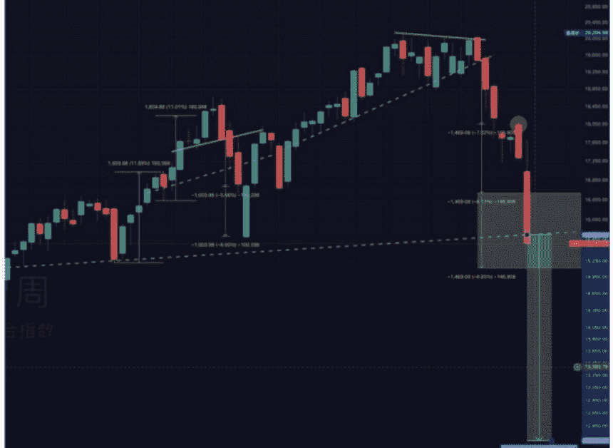
综上：日线级别不追空，周线级别等市场确认新的空单场位置。

5.道琼斯指数：日线级别道琼斯确认头部形成，日线级别段跌幅满足，目前38134.87点。从头的角度观察，2段跌幅合理，目前段跌幅满足，短线有反弹需求，未来还要第2段。

6.小结：
美国三大指数头部确认，在04/02事件催化下，刺破了财富效应的泡沫。财富效应泡沫破裂，预计消费者信心(美国咨会消费者信心、密西根大学消费者信心）、信贷违约率都会恶化。

（二）黄金
1.月线级别：
测幅有两种统计方法，上周发布的是第一种，本周发布的是第二种。两种方法的区别，主要在于第二段的时空跨度会不同。如图所示：
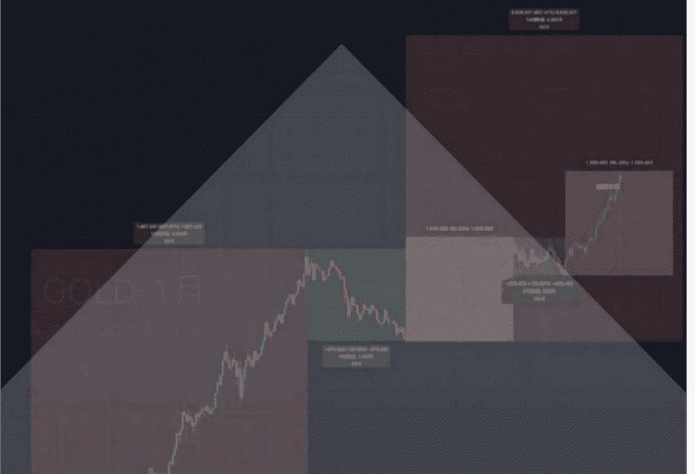

第二段上涨的时空区间，第二段幅(黄色区域)接近满足点，意味着短期不宜追涨。左侧第1段幅满足，调整时间。

820个自然日。这意味着当前是一个心理阻力位。
《新货币战争-黄金》会进行多模型耦合解析黄金周期走势和逻辑。

### （三）BTC
1. 日线级别：
大型头部成型，有效突破，一段跌幅满足后超跌反弹，3/30确认反弹结束。
超跌反弹结构破位，构成2段小级别下跌空间，目前位于第1段空间内，足点80607。

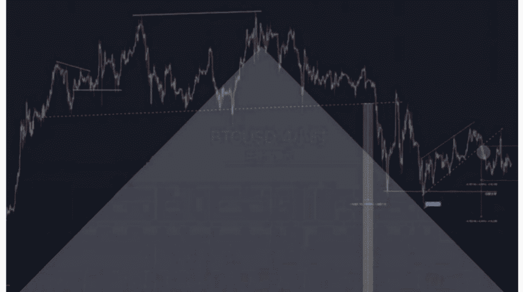

目前BTC相对强势，面对04/02带来的全球恐慌抛售冲击，超跌反弹结构破位的小级别下跌结构都没有跌破，值得观察。
短期支撑：79052
破低76555，加速下跌。

### （四）美元指数：日线级别
1. 头部型结构，小头部型结构，2段跌幅满足，足点101.907，低点101.267。
复合头部型结构，1段跌幅基本满足，足点103，低点101.267。

美元突破压力104.27，3/28再次跌破，回测重要支撑103.4破位。

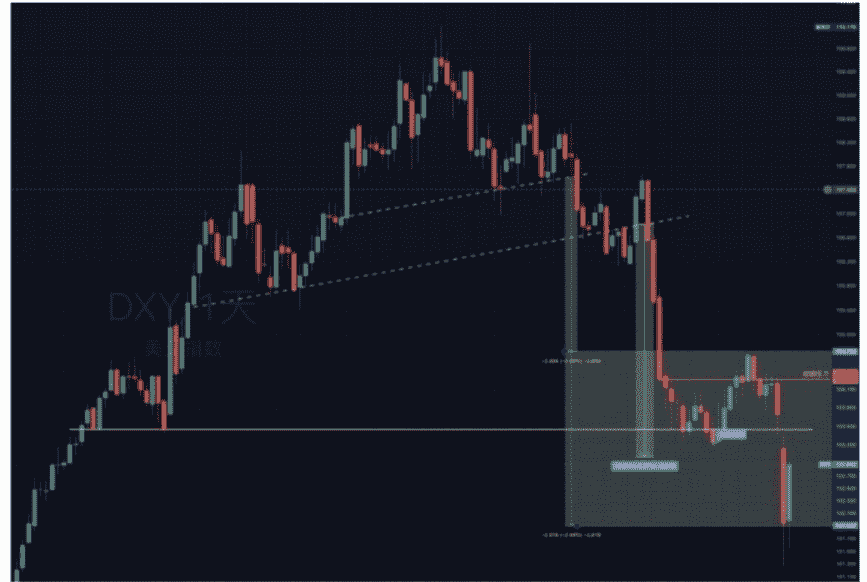

超跌反弹已出现，支撑101.907，压力103.4

### （五）恒生指数
1. 恒生指数：日线级别

恒生指数头部结构基本成型，等待颈线破位进行确认。

反弹不过短期压力构成小级别离型，目前2段下跌测幅接近满足，足点22468。

走势结构已经更加清晰，短期支撑、短期压力精简合并后如图所示：

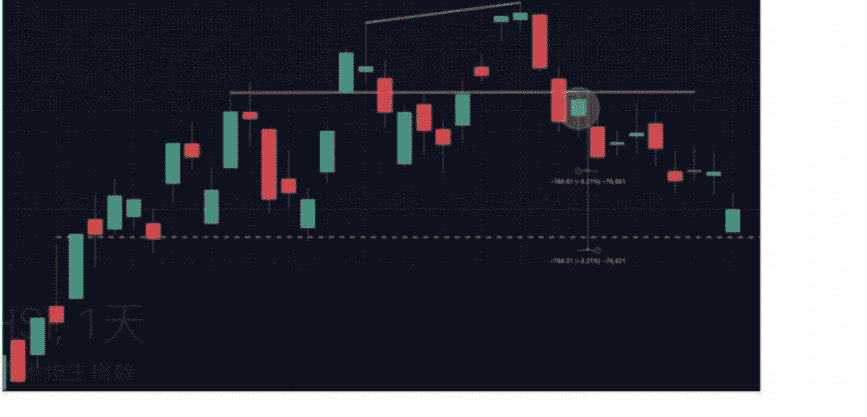

### （六）恒生科技指数
1. 恒生科技指数：日线级别

恒生科技指数头部结构成型，颈线已确认破位。测幅有两种统计方法，目前使用第一种，具体如下：

### （七）大A
1. 上证指数：日线级别

正在构筑头部结构，可能无法支撑变盘窗口4/16。

04/02以来全球指数承压，上证指数已经来到短线支撑3323。如有有效破位，按颈线破位头部成型判定，可测幅下跌空间。

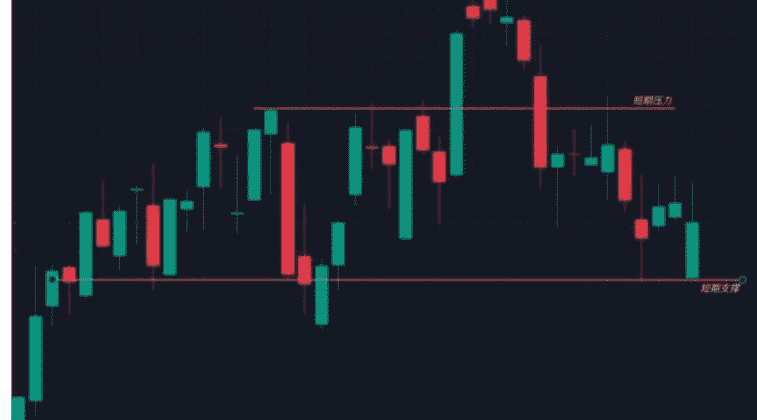

2. 上证50：日线级别

正在构筑头部结构，指数承压，短线支撑2608。如有有效破位，按颈线破位头部成型判定，可测幅下跌空间。

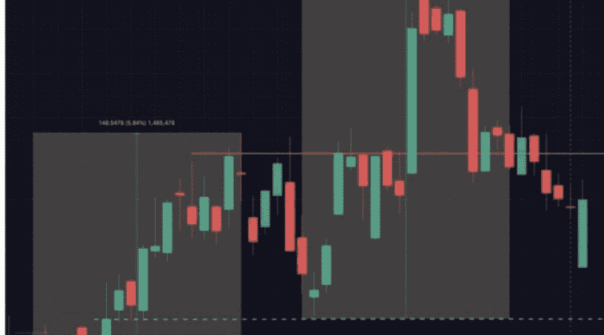

3. 沪深300：日线级别

在构筑头部结构，指数承压，短线支撑2608。如有有效破位，按颈破位头部成型判定，可测幅下跌空间。上周反复测试支撑3914,03/25破位后一路走低。第三段涨幅底部支撑3855,04/03跌破，终止第三段涨幅测幅。

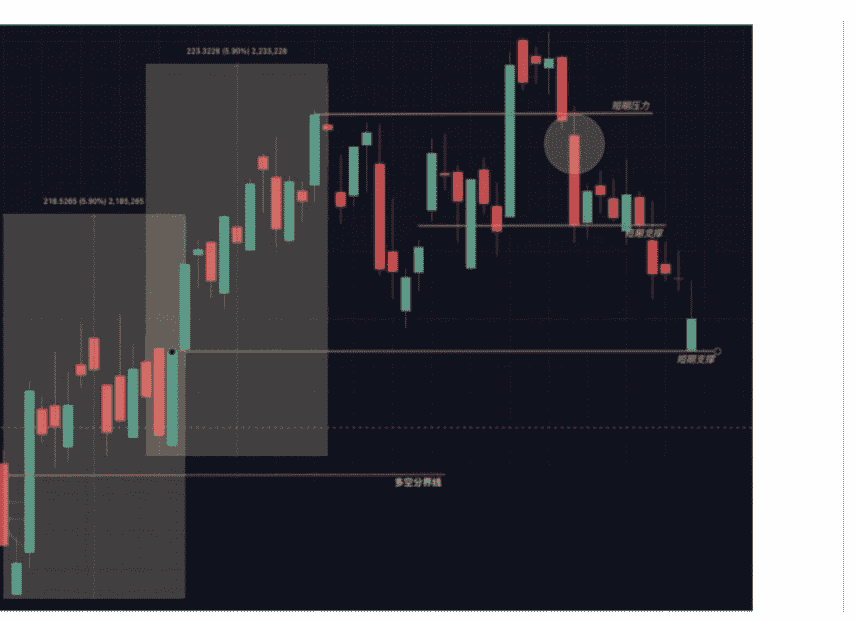

4. 中证500:日线级别

在构筑头部结构，指数承压，短线支撑5814。如有有效破位，按颈破位头部成型判定，可测幅下跌空间。

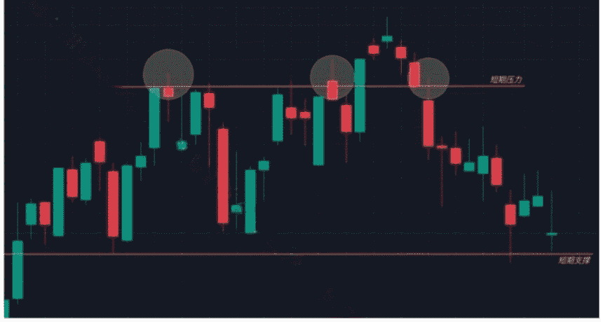

5. 创业板指数:日线级别
上周反射不过压力构成小级别离型，目前2段下跌测幅接近满足，足点22468。
走势结构已经更加清晰，短期支撑、短期压力精简合并后如图所示：
短期支撑1960，压力2065。

6. 科创50指数：日线级别
头部结构破，第一段跌幅满足978，预计下跌会加速。

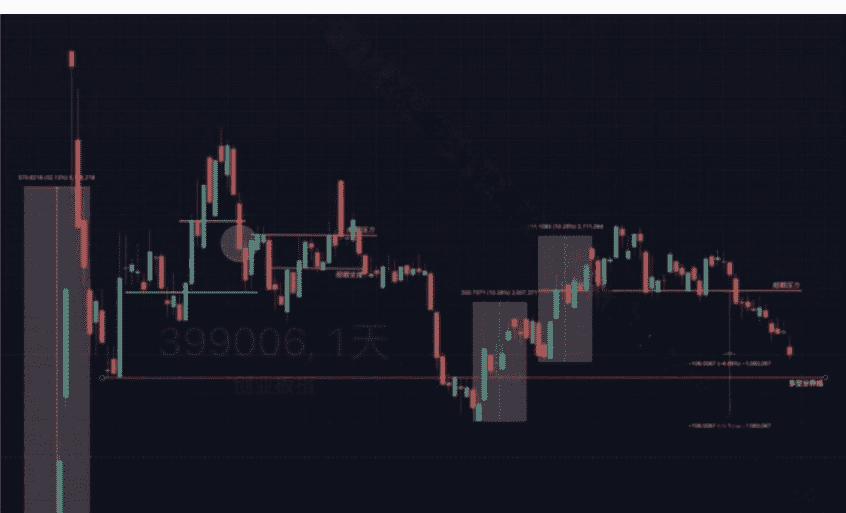

五、A-GIX(测试)
上周判断：考虑到目前成交量回落至2万以下，大原则是以防守为主，要防止成交量持续萎缩的风险，最大程度降低损耗；同时也要防止美股下跌带来的冲击。实际走势基本验证，市场成交量萎缩至1万附近，成交清寂；美股大跌。下图为A市场上收盘指标情况(新增“波动”监控):

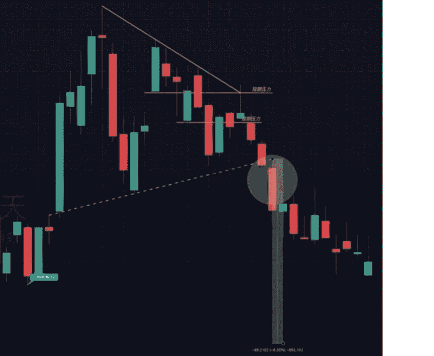

“情绪监控先导”已经触及，“情绪趋势”、“情绪监控”两项仍在中位线以下缓慢行，对应的盘面是震荡，上证指数、科创板、中证200、微盘股等前三天均修复。但图中新增的“波动”监控指标目前处于空头趋势，自3月24日之后加速线下，均线向下发散，整体制约行情走势。

综合考虑节间“全面关税”，下周建议如下：

- 下周“波动”监控指标会有修复，此行为转好基础；
- 仓位仍以防守为主，周初观察，如果盘面恐慌，可以小部分分位低吸；仍以科技为主。

同时，建议美股后做空。原因见如下：

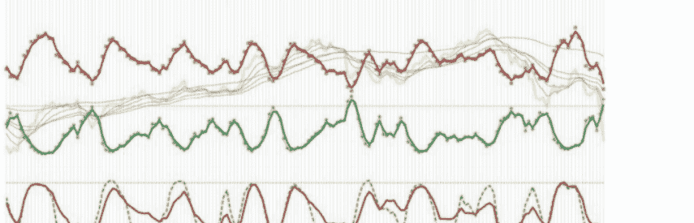

# 免费 价值 及时 专注
# 扫码加入 知识星球 免费资源群
- 每日免费获取价值资源
- 可提供各类资源搜索服务

| 热门付费文章 | 各行行业报告 |
| 精选图书资源 | 副业赚钱方法 |
| 职场实用资源 | AI政经自媒体 |

公众号:知识星球 微信信号:jntsg8 微信信号:jntsgj2

分享资料仅供个人学习，请及时删除，切勿商用传播
