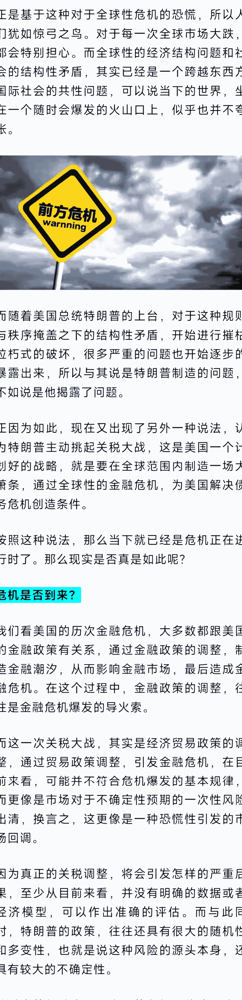
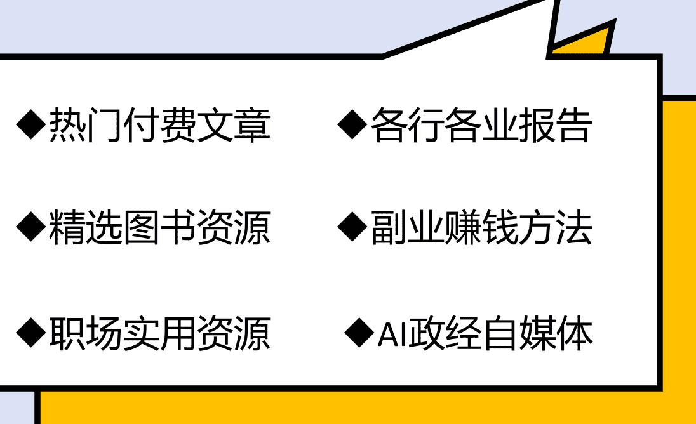
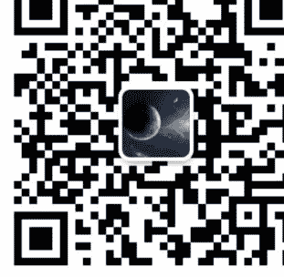

# 大跌暴后，我们还能等多久？我们已经经历过多少年

作者 冯源

全文：我们已经经历过多少年

在股市的大跌中，最痛苦的不是下跌本身，而是这种不知道什么时候结束的焦虑。我们还经历过多少年？去年纳斯达克指数已经暴跌了50%左右。

这种痛苦，我们已经经历过很多次了。但是，大跌暴后，我们还能等多久？

但是，下跌也意味着机会。在很多投资者的眼中，下跌意味着入场的机会，下跌意味着加仓的机会。

但是，其中有一个关键的问题是：我们如何确定现在已经跌底了？

所以，在下跌的过程中，我们该如何判断是否已经跌底了？

## 如何判断跌底

在下跌的过程中，大多数投资者都是采取恐避下跌的策略，或者是越跌越割肉，或者是在不断补仓。

但是，还有一个事实是，下跌往往不是线性的，而是震荡式的。在下跌的过程中，往往伴随着频繁且剧烈的反弹。

很多人在这样的反弹中误以为市场已经跌底了，从而在反弹中入场，结果随后又遭遇了更深的下跌。

其实，只有当市场处于极度恐慌，市场情绪变得极度悲观的时候，我们才接近跌底。

那么，我们如何判断市场是否处于极度恐慌呢？

从历史来看，每一次大跌都伴随着巨大的恐慌。在这种恐慌中，人们会失去理智，甚至要抛一切。

第64章

林远：对自己的心里很有底了，总感觉个人现在越来越自信，有了新的开始，再来一次吧！

林天：说实话，你还生气我吗？

小晴：少说了，还不是生气了吗？

苏晴：你不是在生气我了吗？

林远：我怎么会生你的气呢？

苏晴：我也在想你，吗？

林远：那周末我们一起去看电影吧？

苏晴：好呀，那说定了！

林远、苏晴、林远、陈小雨：这也太甜了，磕我狗了！

苏晴、林远：你什么时候也谈个对象啊？

苏晴、林远、苏晴、林远、苏晴、林远、苏晴、林远、李小萌：我也去休息了，晚安。

张小晴：晚安，小萌。

王大美：晚安，小晴。

李小萌：晚安，大美。

张小晴：晚安，小萌。

王大美：晚安，小晴。

李小萌：晚安，大美。

张小晴：晚安，小萌。

王大美：晚安，小晴。

李小萌：大家都在晚安啊。

张小晴：我也要睡了。

王大美：晚安，大家。

李小萌：晚安，大家。

张小晴：晚安，大家。

王大美：晚安，大家。

李小萌：晚安，大家。

张小晴：我也要睡了。

王大美：晚安，大家。

# 免费 价值 及时 专注

# 扫码加入 知识星球TOP 免费资源群

- 每日免费获取价值资源
- 可提供各类资源搜索服务

| 热门付费文章 | 各行行业报告 |
| :--- | :--- |
| 精选图书资源 | 副业赚钱方法 |
| 职场实用资源 | AI政经自媒体 |

公众号:知识星球TOP 微信信号:jntsg8 微信信号:jntsg2

分享资料仅供个人学习，请及时删除，切勿商用传播
