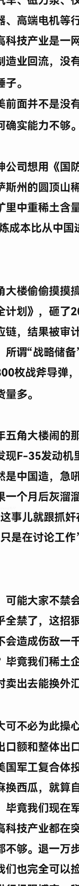

# 马来西亚出口禁口，美国害怕了？

事实上，从2023年开始，中国限制矿产出口，2024年再次加码。这说明，矿产出口政策已经发生了巨大的变化，但这种做法并没有动摇到全球供应链的稳定性。

在此刻，马来西亚也陷入了同样的困境。

采取了以下措施：

马来西亚宣布将禁止矿石出口，从2026年1月1日起，所有矿石都将禁止出口。这包括锡矿、稀土等。由于马来西亚是全球最大的锡矿出口国，此举无疑极大震动了它的产业结构。

除了锡之外，马来西亚还有稀土、铝土、石英等多种矿产。由于马来西亚也是全球最大的稀土出口国，此举无疑会对美国造成巨大的打击。

面对这一局面，美国感到非常头疼。由于马来西亚的稀土出口占了全球的35%，美国该如何应对？

但是，马来西亚的稀土出口减少了，美国真的能找到替代方案吗？

那么对于美国国家会有何应对？
