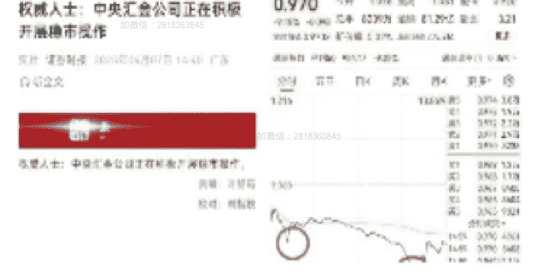
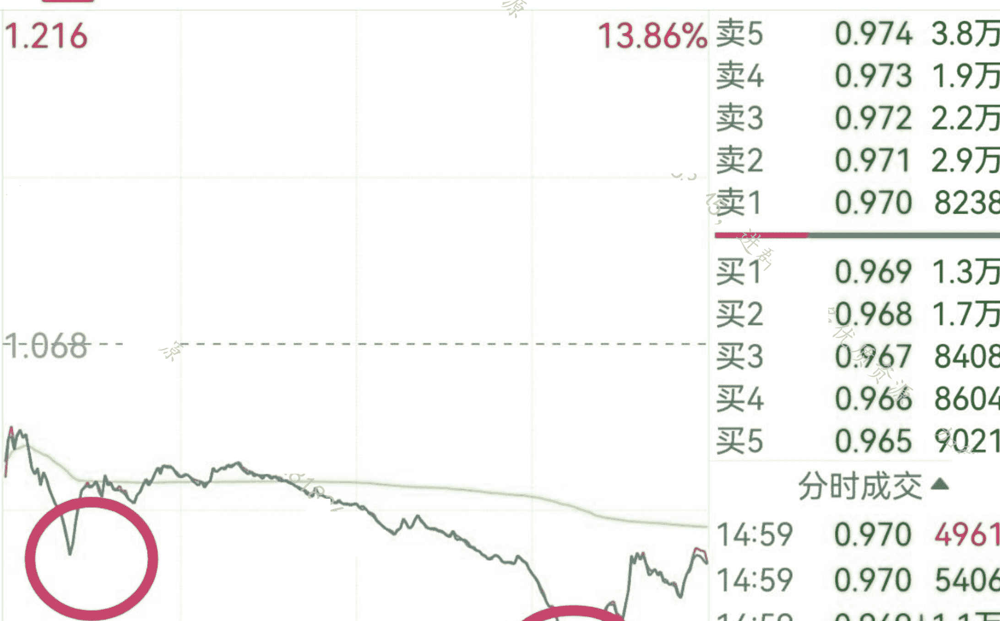

# 南院大王

2025-04-07 15:22
权威人士又出来了

上次出现权威人士，还是鹤公。

权威人士说汇金在操作，

汇金很忙，股债汇都要保，

保外汇，其实是保所有人的身份和民生。

今天股市拉了吗？拉了，

一次9.50，一次2.20，如图。

所以早说要趁10点前减仓，没有满仓站都减。

但抛压盘太大，量化和爆发仓的一起出来，加速速，国家队站不住。

现在最难受的是机构和量化，散户可以随时跑，机构跑不了，量太大。

但他们厉害的地方在于，亏了可以冷静地去复盘检查，然后继续等待机会。

所谓的常胜将军，不是不会输，而都是善战之将。

好消息，今天放量成交1.59万亿，

终于等到了久久的放量下跌，

情绪和压力都宣了大半，

这几天观察在用力扫购结果被大盘砸下去就过去了，过几天企稳了它们又是先锋，

技术上看周期四周企稳，

重要标志包括，动员开会，再发利，降准降息等等，把操作落到位。

## 收起

必胜：现在这种情况，不要博反弹，形势太复杂，能跑起妥距离，等市场稳定再来

2025-04-07 01:25:24

敏捷回复必胜：早稍平了

2025-04-07 01:15:30

明天清水水木济济回复必胜：已经心惊动摇想要搏腾进去，就怕捡的又成了捡的

2025-04-07 01:16:33

上下请求：有事情没明白，既然大等等后击后，美股后几天的走势比提前提醒，按我A 应该会有基本的行情预判，为哈错在节日期间释放政策红利，在周一前率先推出控制措施呢？放任恐慌情绪释放，真的是个优选项

2025-04-07 01:16:38

丰年：有的好

2025-04-07 01:16:47

南南大王回复上下请求：上面认为大家有信心，下面认为上面有信心。早上说的好极不概率泰不来。

2025-04-07 01:16:56

小字回复南南大王：一个认为对方会走，一个认为对方会挽留。A大是什么狗血剧情都有

## 权威人士：中央汇金公司正在积极开展稳市操作

贾壮 证券时报 2025年04月07日 14:40 广东

听全文

权威人士：中央汇金公司正在积极开展稳市操作。

责编：叶舒钧

校对：刘榕枝

## 科创50ETF

0.970 今开 1.016 最高 1.031 最 0.920

-9.18% -0.098 总手 8239万 金额 81.29亿 量比 3.21

实时估值 0.9702 折价率 0.02% 最新份额 775.2亿 更多

跟踪指数 科创50 924.17% -9.22% 跟踪误差 0.05%>

分时 五日 日K 月K 更多

| 档 | 价格 | 数量 |
| :--- | :--- | :--- |
| 卖5 | 0.974 | 3.8万 |
| 卖4 | 0.973 | 1.9万 |
| 卖3 | 0.972 | 2.2万 |
| 卖2 | 0.971 | 2.9万 |
| 卖1 | 0.970 | 82388 |
| 买1 | 0.969 | 1.3万 |
| 买2 | 0.968 | 1.7万 |
| 买3 | 0.967 | 8408 |
| 买4 | 0.966 | 8604 |
| 买5 | 0.965 | 9021 |

分时成交：

14:59 0.970 4961
14:59 0.970 5406
14:59 0.969↓ 1.1万
14:59 0.970↑ 8900
14:59 0.970

0.920 成量 8239万

用户名提问：大王好，想问一节后后如何操作，农业股票需要些？谢谢。

控制仓位，不要乱抬头，先看为主，肯定低开，大盘缓慢跟恒生科技指数，静待团队低开高走。支撑位看320—一线。农业不用，持续性不行，估计要调调消费。

最后编码：2025-04-06 20:53

Daidai：探路者牧高笛
2025-04-06 20:34

升平四海：琥
2025-04-06 20:37

向阳而生：科创芯片etf 还能吗
2025-04-06 20:39

A沃望眼镜口：国资名山是哪些
2025-04-06 21:07

南侯大王 回 A沃望眼镜口：有苦萨的山
2025-04-06 21:18

sk 回 南侯大王：峨眉 山 ⛰️
2025-04-06 22:07

A沃望眼镜口回 南侯大王：[] 了
2025-04-06 22:15

afan 回复 sk：鸭荔山 玖崂山 ⛰️
2025-04-07 21:17

小米：峨眉山、永辉超市
2025-04-06 21:12

往 情：关键词低开高走🥰
2025-04-06 21:48
