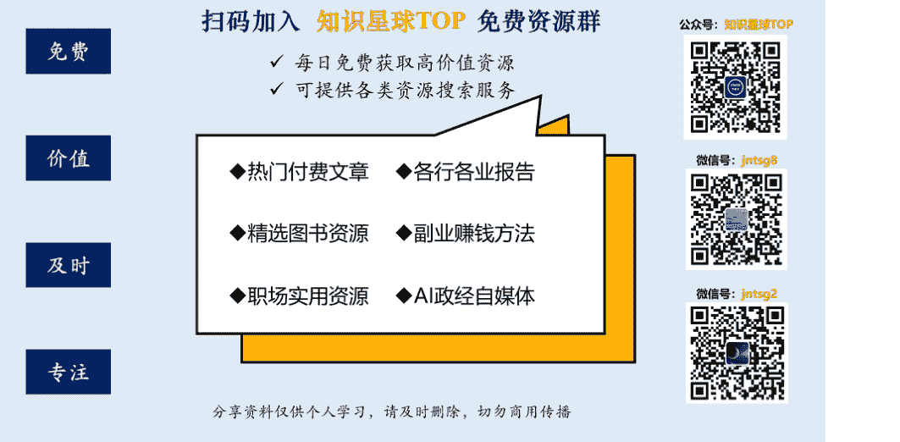
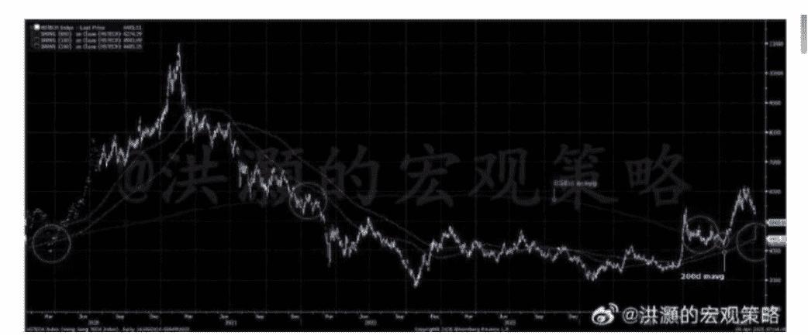
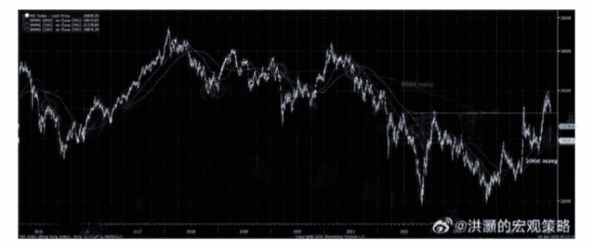

# 关键时刻

# 20250408 洪源

# 特朗普疯了。

昨夜，美股出现了一个非常罕见的盘中逆转。标普期指在盘前暴跌了约5%之后迅速快速拉升，然后再次回落，全天以略低收盘，单天的振幅高达8.5%。这样的盘面，如果我的记忆没有出错的话，应该只有在2008年全球金融风暴的时期才出现过。

如此暴力的逆转再逆转，皆因昨夜市场传闻特朗普将要延迟关税90天，但最终被证伪了。即便如此，标普还是在略高于4800点的位置开始技术反弹，暂时站住了这个我们在这次史诗暴跌之前预测的、“一天就能到位”的关键点位。

继前一个交易日的260多亿量成交之后，美股昨晚的成交量继续创造历史新高，大约280多亿易手。标普的末日期权，从开盘暴涨29倍，到后来收亏85%割肉离场，也是昨晚乱纪交易的一道“靓的风景线”。

不仅是股票，昨晚长期美债的成交量也是数据以来最大的。同时，特朗普对于中国极限限施压，威胁如果中国不马上取消34%的对等关税将再加50%的额外关税，并暂停一切谈判活动。美债十年收益率马上飙升到4.1%以上，同时美国公司高收益债收益率的价差也飙升到2023年10以来的高点。其速度也是近年来最快之一。

连续三天，VIX市场隐含波动率的飙升速度为历史前五，共飙涨了120%，一度暴涨到60以上。这是历史上唯一几次VIX到了这个高度，显示出市场系统性的高企。显然，关税引发的对于通胀前景的担忧，很大程度上抬高了短期内潜在的通胀压力。如果短期通胀上升，那么实体经济价格的波动性上升。这时，系统的不确定性随之上升。在当前美联储货币政策择两为难之间，通胀预期高不下显然不利于股票市场的。

中国市场也运行到了关键位置。

以下内容仅V+会员可见
特朗普对于关税谈判的肆意妄为，让人们越来越看清楚美方的真实意图。昨天在空军一号的媒体访谈中，特朗普认为贸易赤字是一种“损失”（trade deficit is loss)。因此关税是必不可缺的手段回到贸易平衡。在最近的一系列专属报告中，我们指出了贸易平衡是一揽的全球性平衡，而不是国与国之间的绝对对称平衡。每个国家的经济发展程度不同、劳动生产率不同、自然禀赋不同，因此在各个领域的相对优势不同。而国际贸易正是通过互惠贸易让全球分工协作的最优系统。

特朗普没有看的是，美国的贸易赤字并非中国制造过于强劲，而是美国制造缺乏竞争力。通过关税，是无法改变中国十年如一日积累出来的这种相对优势的。然而，特朗普对于贸易赤字的这种误判，并齐头铁般坚持，将很容易把全世界都带到兜里。难怪特朗普自己亲口说，“我的孩子是白脑，缺乏常识也不懂和人相处。只求他千万不要从，否则将是一场灾难”。

港股恒指和恒科已经运行到了850均线和200天均线的交错位置(如图)。同时，昨日港股的历史上第二大单暴跌，从前几次反弹的高点开始跳水，直接GapDown跳到这个850和200天均线的交叉位置，显示了这个位置的重要性。港股超卖的程度，已经与历史上几次低点相当，接近于2022年3月封控期间的水平。那时，全球的贸易戛然而止。现在，美国出口占中国出口的~13%，与其它国家的贸易如常进行，并很可能在美国关锁之后大幅上升。那么，现在观察到的价格的显著性，洞若观火。

# 恒科在850/200关键位值

# 恒科在850/200关键位值

短期，无论如何，在这个位置上应该有技术反弹：国家队将继续出手稳定市场，利率将很快下调，促政策也将很快出台。当然，这一切都将在特朗普关税的背景噪音和负面的新闻条条中进行。市场风高浪急，交易逆水行舟。

# 免费 价值 及时 专注

# 扫码加入 知识星球TOP 免费资源群

- 每日免费获取有价值资源
- 可各类资源搜索服务

| 热门付费文章 | 各行行业报告 |
| 精选图书资源 | 副业赚钱方法 |
| 职场实用资源 | AI政经自媒体 |

公众号：知识星球TOP 微信号：jntsg8 微信号：jntsg2

分享资料仅供个人学习，请及时删除，切勿商用传播
