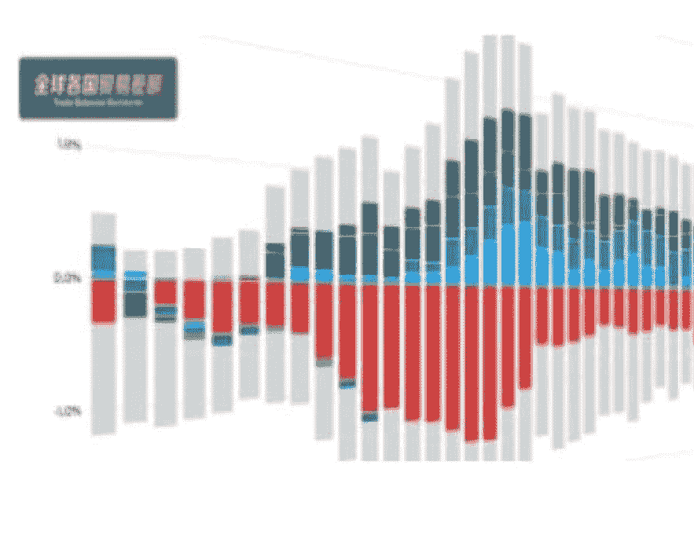

# 守夜人总领付费250410：懂王要妥协!

有一个被大家忽视的细节，但是这个细节却起决定性的作用：美国是全世界的货币输出国，也是全世界各国的贸易顺差对象。文章最后那张图，你就会发现这个结论是对的！

美国社会没有文化的那个群体认为是自己吃亏了，认为为全世界卖东西给美国自己，唯独从美国自己这里买东西，其实全世界都买了美国他们的东西：美元！美元本质上也是一种商品。

全世界各国向美国输入商品和服务换取美元，美国向全世界输出美元换取商品和服务，这个循环对美国人并没有什么坏处，事实上这个循环可以利用美元这种特殊的商品以倾斜的方式收割全世界，也就是说，彼此在交换的时候美国反而可以获得更多，但是存在一个前提条件：就是美元能够正常的流回来！

如果美元不流回来，会怎么样呢？美国社会为了维持自己的运转和需要，就需要增加货币供应，否则拿什么去购买必要的那些东西呢？如果越意的美元滞留在外面，没有及时的流回来，那么美国社会要投入的货币就会越来越多。美国会产生两个后果：1.债务规模和水涨高利的利息负担，2.内部购买力下降造成的通货膨胀。

加微信intsg2 免费资料群

不管是购买美国国债，还是华尔街买筹，不是外部资金回流美国的一种方式，问题就在于这两年上面的方式都跟不上美国扩大债务规模的节奏。2008年伯马上台美国国债10万的时候超过25万，在2025年正在迈向33.5万，利息超过800亿，比美军的军费还高，在这种情况情况下，美债不仅卖出去，主要债主还在减少持有的规模，所以这些只能在华尔街不断的造科技概念去吸收资金，然而，一旦有人在科技领域不说超过你，就算和你差差不多，有了一种新的替代，那么你这些面向未来的概念对全世界吸引资金的能力就会打折扣。

这恰认为是什么中国不遗余地追求 DeepSeek深度模型的原因，更加高调地展示中国自己的科技成果和产品的原因：只是为了告诉世界，美国的那些东西我们中国也有，如果美国的那些东西值钱，中国的这些东西也值钱，我们至少可以分一半，所以美国他们的那些东西就没有那么值了！

有什么反手段呢？还确实没有！因为现实中的东西不是一朝一天能够出来的，而是一环一环互嵌套套形成的综合效率和综合性成本的体现。唯一能够用来反击的就是自己不可替代的优势：贸易逆差。

为什么贸易逆差成为优势呢？因为贸易逆差存在于买方，而不是卖方，美元对美国国内来说是货币，美元对全球来说是商品，因为目前为止，

加微信ints2，免费进资料群

其他国家之间的贸易基本上都需要美元结算，于是美元就变成了一种必需品。欧元曾经试图扮演美元替代品的作用，经过2022年2月开始的俄乌冲突三年，欧元从接近40%降到20%的份额，现在的份额连欧元区内部的所有贸易都覆盖了，各国在能源方面还需要用美元结算。当欧元的威胁解除以后，美元更成为各国的必需品，人民币替代美元的威胁呢？不存在的！

为什么人民币不具有替代美元的威胁？不是因为你要输出货币，要输出商品，不可二者同时输出时都占大头。为什么呢？你把货卖给别人从别人那里挣钱。每一年的巨贸易顺差都是从别人那里获取资金，本质上是对对方输出货币，不管这个货币是什么货币，你在输出商品。你输出的商品越多，利润就越高，你从对方那里获取的货币就越大而对你的货币需求量就越小。贸易逆差，意味着两相抵消美国要要给你。只有贸易逆差才会扩大输出货币量，这就是为什么美元在全球其他国家的贸易逆差的现象，因为美国要不断向外输出美元，需要向全世界买买卖，才能持续扩大美元的规模。

如果美国停止持续输出美元，那么全球贸易必然萎缩，因为其它国家之间进行结算所需的美元减少了，而美元是结算的必需品！当然，大家也可以寻找新的方法来结算，然而，美元作为彼此贸易的通用结算媒介具有通用性的成熟体系。任何一种

加微信intsg2，免费进资料群

新的媒介以及配套工具的普及，特别是信用链条的建立都需要长时间的磨合，在这个过程中，所形成的萎缩，将不可避免！

如果我们想要像美国那样扩大人民币的份额，那就需要从最大的商品输出和贸易逆差对象化为贸易逆差对象，这种转换高度的依赖成熟的货币回收机制，否则，就会死翅；这就像一个穷家的孩子读了金融专业，却没有人脉和本金进入相关的岗位，那个时候就会发现，既没有立身之本的手艺，又没有钱，只能降级到毫无门门的苦力方式谋生，所以，中国官方突然醒悟，不再推人民币国际化和所谓的人民币替代，即便彼唱一唱高调也是基于创造筹码的临时策略，而不是作为一既定的政策。

理解了我们中国的处境和状况，也理解了美国的处境和状况，就可以大概观见这个20254月份美元威胁升级对中国关税的剧将会如何演变：特朗普及其背后的孤立势力试图构溃现有体系为威胁迫使华尔街屈服，同时也以此为威，打击所有潜在的对手。由于那些潜在的对手都依赖于现有的美国全球体系，你会发现，凡是有强度硬的国家，是有一定的工业基础，有一定优势的国家，领先下的国家都是完全依赖美国买方市场生存的，这些人对特朗普背后的势力来说没有什么用，因为领先下的国家没有办法影响华尔街的态度！

加微信ints2，免费资料群

包括 G7 集团和在中国内的主要大国不倒，华尔街就不会屈服，如果华尔街不降不屈服，这个升级关税的情绪推下去对特朗普不利，这个升级关税的手段会把除了极端派之外有点本钱的持有者全部面对，而那些活活的抽象的极端派，往往是被排除在外的失意者，他们可以为特朗普投票甚至可以为特朗普冲锋，但在经济中的分量微道！拖下去，特朗普要妥协。

| 免费 | 每日免费获取高价值资源 提供各类资源搜索服务 |
| 价值 | 热门付费文章 | 各行业报告 |
| 及时 | 精选图书资源 | 职业搞钱方法 |
| 专注 | 职场实用资源 | AI财经自媒体 |
