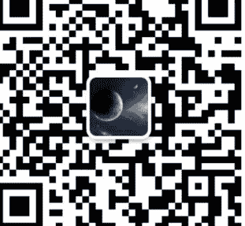

# 美联储闻20250504——月晕风雾不开

中美关税对抗再次升级，昨晚美国一度冲高，但是最终扛不住巨大的抛压，由升转跌。今天，A股大跌开市后高涨猛猛，沪指超过1%的涨幅收市，连港股都开始跌后站稳。对于多年股民来说，真的是活久见的体验。过去什么负面新闻都打不倒的美股如今也有扶不起起来的时候，随便一风吹草动都要被埋单的A股居然也成了强势，作为韭菜股民，真的有几点吐气扬眉的感觉。虽然风险远没有解除，但士气上还是振奋人心的。如果说昨天的涨幅靠正规国家队稳市场的信心，今天军工和芯片的大涨实际上是资本市场对兔子这一轮应对态度的肯定，国家队兜底，市场资本参与大户信心不灭，才有了现在这种巨浪前兔子资本市场风景独好的场景。这可能是兔子资本市场的难得的高光时刻，也为这一轮关税开了个开头。

# 免费 价值 及时 专注

# 扫码加入 知识星球TOP 免费资源群

- 每日免费获取有价值资源
- 可提供各类资源搜索服务

| 热门付费文章 | 各行各业报告 |
| --- | --- |
| 精选图书资源 | 副业挣钱方法 |
| 职场实用资源 | AI政经自媒体 |

公众号:知识星球TOP 微信号:jntsg8 微信号:jntsg2

分享资料仅供个人学习，请及时删除，切勿商用传播

过去几年来，甚至自二战以来，美国一直在自制定和制裁的国际贸易博弈中赢得胜利。所以，在大家的既往认知里，就没有反抗这个词。所以当兔子真正表明了要对抗的态度后，但不特朗普理解，美国媒体也不理解，实际上，这不是美国第一次表现霸权，但是因为了兔子的挑战，美国的霸权显得荒诞起来了。上世纪80年代，时任美国联储局主席沃尔克的沃尔克冲击曾是导致全球经济重组的先例。当时并没有人觉得沃尔克疯狂，1979年10月，沃尔克当时为应对通胀，将利率调至惊人的13%，随后又升至17%。很快美国就陷入经济衰退。在接下来的两年里，数百万人失去工作，尤其在制造业领域：因飙升的利率和高美元价值，使美国出口产品的价格在世界上失去优势。沃尔克其后又将利率推高至19%，迫使经济陷入二次衰退。到1983年中期，通胀率已降至2.5%。然而，比降低通胀更具决定性的是美国经济的重塑。

沃尔克的高利率导致美国工业化进程加速，投资涌入金融和房地产，引发了90年代和21世纪初的巨大信贷泡沫。当时，美国股市在沃尔克宣布后暴跌8%，但美国通过看似无限的借贷，吞噬世界其他国家的出口，使得世界经济围绕着美国进行重新排斥。如如今，沃尔克已成为央行长们的民间英雄。实际上，在回头看，当时沃尔克的操作也是相当疯狂的。

如果沃尔克冲击是帮助美国金融去工业化，那么这次川普的操作就是一次方向上的大回头，是对70年代末美国经济的转向。川普曾多次表示，要仿第25任美国总统麦金莱的贸易政策。麦金莱的任期为1897年—1901年，当时就是依靠增加对等关税，让制造业回流美国。不过那已经是100年前的事情了。现在川普真的是用明朝的剑斩清朝，大家都觉得荒诞，但现实情况下，这种事是普遍存在的。川普所指的1890年关税法案，通常称为麦金莱关税(McKin Tariff)，是一项美国法案，由当时的议员拟定。1890年10月，该法案通过，将进口平均税率从8%上调近50%，旨在保护国内产业免受外国竞争。1890年选举中，共和党失去了众议院多数，席位减少近半。由于关税水平和产业链的情况引起了美国经济和政治剧变，那么目前全球贸易总量来看，关税工具基本上不是剑而是核弹，对全球的影响也是毁灭性的。对于川普来说，可能根本没有想过兔子会对反抗，所以工具箱里没有对应的准备，他们想要滑跪。

现在全球都在目睹一场没有预演的格斗，大家在平衡木上互相搏脖子，看谁先死。兔子没有而退，顶住了美国的第一轮冲击。展示了兔子的实力和肌肉之后，让川普意识到对抗的难度，各国反应可以简单归类如下：

- 已经宣布对美国取消关税寻求合作的国家：越南、柬埔寨、阿根廷、以色列和印度
- 没有采取报复性关税的国家：墨西哥、日本、澳洲
- 已经声称准备采取报复性关税的国家：欧盟加拿大
- 世界上第一个宣布对美国反制的国家：兔子，并迅速出台了一系列反制拳

对美国来说，关税战的真正目标只有一个，如果兔子不跟美国谈，关税战就打了个寂寞。其他经济体可以帮美国解决的问题有限，又回到了1890年川普就想做的事情：只有杀兔子放血才能解决美国的困境。现在也是一样，但可惜兔子已经不是兔子而是长出了牙。目前这个阶段，各种各样的假信息非常多，足以扰乱，夸大其词的信息满天飞。从川普政府执政100天的动向来分析，贸易战根本不是川普的主要方向。在白宫公布的优先事项中，涉及到贸易的只有可怜的一行，完全淹没在政府效率、反DEI、反移民等一系列大政针之中。

但是随着调解受阻，政府治理难以为继，甚至连打击胡塞武装占不到便宜，还出现了军事行动乌龙的安全丑闻，把川普团队逼到了墙角。如果再不拿出一点亮眼的政绩，不仅会被弹劾，甚至会被选民抛弃。所以，这个时候川普突然抛出关税大棒，原本是一场转移关注力、制造混乱从而解决自己政治麻烦的操作。原本以为各国滑跪给自己挣一点面子就能把难关渡过去，只是没想到，兔子一点没给川普面子，不但愁上来，还把美股这个霍笼插破了。如今川普骑下虎下，只能继续开火，甚至公开放话。这一系列荒腔走板的操作是各种错误叠加的结果，难怪英国《金融时报》的评论认为，这是令人震惊的自残行为。所以，现在最好的地缘政治应对方式就是让川普自己去演戏。川普一下就把美国的关税政策回到19世纪的水平，有效平均关税税率比1930年大萧条时还要高，达到大约25%水平。而在川普回白宫之前，就是不足3个月之前，美国的有效平均关税税率只有2.5%，在大萧条时税率也是20%。

所以，这次关税大棒可能出现的影响还需要时间发酵，现在兔子就是那句话：扎好篱笆，看好门户，做好自己的事情。除了稳定住金融市场，还要快对企业的情况摸底，稳住经济基本面，拉过这一轮因不确定性和政策快速变化带来的剧烈震荡。比如很多出口企业立刻就被叫停订单，很多在路上的船和货都受到直接冲击和影响。据我所知，各级政府已经在积极摸底相关企业受到的冲击和问题，评估影响。今天彭博社和华尔街报道了兔子高层开会研究应对措施的新闻，这边也发布了周五开新闻发布会做信息的发布，显然这也是稳定市场预期的操作，先要稳住这一周，稳住大家的心理预期，后面的事情才有时间处理。

全球来看，关税战并没有解决美国的问题。对于兔子而言，稳住自己就是胜利。川普根本没有想过兔子会反抗，所以目前全球来看，关税战是不可能的。
