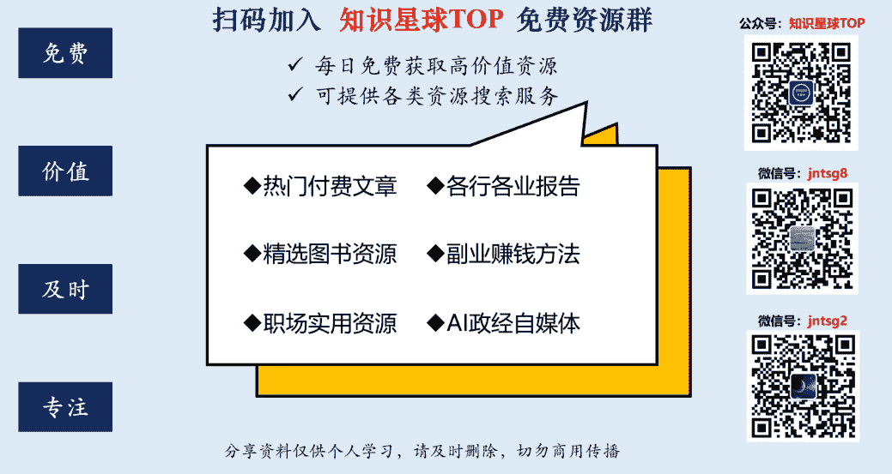
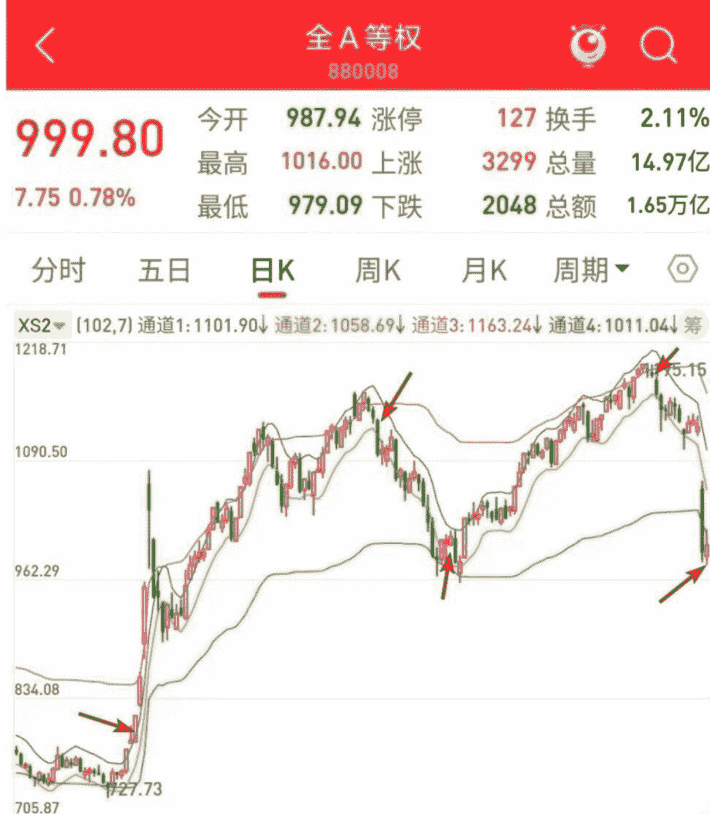
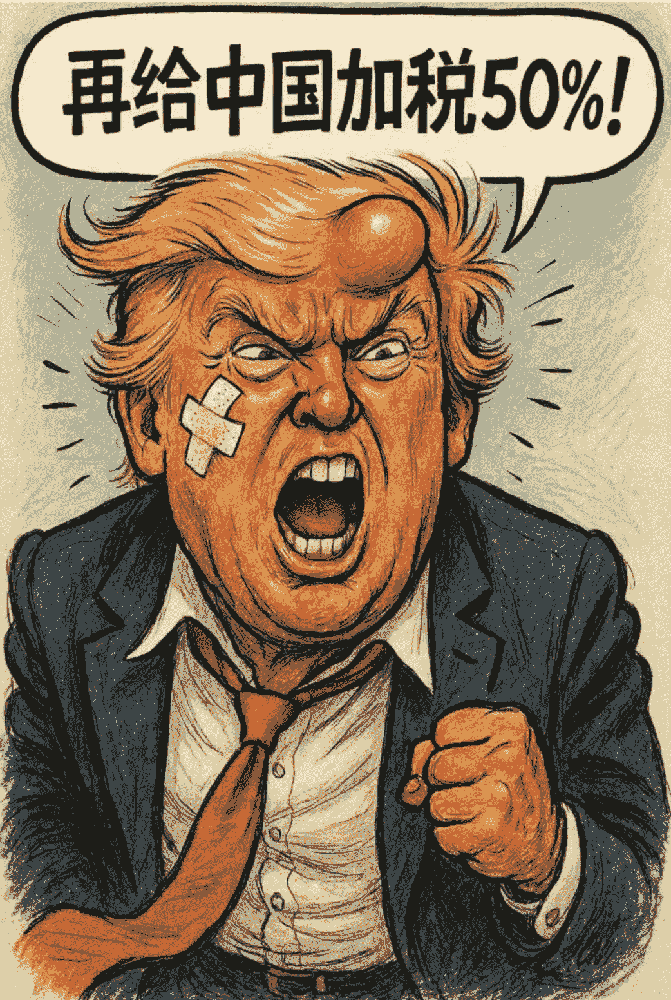
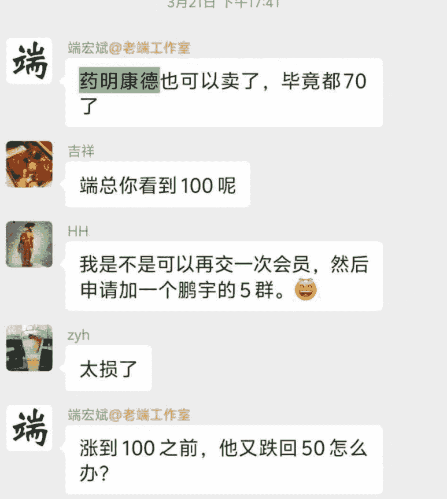

# 警报解除，我空翻了

# 20250408 端宏域

在开始今天的文章之前，我们先来看图，下图是最近半年的全A等指数K线图：

最近半年来，老端在大势方面的判断全对。你看到图中一共有五个箭头，从左到右分别是：

- 2024年9月26日，我发表文章《重要提醒：这是反转，不是反弹》，告诉你一波级别行情就在眼前；
- 加微信jntsg2，免费进资料群
- 2024年12月17日，当天的《日间分析》告诉你中级调整开始了，只要反弹就要卖出；
- 2025年1月9日，文章《危险警解除了吗？》告诉你危险已经解除了，短线已经见底，14日文章《警报解除，又能吃肉了》再次强调反弹开始了；
- 2025年3月20日，我发表文章《风险警报响了》，提醒你危险来了，这次下跌必须跌到A等指数1050点以下才能买入，本来跌得很慢，没想到川普又来关税贸易战，一口气把A等指数打到了979点，跌幅大超过预期；

今天是4月8日，我写这篇就是我开始空翻了。其实我昨天（4月7日）的日间分析里面已经提醒了你了，底部就在这几天，唯一的不确定性是面对中国34%的关税增幅，川普扬言要再加50%关税，这句话说到底不算数，等到现在也没有见到动静，我猜川普可能已经绝望了说完这句话了。

在以前的文章中，我已经说过，川普并没有什么牌可打，他翻来覆去无非就是那种样，像程咬金的三板斧，第一次使出来的时候是很厉害的，因为别人没见过，但你反反复复复就这么猛招，大家早就审美疲劳了，你就算再装卖爪，别人都认定你是在宰胡，既然是宰胡又有什么好怕的呢？

再说50%关税这件事，因为现在他给中国加的关税已经到了54%，生意已经没没办法做下去了，你再加50%变成104%，生意还是没办法做，就好比枪腿一次和枪腿两次有区别吗?判刑50年和100年有什么区别吗?那么你54%的关税和104%的关税都一样，这已经无法下咽了。如果投资者不怕了，那兜也也没了，更何况国家队又开始增加各种ETF，所以我认为这个点位是安全的点位，你现在加微信jntsg2 寻求买入，就算被套了也是全套，根本不怕。

至于买什么股，我想起3月中旬的时候，我建议某友可以考虑在70元以上卖掉药明康德，结果他问：老端，这股票你不是看到100元的吗？怎么70就要卖？

我回答：到100元之前，为什么就不能先到50元呢？

结果你也看到了，港股药明康德今天最低到了44.3元，如果你当时70多元卖掉，现在40多元买入，手里的股又能增加40%+,有什么不好的呢？人还是要灵活一些才好，不要一根筋。

加微信jnts2，免费进资料群
