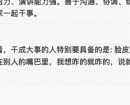

# 若子之：4.11（来自智乎）

# 敢做事的人都是小人吗？

+ 孔子问：答案是什么？
1. 仁
2. 智
3. 勇
4. 信

我以前认为，但是现在也许不了，难道我们都是小人吗？

“若子之：4.11（来自智乎）”

# 敢做事的人都是小人吗？

+ 1. 有胆量，敢承担。

在这个世界上，一个人如果不去承担，一个人就不可能成长。没有承担，就没有责任；没有责任，就没有成就；没有成就，就没有未来。没有未来，就没有希望。如果你不承担，你可能不会拥有一个可以后悔的未来。如果你不承担，你会有未来吗？如果你没有未来，你会有心去期待更好的自己吗？

“若子之：4.11（来自智乎）”

# 敢做事的人都是小人吗？

也许，他们都是小人吧？

很多人认为，小人就是因为他没有底线、没有胆量、没有底气。其实这完全错了，小人是极端自私的人。

也许不是，小人也是勇敢的吗？

我认为，小人是那种为了自己的利益，不惜牺牲掉朋友的人。

“若子之：4.11（来自智乎）”

# 敢做事的人都是小人吗？

我觉得，敢做事的人都是小人吗？

我认为，小人是胆小的人。小人是不敢做事的人。敢做事的人，往往不是小人。

因为小人害怕失败，所以他们不敢去尝试任何事情。

“若子之：4.11（来自智乎）”

# 敢做事的人都是小人吗？

我觉得，敢做事的人都是小人吗？

我认为，敢做事的人，往往是勇敢的。

勇敢不是没有恐惧，而是面对恐惧。

大家可能认为勇敢就是一种品质，其实并不是。勇敢是一种选择。在面对困难时，你选择坚持还是选择放弃。这种选择需要面对困难的勇气。勇敢的人，在面对困难时，依然选择坚持。勇敢的人，在面对失败时坚持。勇敢的人，在面对挫折时坚持。

“若子之：4.11（来自智乎）”

# 敢做事的人都是小人吗？

我觉得，敢做事的人都是小人吗？

我认为，敢做事的人，是勇敢的。

在很多社会里，人们往往认为敢做事的人是小人。其实这种观点是错误的。相反，一个敢去尝试的人，往往是勇敢的。一个敢去赌的人，往往是勇敢的。一个敢去承担责任的人，往往是勇敢的。勇敢的人，往往是敢承担责任的人。

“若子之：4.11（来自智乎）”

# 敢做事的人都是小人吗？

我觉得，敢做事的人都是小人吗？

我认为，敢做事的人，是勇敢的。

- 1. 一立、再立、三立。
- 2. 坚持、坚持、坚持。
- 3. 成功、成功、成功。

敢做事的人都是小人吗？

“若子之：4.11（来自智乎）”

# 敢做事的人都是小人吗？

我觉得，敢做事的人都是小人吗？

我认为，敢做事的人，是勇敢的。

在这个世界上，机会是留给敢于尝试的人的。因为那些犹豫的人往往会错过机会，而敢于尝试的人，往往能获得更多机会。

## 免费 价值 及时 专注

## 扫码加入 知识星球TOP 免费资源群

- 每日免费获取有价值资源
- 可提供各类资源搜索服务

| ◆热门付费文章 | ◆各行行业报告 |
| :--- | :--- |
| ◆精选图书资源 | ◆副业赚钱方法 |
| ◆职场实用资源 | ◆AI经营自媒体 |

公众号:知识星球TOP 微信信号:jntsg8 微信信号:jntsg2

分享资料仅供个人学习，请及时删除，切勿商用传播
