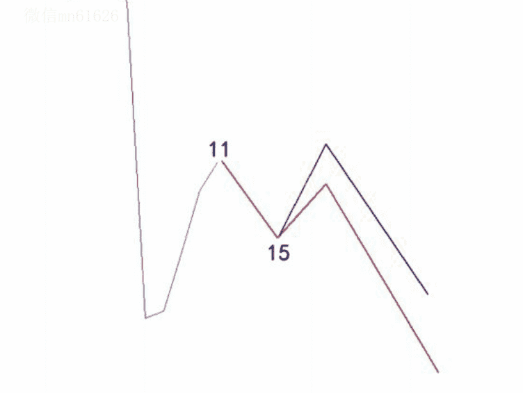

# 下周走势剧透

原创 飞浪王 指浪王 2025年04月12日 10:30

湖南

## 前言

下周走势剧透

开篇，我只说一句话：下周走势关于大下周，因为市场要放大招了！

金不换不要订阅，周天7:30会发布！

国证2000日线收盘价位图:

我判定国证2000在11号已经形成了高点，故此下周市场大概率将会出现下跌。

由于15号是4月份第3个时间窗口，那么这里存在小小低点或加速中长阴的两种概率。

图中红色路径所描述的是小低点，实际上可以选择连续急跌的方式跌下去，这样红色路径就会变成一条直线，而中间没有抵抗动作。

但这种概率不是说没有，只是我这里强调一下，怕有些朋友专注了15号小低点的概率去抄底。

15号产生小低点时（一定是排除了15号不是加速中长阴，这点等到当天14:30就会明确），就有了红色和蓝色路径。

红蓝唯一的区别在于会不会会在新的高的问题，这不重要，关键在于还会再次跌下来。

即15号小低点，则下周指数探底回升，值得一提的是下周一旦探底回升，大下周就是一波急跌动作。故此，下周主要任务仍然是防守观望。

当15号不是小低点，而是中长阴急跌，则红色路径线条会拉直，下周则是单边下跌结构。

# 下周走势推敲的结论是：探底回升或单边下跌，重点盯紧15号的情况。

经过反复推敲，15号小低点出现了不参与，后面有上攻即便新高也不参与，下周休息观望，重点是防范后面的急跌。

至未来的抄底时间，我需要等下周走明之后才会再写精准的抄底文章，如发生变数，抄底时间提前，则我实时发布的抄底提醒为准。

# 底层逻辑，简单说一下：

北证50下周跌，国证2000跌，中证1000也会跟跌，包括上证指数及其他也会跟跌，因为北证50是4月7号抵抗以来以来最强的代表，老大跌，小弟跟！

> “登四千，不忘回望一笑，尔敢同行 ”

喜欢作者

## 免费 价值 及时 专注

## 扫码加入 知识星球TOP 免费资源群

- 每日免费获取价值资源
- 可提供各类资源搜索服务

| ◆热门付费文章 | ◆各行行业报告 |
| :--- | :--- |
| ◆精选图书资源 | ◆副业兼钱方法 |
| ◆职场实用资源 | ◆AI政策自媒体体 |

公号:知识星球TOP 微信号:jntsg8 微信号:jntsg2

分享资料仅供个人学习，请及时删除，切勿商用传播
