# 金政通鉴：全球市场每周预测 0414—0418—本周策略超过了300%

《Q1》美股见顶已经验证；
《Q2》部分预测已经验证：
- 美国 2025 年爆发危机的概率高达90%——下周根、高盛等知名机构和达利欧等权威专家开始讨论危机；
- 重点介绍 UVIX，30以下布局，本周恐慌很恐慌，最高到105，在100附近妥结了；
- 重点介绍黄金，清明前夕，关税周 UVIX高位转移黄金期权多单，然后黄金疯狂了。

每周跟踪全球市场，根本是在追踪资本轮动。显然，从美股恐慌切换到黄金避险，逻辑非常简单，而这就是“春的热带雨林”第一次演习。

然后 UVIX 可以抄了，部分仓为零，我们不是赌博，机会太贵了，大家需要停下来想一想。前面建议低不低于半位的黄金，现在我把 UVIX 的利润分配留给 CALL，4月4日开始调仓，UVIX-黄金 CALL 就是，UVIX需要全部出掉，4月9日调整完毕，UVIX-黄金 CALL 就是。

## 当前，关税战的进展，符合《Q2》的预测：

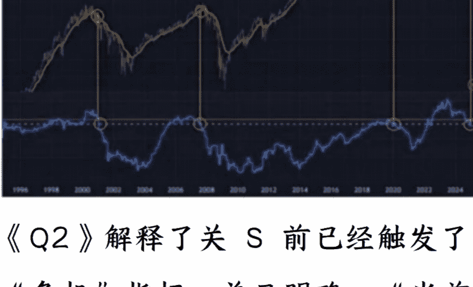

## 《Q2》解释了上周已经触发了“危机”指标，并且明确：“当前阶段，也即危机以前，不急于启动双方会谈。”

> 正义方：通过让世界各国电话锁的野人，永远不要等到对方的电话。反投方：我们将美国大通通过世界各国电话锁的野人听到中国，要等到中国在1月美国也面临危机时进行调整。10小时前。

“现在，随川普热情邀请，随关税胜，随他科技封锁，对对抗的形势用太久将“物极必反”，我们将在 Q3 或者 Q4 进行讨论。”

- AH 的讨论，在季报和周报里都非常详细，上周的预测是“深 V”。

微信jnt52，免费进资料分享群。

方面，上篇周报，我们画了一条白色线（上图），上周周围绕这条白色线做防守反击（下图—黄色圈）。

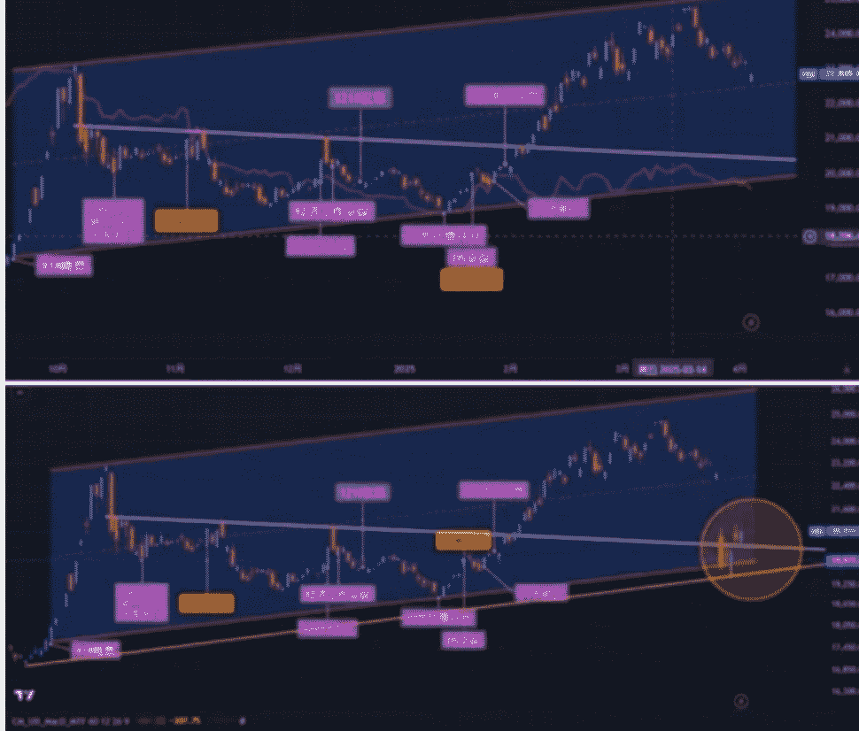

上篇周报，我们画了一条黄虚线，和一个蓝色的防御带（上图），一周结束后，非常完美的落在区间内完成深深V。

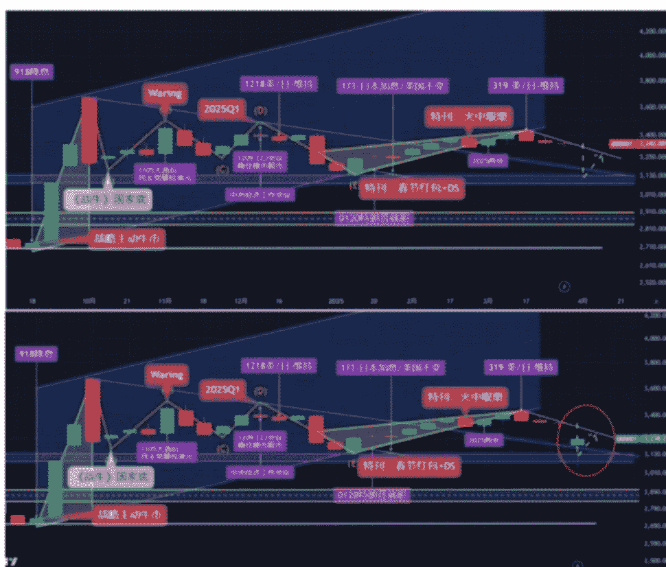

我们花了很多周末讨论了全球资本轮动，危机将临时应该应该“春天的热带雨林”，而现在只是开始，一切调整都来得，甚至可以“转危为机”。这周聊“转危为机”。

本文为研究参考，不作为投资建议。

## 一、转危为机

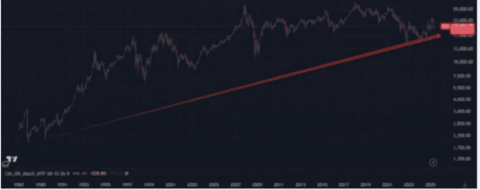

以恒生生例，一直处于上升趋势。

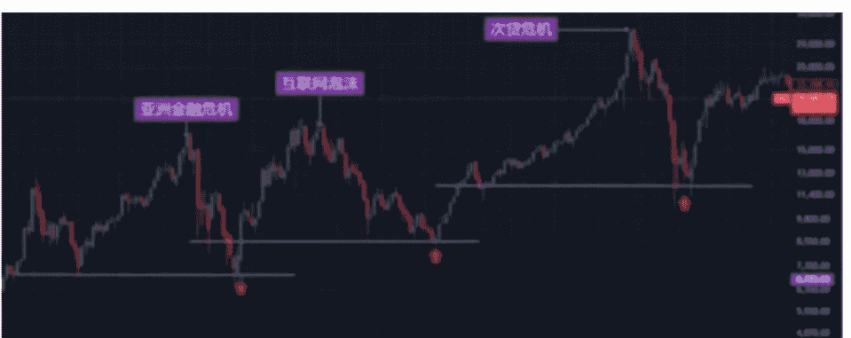

恒生经历了亚洲金融危机、互联网危机、次贷危机等等等：
- 1. 危机可能会消掉危机前的几乎全部涨幅；
- 2. 下一次危机的底部比上一次危机高，像是跷底楼梯；

我们从简单到复杂的推演一下：
1. 价值投资：选定“核心资产”（《新交易》系列），随他危机，一直持有。好处是不花费精力，但考验的是耐心和定力；
2. 趋势投资：在低位布局，在高位撤离（季报研究时）。好处是大概可以多优质避开危机，但不能把掌握全部涨幅，考验的是贪婪和自律；
3. 双向投资：比如这次演练的UVIX，是一种美股越跌反越越涨的品种，近似“做空”；这很重要，一旦可以在跌的时候也盈利，那么，看待市场就不会指它一直涨，无论涨跌，都会更客观和理性
4. 杠杆交易：如果可以非常确定一个方向，是可以用期货或者期权来放大收益的；但同时，风险也一样放大。所以，这些要学习很多知识积累经验
5. 量化交易：当知识和经验达到一定程度，就可以固化为一些模型，自动交易；DeepSeek的幻方等，华尔街所有机构基本都是量化交易。

我们在市场中交易时，我们的对手，有很多专业投资者或者机构，他们有更多的时间、工具和经验，在100次与对手的交易中，胜算可能就不高了。所以对于我们，大致先选定自己的方向：

第一种，对缺乏时间和精力的投资者，“价值投资”的方式，看起来很佛系，在数学统计上算是最高的。“唯不争”。这不是玩笑，我们都有这样的经验：一个季度忙碌，回头一看没收益，无论炒股还是炒金，盈利的大神都具有极强的耐力和定力。

第二种，投入更多的时间和精力，提高竞争力和胜率，往“趋势投资”和“双向投资”发展。只会做多而做空，选择了 UVIX 作为重点演练的对象，这两种都是“转危为机”的方式，这两种兼得，好选一种进一步开展交易：
- 1. 因为看涨，所以买的时候，想清楚准备多久，涨到多少卖？
- 2. 交易亏损都是卖的时候，当时买的判断还记得吗？
- 3. 不清，长期亏损。每一次交易，如果都是模糊的判断，就会被情绪控制，追涨跌。我们一直恐慌情绪VIX割的。

4. 模式迭代是最重要的。每次交易都建立在理性的规划基础上，一段时间以后，回顾一下复盘，优化迭代，回到当下，看空。在这种情况下，除非自信能够驾驭风险，否则要做一个方向选择：
- 1. 倒过坑随它波动会“冬来”，或者暂时放弃这种收益；
- 2. 学习实践，去探索“春天的热带林”，比如研究空股，让你打击。

## 二、全球资产跟踪

### （一）美股

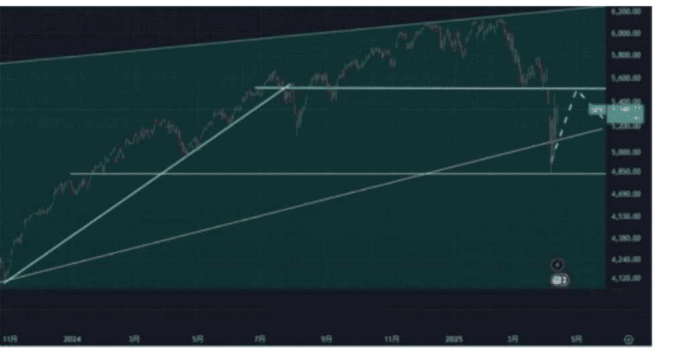

趋势性空，短期看幅度修复。

### （二）黄金

非常强势，上一次类似的强势是新爆发的2020年4月到8月，区间涨幅30%；继续趋势性多，然后波段跟随顶部/底部技术指标做仓位。

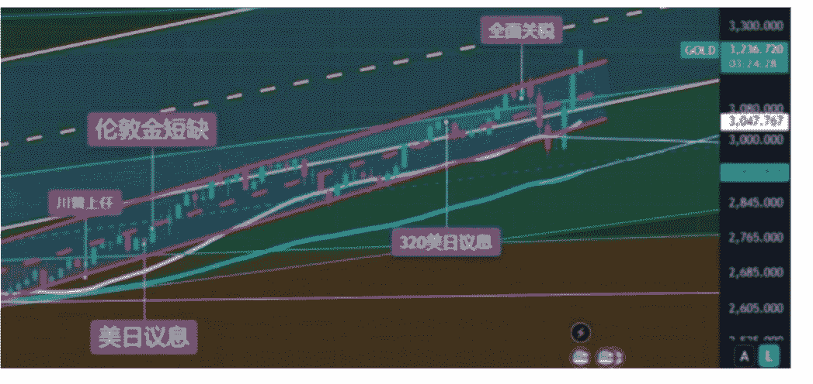

### （三）加密

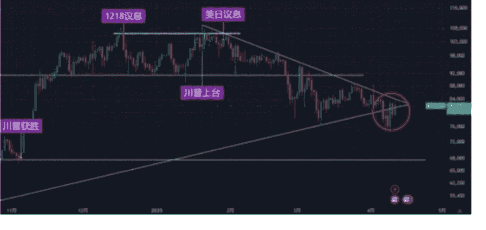

再次破位，加强了看空趋势。感觉机会临近了。

### （四）美元

在新货币战争的视角下，或者金融战争的视角来看，U/U/C“关税战”下围绕美元的“三国杀”精彩绝伦。可以预见，“原油”即将登场。

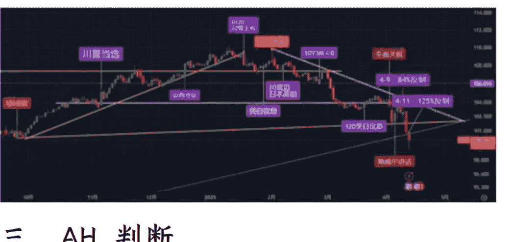

## 三、AH判断

### （一）H

这周，我们增加一条黄线，以及我们所在《战牛》提及的“国家底1977”蓝虚线。接下来的时间，主要在黄金铸防。

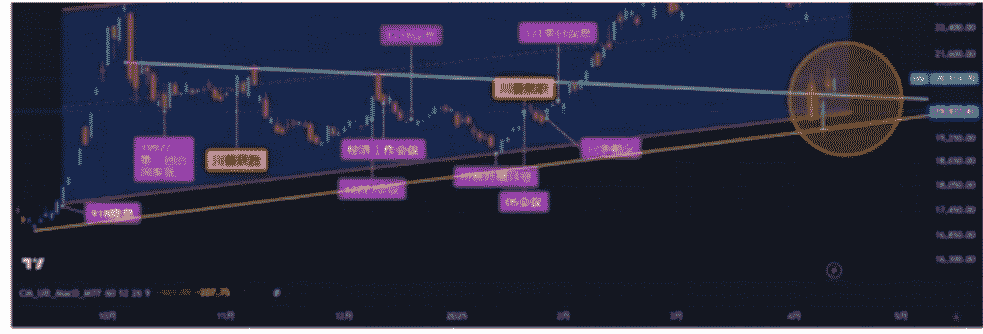

### （二）A

图不需要调整，下周还是红色圈。

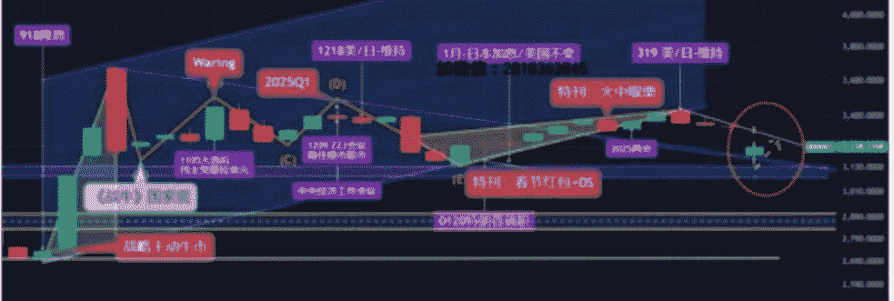

## 四、技术分析

### （一）美股

1. 标普500：周线级别。反弹回到颈线之上，有效跌破周线级别头颈线，倾向周线级别空。测幅统计：第二种方式，具体如下：
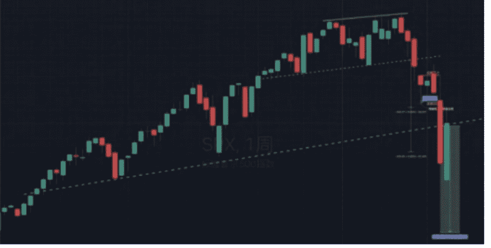
2. 纳斯达克：周线级别。反弹回到颈线之上，有效跌破周线级别头颈线，倾向周线级别空。

### （二）黄金

1、日线级别：上周我们使用了第二种统计方法，观察黄金月线级别结构。本周我们维持到日线级别，观察走势结构（月线第二段上涨时空相关的）。
- 使用涨幅区间进行测幅，目前第2段涨幅满足，满足点3207。
- 底型结构突破，对应涨幅。有两个底型结构，我们用底型结构A（左侧），用底型结构B（右侧）进行描述：
- 1) 底型结构A：3段涨幅，第三段满足点3046.4，满足达到进行了回测。
- 2) 底型结构B：3段涨幅，目前位于第3段区间，满足点3370。

### （三）BTC

1、日线级别：大型头部，有效破，段幅满足，满足点7760。随后超跌反弹结束。BTC测试拉回，但低点与高点均在移动。目前多头仍有力量，建议尊重趋势，空。再次跌破7760，相对安全：
- 1. 04/02冲击，超跌反弹小级别下跌都没有跌破。
- 2. 04/06冲击，小级别下跌结构段幅完成，强势。反弹站回7760之下。
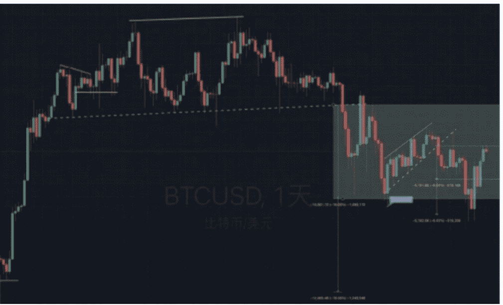

### （四）美元

1.美元指数：日线级别。复合头部结构，段幅基本满足99，低点99.14。结构上有反弹，但美元指数规模出现，预计100.2附近博弈。
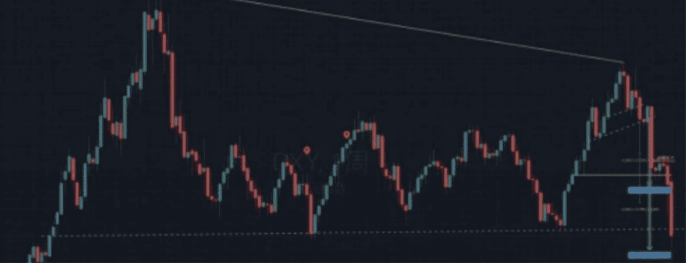
美元指数长期趋势空，黄金、原油的弹性。

### （五）AH

1.恒生指数：日线级别。头部结构，颈线22589（绿色虚线）。04/07在恐慌情绪下，已完成段幅，满足点20307。低点19260，进入段幅区间，目前超跌反弹中，支撑20307。支撑之上盘整，有效跌破段幅满足。综上，恒生指数走势强于上证指数，未出现大别型，未跌左低点18674。
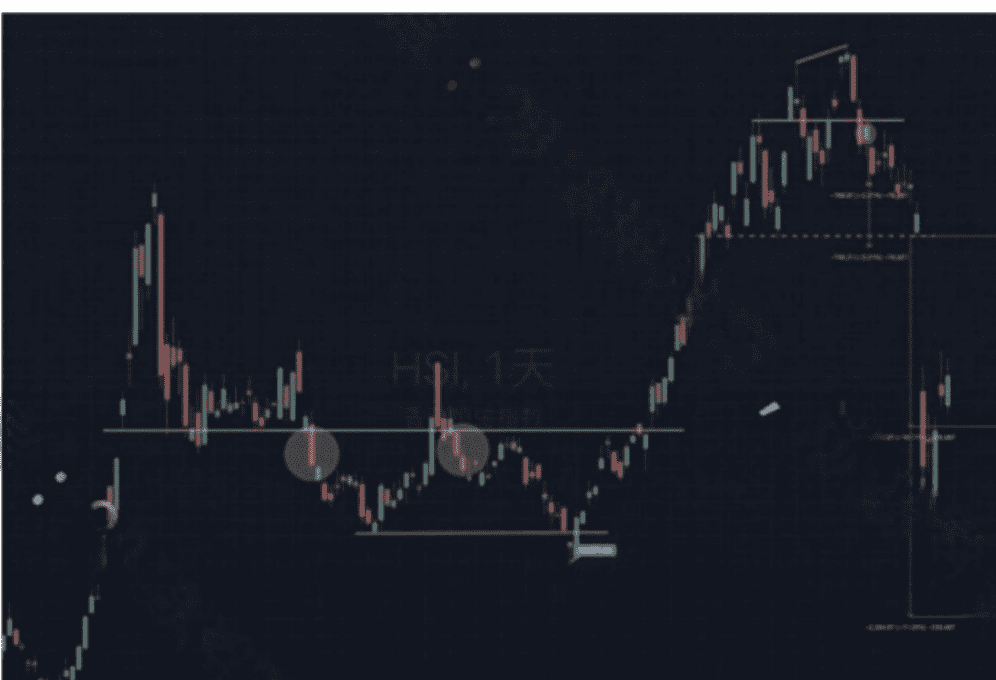
2.恒生科技指数：日线级别。头部结构，颈线22589（绿色虚线）。04/07在恐慌情绪下，已完成段幅，满足点4725。低点4296.16，进入段幅区间，满足点3945。目前超跌反弹中，支撑4725。支撑之上盘整，有效跌段幅满足。
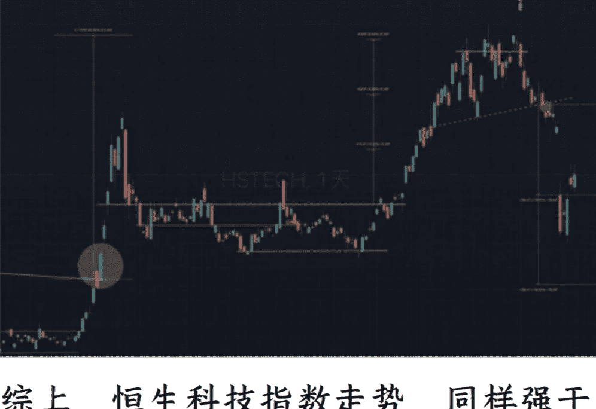
综上，恒生科技走势同样强于上证指数，未出现更大的，未跌左低点4168。
3.上证指数：日线级别。头部结构，颈线3323（绿色虚线）。04/07在恐慌情绪下，已完成段幅，满足点3078。低点3040.7。目前超跌反弹进行，未来两周观察，更大模型是否被确认。
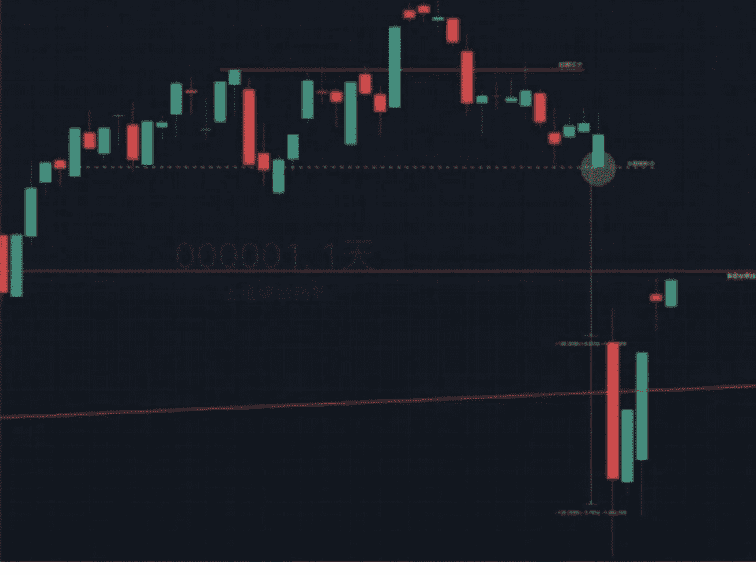
4、上证指数：周线级别观察：
- 一、两周内，周线收复3245。无法收复，或收复再次跌破，更大的头型形成，颈线之下不宜做多。
- 二、本周跌破长期支撑（红色趋势线），目前反弹已收复，指数相对强势。观察支撑有效性，对指数周线收盘点位要求越来越高，下周3164。长期支撑月线级别以上，线下整理时间以季度为单位。

5、上证50：日线级别。头部结构形成，颈线2608（绿色虚线）。04/07在恐慌情绪下，已完成段幅，满足点2458，指数低点2457。目前超跌反弹突破颈线2608，下周观察颈线能否守住。
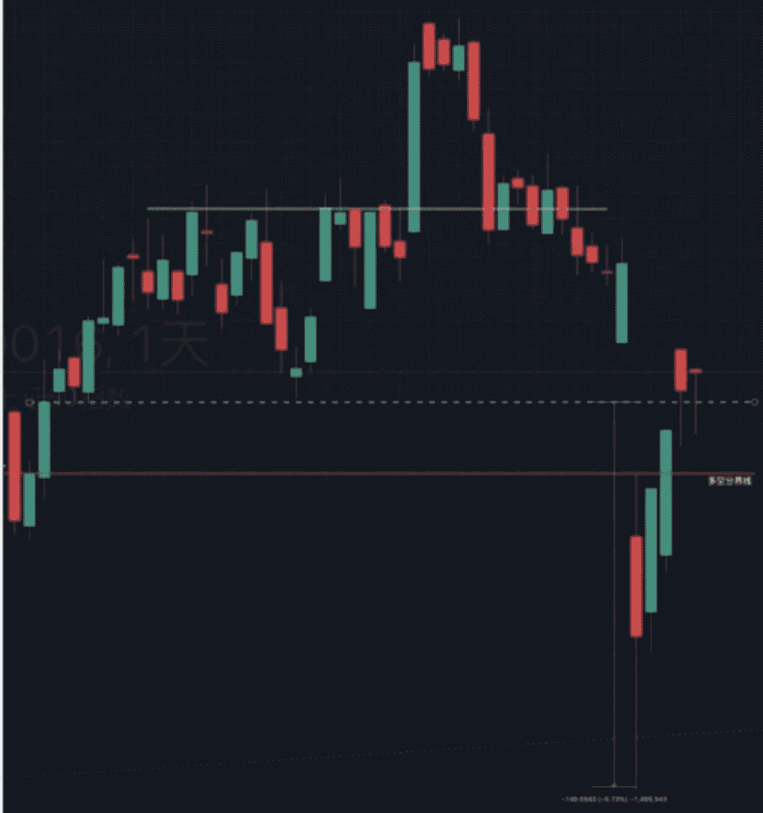
6.沪深300：日线级别。头部结构成型，颈线3843(绿色虚线)。04/07在恐慌情绪下，接近段幅满足，满足点3480.6，指数低点3514。目前超跌反弹中，未来两周观察，更大形态是否确认。
7.沪深300：周线级别观察：两周内，周线收复3767。无法收复，或收复再次跌破，更大的头型，颈线之下不宜多。
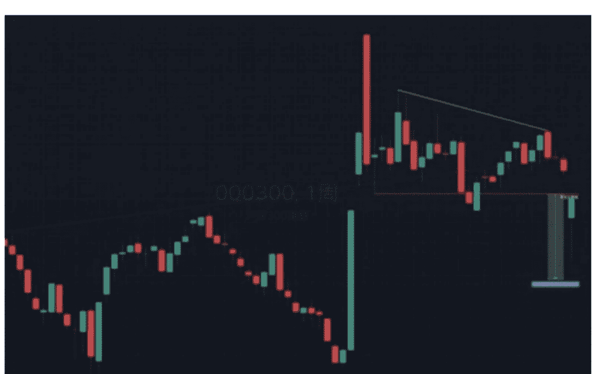
8.中证500：日线级别。头部结构，颈线184（绿色虚线）。04/07在恐慌情绪下，接近段幅满足，满足点522，指数低点135.9。
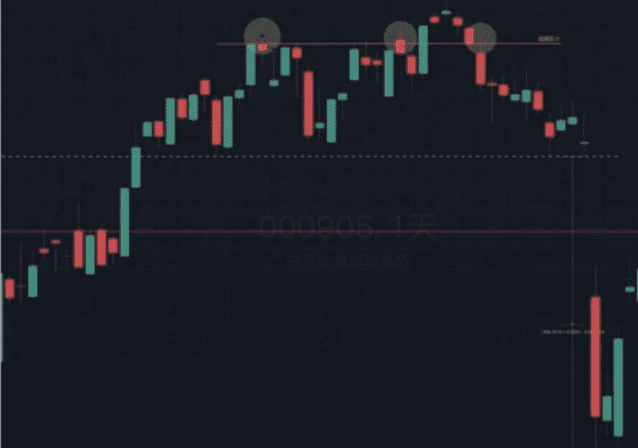
目前超跌反弹中，更大的头部跌破颈线（557），未来两周观察，周线能否站回线之上。
9.创业板指数：周线级别。小级别头部结构，段幅满足足1960.7，指数低点1756.6。04/07在恐慌情绪下，更大的头部跌破颈线（227），未来两周观察，周线能否站回线之上。
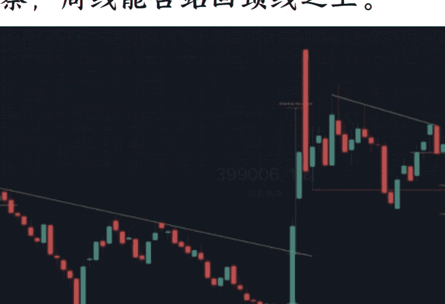
10.科创50指数：日线级别。头部结构，段幅满足889.5，指数低点877.7。04/07在恐慌情绪下，虽然更大的头部跌破颈线（938.7），但小级别头部段幅满足后，指数开展强势。综上，小级别头型已满足，颈线938.7之上不宜空。

## 五、A-GIX(测试)

A—GIX指标离线观察市场运行纪律，其主要意义在于综合仓位大小的考量，而不是简单的猜测市场的涨跌。上周收盘数据显示，在整体价格走势震荡过程中，波动指标快速下降，情绪领先指标触及顶部，建议周初观察盘面可低吸科技。本周周初市场向下剧烈波动，周三开始个股大面积修复；三大指数中，以科技为代表的科板强修复缺口。图中，上为价格均线及情绪趋势，下为情绪监控指标和波动均线指标。

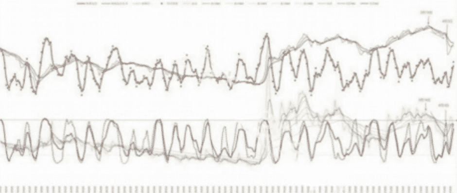

解读：市场整体从3月14日开始，波动指标快速下行，3月27日“情绪监控”、“情绪领先”两项指标在底部反复之后开始上行，期间波动指标依然呈快速下行态，市场整体弱震下行。直至4月3日，“情绪领先”大幅领先“情绪监控”快速触及天线，预示市场弱反抽即将结束。本周收盘，市场整体价格走势仍然是反抽态势，波动均线有所收敛，但仍然空头态，同时“情绪领先”及“情绪监控”两个指标上行值高位；但是，“情绪趋势”、“情绪领先”、“情绪监控”指标均暂时未转向向下迹象。那么鉴于“情绪趋势”指标正常上行，其两项监控指标均在高位，下周建议：目前仍是空头市场，处于修复阶段，这是主调；虽然“波动”指标出现修复，但仍然需要观察在“情绪趋势”下行过程中的具体表现。预计初期可以保持上周仓位参与市场，经验丰富的参与者可以波动，但不建议追高，同时需重点观察市场成交量的变化。下半周整体仓位建议谨慎，需要观察市场以何种形式过渡监控指标的下行阶段。

# 免费 价值 及时 专注

# 扫码加入 知识星球TOP 免费资源群

- 每日免费获取有价值资源
- 可提供各类资源搜索服务

| 热门付费文章 | 各行行业报告 |
| :--- | :--- |
| 精选图书资源 | 副业赚钱方法 |
| 职场实用资源 | AI经营自媒体 |

公众号: 知识星球TOP 微信信号: jntsg8 微信信号: jntsg2

分享资料仅供个人学习，请及时删除，切勿商用传播
