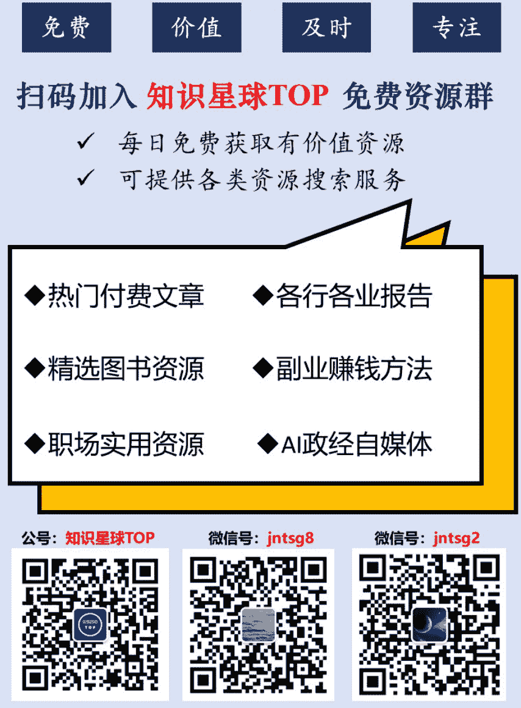
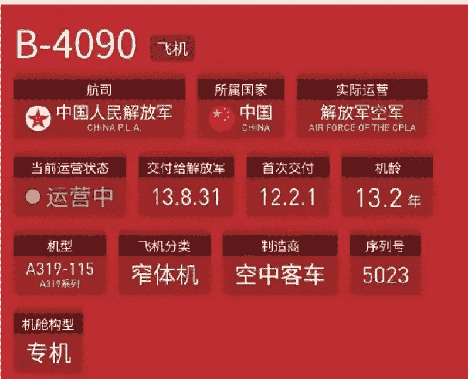
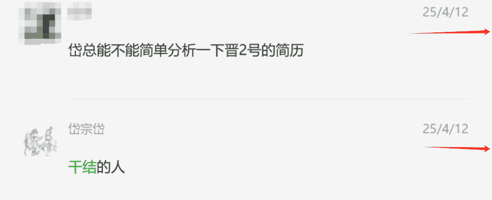

最近落马了山西金湘军。

据说抓捕人动用了军机，是派军装的，妻子弟弟一等人都抓了，抄家而回。

分享资料仅供个人学习，请及时删除，切勿商用传播
加微信jntsg2享免费资料群

# 武汉机场来了一架神秘的飞机#PLA

04-08

共 1051 条评论

平等表达，友善交流

七安：
我说这两天昨天这么大的风，原来把我们省长刮进去了。
昨天22:39·山西 回复 3885

展开186条回复

加微信jntsg2，免费进资料群

# 本架飞机的运营历史
HISTORY OF OPERATION

- 12.2.1 B-4090 变更注册
- 13.9.1 中国联合航空
- 13.8.31 B-4090 专机 运营中
解放空军(中国人民解放军)

一个省二号而已，搞成这么大阵仗，是很少见的。

金湘军是湖南江华人。江华这个地方在永州，就是柳宗元笔下的“永州之野异蟒”的“永州”。

加微信jntsg2，免费进资料群

他能力很强，湖南干部很拼，当年跟随潮流去海南发展过一段时间时间。

从海南干部，到广西玉林防城港，再到天津秘书长，再到山西省长。

其人能力很强，在天津也是管自贸区这样的专业活，按理说小贪小腐不至于出事。

只有两个可能。

要是敏锐。

要么干劲。

先说敏锐。

金曾是天津的大内总管。

加微信jntg2，免费进资料群

2018.01-2019.04 天津市副部长、党委员 [1] [5]
2019.04-2021.01 天津市副部长、党委员，中国（天津）自由贸易试验区管理委员会主任 [2]
2021.01-2021.02 天津市常委、秘书，中国（天津）自由贸易试验区管理委员会主任 [6-7] [10]
2022.02-2022.03 天津市常委、秘书 [9] [11-12] [16] [20]
2022.06-2022.12 天津市副书记 [16-18] [20] [23]
2022.12-2023.01 山西省委书记，省人民政府省长、代理省长，党组书记 [23-24]
2023.01-山西省委书记，省人民政府省长，党组书记 [27]

# 敏锐的交集只有半年不到。

2017-2022年 中央政治局委员，重庆市委书记 [1]
2022-中央政治局委员、天津市委书记 [9-10]

看起来，敏锐刚来此人就走了，似乎没有瓜葛。

但是，新闻是要连起来看。

在金省长出事之前，还有一个人出事。

此人是3月落马的天津周德睿。

加微信jntsg2，免费进资料群

——3月13日，天津市常委委员、组织部长周德睿被查。
——周德睿成为中共十八大后，继湖北的贺家铁、河北的梁滨后，第三名在任被查的省级党委部长。
——金湘军和周德睿是湖南同乡，曾经当过天津市委。所以，单看履历，金湘军和金省长交集不多。但两个月时间，连续落马的周德睿相当于天津大内总管的金。

# 这样的动态，你是哪个？

而且，还可以连起来。在此之前，我们专门开了座谈会，谈了责任。果然，重庆落马一个段成刚，牵出江新区。重庆市政协副主席段成刚被查，由于江新区三任党委书记落马，2025-03-31重庆号就内部检落马了。

可以说，新闻要连起来看的。从金到周，两个曾经的市委，看着天津出事。如果挖出，天津那位估计和重庆一样，准备落马。这可能是之一，和敏锐有关。二，则是干劲。

金和周，他们可能不是冲着敏锐去的。因为金和周，都是湖南人。一个湖南人，一个江华。而干劲是湖南长沙。

# 关键的是履历细节。
# 这是金省长的履历。
# 看出细节没。

2003.05-2009.01 西藏自治区湘宁市书记、市长（其间：2003.07-2003.09 清华大学公共管理学院和哈佛大学肯尼迪政府学院公共管理高层培训，获得管理学博士；2007.09-2010.06 国外院校研修2009年中青第一班学习）
2009.01-2014.02 西藏自治区湘宁市书记、市长
2009.02-2014.01 西藏自治区湘宁市书记、人大委会主任（2014.02），东冈重点开发试验区党委书记、市长、市委书记（2014.05）
2018.01-2019.04 天津人民政府市长、市书记 [5]
2019.04-2021.01 天津人民政府市长、市书记、委员员（天津）自由贸易区管理委员会主任 [6-7] [10]
2021.02-2022.01 天津市常委、秘书长、市长（天津）自由贸易区管理委员会主任 [8]
2022.03-2022.03 天津市常委、秘书长 [9] [11-12] [16] [20]
2022.06-2022.12 天津市副书记 [16-18] [20] [23]
2022.12-2023.01 山西省副书记、省政府副书记、代理省长、党组书记 [23-24]
2023.01-山西省委书记、省政府省长、经费组书记 [27]

加微信jntsg2，免费进资料群

在18年能从名不见传的防城书记，去天津当副市长，从正厅级变成副部级，无异于脱颖而出。18年天津副市长，22年就天津副书记，直接副部变正部。4年，副部变正部。

这个速度是坐火火箭的速度，一大帮人要羡慕死。

更重要的是，他在天津当了两年常委，就外派去当省长了。

这种速度，这种提拔，没有上面的推力是难以办到的。

可以总结为，金在18年被贵人扶一把，22年又被贵人更加大力的扶一把。

# 而另一位3月落马的天津组织周德睿，其简历很有趣。

2017.06-2017.09 湖南省常德市委书记、市人民政府、党组书记
2017.09-2017.12 湖南省常德市委书记 [2]
2017.12-2021.03 湖南省常德市委书记、人大委会主任
2021.03-2021.09 天津市副市长、党组成员 [1] [6-7]
2021.09-2021.11 天津市委书记、宣传部长、市人民政府副市、党组成员 [8-9] [20]
2021.12-2022.06 天津市委常委、组织部长
2022.06-2022.12 天津市委常委、组织部长 [15-16]

21年，从地级市的厅干部，变成直辖市的市长，成为副部级。而且金并不是敏锐，他仅有4年的过渡。

2006.03-2006.10 西藏自治区湘宁市书记、市长
2006.10-2009.07 西藏自治区湘宁市常委、组织部长
2009.07-2010.11 西藏自治区湘宁市常委、组织部长、市委党校（行政政学院）第一校（院）
2010.11-2013.03 西藏自治区湘宁市常委、市人民政府副市（常务）
2013.03-2013.04 湖南省常德市书记

# 这样的动态，你是哪个？

而且，还可以连起来。在此之前，我们专门开了座座会，谈了责任。果然，重庆落马一个段成刚，牵出江新区。重庆市政协副主席段成刚被查，由于江新区三任党委书记落马，2025-03-31重庆号就内部检落马了。

可以说，新闻要连起来看的。从金到周，两个曾经的市委，看着天津出事。如果挖出，天津那位估计和重庆一样，准备落马。这可能是之一，和敏锐有关。二，则是干劲。

金和周，他们可能不是冲着敏锐去的。因为金和周，都是湖南人。一个湖南人，一个江华。而干劲是湖南长沙。

# 关键的是履历细节。
# 这是金省长的履历。
# 看出细节没。

2016.10-2017.05 河北省副书记
2017.05-2018.03 保护部长、党组书记
2018.03-2020.04 生态部长、党组书记
2020.04-2020.07 山东省委书记、省长、代理省长、党组书记
2020.07-2021.09 山东省委书记、省长、党组书记
2021.09-2021.10 山东省委书记、人大常委会党组书记
2021.10-2022.12 山东省委书记、人大常委会委员、组书记
2022.12-2023.01 中央政治局委员、中央书记书记、山东省书记、人大常委会主任 [8-9]
2023.01-2023.04 中央政治局委员、中央书记书记、中央组织部长 [10]
2023- 中央政治局委员、中央书记书记、战略部部长 [14]

# 干劲什么时候起飞的？

是17年从河北副书记，升为环保部这个强势部委的一把手之后。

# 干劲什么时候彻底起飞呢？

是在22年10月大上内为部长书记的时候。

加微信jntsg2，免费进资料群

而这两个时间点，无比合周德睿金湘军两人的上升轨迹。加上，这三人都是湖南人。谁说湖南人不懂拉帮派的啊，这不是已经在拉帮派了吗？18年左右他作为贵人扶持他们一把，22年后他作为贵人又大力扶持了他们一把。自己当实权部委的时候，就把核心圈里的两个厅级小弟，送去直辖市解决部级，然后留在天津镀金。22年一飞冲天成为部长尚，这两位小弟更是水涨船高，一个从宣传转为位高的天津部长，一个更是4年光速完成从副部到正部的华丽转身，外放山西省长。

可以说，一个围绕的湖南小圈，已然形成。而且这两个人必然是核心成员，不然干劲不会如此急忙的把最好的机会给他们。

所以说，周和金很有意思。这两个人都从领域责任来看，是冲着敏锐去的，两人接连落马敏锐少不了惶恐检。加微信jntsg2，免费进资料群

这两个人从圈子看向，明显是干劲的核心小弟。两人接连落马之间夹着干劲调统战部，清理干劲的湖南小团体用，更是呼之欲需。所以，你可以理解为，要么冲着敏锐去的，要么冲着干劲的。或者说，本来是冲其中一个人去的，查看查看发现还能牵出另外一个人，干脆两个人都冲着去吧。但是，总有一个是重点的。目前，平调部长书记是一个重要的信号，平调部长书记可能是重点，这波是冲着干劲来的，敏锐属于误判的。

“干劲你有什么仇吗？”但是，看时间顺序，是周在3月，然后干劲4月初，然后月中旬金再出事。看时间顺序，周在平调之前，干劲出事；周在平调之后，金出事。可以说，干劲是合理的解释，这波是冲着敏锐去的。

了一个周落马，没想到周出了意外，交出了潜伏的湖南小圈，然后干劲被平调，然后金就有了待遇，被军装带走。反正敏锐是完全误判的很难论证。毕竟，敏锐现在在心灰冷，但他还是副部级。看年龄和级别，敏锐就算心灰冷，他还是那个队伍建设的，虽然不再靠前了，仍然是可能的。

如同队伍里的重庆那位，就遇了会谈属地责任——下属落马——自身检讨的组合拳。所以敏锐这边来这一套组合拳，打打打打，也是题中应有之。只是没想到落马周能牵湖南小圈，这个属于意外惊喜。这个意外惊喜说不定对敏锐还是好事。因为一下我们的注意力从队伍建设，转换到湖南小圈。说不定现在干劲在心里疯狂后悔。加微信jntsg2，免费进资料群

“我当初看着北京上了，把小弟摔弃到天津既镀金又方便，现在看来是这么傻！上面只是一下天津，竟然把我一个倒霉的小弟打了，这一下就把我的小圈弄出来的！我当初就不该把小弟送到这块鬼地方啊！”现在就等第三人了。打天津，看重庆的手法，必然有窝在后等着。审查干劲，必然是圈子问题，圈子就不会只有这两个人。不管是冲谁来的，周金过后，必然有第三人落马。只要后面的落马的人，是偏于干劲多一点，还是偏于敏锐多一点，就能知道我们真实的想法动机。就能知道当下重点是队伍建设，还是整治干劲圈子了。当然，如果第三个人还是之前两个人一样，不仅和干劲有关，还和敏锐有关。那没的说，干劲和敏锐直接结为女儿亲家吧。因为你们哥俩实在是在官版的欢冤家，实在是太缘了~~~~

# 免费 价值 专注
# 扫码加入 知识星球免费资源群

- 每日免费获取价值资源
- 可提供各类资源搜索服务

| 热门付费文章 | 各行业报告 |
| 精选图书资源 | 副业赚钱方法 |
| 职场实用资源 | AI经营自媒体 |

公众号:知识星球TOP 微信号:jntsg8 微信号:jntsg2
