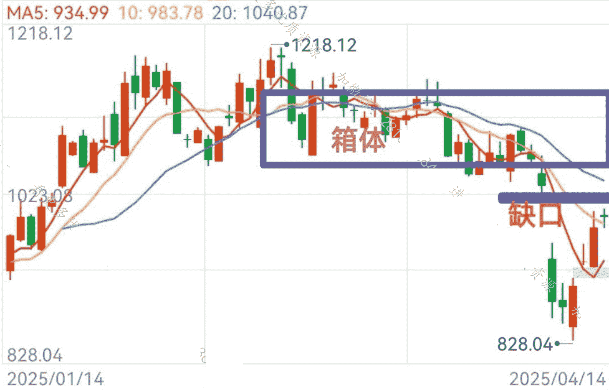
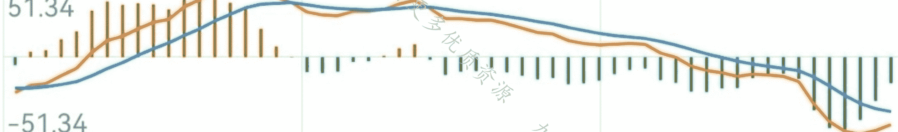
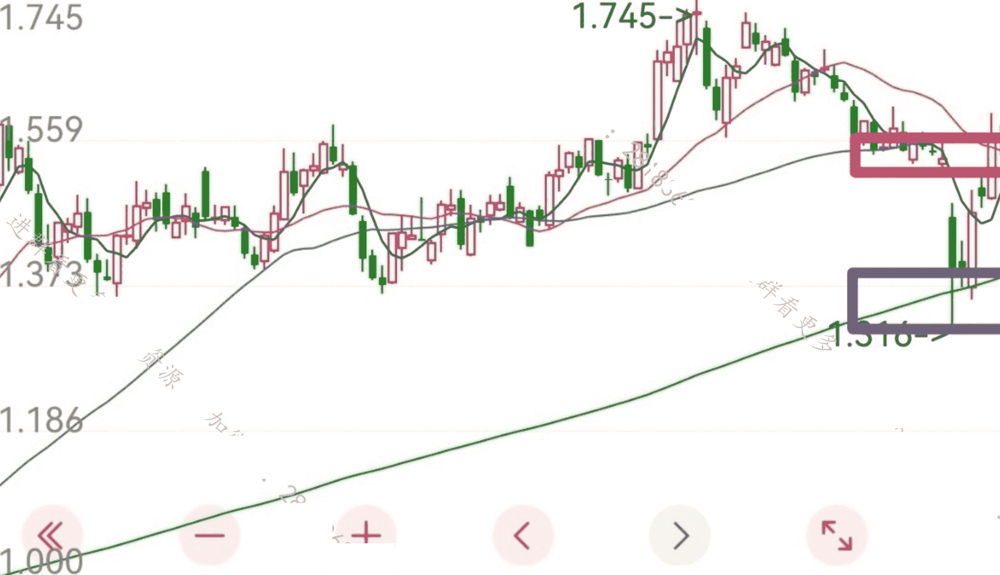

# 南院大王
2025-04-14 15:09

## 最先补缺

科技板块里最先补上4月3日大跌口的，SOC板块。

整个大科技板块的调整是3月份开始的，它们是2月中旬开始的。

本来在4月初，已经率先先初步稳住了阵脚和技术图形，主要要趁一季报大力推动一底。

结果4月3日碰到关税战，它们因为有出口份额被连带进果链杀。因此主力开始积极的自救行情。

其中一些已经收回跌，比如soc/mcu都搞的芯原，一季业绩炸裂的威尔等等。

个股搞不明白的依然可以了解588200那个ETF。

这些人的大类统称，科创芯片。

当然，补缺不会一蹴而就，但却是一个必然。

## SOC芯片
J10603

992.08 +13.73 +1.40%

最高 1003.30 今开 995.00 涨家 7家
最低 977.34 成交额 113.09亿 跌家 6家

分时 五日 日K 周K 月K 分钟

MACD(12,26,9): 17.31 DIF:-44.90 DEA:-36.25

## 科创芯片ETF

588200 融沪股通 L1

1.559
0.00% 0.000

今开 1.565 最高 1.579 最低 1.540

总手 1462万 金额 22.79亿 量比 0.66

实时估值 1.5580 折价率 -0.06% 最新份额 153.2亿

跟踪指数 科创芯片 1728.04 0.18% 跟踪误差 0.02% >

时分 五日 日K 周K 月K 更多

均线 MA5:1.493 ↑ 20:1.547 ↓ 154:1.384 ↑

55:1.566 ↑

成交量 1462万 MA1:2035万 MA2:1663万

20241111 20250410

小字：大王东盟自贸区这个概念您觉得预期还大不大？看宁百货什么时候倒？
2025-04-14 15:11

往楷：大王又掰开喂饭了🤭
2025-04-14 15:12

必胜：大王，中科蓝咏业绩表现也可以，销售主要在国内，美国关税对他有影响吗？后续可以帮忙看一下吗
2025-04-14 15:13

人生就像滴水：今天自选股票转了一圈，半仓了科创芯片，大王又给了一颗定心丸，开心。
2025-04-14 15:14

葫渺：本来瑞王给了一次上车机会，结果不被靠谱关税大棒懵了没反应过来，如今请教大王，我明天诸涨票上船，是先遇见肉丝儿还是先遇见冰冰山呢？
2025-04-14 15:19

南院大王回复小字：董事长长程回来就差不多了
2025-04-14 15:24

南院大王回复必胜：辛苦，其实是SOC。这一波它们被果链殃及池鱼。
2025-04-14 15:25

小字回复南院大王：收到😌

## 免费 价值 及时 专注

## 扫码加入 知识星球TOP 免费资源群

- 每日免费获取有价值资源
- 可提供各类资源搜索服务

| 热门付费文章 | 各行行业报告 |
| :--- | :--- |
| 精选图书资源 | 副业赚钱方法 |
| 职场实用资源 | AI财经自媒体 |

公众号：知识星球TOP 微信信号：jntsg8 微信信号：jntsg2

分享资料仅供个人学习，请及时删除，切勿商用传播
