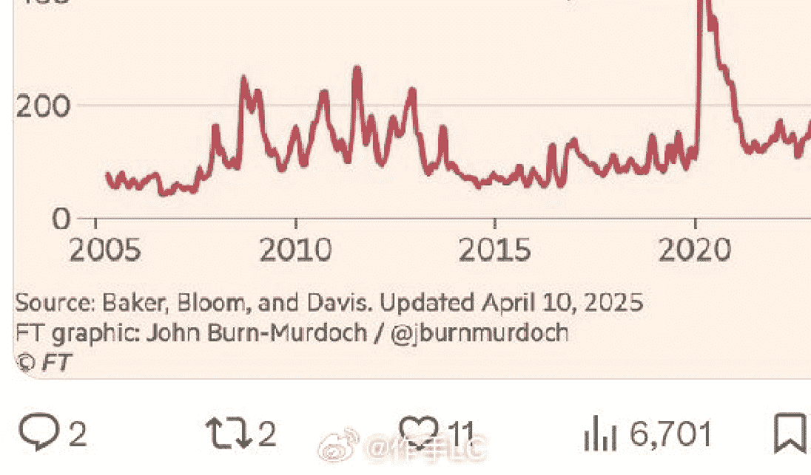

# 发星

郭磊 · Crypto+ AI @gelei

这个人的预测很准：

他现在确实崩了：

1. 日本经济的崩溃
2. 2008年美国金融危机
3. 美中之权的权力转移

达洛乔 (Ray Dalio) 发布了新的警告：

我们正在面临的是：

2025年4月13日，16:40 5.3万 关注

收藏 219 赞 189 回复 129 条

# 最近的回复：

郭磊 · Crypto+ AI @gelei · 3小时前

2. 三、多力量正在均衡：

郭磊 · Crypto+ AI @gelei · 3小时前

3. 这里的通胀正在发生：

达洛乔，地缘政治正在从负面变成正面的压力：

全球60%的财富正在流向美国：

台湾，半导体产业，甚至军事竞争的优势，可能已经结束了：

市场流动：

郭磊 · Crypto+ AI @gelei · 3小时前

4. 美国的货币正在贬值：

