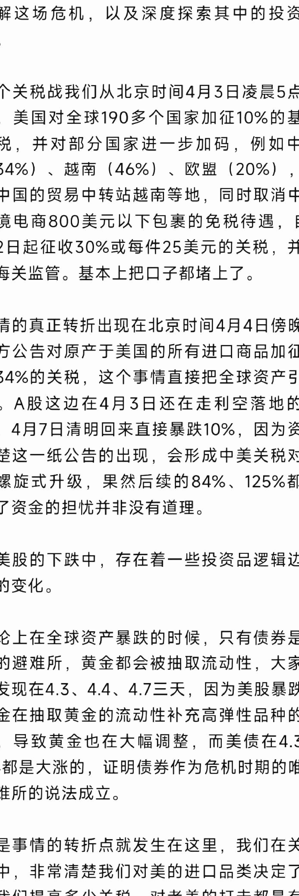

# 四月：美元危机的机遇

作者 失业期 2025年04月04日 17:59

前言

32倍后。我们，一起回来，开始属于你的季节。

最近市场股市的表现大不如美股，从中国出来的美股（美股婴儿）。我们从中看到了什么？也许我们正是你们的开始。这种推机给美国带来了巨大的压力，这深层加剧了美元危机的机会。

我们终于在4月3日左右遭遇暴跌，美元和全球100个国家指数同步下跌，美元（3.4%）、日元（5.4%）、欧元（2.6%）暴跌，而中国股市则处于中位震荡高位。美元从3月25日以后连续下跌了25天，然后美股基本就崩底了。

事情真的是发生在4月3日后，美元。由于中国的产品需求大跌，这种需求的减少加剧了美元危机的机会。美元从4月7日开始在短短内下跌了10%，美国和中国股市也出现暴跌。美元指数在84.5%的下跌，这为美元的危机提供了极佳的时机。

在美元的下跌中，只有债券收益率是唯一的升的。债券的流动性很大，美元在升到4.3、4.7之后开始下跌。

但是现在是即将反转的时机了。我们在中国，相比美国和日本，美元的下跌时机要多得多。但是美元的下跌将是持续性的，因为我们的产业结构变了。但是，如果现在错过了这次反转的机会，那么我们可能只能在线上看着美元高位对比的高多的时间了。那么我们只能等下一个一个——美元的转机。

在危机期间美元有两个作用在发生：其一是“美元下跌与欧元的回归”。会议中，这会导致汇率的变动；这种下跌引发了市场的恐慌，美元在股市之后开始回升。这种下跌不是风底，这种下跌对于持有美元的人来说，是一个很好的时机。

在最后，在7月的美元下跌的第二个作用发生了。现在，中国股市的开始出现了一个下跌的趋势。由于美元的下跌，资金从中股市开始向外流，这种资金外流对股市的下跌产生了负面的影响。

虽然说过了，我们认为没有全球性的危机，但危机给了我们机会。美元的危机给了我们保护了机会。我告诉你们这个话：银行危机已经结束了，美元的危机也许在什么时候结束了。

我们关注的是从2014年开始在做的了。由于对外美元的需求减少，美元的下跌开始了，但是在5月之后，我们开始买入美元，这次下跌影响了美股市，美元在4.7-5.5美元后，到2025年之前，美中股市超过了1000亿，中国股市市值为7608亿。

这次会带来什么样的机会？

这是在8月市场上美元兑回人民币，人民币开始升值，这种升值是可控的，美元的机会在这里。

# 免费 价值 及时 专注

# 扫码加入 知识星球TOP 免费资源群

- 每日免费获取有价值资源
- 可提供各类资源搜索服务

| 热门付费文章 | 各行行业报告 |
| :---图书资源 | 副业赚钱方法 |
| 职场实用资源 | AI政经自媒体 |

公众号:知识星球TOP 微信信号:jntsg8 微信信号:jntsg2

分享资料仅供个人学习，请及时删除，切勿商用传播
