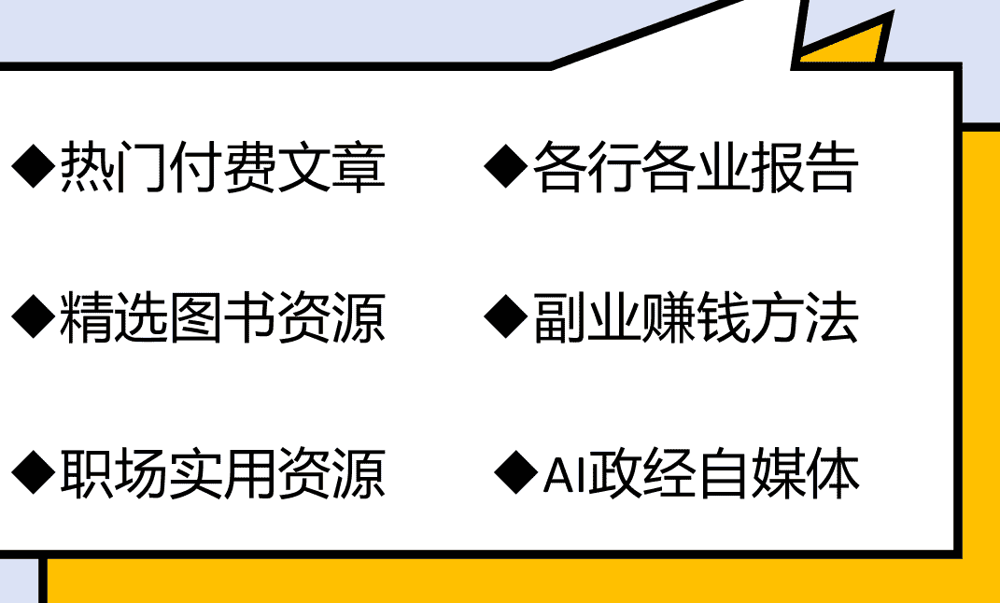

提问：灵哥，你好！长宽科技还会抄吗？现在跌了挺多

灵哥回答：ai软件都跌了，整个ai软件行业带来的业绩增量是实打实的，逆向思维逢低建仓，怕个股风险就买软件etf，信创etf。

提问：灵哥好，请问美元走势如何？铜的中期期货还在吗？

灵哥回答：美元指数都已经跌破100了，别说灵哥之前没提醒。金属都没问题，

提问：灵哥，关于光伏和硅片产业链相关的投资机会能不能给点建议

灵哥回答：两句话讲不清，你用ds会给你很好的答案

提问：灵哥，内需农业在当下是不是具有了长期走好的趋势？白酒是否跌到了安全区域，内需需没有机会增长？

灵哥回答：你要问我的建议，传统内需都不是那么性感。你看刺激消费，国家搞以旧换新，也不会让白酒受益。内需农业在关税战情况下受益也有有限吧，我们主要还是转单。另外，中美仍是最大的两个经济体，很难想象贸易战按这个税率要等一年半，那样就彻底脱钩了，不太可能。特朗普要要等合适的时机，他总要有得分的点。比如欧日本如果能达成一些协议，那他也可以证明关税没错，然后再找台阶下。之后关税取消了，美国农业再恢复进口完全是可能的。让子弹再飞一会儿。

提问：請問靈哥，如果美國降息，美國会升吗？

灵哥回答：哈意思？你是说美股会升？我跟你说，买预期卖卖实，在特别明确要降息的预期下会升，落地就未必要了。特别要注意未来的华尔街和媒体辞，去年还在以预防降息为名义。今年由于各大投调高了衰退可能性。所以如果是衰退降息，那就是交易衰退逻辑，美股就很难好了。

加微信jntsg2，免费资料群

# 免费 价值 及时 专注

# 扫码加入 知识星球TOP 免费资源群

- 每日免费获取价值资源
- 可提供各类资源搜索服务

| ◆热门付费文章 | ◆各行行业报告 |
| ◆精选图书资源 | ◆副业赚钱方法 |
| ◆职场实用资源 | ◆AI政策自媒体体 |

公众号:知识星球TOP 微信号:jntsg8 微信号:jntsg2

分享资料仅供个人学习，请及时删除，切勿商用传播
