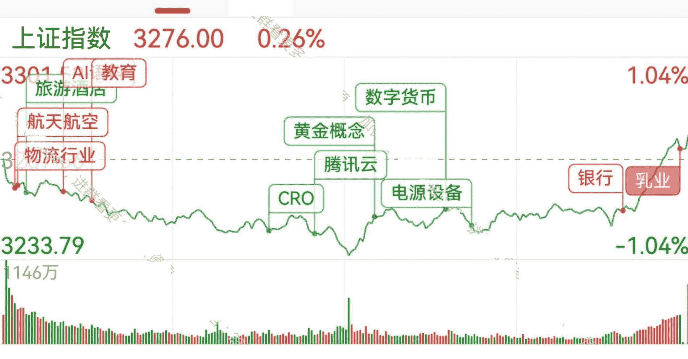
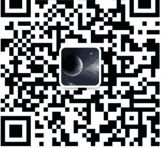

# 南院大王
2025-04-16 16:03

## 阶段三进行时

无量上涨有多猛，下杀就有多凶，所以要要控制仓位。

坏消息是，
指数强行拉起来，个股稀里哇啦，

好消息是，懂王不玩什么猴子的话，纯技术指标看，再有一两跌，市场还不得放量到1.3万亿？

1008以来最大的调整，即将结束。

部分的资金抱团方向，（虽不明朗已已有端倪）

乳业，有点高了，调整后还有机会。

MCU，势达好几天，略。

个股搞不定的我们说的ETF有国家队在。

涵芦：有请课代表回答一下MCU（2025-04-16 16:14）

人生就像一滴水：今天科创芯片ETF尾盘看着不太稳，趁拉升出了半，后面等等震下来接回来，紧跟大王节奏。（2025-04-16 16:16）

南院大王 回复 人生就像一滴水：拉尾非玄即逸。（2025-04-16 16:18）

Star~ 回复 涵芦：上海贝岭，圣邦股份，东软载波（2025-04-16 16:20）

人生就像一滴水：回复 南院大王：收到，防火防盗防拉尾。（2025-04-16 16:22）

豫轩：现在是垃圾时间，躺平（2025-04-16 16:22）

Mr.吕：已经进了点算力，弘信朕的凶呀（2025-04-16 16:27）

涵芦 回复 Star~：谢谢！以茶代酒洒（2025-04-16 16:38）

## 大盘异动

## 个股异动

| 类别 | 数值 | 涨跌幅 |
| :--- | :--- | :--- |
| 上证指数 | 3276.00 | 0.26% |
| 3301 AI 教育 | 3233.79 | -1.04% |
| 旅游酒店 | | 1.04% |
| 数字货币 | 1146万 | |
| 航天航空 | | |
| 黄金概念 | | |
| 腾讯云 | | |
| 物流行业 | | |
| CRO | | |
| 电源设备 | | |
| 银行 | | |
| 乳业 | | |

异动详情 2025-04-16

- 1. 本来就要跌，因关税由头大跌（已发生）
- 2. 反弹，形成复杂的底部，有些人忍不住再进去了（爬行中）
- 3. 再一轮，甚至更猛烈杀跌，把这些人这些人也埋了。
- 4. 调整完毕，大涨。

你得活到4啊。

[作者] 南院大王
南院大王摘录自：鉴茶财经院

## 免费 价值 及时 专注
## 扫码加入 知识星球TOP 免费资源群

- 每日免费获取价值资源
- 可提供各类资源搜索服务

| 热门付费文章 | 各行行业报告 |
| :--- | :--- |
| 精选图书资源 | 副业挣钱方法 |
| 职场实用资源 | AI政经自媒体 |

公众号：知识星球TOP 微信信号：jntsg8 微信信号：jntsg2

分享资料仅供个人学习，请及时删除，切勿商用传播
