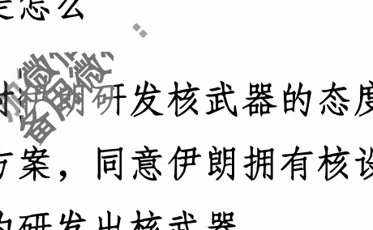

# 令人意外的重大让步

嘉凭：梦回安西

2025年4月15日，美国中东问题特使特威科夫证实，将不再完全要求伊朗“无核化”。消息一出，舆论哗然，以色列那边都快疯了。

因为特威科夫的表态，伊朗的重大让步，事情来得十分突然。

那么，这是怎么？

美国内部对研发核武器的态度，分为两种：一种是民主党方案，同意伊朗拥有核设施和和平利用核，只要不真的研发出核武器。

奥巴马时代，美国和伊朗签了《伊核协议》，按照上述思路处理的，这套方案因此被称为“奥巴马模式”。

另一种是特朗普方案，或者叫做共和党方案，拒绝对伊朗进行任何让步，要求伊朗无条件放弃研发核武器，并拆除一切相关设施。

共和党这套方案，曾对利比亚使用过，卡扎菲同意无条件拆除核设施，换取美国解除制裁，共和党方案由此被称为“利比亚模式”。

以色列最关心的，是“利比亚模式”，非常不喜欢“奥巴马模式”。毕竟伊朗只要有核设施，说不定哪天就真的把核武器发出来了。

看着伊朗的核设施，以色列坚决睡不着觉。

特朗普非常讨厌以色列，所以在第一任期时，悍然摧毁《伊核协议》，并发动了一系列制裁和军事行动，希望强迫伊朗接受“利比亚模式”。

击杀莱曼尼，正是其计划的一部分。

从2018年至今，兜兜转七年，折腾了半天，结果还是回到了原地。

早知如此，何必当初。

让步的主要原因，是极端施压没有奏效。

二次登基以来，特朗普很希望压服伊朗及其盟友。为此，又是轰炸胡塞武装，又是调动6架B-2轰炸机到迪加西亚亚岛（印度洋中部）。美军现役B-2数量才19架，一次性调动6架去轰炸伊朗，真的是下本钱了。

不过，伊朗不吃这一套，胡塞也不在乎轰炸，双方对峙了一个多月，啥效果没有。

伊朗敢硬气，是知道特朗普想战略收缩，不想开战，赌的就是你不敢开战。

胡塞也差不多，反正我家里没啥值钱的东西，你随便炸，只要你不上陆，我都是无所谓。

# 特朗普的法

已经已经被很多人看穿，很难再捞到利益了。大家知道只要不屈服，他没不能对你怎么样。

他不想、也不敢轻易开战。

基于此，伊朗和美国耗上了。

伊朗总统佩泽扬，外界都知道是个投降派，但最高领袖哈梅内伊不是。

哈梅内伊一直玩政治。

而特朗普的政治问题日益严峻，比伊朗问题更重要的是，比如俄乌战争，折腾了两个，丝毫不看不到有停火的。

这种情况下，继续和伊朗耗下去不是明智之举，最好的办法是做出让步。如果伊朗拒绝，双方接下来的将会有好戏。

伊朗的经济状况也很困难，它确实希望美国减少制裁，就认为是哈梅内伊伊朗也不会拒绝。

而这次重大让步，将带来两个明显的负面后果。

负面后果一，是伊朗亲派受到打击。

伊朗的亲派倾向于对美国投降，如果不投降，就会面临灭顶，经济一点损失了。只有伊朗让步的份，不要幻想美国让步。

要知道，美国竟然主动让步了，简直是特朗普给伊朗亲派的曙光。伊朗强硬派可以直气壮地地说，不用投降，面对面会让步的。

伊朗亲派，已经不是第一次遭到特朗普打击了。

第一次是2018年时，特朗普悍然撕毁了《伊核协议》，由于协议是亲美派的鲁哈尼签字的，许多伊朗亲美派，将协议视为大胜利。

而强硬派，则对协议非常不满，他们希望继续发展核武。

特朗普上台后，强硬派声势大涨。然而，伊朗也让步，美国主动让步了，这这结果是不对的。

负面后果二，是美国耗不起。
