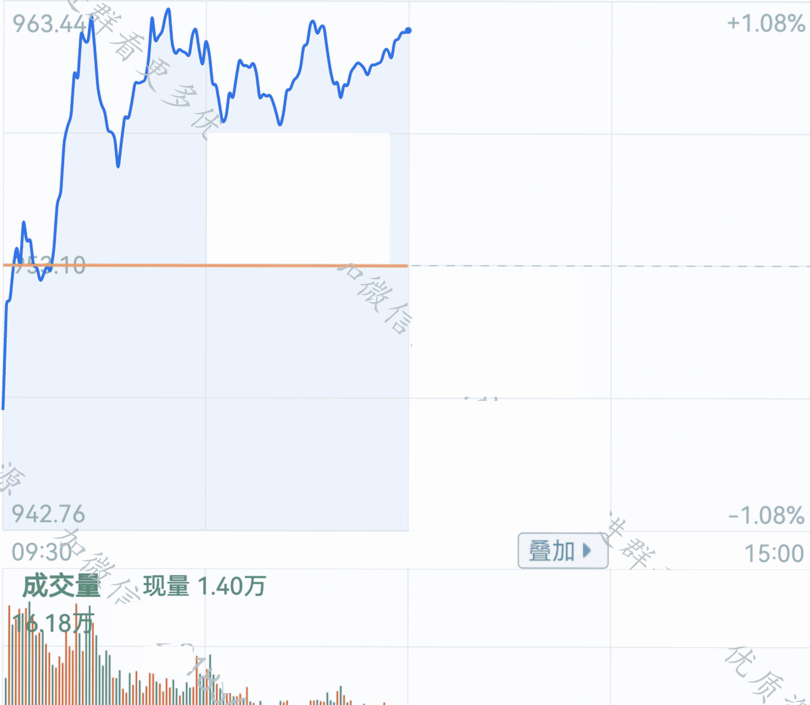

# 南院大王

2025-04-17 11:43

抱的一手好团

MCU筹谋已久，属团新方向。

位置低啊，很多都是1008以来没涨多少。

SOC是错杀实修复。

贵归贵，业绩实实在炸裂。

恒生科技稳则大A科技稳。

科创芯片设计的ETF588780，看样子模拟芯片较多。

之前关于mcu的探讨，

大王，西大对半导体和电子产品的...

其余的翻帖子自己找找吧，胖虎说的中也又表现了。

## MCU芯片

J10461

最高 963.44 今开 947.46 涨家 56家
最低 946.56 成交额 258.45亿 跌家 9家

分时 五日 日K 周K 月K 分钟

成交量 现量1.40万

成分股 新闻 研报

+ 涨幅榜 跌幅榜 净流入榜 成交额 市值榜

| 股票名称 | 最新价 | 涨幅 |
| :--- | :--- | :--- |
| 思瑞瑞 688536 | 184.50 | +10.48% |
| 中颖电子 300327 | 24.79 | +9.98% |

## 免费 价值 及时 专注

## 扫码加入 知识星球TOP 免费资源群

- 每日免费获取有价值资源
- 可提供各类资源搜索服务

| 热门付费文章 | 各行行业报告 |
| :--- | :--- |
| 精选图书资源 | 副业赚钱方法 |
| 职场实用资源 | AI经营自媒体 |

公众号:知识星球TOP 微信信号:jntsg8 信号:jntsg2

分享资料仅供个人学习，请及时删除，切勿商用传播
