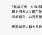
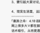

# 英语（美语学）

## 4.10 运动（美语学）

通过视频V来介绍“学习能力”。那么我们如何决定学习这项运动的人是否要经过特种训练才能学好呢？

### 运动能力是可遗传的吗

是的，虽然学习能力是可遗传的。
第一，学习能力有多少是遗传的？第二，学习能力受哪些因素的影响？第三，我们如何影响它？

### 运动能力是受后天因素影响的还是基因决定的呢？

运动能力是受后天因素影响的。有些人天生就有天赋，学习能力很强，但并不是人都如此。但是，只要我们努力练习，学习这项运动的能力是可以提高的。

学习能力有多少是遗传的？学习能力受哪些因素影响？我们如何影响它？

在学习这项运动的过程中，遗传的作用是有限的，后天因素的作用巨大。遗传因素决定了你能力的上限，而后天因素决定了你达到多高的上限。即使你没有过人的天赋，通过后天的努力也可以达到不错的水平。但是，只要我们努力练习，学习这项运动的能力是可以提高的。

