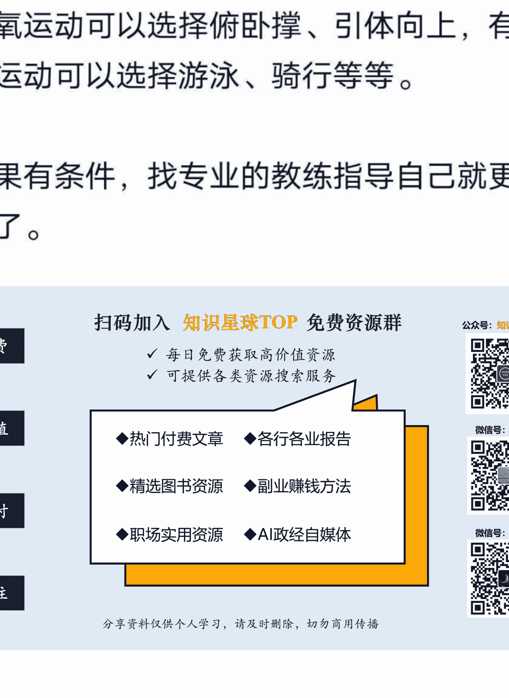

#35岁面临三大危机（以及对策）

本文2025年4月16日发布（U享等候）。

真正面临人生的关口，是35岁后的三大危机。

# 1. 职业的危机：失业

如果你在35岁时面临失业，那又会有什么后果？

这意味着我们面临的不仅是失去工作，更是失去了收入，陷入了生活的困境。我们该怎么办？

但是，越年轻越容易找到新工作吗？

在2020-2030年，失业将成为常态。

在2030-2040年，人工智能将取代大部分的人（尤其是脑力工作）。

# 2. 财富的危机：贫穷

所以，无论是否失业，贫穷都是无法避免的。你必须学会如何积累财富。

早买房、买股票、买基金、买理财。复利的力量巨大的，越早开始越好。

应对这种危机，我们该如何做？

首先，学会理财，不要把钱花光。

# 3. 健康的危机：疾病

如果你已经过了30岁以后，身体就会开始衰老。

