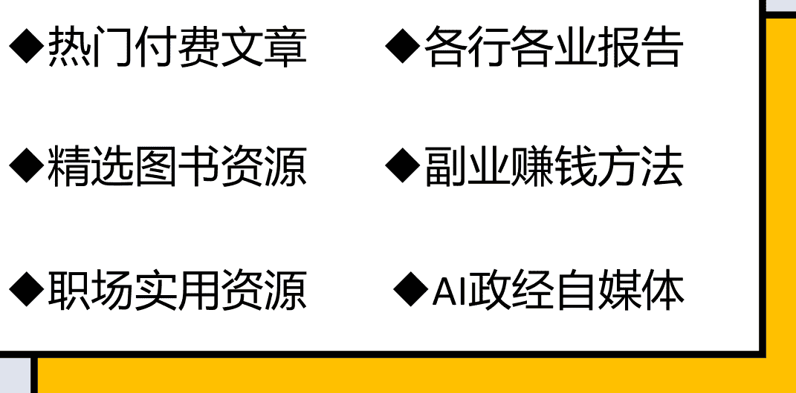
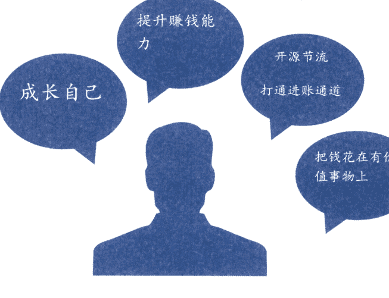
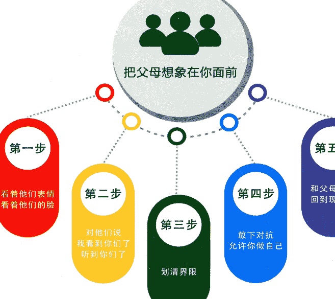
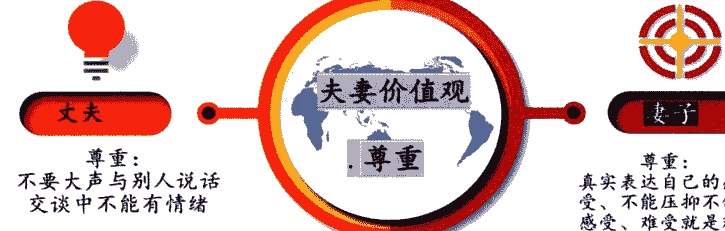
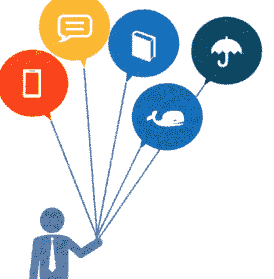

# 目录

前言 7

什么是决定着你的命运? 11

你是你生命的创造者 13

第一章：如何轻松快捷实现目标? 18

你渴望拥有什么吗? 18

设定目标，对人生有多重重要? 19

如何设定人生的目标? 22

第一步：找出你的目标 22

第二步：找出你的核心目标 24

第三步：清理头脑中的杂念 27

第四步：将目标进行分解 35

第五步：制作目标宣言 39

目标模板 41

第六步：落实目标确认还 44

# 免费 价值 及时 专注

# 扫码加入 知识星球TOP 免费资源群

- 每日免费获取价值资源
- 可提供各类资源搜索服务

公众号:知识星球TOP 微信号:jntsg8 微信信号:jntsg2

分享资料仅供个人学习，请及时删除，切勿商用传递

# 第七步：制作梦想板：

### 第八步：祝愿别人实现“梦想”

## 自我暗示

## 第二章：如何拥有幸福的婚姻关系

你的配偶就是你的潜意识

承担起孩子百分之的责任

### 父母对于孩子婚姻观的影响

- 一、孩子会忠诚父母
- 二、父母是婚姻模式的原件

### 如何突破婚姻不幸的重围

- 第一：觉醒原生家庭的模式
- /与父母和解的练习/
- 第二：在婚姻中调整双方价值观念
- 第三：用正面的光光看待你的伴侣
- 第四：梳理理想婚姻模式的蓝图!
- 第五：正向的自我暗示!

《吸引理想的丈夫》
《吸引理想的妻子》

# 《幸福婚姻的暗示语》

## 第三章：做情绪的主人

### 情绪是传递的

# 如何与情绪和解?

- 第一步：转变为以往看待事物的方式
- 第二步：拿到情绪背后的资源
- /练习*与情绪对话/
- 第三步：与内在小孩和解
- /练习*治愈负责的小孩/
- /练习*治愈内疚的小孩/
- /练习*治愈愤怒的小孩/
- /练习*治愈孤独的小孩/
- /练习*治愈哭泣的小孩/
- /练习*治愈孤单的小孩/
- 第四步：将美好种子耕在潜意识里

## 第四章：你生而健康

# 如何向意识传递健康的观点?

《与身体对话》
《身体健康疗愈》
《健康的正向暗示语》

### 如何启动潜意识自我疗愈？

《自我疗愈暗示语》

## 第五章：你与金钱的关系

### 你内在有哪些限制性信念

# 形成限制性信念四个途径

- 第一：童年经历
- 第二：个人成长经历
- 第三：与他人的关系中形成的
- 第四：外部影响

# 如何打破限制性信念？

- 第二阶段：改写画面
- 第三阶段：转化

# 如何让金钱爱上你？

> 【我是一块吸引金钱的磁铁】

《让金钱爱上你》
《感练习》 196
《爱与感暗语》 198

# 第六章：改善人际关系 200

如何拥有好的的人际关系? 206

第一、时刻保持觉知! 206

第二：正向暗示 207

《良好人关系确认语》 209

如何吸引贵人? 212

《吸引贵人练习》 214

后记 216

# 前言

亲爱的读者朋友：

你好，恭喜你翻开此书，当你看完此书后，书中的内容会带你揭开茧背后的神秘面纱，书中内容将带你打开启你的认知。你将从书中找到一份宝藏，这 unique宝藏会让你轻松易举地实现你的愿望！

它会让你从贫穷走向富有，
从黑暗走向黎明，
从黑夜走向光明！

首先去问下自己，
你对当下的人生现状是否感到满意？
你有没有问过自己，你到底想想要过什么样的生活？

去思考一下，那些比你成功 100 倍的人，他们真的比你聪明 100 倍吗？
为什么你的人生无法突破？

加微信 ntsg2，免费资料分享群

## 为什么你的工作那么累？

为什么你有计划没成果？
为什么你找不到努力的方向和动力？
为什么你无法吸引异性的目光，成为人群中的焦点？
为什么你想要的一切，爱情、事业、财富无法实现？
为什么你身上总有无穷的压力，让自己疲惫不堪，无法摆脱？
为什么你会活得卑微无力，生命无法绽放？
为什么你总是半途而废，无法坚持，事业无成？

因为……你的智慧在沉睡！
因为……你不懂得正面思考！
因为……你不相信自己能够卓越！
因为……你没有目标、没有梦想！
因为……你不知道改变后的秘密！

加微intsg2，免费资料分享群

## 什么是决定着你的命运?

现在再次向你确认一次，你是否已经准备好开启显化背后的神秘纱？
你是否渴望改变，精进自己，达到财富上的自由？
你是否渴望让自己获得财富、爱情、健康、人际关系、孩子实现？
你是否渴望将自己的梦想精准显化？

如果你的答案是“Yes”，那么，书中的内容将带你从人生八方面（家庭、财富、人际关系、健康、孩子、事业）出发，每个方面将为你解读，并告诉你显化的步骤、方法，你只需要运用书中方法，就能精准显化，成功的人生！这是一本实战、练习为主的工具，也是一本精准显化的字典，当你用心读完本书，一定会惊喜。

种瓜得瓜，种豆得豆。种下什么就会长出什么！土地无法什么是他想要的种子，什么是不想种下的。不管农夫选择什么，无论他种下的是西瓜还是毒草，长出的都是果实！无论你在头脑中播下什么种子，最终都会显化到世界上。

为什么大多数人得不到他们想要的？那是因为他们被训练去关注和思考他们不要的！如果你经常不断地想着那些你不希望发生的事，你就在播下那样的种子。根据宇宙法则之“播种和收获法则”，它一定会发芽。你要知道一切都是能量，所有的能量都是同频的，你不能发出负面能量却期望正面的结果，同样你不能在失败的土壤上长出成功的果实。牢记一句：“你想什么就会成为什么。”如果我们把大脑比作一个花园，在花园中不时会有各种杂草冒出，我们把杂草比作你的负面念头。如你时常把焦点聚焦在让你失败、让你怀疑、让你恐惧的念头上，那你的花园将会杂草丛生。记住，一个成功的园丁，总会好好培养它的花朵。他会清理杂草，好好培养花朵，让花园盛开娇艳的花朵。同样你需要现在去培养你的“头脑花园”，让它长出丰盛、理解、感、富足、幸福、繁荣、仁慈、宽恕和爱吧！

加微信：ntsg2，免费资料分享群

当然，你要意识到，我们的思想比土地更加的肥沃、更加奇妙、更加神秘，它是以同样的方式在运作着的。思想并不在意我们种的是什么，不管是成功还是失败，是一个坚定的目标还是困惑、焦虑、等等，它都会全盘接受。思想是最后一块土地，它拥有最疯狂的梦想，种什么你一定会得到。

思想比土地更加的肥沃、更加奇妙、更加神秘，它是以同样的方式在运作着的。思想并不在意我们种的是什么，不管是成功还是失败，是一个坚定的目标还是困惑、焦虑、等等，它都会全盘接受。

（此处根据OCR逻辑重复部分，已合并后续内容）

## 第二章：如何拥有幸福的婚姻关系

你的配偶就是你的潜意识

承担起孩子百分之的责任

### 父母对于孩子婚姻观的影响

- 一、孩子会忠诚父母
- 二、父母是婚姻模式的原件

### 如何突破婚姻不幸的重围

- 第一：觉醒原生家庭的模式
- /与父母和解的练习/
- 第二：在婚姻中调整双方价值观念
- 第三：用正面的光看待你的伴侣
- 第四：梳理理想婚姻模式的蓝图!
- 第五：正向的自我暗示!

《吸引理想的丈夫》
《吸引理想的妻子》

# 《幸福婚姻的暗示语》

## 第三章：做情绪的主人

### 情绪是传递的

# 如何与情绪和解?

- 第一步：转变为以往看待事物的方式
- 第二步：拿到情绪背后的资源
- /练习*与情绪对话/
- 第三步：与内在小孩和解
- /练习*治愈负责的小孩/
- /练习*治愈内疚的小孩/
- /练习*治愈愤怒的小孩/
- /练习*治愈孤独的小孩/
- /练习*治愈哭泣的小孩/
- /练习*治愈孤单的小孩/
- 第四步：将美好种子耕在潜意识里

## 第四章：你生而健康

# 如何向意识传递健康的观点?

《与身体对话》
《身体健康疗愈》
《健康的正向暗示语》

### 如何启动潜意识自我疗愈？

《自我疗愈暗示语》

## 第五章：你与金钱的关系

### 你内在有哪些限制性信念

# 形成限制性信念四个途径

- 第一：童年经历
- 第二：个人成长经历
- 第三：与他人的关系中形成的
- 第四：外部影响

# 如何打破限制性信念？

- 第二阶段：改写画面
- 第三阶段：转化

# 如何让金钱爱上你？

> 【我是一块吸引金钱的磁铁】

《让金钱爱上你》
《感练习》 196
《爱与感暗语》 198

# 第六章：改善人际关系 200

如何拥有好的的人际关系? 206

第一、时刻保持觉知! 206

第二：正向暗示 207

《良好人关系确认语》 209

如何吸引贵人? 212

《吸引贵人练习》 214

后记 216

# 前言

亲爱的读者朋友：

你好，恭喜你翻开此书，当你看完此书后，书中的内容会带你揭开茧背后的神秘面纱，书中内容将带你打开启你的认知。你将从书中找到一份宝藏，这 unique宝藏会让你轻松易举地实现你的愿望！

它会让你从贫穷走向富有，
从黑暗走向黎明，
从黑夜走向光明！

首先去问下自己，
你对当下的人生现状是否感到满意？
你有没有问过自己，你到底想想要过什么样的生活？

去思考一下，那些比你成功 100 倍的人，他们真的比你聪明 100 倍吗？
为什么你的人生无法突破？

加微信 ntsg2，免费资料分享群

## 为什么你的工作那么累？

为什么你有计划没成果？
为什么你找不到努力的方向和动力？
为什么你无法吸引异性的目光，成为人群中的焦点？
为什么你想要的一切，爱情、事业、财富无法实现？
为什么你身上总有无穷的压力，让自己疲惫不堪，无法摆脱？
为什么你会活得卑微无力，生命无法绽放？
为什么你总是半途而废，无法坚持，事业无成？

因为……你的智慧在沉睡！
因为……你不懂得正面思考！
因为……你不相信自己能够卓越！
因为……你没有目标、没有梦想！
因为……你不知道改变后的秘密！

加微intsg2，免费资料分享群

## 什么是决定着你的命运?

现在再次向你确认一次，你是否已经准备好开启显化背后的神秘纱？
你是否渴望改变，精进自己，达到财富上的自由？
你是否渴望让自己获得财富、爱情、健康、人际关系、孩子实现？
你是否渴望将自己的梦想精准显化？

如果你的答案是“Yes”，那么书中的内容将带你从人生八方面（家庭、财富、人际关系、健康、孩子、事业）出发，每个方面将为你解读，并告诉你显化的步骤、方法，你只需要运用书中方法，就能精准显化，成功的人生！这是一本实战、练习为主的工具，也是一本精准显化的字典，当你用心读完本书，一定会惊喜。

种瓜得瓜，种豆得豆。种下什么就会长出什么！土地无法什么是他想要的种子，什么是不想种下的。不管农夫选择什么，无论他种下的是西瓜还是毒草，长出的都是果实！无论你在头脑中播下什么种子，最终都会显化到世界上。

为什么大多数人得不到他们想要的？那是因为他们被训练去关注和思考他们不要的！如果你经常不断地想着那些你不希望发生的事，你就在播下那样的种子。根据宇宙法则之“播种和收获法则”，它一定会发芽。你要知道一切都是能量，所有的能量都是同频的，你不能发出负面能量却期望正面的结果，同样你不能在失败的土壤上长出成功的果实。牢记一句：“你想什么就会成为什么。”如果我们把大脑比作一个花园，在花园中不时会有各种杂草冒出，我们把杂草比作你的负面念头。如你时常把焦点聚焦在让你失败、让你怀疑、让你恐惧的念头上，那你的花园将会杂草丛生。记住，一个成功的园丁，总会好好培养它的花朵。他会清理杂草，好好培养花朵，让花园盛开娇艳的花朵。同样你需要现在去培养你的“头脑花园”，让它长出丰盛、理解、感、富足、幸福、繁荣、仁慈、宽恕和爱吧！

加微信：ntsg2，免费资料分享群

当然，你要意识到，我们的思想比土地更加的肥沃、更加奇妙、更加神秘，它是以同样的方式在运作着的。思想并不在意我们种的是什么，不管是成功还是失败，是一个坚定的目标还是困惑、焦虑、等等，它都会全盘接受。思想是最后一块土地，它拥有最疯狂的梦想，种什么你一定会得到。

# 第一章：如何轻松快捷实现目标？

你在大脑中种下什么？此刻你去问下自己：你想成为什么样的人？你渴望什么样的生活？目标是人生的灯塔，前进的方向。我们都知道常识：向日葵是向着太阳转的，只要我们确定了目标，就不会受干扰，这会让你变得豁达、开朗。著名激励大师汤姆·霍普斯说：“成功是个火炉，目标就是燃料。”有一句话说“向着目标前进的人，全世界都会让路。”设定目标，对人生有多重重要？哈佛大学做过一个调查，对象是一群环境和智商差不多的年轻人。调查结果发现：
- 27%的人没有目标
- 60%的人生活模糊
- 10%的人有理想，制定了短期规划
- 5%的人有理想，制定了长期规划

25年后，这群人的生活状况很有：
- 5%的人几乎成了顶尖人士
- 10%的人成了社会中产
- 60%的人在社会下层
- 27%的人活在社会底层，天天抱怨他人

同样在53年，耶鲁大学进行了一项研究发现：
- 10%的人设定了一个目标，但只有4%的人清晰、具体的目标。

二十年后，这4%的人拥有的财富超过了96%。目标对人生有巨大的作用。如果你设置了一个目标，潜意识会调动一切资源来帮助你击这个目标。你选择什么样的目标，就会有什么样的的人生。有一个故事是这样的：三只猎狗追一只土拨鼠，土拨鼠钻了一个树洞。这个树洞只有一个出口，一会儿从树洞里钻出一只白色的兔子，兔子飞快地奔驰，三只猎狗围堵，兔子急了，“嗖”的一声跳上了另一棵大树。兔子在树上没有稳态，一下子掉了下来，砸了正忙看的三只猎狗，兔子趁机逃跑了。

你对这个故事有什么质疑吗？兔子不会爬树？一只兔子不可能砸死三只猎狗。可是还有一个问题，你们没有想到：土鼠哪儿去了？故事的开始，土拨鼠才是猎狗的目标，可是由于兔子的出现，猎狗改变了目标，我们的思维在不知不觉中打了差，土鼠竟在脑中消失了。在追求的人生目标中，我们有时会被分散精力，在中途停下，有时会被细枝末节打破，有时会被琐事分散，迷失了方向，或走上了歧路，从而失去了最初的目标。人生的路很，既有奇花异草的诱惑，又有重重叠嶂的阻碍，你一定要常常提醒自己——土鼠哪里去了，不要忘记你最初的人生目标。

## 如何设定人生的目标呢

### 第一步：找出你的目标

现在我需要你在下方，写下你所有渴望实现的目标，把你当下所有渴望实现的目标全部写在下方表格中，想到什么就写什么，不要有任何束缚，也不管它们不能实现。（你可以参考图中的八大分类，作为催化愿望的参考方向）。每一个板块中你最渴望实现的愿望是什么？

### 举例：李先生

| | |
| 成为一名优秀的销售人员 | 成为卓越的领导 |
| 公司营业位居行业领先 | 实现年入千万 |
| 拥有三观一致的灵魂伴侣 | 实现债务翻转 |
| 拥有完美的身材 | 拥有一辆顶级豪华 |

### 第一步：找出你的目标

现在我需要你在下方，写下你所有渴望实现的目标，把你当下所有渴望实现的目标全部写在下方表格中，你要尽地想象，想到什么就写什么，不要有任何束缚，也不管它们不能实现。（你可以参考图中的八大分类，作为催化愿望的参考方向）。每一个板块中你最渴望实现的愿望是什么？

### 第一步：找出你的目标

现在我需要你在下方，写下你所有渴望实现的目标，把你当下所有渴望实现的目标全部写在下方表格中，你要尽地想象，想到什么就写什么，不要有任何束缚，也不管它们不能实现。（你可以参考图中的八大分类，作为催化愿望的参考方向）。每一个板块中你最渴望实现的愿望是什么？

### 第一步：找出你的目标

现在我需要需要你在下方，写下你所有渴望实现的目标，把你当下所有渴望实现的目标全部写在下方表格中，你要尽地想象，想到什么就写什么，不要有任何束缚，也不管它们不能实现。（你可以参考图中的八大分类，作为催化愿望的参考方向）。每一个板块中你最渴望实现的愿望是什么？

### 第一步：找出你的目标

现在我需要需要你在下方，写下你所有渴望实现的目标，把你当下所有渴望实现的目标全部写在下方表格中，你要尽地想象，想到什么就写什么，不要有任何束缚，也不管它们不能实现。（你可以参考图中的八大分类，作为催化愿望的参考方向）。每一个板块中你最渴望实现的愿望是什么？

# 如何打破限制性信念？

- 第二阶段：改写画面
- 三阶段：转化

# 如何打破限制性信念？

形成限制性信念四个途径

- 第一：童年经历
- 第二：个人成长经历
- 第三：与他人的关系中形成的
- 第四：外部影响

## 如何设定人生的目标呢

- 第一步：找出你的目标
- 第二步：找出你的核心目标
- 第三步：清理头脑中的杂念
- 第四：将目标进行分解
- 第五步：制作目标宣言
- 第六步：落实目标确认还

### 第一步：找出你的目标

现在我需要你在下方，写下你所有渴望实现的目标，把你当下所有渴望实现的目标全部写在下方表格中，你要尽地想象，想到什么就写什么，不要有任何束缚，也不管它们不能实现。（你可以参考图中的八大分类，作为催化愿望的参考方向）。每一个板块中你最渴望实现的愿望是什么？

### /练习·看见杂念/

接下来的你需要你找到一个安静的地方坐下来，我将带你去清理头脑中对你有限制的杂念！

先做三次深呼吸，让自己放松下来

深深地吸气——慢慢地吐气放松

再次深深地吸气——慢慢地吐气放松

在最后一次深呼吸——慢慢地吐气放松

现在你需要你在表格中写下，你当下头脑中所有的思想和杂念！

| |
| :--- |
| |
| |
| | |
| | |

加微信inttsg2，免费进资料分享群

注意：这些想法，也许前言不搭后语，也许上句不当下，没关系，尽情地去写！因为当你写完后，看见即消融，看见即流动，看见即改变，看见即完结！

当你写完后，看向你所写的，在内在的默念：

对不起，请原谅，谢谢你们，我爱你们

对不起，请原谅，谢谢你们，我爱你们

对不起，请原谅，谢谢你们，我爱你们

/练习·拿到念背后的资源/

你要察察到，你所抱念的，所有负面思想背后都有宇宙给到你的巨大资源！

每一个思想的出现，都有它的使命所在！

举例：有一个快递小哥，去给刘先生送快件，快递安全抵达刘先生楼下，快递小哥打电话给刘先生，让他下楼取快件，如果刘先生不接呢，他会持续打，甚至快递小哥会对应的单元楼，敲鼓刘先生家的门。

如果他不开，快递小哥以为他没在家，下次还会来光顾刘先生，直到他取到快件为止！

其实如果我们把障碍比做快递小哥，他是使命所在的，当你拿到了快件，拿到了障碍背后的资源，他就不会来打扰你！因为他的使命完成了！

接下来我需要写你头脑杂念背后的资源是什么？

举例：

| 杂念或障碍 | 障碍背后的提示或资源 |
| --- | --- |
| 现在负债 | 成长自己、提升赚钱能力、开源节流、打通通道、把钱花在有价值事物 |

在下方写下你杂念背后的资源：

加微信ntsg2，免费资料分享群

| 杂念或障碍 | 障碍背后的提示或资源 |
| --- | --- |
| | |
| | |
| | |
| | |
| | |
| | |
| | |

看着上方所写的资源，对它们表达无限的感谢。

内在一直默念：“谢谢、谢谢、谢谢”

/练习•与资源对话/

现在闭上眼睛，做三次呼吸，让自己放松下来，把资源想象在脑海里，去看向它们。

加微信：ntsg2，免费资料分享群。

对它们说：“我现在终于看到你们了，我深感受到你们们了，我知道你们的出现是源于爱，我拿到你们带给我的提示了，感谢你们、我爱你们！ ”

继续它们说：“今天我终于看到你们们了，对不起，我过去曾无意无心伤害了你们，希望得到你们的原谅，原谅我对你们有无意无心的伤害，感谢你们的保护，感谢你们给予的提示，我爱你们、感谢你们、感恩你们、深情地祝福你们！ ”

现在感觉一下，此刻你已经放过了这些思想，拿到思想背后的提示，你允许了它们做自己，同样也允许了自己做回真实的自己!

加微信ntsg2，免费资料分享群。

此刻，慢慢地睁开双眼，回到当下！

你也可以每天静坐 30 分钟，去照见你的思想。当看见思想时，思想就松动了，你就改变了！

### 第四步：将目标进行分解

当我们面临一些比较长期，难度较大的目标时，焦虑情绪会增强。

制定计划时要从上往下拆分，先定好大目标，然后将大目标分成小目标。

明确达到每个大目标和小目标时的衡量指标，截止日期、通过什么方式达到目标等。

将大目标拆成小目标，可以使得目标更明确、更好执行，让整个任务感觉更可控。

加微信：intsg2，免费资料分享群。

制定可实现的小目标，自信来自成功的经验，把目标由远及近分解为一个小的目标，让原本“看上去很难”的任务，因为分解而变得相对简单。

当实现了这个小目标的时候，我们会得到积极的自我肯定，从而有信心完成下一个目标。

为什么有些人制定了目标，却总得不到落实，而有些人却可以一步步朝着梦想迈前？

那根源源于他们运用了逆向思维！

我们也可以采取逆向思维，所谓逆向思维就是要先确定目标，然后从目标出发，反向推演，当你达成目标需要用到什么样的战术、什么的方法，如何分配你当下的有的资源，时间如何分配，以及你要什么途径来达成目标！

比如，无论你现在收入是多少，想要提升到每年收入30万，50万，100万等等，其中一种都是结果。我们用逆推的方式将目标进行拆分：

| 目标 | 每天需要 |
| --- | --- |
| 如果你想年赚5 万元 | 只需要每天137 元 |
| 如果你想年赚10 万元 | 只需要每天274 元 |
| 如果你想年赚20 万元 | 只需要每天548 元 |
| 如果你想年赚30 万元 | 只需要每天822 元 |
| 如果你想年赚50 万元 | 只需要每天1370 元 |
| 如果你想年赚100 万元 | 只需要每天2740 元 |

来举一个例子：无论你现在做什么，是工作还是创业，运用逆推思维如何实现？如何一年赚10万？除以12个月，每月就是833元，再除以30天，每天就是277元。

加微信：ntsg2，免费资料分享群。怎样能够赚到80元？有很多途径，我们最直接的方式，假设你有一产品，每单利润是300块，那么要想赚到80元，算一下，是不是只要1单就可以了。现在，我们的目标发生了一点变化，每年10万变成了每天1单，看起来简单多了？如何每天卖出产品呢？如何获得流量呢？

互联网中获取的方法非常多，如短视频、直播、微信、电子书、软文、同城网站等等。精通任何方法，倒推思维：成交——信任——承诺——激发需求——培育——引发好奇——接触——推广，就是一个很好的销售流程！到现在的每年10万，只需要每天获取200个流量。你每天的工作就是获取流量，或者自己操作或者雇人为去做，只要执行，12个月以后，10万自然就成了！

### 第五步：制作目标宣言

早晚宣读目标：根据以下5步骤，写出你的目标宣言！

- 1. 明确你渴望得到的金钱数额。（举例：年入10万（XXX））
- 2. 确定为了想要的金钱数额，你能够付出什么？（举例：每天开发多少客户）
- 3. 拥有一个明确的截止期限！（举例：在某年某月某日之前）
- 4. 具体写你想获得金钱的具体计划
- 5. 采取相应的行动

每晚睡前，心中默念着你的目标宣言，晚上睡觉前默念一次，早上起床后也默念一次。将目标耕种在潜意识里，一夜潜意识都在为你吸引目标的一切资源；早上醒来，它就会引导你走向目标！一定要坚定目标，你对你的目标越强烈，它实现的速度就会越快。我的人生格言是：“心之渴望，身践行；心有所应，而必成”你对目标渴望的程度，就决定它强化的速度！曾说过：“你必须持续抱有强烈的愿望，乃至不知不觉中让这种愿望渗透到潜意识之中。”所以你需要在晚上入睡前宣读目标宣言，把它种植在你的潜意识里，来唤醒心中对目标的渴望！

### 目标模板

把你的目标套进去：在XXX年XXX月XXX日前，我已经拥有XXX元，在此期间，这些钱将随时以不同的额到来！为得到这笔钱，我愿意付出能力及最有效的服务，作为一名XXX（销售人员），提供尽可能多和最优质的服务！我相信我将拥有这笔金钱，我十分笃，这笔钱此刻能清晰地看到它，触碰到它，当我拥有这笔金钱时，我能听到我的家人、团队、朋友对我的赞赞，当我我有这笔金钱时，我感受到的内心是喜悦的、开心的、富有的、流动的！（注意）：写出当你实现目标时，你看到的、听到的、感觉到的美好画面，写的越美好、越快乐越能轻松放松！）从此刻开始，只要我提供高质量的服务，它就会立刻转化为同等比例的利益给我。我在等待一个可以获得这笔金钱的计划，一旦计划出现，我将立刻行动，毫不拖延！（特别提醒：在阅读目标宣言时，你要尽可能多地借助于你的想象力）

### 看到
### 深深地相信

达成目标时：
- 你看见什么？
- 内心深深地相信已经实现了？
- 你听到什么？
- 触碰到什么？
- 感觉到什么？
- 内心深深地知道已经实现了？

想要提升想象力的技巧，比如：闭上眼睛，在脑海中像电影一样，清晰地这些画面。 让他感受这些画面的真实，这种戏剧化过程，让潜意识自动做出反应。晚上睡前重复，次数越多，效果越好！一个最可行的方法是录制目标带，每晚睡觉前重复播放，让目标带陪伴你入睡。在睡觉时不停地重复，潜意识都在运作，来帮助你实现目标所需的所有。最好将其中一张，贴在卧室床上方，目标上方，早上醒来，它就会引导你走向目标！目标越强烈，实现的速度就会越快！

### 第六步：录制目标带

录制属于你的目标带 想要改变的快，录制时间！最好录制5-10分钟！

**特别注意：**录制目标带时，你的声音要小一点，我们要逃避思想的审判，偷偷种植在潜意识里，所以录制目标带时，一定要小声宣誓！

**如果你的梦想是成为演说家：**你可以把这段演说家的暗示语配上潜意识专用音乐，进行录制，每天循环播放！下方是给大家提供的模板，可以借鉴，录制属于你的：

### 《超级演说家暗示语》

亲爱的XXX，你是全世界最有爱心的、最有能量的最有魅力的。你具有超强的表达力和影响力，你已经做好了充分的准备，你即将上台演说！你是财富导师，你是身心灵教练（XXX），你是爱的使者，通过你将会影响更多人的生命！听众通过跟随你学习：他们的财富不断增倍、他们开始懂得并热爱生活、他们不断感悟生命的真谛、不断传播爱，最终实现心灵充足、全方位成功的人生！在你的影响下，你将智慧与爱的种子渗透到他们的潜意识里，这股爱的力量通过听众传向四方。亲爱的XXX，你知道你站在舞台上完美充满活力，你光芒万丈、魅力四射、无懈可击，你的肢体语言极其富有能量，你演说的内容无比精彩，这些精彩的内容都会长久地留在听众脑海及他们的心里。你是史最有吸引力、最有感染力、最有影响力的演说家。你所讲的信息像甘泉一样流进听众的心里，给他们的灵魂的滋养！亲爱的XXX，会有越来越多的人因为你，生活得更有品质、更有活力。你将富有的种子深地扎根在泥土中，生根发芽、开花结果，直到黄金的麦穗结出成百上千麦粒，麦粒须等待大自然的机会方成熟。而你却无须等待，你有选择命运的能力。不断有人伸出手来帮助你成功，也有更多的普通人从你这里得到无价的礼物：爱、信心、自由、富足和支持。亲爱的XXX，你能主宰自己的命运，你将不断创造奇迹。你的使命就是运用你的文字、口才到世界的各个地方去传播爱与智慧。亲爱的XXX，你的每一次演讲都非常成功，从你这里得到无价的礼物：爱、信心、自由、富足和支持。加微信ntsg2，免费资料分享群

### 第七步：制作梦想看板

建立梦想仓库，从人生大板块中（财富、事业、人际关系、成长、家庭、学习），是你想做的事，都可以统统收集起来。建立好梦想仓库，以一年为单位，选择你想要实现的梦想，举例：XXX年（今年）。

| 板块 | 梦想目标 |
| --- | --- |
| 财富 | 20万 |
| 事业 | 50万 |
| 人际关系 | 10万 |
| 成长 | 30万 |
| 家庭 | 30万 |
| 学习 | 80万 |

把其中一张，贴在你经常能看到的地方。举例：（卧室、厨房、卫生间、床头、办公桌、客厅）。

 旅行：买一辆车
- 家庭：带宝宝旅行
- 旅行：去西藏、环游中国
- 学习：读80本书

二、将梦想视觉化你可以采用三种方式制作梦想板：

- 1. 清单型：把你列出来的渴望实现的梦想，以文字形式写在备忘录里。
- 2. 梦想册型：把你渴望实现的梦想，在网络上找到对应的图片，将它们一一打印出来，制作成梦想册，放在床头，每天睡前翻阅梦想册，将画面植入到潜意识里！
- 3. 拼图型：根据梦想清单里的事情，找到与之对应的图片，把所有的照片拼在一起成了梦想模板！把制作好的拼图打印出来，至少打印5份，把它贴在你经常能看到的地方。

特别提醒：一定要把握好以下两个原则：
- 每个梦想不要超过5件事。
- 每件事要写得具体，用数据和行动的方式描述梦想。

### 第八步：祝愿别人实现“梦想”

如果你想达成某个目标，那首先要带着慈悲之心帮助或祝愿他人完成这个目标。当你这样做时，你会获得更强的能量来帮助你实现更大的目标。你要记住，外在没有别人，外面世界是一面镜子，透过别人才知道真实的自己！一样，如果你渴望实现的目标，你就去帮助或祝福那些渴望实现目标的人，帮助达成达成！

举例：我有一个学员负债累累，他的目标就是翻转债务，他问我如何才能做到实现财务上的翻转，让自己实现财务自由！我告诉他：每天晚上睡觉前，躺在床上，闭上眼睛，让全身放松下来，去发大愿！所谓的愿：就是在脑海中把天下的所有像你一样负债的人想象在脑海里，祝愿他们还清了负债，想象他们财务上已经得到了翻转，想象源源不断的金钱已经找到了他们，想象他们实现了自由！他真的简单、相信、听话、照做了，持续做这些练习了21天，他奇迹般地吸引了一个好项目，好机会的到来，轻松实现了财富上的翻转！

那背后的原理是什么呢？当你渴望还清负债时，你首先想到的是负债，而想到负债时，你内心是紧张的、压抑的、匮乏的，按照吸引力法则，你装着什么就会吸引什么，你装着的是恐惧、匮乏，那么你就会吸引恐惧和匮乏降临你的生命中！

加微信ntsg2，免费资料分享群

## 自我暗示

运用潜意识达成目标的最快、最直接的方式就是积极地自我暗示，显示自己一定会达成目标。

人因悲伤而哭泣，但往往因哭泣而悲愁，世界上有许多被挫折、不安、自弃感所苦恼的人，他们总以为自己对任何事都无能为力。这显然是陷入了负面作用的自我暗示的陷阱中。

自我暗示的正面作用，乃训练我们如何达成目标，如何赚钱致富，如何由失败中体验成功，又如何克服恶劣的情绪等等。

自我暗示能使人把药当药物治好疾病，也能人把药水当毒药吃送命。自我暗示如何正确使用，乃是人生过程中不可避免，且必须渗透的一门学问。

心理学家威廉·詹姆斯给我们提供了一个自我暗示公式，他提醒欲望吸引良好目标的人，不断对自己说：“在每一天，在我的生命里面，我都越来越好”。

而我呢？在我的人生中，一路走来遇到了很多贵人相助，后来我发现，是因为我时常把：“我太幸运了”这句话，常挂在嘴上，所以才无形间吸引了很多好运来到！

自我暗示，最简单、最直接的方式就是不断地默写，大声朗读或默念自我暗示术语。

本书，每一章节的结束，我都会给大家贴上相应的潜意识暗示术语，你只需要反复念，就会将对应的正向的语言耕沃你的意识里！

接下来我为你分享一段关于实现目标的暗示：

> 《实现目标的潜意识确认语》

我有清晰明确的目标，
我笃定我的愿望能够照进现实，我清晰地看到我已经达成目标的美好画面！
我有明确的通向目标的详细计划，
此刻我马上行动，我现在就去做，
我热爱行动，行动是所有快乐的源泉。

加微信：ntsgg2，免费资料分享群

我不不断地完成我需要要做的事情，我开始做的事一定能够完成它。我非常迅速而有效地完成每件事情，我享受工作的过程，我享受我的人生，我享受努力后的成果，也享受我富裕的过程，我有坚强的信心，我有无限的精力来采取大量的行动！

我不不断地告诉自己，马上行动。我有完成任何事情的能力，我想到的事情就马上去做。我是一个有行动力的人，我的行动给我带来无限的快乐，我在行动中不断学习，不断精进！

行动中我的能量越来越高，状态越来越好！我有取之不尽的能量，我精力充沛，神清气爽，我有毅力，我的眼神露出刚毅！我握拳头，我积极有力！我有力量，我富有激情！我以行动表达信心！当我不断采取行动，我就能轻而易举地达成目标、实现愿望！

## 第二章：如何拥有幸福的婚姻关系

### 你的配偶就是你的潜意识

我们每个人生来都是一个完整的个体，但为了适应环境的变化，我们每个人都展现出一部分的内在感受，而压抑了另一部分，结果导致我们每个人都成了“半个人”。

你的配偶就是你的潜意识，若要知道你的潜意识里在想什么，那么就看看你的伴侣，对方完全反映出你压抑的部分；你之所以会被对方吸引，是因为你底部压抑的碎片与对方一样。这样的两个人都结合在一起，似乎又变成了一个整体。

看似运作的规律，我们可以察觉一下：有的夫妻刚开始在一起比较融洽，一旦在一起久后，也会发生冲突，所以你察觉到，每个人其实并不是在跟伴侣冲突，而是在与自己的潜意识冲突。

无论你认为自己有什么特质，你一定也同时有着与之相反的特质。只是你压抑住了这一部分而已！

去觉察一下：

| 你是一个自信的人 | 同时也是一个自卑的人 |
| :--- | :--- |
| 你是一个快乐的人 | 同时也是一个悲伤的人 |
| 你是一个严苛守规的人 | 同时也是不拘小节的人 |
| 你是一个优柔寡断的人 | 同时也是当机立断的 |
| 你是一个志存高远的人 | 同时也是安于当下的人 |

潜意识中的每一面，都并非不可接受，也一定都有积极的意义。对特质的两面需要充分地被看见、理解、接纳、整合，并最终变出智慧。

如果自己一个人无法看清，你的伴侣会是最好的镜子，他能帮你看到生命的完整！

你生命中所有的结果，其实都是你吸引来的，都是你潜意识所渴望的，并且都与你的童年有关：古人云：“三岁看大、六岁看老”。

你童年所看到、所听到、所感受到的！它们会慢慢演变为你的习惯，从而决定了你的运气！

在你的一岁之前若被接纳、被包容、被爱与连接，那你长大后就会有一个很强的心想事的能力。

如若你两岁之前，没有从父母那里得到足够的爱与认同，长大后你就会渴望从身边身上索取爱！如果从父母给你的内心创造了很多愧疚、罪恶感，你长大后就会牺牲自己来成就别人，不太会考虑自己的感受！

如若小时候，身边常常被忽视，长大后你就会拥有很强的控制欲！你看到的世界，完全反映你的内心世界。外在的世界是一面镜子，它反映的是你内在的。

为什么不可避免地被一个人吸引，不可自拔，是因为那个人是你缺失的部分。伴侣所吸引的是你缺失的部分。你喜欢或讨厌伴侣，只是你喜欢或讨厌自己而已。伴侣是你的一面镜子。

你的配偶是你的替身，是你的投射，是你的镜子，他把你外化，让你看清真实的自己。你喜欢他，或者讨厌他，都和你自己，说明你喜欢或讨厌自己。如果你无法看清楚真实的自己，那就试着察觉你和伴侣之间的距离，对方身上会有投射。每个人的存在都给我们带来一份贵的礼物，帮助我们看见更完整的自己，只是给予的方式不同。察觉一下，在婚姻中的争吵，其实是在对方没有满足你的需要，这往往是关系出现的巨大卡点。加微信：ntsg2，免费资料分享群

如若一个人愿意停止吵架，来反思，你就会发现事物会有转机。婚姻是一场修行、一场走向完整的自我救赎，通过伴侣才能察觉到完整的自己。你们身上有相似的，也有不同的。当你开始接纳生命的每一个面向，才能成为完整的自己。所谓灵魂伴侣，就是两个不完整的个体，通过婚姻来疗愈自己；通过学习，接纳了所有的面向，拿回属于自己的力量，最终成为了完整的。两个完整的个体，相互交互。如图所示：

- 白色：相同特质
- 蓝色：丈夫特质
- 白色：相同特质
- 绿色：妻子特质

- 白色：相同特质
- 颜色：不同之处

- 通过学习：丈夫成为完整的
- 通过学习：妻子成为完整的
- 最终成为：灵魂伴侣

（允许其自己）婚姻其实是一场“圆满”的自我救赎。一对男女，他们一见钟情，在蜜月期中尝了爱情的甜味，然后进入“磨合期”，在艰苦的“旷野”中继续发展成为完整的。加微信：ntsg2，免费资料分享群

有的夫妻一开始比较融洽，但是在一起久后，也会发生分化。人们对压抑的部分，也就是配偶拥有的部分，可能是接纳的，两个人在一起就会和谐；如果不接纳的，就会产生冲突。

- 60%：你身上压抑的部分
- 40%：你身上压抑的部分

事实上，人们不是跟配偶冲突，而是跟自己的潜意识冲突。只有跟自己的意识达成“和解”，夫妻冲突才能消除。睿智的人懂得一个诀：如果人在身上尚未整合的部分（父母、子女、敌人乃至自己），都要承担100%的责任。你所有模式的由来，都起源于原生家庭。加微信：ntsg2，免费资料分享群

你无意识间重复原生家庭中的模式，你无意识间重复父母的行为。每一段关系背后都有相似的模式，我感觉总有一股神秘的力量在促使我，让我像母亲对待父亲的模式一样，对待我的伴侣，对他产生各种错误！

她说：“我现在一闭眼，出现的就是我母亲的脸！就是我母亲对我抱怨父亲出轨的画面，我现在深刻感受到我一直活在母亲的阴影之下。”她下决心渴望改变自己的婚姻现状，后来走进了我的课程进行系统学习。

**学习后：**她的人生发生了翻覆性的变化，从之前眼前出现母亲抱怨父亲的画面，到现在脑海中时刻包围着幸福的婚姻画面。

最后再给你分享一个案例！一位叫刘婉秀的女士（花名），是一个大城市的高管。她能力优秀，但同事们通常发现她愁青。加微信：nts2，免费资料分享群

你无意识压抑了另一部分。潜意识中相信所有男人都不是好的，你今天，都要承担100%的责任。

- 100%：你的责任
- 100%：你的责任
- 100%：你的责任
- 100%：你的责任

新年到来之际，大家都纷纷回家过年。在春节的某一天，我正坐在沙发上看电视，厨房和卧室传来了呵斥的声音。我坐在沙发上安静地观察，惊人地发现，他们的语气、语调、肢体动作都是如此相似！仿佛复制般，我的回应也如出一辙。现在这个画面仍然在脑海中历历目目。如果你没有成长，没有看见和解，以后无意识间像妈妈对待伴侣的方式。

她留言：“老师，我听了你的课程，感触非常大。我目前两个月了，晚上刚哄睡着，我还是忍不住向你分享我的的人生。”她说：“听完你的课程，我才觉察到，我无意识间忠诚了我的父母。在我童年的时候，我的父母经常争吵，起因是我的父亲经常出轨，我感受到深深的背叛，时常给爸吵。妈还会委屈时找爸，抱怨他的各种不堪！”

- 白色：相同特质
- 蓝色：丈夫特质
-  白色：相同特质
- 绿色：妻子特质

- 白色：相同特质
- 颜色：不同之处

- 通过学习：丈夫成为完整的
- 通过学习：妻子成为完整的
- 最终成为：灵魂伴侣

（允许其自己）婚姻其实是一场“圆满”的自我救赎。一对男女，他们一见钟情，在蜜月期中尝了爱情的甜味，然后进入“磨合期”，在艰苦的“旷野”中继续发展成为完整的。加微信：ntsg2，免费资料分享群

当你开始接纳生命的每一个面向，才能成为完整的自己。所谓灵魂伴侣，就是两个不完整的个体，通过婚姻来疗愈自己；通过学习，接纳了所有的面向，拿回属于自己的力量，最终成为了完整的。两个完整的个体，相互交互。如图所示：

- 白色：相同特质
- 蓝色：丈夫特质
- 白色：相同特质
- 绿色：妻子特质

- 白色：相同特质
- 颜色：不同之处

- 通过学习：丈夫成为完整的
- 通过学习：妻子成为完整的
- 最终成为：灵魂伴侣

（允许其自己）婚姻其实是一场“圆满”的自我救赎。一对男女，他们一见钟情，在蜜月期中尝了爱情的甜味，然后进入“磨合期”，在艰苦的“旷野”中继续发展成为完整的。

刘婉秀女士的案例：她能力优秀，但同事们通常发现她愁青。她的第一任丈夫，她选择了离婚；第二任丈夫，她也离了。后来我考上了大学，如愿以偿地去很远的地方上学，毕业后，我遇到了我的第一任丈夫，我们刚开始在一起时，过得很甜蜜。不知何时开始，我每天都在焦虑和猜忌中，不断找对方出的丝丝马迹，不断通过这样的方式来折磨着我自己。几乎每天都活在深深的煎熬里，后来即将崩溃的我，主动提出的离婚，结束了我的第一段婚姻！过了两年，又认识了第二任丈夫，我发现人生的模式总是惊人的相似，又是源于种种猜忌，这段关系也告夭了！我总以为只要换一个男人，我的婚姻就幸福了，但我现在才发现事物并不是这么运转的，就像一个不会游泳的人，总换游泳池是没有用的。现在已经是我的第三段婚姻了，我深深地觉察到：加微信：ntsg2，免费资料分享群

刘婉秀女士的经历：她的第一任丈夫，她选择了离婚；第二任丈夫，她也离了。她潜意识中相信所有男人都不是好的，你今天，都要承担100%的责任。

- 100%：你的责任
- 100%：你的责任
- 100%：你的责任
- 100%：你的责任

她无意识间重复原生家庭中的模式。她无意识间重复原生家庭中父母的模式。

很多时候，孩子并不成为父母的翻版，他们压抑了自己的恨。为了减轻愧疚，他们欺骗自己：“我依然爱父母”，从而从忠诚父母的行为，之后他们会将相同的模式带入新的关系中，变成和他们类似。在强大的角色认同之下，孩子可能会重复父母的人生。

父母对于婚姻观的影响，主要来自两个方面：

### 一、孩子会忠诚父母

台湾《泛科学》网站曾有科学家追踪过1500名成年人，结果发现如果父母在16岁以前离婚，这些孩子在30岁离婚的可能性更高。文章解释说，除了自身对婚姻的不信任之外，他们还有可能通过离婚来受伤。

### 二、父母是婚姻模式的原件

很多时候，孩子步入婚姻遇到问题后，他们并不是不想处理问题，而是他们不知道如何处理。在他们潜意识第一时间会出现父母处理的方法，他们就会模仿父母的方式处理。有一个学员，每次和伴侣发生冲突时，他都会选择以冷战的方式处理！后来知道冷战就是他父亲对待母亲的方式。他一直以为只有这样才能双方停止争吵，却不知这样无法沟通，反而会让对方更加压抑和难以。可见，孩子非常善于模仿父母。

| 父母每次都陷入争吵 | 孩子也以争吵解决问题 |
| :--- | :--- |
| 父亲曾对母亲暴力 | 孩子也可能用暴力解决问题 |
| 父母用吼叫、呵斥解决问题 | 孩子也会用吼叫解决问题 |

如果父母每次都陷入争吵，孩子也很可能将争吵视作处理矛盾的必然方式。如果父亲曾对母亲暴力，孩子也很可能以暴力解决问题。如果父母每次都通过吼、呵斥解决问题，孩子也很可能用吼的方式解决问题。

所以很多时候，我们兜兜转却依然停留在原地，是由于原生家庭将我们画为牢。所以，你必须去看见、去疗愈、整合！如果你的部分没有被疗愈，这些部分就会传给下一代（不自觉的状态下），因为孩子太爱父母，就会继承父母的碎片，就会无意识中忠诚于父母。如若你想改变，就必须去抗拒学习和成长。但大多数人为什么会抗拒学习和成长？是因为揭开伤疤，痛就出现了，人为为了不感受伤害，就不断逃避。

很多时候，孩子在原生家庭中没有快乐，甚至是痛苦。更可怕的是，绝大多数人在潜意识里还藏着童年行为，会是不快乐的根源！父母对孩子有如此大的影响，在于家庭本身是一个强大的系统，单个成员的问题，都是家庭的问题。加微信：ntsg2，免费资料分享群

### /与父母和解的练习/

示意图：与父母和解步骤

此刻我需要坐在一个舒服的地方，闭上眼睛，把注意力放在呼吸上，关注你的一吸一呼！

吸气——慢慢地吐气放松

深深地吸气——慢慢地吐气放松

再次深地吸气——慢慢地吐气放松

感受一下你的身体，此刻你已经从头到脚的完全放松了下来！

把父母想象在你的面前，此刻你能够清晰地看到他们的脸、他们的表情、他们的眼睛。

此刻对他们说：“亲爱的爸爸、妈妈，我看到你们了，我感受到你们了，我荣耀你们的过去，我尊重你们的过去，那是属于你们的过去，我不把属于你们的还给你们（划界限）。

我深深知道，你们与生也是完整的个体，此刻，我把对抗你们、不认同你们的思想放下，我允许你们真实地做自己一样，我也允许自己真实地做自己。谢谢你们，我爱你们！”

“当我真实做自己时，我希望你们允许我、深深地祝福我，此刻我将属于我的婚姻模式交给你们！谢谢、谢谢、谢谢、谢谢”

（吸气——呼气）

此刻可以向前走一步，父母深深地拥抱，感受一下你父母允许你做自己，允许你拿自己的力量！

此刻，再一次深长的呼吸！带着感觉慢慢地睁眼睛，回到当下！

### 第二：在婚姻中调整双方价值观

在每个人潜意识中都认为有不同的规则！

我有一个学员，我称呼他为李总：

在他的婚姻中认为相互尊重非常重要，这是他的价值观！而他的伴侣成长的家庭也同样重视“尊重”，但对于“尊重”，他们双方家庭却有着不同的“规则”。

他所成长的家庭，是经过惩罚和奖励学习到的“尊重”，当尊重对方时，会有奖励；不尊重对方时，会有惩罚！

在他家里，假如尊重一个人的话：

- 你绝对不能大声地与对方说话，你要要心平和，不要带着情绪与对方交流，即使你很生气，也绝对不能表现出来。
- 而且绝对不能使用任何不敬的语言，更不能说脏话！

加微信：ntsg2，免费资料分享群

然而在他伴侣的成长环境中，对“对方的尊重”，就是必须传达内心的真实的感受，不高兴就是不高兴、难过就是难过、有情绪就是有情绪、你不能隐藏自己任何的感受。当不舒适时，也可以提高音量，大声地讲出来，来真实地表达自己！

如下所示：

此刻你可以想象一下，当这两个两个人生活在一起时会是什么结果？

当双方产生矛盾时，一个大声地说出心里的想法，据理力争；另一个压抑感受，不愿表达！双方都觉得对方不尊重自己！就陷入了深层相互伤害之中！

后来他听了我的系统课，他感觉察觉到了！他和妻子一起开心心地探讨了这个问题，并且表达了理想中相处的方式，他们拟定了规则。

当下次再有冲突出现时，双方坐下来以理想方式来应对！之后他们还会遇到相同的问题，还会反复之前的模式。但他们开始慢慢地发现，长此以往，加以练习，他们的婚姻从亮红灯慢慢变得更加和谐，最后拥有了幸福的婚姻关系！

在婚姻中，你必须找到你们彼此认为为重要的价值观，拟定理想的相处模式，去进行相应的调整，婚姻关系自然会朝着好的方向发展！

### 第三：用正面的眼光看待你的伴侣

人在持续关注的情况下，所关注的内容会被写进潜意识里。

加微信 ntsg2 免费进资料分享

如果我们内心持续关注的是，对对方加班晚归，可能有不忠诚，那么当质疑时：说话的口气、内容都会让对方感到的不被信任。

当把这些投射了对方，而对对方同时也接收到了你发出的这些不信任频率，自然就会产生委屈、被冤枉的情绪，在质疑和敌对的情绪中，就会伤害双方的关系，那么最初怀疑的结果便“真实”地出现了。

所以牢记一句话：“你要用正面的眼光看待你的伴侣，因为你期待什么，你就会得到什么！”

给你分享一个故事：

邵华（化名）因种种原因与初恋女友晓婷（化名）分开，之后两人分别成家生。一天邵华醉酒后拨通了晓婷的电话，一句“你好吗？”引来了电话那边的哭泣声，两人一通电话断断续续、听着......

挂断电话后的邵华醉醉醒醒被哥们送回了家，嘴里还唾沫地念叨晓婷，不久之后，邵华老婆知道了这位前任晓婷的存在，也知道了他们通过了电话：

后来的，晓婷孩子总生病，在电话中给邵华诉苦，邵华老婆知道找到当地医生开个药给晓婷，如果方便，孩子治好了，两个女人也成了朋友。邵华以后不再联系。

（注：此处OCR文本存在大量重复和乱码，根据语义逻辑已进行核心内容修复与去重）

由于原始OCR文本存在极其严重的字符重复、乱码及识别错误，此处根据语义，修复后的核心逻辑如下：

- 此刻对他们说：“亲爱的爸爸、妈妈，我看到你们了，我感受到你们了，我荣耀你们的过去，我尊重你们的过去，那是属于你们的过去，我不把属于你们的还给你们（划界限）。”
- “我深深知道，你们与生也是完整的个体，此刻，我把对抗你们、不认同你们的思想放下，我允许你们真实地做自己一样，我也允许自己真实地做自己。谢谢你们，我爱你们！”
- “当我真实做自己时，我希望你们允许我、深深地祝福我，此刻我将属于我的婚姻模式交给你们！谢谢、谢谢、谢谢、谢谢”

### 第四：勾勒理想婚姻模式蓝图

当我们写下蓝图后，我们会按照设定的理想方式努力，直到符合我们预期的理想生活！我和伴侣在一起，我们设定的蓝图是：

- 彼此一致，婚姻甜蜜，不被琐事绊住，时间自由，财务自由。
- 生活在四季适宜的地方，四处旅行。
- 我们渴望的事情。

你期望婚姻的模式是什么样的？期望中的人生是什么样的？去听从内心的声音，完美地写在下方表格中，写得越详细、越具体越好！

| |
| :--- |
| |
| |
| |

只要你愿意重新为自己勒一张人生的地图，你就能找到人生方向的可能性。当你脑海中有了幸福婚姻的生活蓝图，你就能创造出你蓝图中所设定的理想生活！

### 第五：正向的自我暗示！

我们所遇到的，是我们内在在频率上所吸引来的！如果你渴望吸引理想的伴侣，非常重要的一个办法，就是提升自己，给自己积极的正向暗示。

- 我们不希望也被生活的琐事绊住，而是被迫生活。
- 我们露出笑容，看到的将是更多的微笑。
- 我们表现正向乐观，那么遇到的事情也会更好。
- 我们做事踏实谦虚，也会给予我们更多的认可。
- 这就是吸引力法则，种什么种子，就会长什么果实！

如果你渴望吸引理想的伴侣，现在就在潜意识里种下什么。

### 理想婚姻暗示语：

《吸引丈夫》：
- 坐在椅子上，闭上眼睛，忘掉其他事，放松你的身体，把注意力放在呼吸上，感受你的身体，完全放松。
- 在心里默念：我正在吸引一个具备以下品质的男人：热爱学习、热爱生活、善良、孝顺、阳光、大方、诚实、平和、快乐、充满活力。
- 我欣赏这些品质，让它们根植在潜意识中，根据我潜意识中的期望，我会吸引正确的男人。

《吸引妻子》：
- 坐在椅子上，闭上眼睛，忘掉其他事，放松你的身体，把注意力放在呼吸上，感受你的身体，完全放松。
- 在心里默念：我正在吸引一个完全标准的女人：热爱生活、工作、事业、和谐、快乐。
- 我欣赏这些品质，让它们根植在潜意识中，我会吸引理想的妻子。

## 第三章：做情绪的主人

你是否常感到身心疲倦？
你是否觉得无法承受的压力？
你是否经常处于亚健康的状态？
你是否渴望摆脱疾病的折磨？
你是否对过去的事情无法释怀的怨恨？

如果是，以上种种让你痛苦的情绪背后，其实都隐藏着你没察觉到的规律，规律背后都隐藏着一扇深入自己的觉醒门。

举例一：来自河南郑州的刘启迪（化名），今年13岁，他喜欢吃草莓，却很讨厌吃香蕉！经过观察和咨询，发现原因是：启迪在5岁之前，对吃草莓和香蕉没有明显的喜欢与讨厌的情绪。

有一天，他从幼儿园放学回家，因为在幼儿园与其他小朋友打架被老师投诉，妈妈回到家很狠狠地训斥了一顿，并把他打了，他很委屈、伤心，因为妈妈并没有听过他在学校打架的理由。在他最最伤心的时候，他的爸爸拿了一个香蕉来：“吃香蕉吧，惩罚！”他用力把香蕉摔在地上！之后又有2-3次他伤心难过的时候，爸爸或是其他人拿了一根香蕉给他。在启迪的脑神经系统中，建立了连接。

（注：后续OCR文本存在大量字符重复、乱码，已根据语义逻辑进行核心内容修复与去重）

像这样大小的事情，在我们生活中时时时刻刻都在发生着。如果你不了解情绪，如果你不懂得运用情绪，那么你就会一直被情绪所困，一直被情绪影响着你的命运……

我有一位学员“杨总”

在听了我的课程后，开始在生活中觉察自己，反思自己，因为他过去时常被情绪所困。

他和爱人时常争吵，每次争吵后，他孩子都害怕地躲在角落里，他觉得知道了，父母之间的葛底底里，是在吸干孩子的能量。

他开始反复问自己：为什么会有这么多情绪困扰着自己，这些情绪来自哪里，孩子长大后会不会也像自己一样在他的孩子面前大声争吵！

他是一个不善言辞的人，当情绪来临时，他要么压抑着表达，要么就控制不住大声争吵！

通过跟跟我学习，他清楚知道，一切都是童年的延续，时候生活在什么样的家庭里，有什么样的父母，他会被潜移默化化成什么样的人。

他开始回忆童年，在他的记忆里，他的爷爷，他的父亲当面临矛盾时，也是以同样的模式来处理问题的，他意识到这大概就是家族能量的延续吧！他无意间忠诚了他的家族！

> 轮回的模式，从祖先代代相，一直延续到今天！
> “在内在发生后，免压抑抒情，当压抑不住，就爆发抒情了”

他开始深深地觉到自己，当自己莫名地发火，莫名地伤害孩子时，他知道自己进入了潜意识模式。

通过潜意识，他慢慢觉得背后向他在表达些什么。

他知道任何一个强烈的负面情绪，不是来自外界事物，而是来自我们内在，都跟过去过的创伤有关。

当走进自己的潜意识，去看情绪背后的表达，他发现每一个情绪背后都在叙述一个痛苦的童年发生！

加微信intsg2，免费资料分享

一个人幼年时形成的模式，已经深深植根于他的潜意识。

对一个人影响最大的不是他能够记住的东西，而是他记不住的东西，也就是他幼年时的经历。

父母的情绪状态，父母的关系模式已经深深植根于他的潜意识。

潜意识是我们身体的原生记忆，它左右看着我们的行为和情绪，一定程度上又决定我们命运的走向和取舍。

情绪源于潜意识，潜意识决定着我们的命运。

我们的身体也是潜意识的表达。

一种疾病都是在情绪上对应着一个不开的结，一种器质性的疾病都是内心深处想法的显现，都是潜意识的表达，可以说情绪，潜意识，身体是一体性的。

我们对孩子的伤害会进入他的潜意识。

他也会通过他的婚姻，工作和与孩子的互动，来弥补潜意识中的缺陷，这也许解释了家族能量的传承吧。

家族能量传递的不仅有理念，见解，还有性格和疾病。
斩断家族负能量的轮回不取决于父母，更不能依靠孩子，而在于自己。

在婚姻中，我们常常会莫名其妙地被配偶“激怒”。

有时我们对配偶的某个表情、某个动作觉得特别忍不可忍。

> 配偶无意间说了一句：“你真用用”，就可能使我们暴跳如雷、小题大做。

这是因为他们在无意间触碰到了你内心积累的某个“童年创伤”。

这让我们似乎在配偶身上，又看到了父母严酷指责的影子，和重新经历了被父母苛责训讯的痛苦。

当你没有意识到这一点时，往往就会在无意识中被童年创伤所控制：

加微信ntsg2，免费资料分享

事实上，几乎每个人都会以自我伤害的方式，重复童年养成的负面行为逻辑。

- 遭受家暴的孩子，长大后，往往会和施虐者结婚，或者自己变成施虐者；
- 童年缺失爱的孩子，长大后，越是渴望爱，越是容易疏疏，冷漠自己的人；
- 被家长管控太多的孩子，长大后，容易被别人操控。

福洛伊德把这种过程称作强迫性重复！

那为什么我们会人为地重自己的痛苦，延长自己的痛苦？为什么不从这样的模式中脱离，去创造更好的生活？

这是因为，我们被自己的“潜意识中的童年创伤”所困缚！

一旦你认识并觉察到童年留下的创伤，尽管它们不会消失，但是它们带来的影响会逐渐减轻，更重要的是，你能重新掌握童年创伤而失控的部分的人生。

生活抛给你的并不是能够由你选择。但得到什么则是有你选择的。

加微信|ntsg2| 免费资料分享

当放下生命中未完成事件，与生命本身握手和解，对情绪说是对说是，看见就已经已经是疗愈的开始。

我们需要探索到情绪背后在向你表达什么！

我们要学会转化情绪，从情绪中找到力量！

如此，才能不被情绪困扰，做回情绪的主人！

从上面的故事中我们可以了解到：

- 1. 情绪它是一股能量，它不生不灭，不增不减一直传下去！
- 2. 情绪并不是来源于你
- 3. 我们很容易被别人的情绪带走，受他人情绪的影响

你要察觉到什么是真正的情绪，其实情绪有积极和消极的，有我们喜欢的和我们不喜欢的。

我们很容易因为对情绪的感受进行评判：对于那些不愉快的、不喜欢的情绪，就称之为负面情绪。

但实际上，并没有什么真正的“负面情绪”！

加微信|ntsg2|免费资料分享群

每一个情绪都是一种语言，都是带着信息来与我们沟通的！

## 情绪是发送信

情绪是发送信，每一封信都来自我们的内心。

如果你好好地收下这个信息，理解并对好这封信，信息就会走掉。

相反，如果你关门不接待这个发送人，他就会一次又不请自来，就像我前提到的一个故事，一个快递的，如果你没收到快件，他就会一遍又一遍地送。

如果你关着门，他就会敲门。白天你不接收，他晚上还会来。这也是为什么我们总在梦中梦见一些不愿意看见和接受的画面。巨大的情绪，包含着越大越重要的信息！

如果你不接受、解读，它就会反复出现并提醒我们。因为这封信里，包含了内心的需要，更隐藏着巨大的宝藏！所以，如果你处于巨大的情绪中，感觉自己不要自我批判和自我责。这绝对不是坏事，我们需要的是通过情绪，看到真实的感受和需求，从而做出、释放和转化，最终成为情绪的主人。可以说，很少人知道什么是情绪，不用去运用了。情绪真的是好的能量，如果你真的学会运用它、掌握它，就可以帮助自己创造出想要的一切。例如：

- 嫉妒的情绪可以给你一股力量，让你提升自己，遇见完美的自己；
- 愤怒的情绪可以给你爆发力，让你打破极限，完成不能完成的事情；
- 紧张的情绪是在提醒你，让你充分准备，让你放松……每一种情绪的到来，一定有目的，一定有意义，一定给你很大的好处！

### 如何与情绪和解？

### 第一步：转变以往看待的方式

首先看着下方的图：
加微信intsg2，免费资料分享

如所示：如果我们把一切比作人生，童年创伤是黑色图案，幸福是空白通过这个比喻，你学到了什么其实你只需要将焦点聚焦在空白上，而非黑色图案上！大多数，把焦点聚焦在情绪上，不断评判自己，直到你发现处处是美好！此刻你的就是转移焦点，看向人生！

### 第二步：拿到情绪背后的资源

情绪是信息，你需要拿到情绪背后的资源！安静下来，闭上眼睛，放松一下不舒服的情绪在哪个位置，是胸腔还是哪个位置！双手放在胸腔或不舒服的位置上，做两次呼吸，感受一下不舒服的情绪在脑海里去看它，对它说：“我你了，对不起，我无意间伤害了，请原谅，感谢你，我想问一下：你的出现向我传递了什么？”静静地等待，直到它回应你！

加微信ntsg2，免费资料群

当拿到提示时，对它说声“谢谢！”然后睁开眼睛，回到当下！把情绪记录下来，完全信任潜意识，做出相应的调整与改变，你就会回到情绪！

### 第三步：与内在小孩

疾病是爱的呼唤，也是情绪的表达！当看到内在压抑时，你只需要和解、疗愈它，你的人生才能发生转变！

| 压抑了哪个小孩 | 身体反应、症状 |
| :--- | :--- |
| 自责的小孩 | 背部此时疼痛 |
| 内疚的小孩 | 心口堵难受 |
| 愤怒的小孩 | 口腔溃疡、嗓子发炎 |
| 郁闷的小孩 | 心口堵、不过气 |
| 孤单的小孩 | 提不起精神 |
| 哭的小孩 | 喜欢哭 |
| 自卑的小孩 | 胸腔、背部此时疼痛 |

如果你背部此时疼痛，觉察一下你是不是一个自尊心强的人，你非常奋，所有的事情都做到更好，不想辜负大家对你的期望！这时压抑住了内在的自责小孩！

/练习*痊愈自责小孩/此刻需要你放松下来，把童年那个做不好就自责的你想象在你面前。对它说：“爱的，你真的很棒，你是一个上进的孩子，你总是为别人考虑太多的。谢谢你、我爱你、对不起、请原谅！原谅我不懂你的心思，原谅我是有意无间批评你，原谅我没有感受到你的感受，没有拥抱你。此刻我想对你说：“你真的很棒，你做得非常好，你无需为任何人而努力，你就是你，独一二的你，为你的天命而活，我爱你，我永远支持。”

如果你心匮痛苦难受，时常感觉无用，自惭形秽，不断内耗能量！这是源于你压抑住了内卑小孩。

/练习*治愈内卑小孩/此刻需要你放轻松下来，把童年那个内卑的小孩想象在你面前。对它说：“对不起，我对你的要求太高、太严格、太苛刻了：童年时期，身边人总是高标准要求你、宽策你，让你承受了许多委屈！”此刻我想对你说：“爱的孩子，你是我心中最棒、最优秀的孩子，你已经做得非常棒了，无论你以后出现什么、发生什么事情，我相信你都已经尽全力了，已经把它做到最好了”。无论你如何看待自己，你永远是我心中那个可爱、最、最值得赞颂的孩子！爱的孩子：你真棒，谢谢你，我爱你”

如果你时常口溃疡，嗓子发炎。控制不住自己的情绪，你不自觉地与周围事物对抗，一经刺激就容易发愁，说明你压抑住了内心的愤怒的孩子！

/练习*疗愈愤怒的孩子/此刻需要你放下下来，把童年那个愤怒的孩子想象在你面前。对它说：“我知道过去无人体会你的感受，你一直压抑着内心的恐惧！爱的孩子，如果你愿意，就向我倾诉！我爱你，对不起，我忽略了你时间太少了，等了你。”

如果你每天精打采，没有精神，心口堵，每天开心容易悲伤、消沉，身体很累，那你觉察一下你是否打压自己，表现出处，说明你压抑了郁闷小孩。

/练习*治愈郁闷小孩/此刻你需要放轻松，把童年那个郁闷的小孩想象在你面前。对它说：“爱的孩子，对不起，我知道忽略了你一个空间，然而你太小了，等你长大了，我会陪着你，直到你快乐。”

加微信tssg2，免费资料分享

### 第四步：将美好种子耕种在潜意识里

早晚睡前在心中默念，下面这段潜意识正向确认语，将正向种子耕种在潜意识里！

我已经全然活出自己，放松自己！无论我在什么样的生存环境，我都可以用自己的力量来抚平心中的创伤，活出全然放松的自己！在人生的旅程中，我见过无数的风景，我笃定我的人生目标，我能轻而易地学会坚强，在爱中不断成长，在闯尽千帆后，回过来思考人生的意义。

加微信|ntsg2|免费资料分享群

从而在蜕变中重生自己。我见过最美的人间，经由它们，回到生命的本源。我享受并热爱生活，把最好的祝福献给自己！我全然接纳不够好的旧的自己，当接纳它的存在，我才能在这种接纳中不再消耗能量，才能不去抵抗、不去遣责、不去逃避。我能够在……处。如果你时常感受到胸腔、背部疼痛，身体很紧张、手脚发麻！那你觉察一下你是否打压自己，突出自己，为了让别人认可！说明你压抑了内在自卑小孩。

/练习*治愈自卑小孩/此刻需要你放松下来，把童年那个自卑小孩想象在你面前。对它说：“爱的孩子，你就是你，独一无二、最棒的你自己。你原本就是上天的完美的，带着你的智慧来到世间，你是如此完美、可爱。在人群中你又是如此同，我爱你，去做你自己吧！对不起，过去我总是赞扬你，肯定你的进步与成绩。我是拔苗助长，忘了陪伴你自然的成长，请你原谅吧，原谅我有无意伤害了你！”我想对你说：“你就是你，独一二的你自己，无论你做什么，我都相信你，支持你。无论外面有人说什么谈论什么，我都相信你。相信你是最棒的、最爱的、最真诚的、最坦然的、最从容定的。你生来就是一位智慧大师，你现在唯一要做的事：就是做回自己，活出自己。你真的很棒，我爱你！”

- 1. 情绪它是一股能量，它不生不灭，不增不减一直传下去！
- 2. 情绪并不是来源于你
- 3. 我们很容易被别人的情绪带走，受他人情绪的影响

你要察觉到什么是真正的情绪，其实情绪有积极和消极的，有我们喜欢的和我们不喜欢的。

我们很容易因为对情绪的感受进行评判：对于那些不愉快的、不喜欢的情绪，就称之为负面情绪。

但实际上，并没有什么真正的“负面情绪”！

加微信|ntsg2|免费资料分享群

每一个情绪都是一种语言，都是带着信息来与我们沟通的！

# 情绪是发送信

情绪是发送信，每一封信都来自我们的内心。

如果你好好收下这个信息，理解并对好这封信，信息就会走掉。

相反，如果你关门不接待这个发送人，他就会一次又不请自来，就像我前提到的一个故事，一个快递的，如果你没收到快件，他就会一遍又一遍地送。

如果你关着门，他就会敲门。白天你不接收，他晚上还会来。这也是为什么我们总在梦中梦见一些不愿意看见和接受的画面。巨大的情绪，包含着越大越重要的信息！

如果你不接受、解读，它就会反复出现并提醒我们。因为这封信里，包含了内心的需要，更隐藏着巨大的宝藏！所以，如果你处于巨大的情绪中，感觉自己不要自我批判和自我责。这绝对不是坏事，我们需要的是通过情绪，看到真实的感受和需求，从而做出、释放和转化，最终成为情绪的主人。可以说，很少人知道什么是情绪，不用去运用了。情绪真的是好的能量，如果你真的学会运用它、掌握它，就可以帮助自己创造出想要的一切。例如：

- 嫉妒的情绪可以给你一股力量，让你提升自己，遇见完美的自己；
- 愤怒的情绪可以给你爆发力，让你打破极限，完成不能完成的事情；
- 紧张的情绪是在提醒你，让你充分准备，让你放松……每一种情绪的到来，一定有目的，一定有意义，一定给你很大的好处！

### 如何与情绪和解？

### 第一步：转变以往看待的方式

首先看着下方的图：
加微信intsg2，免费资料分享

如所示：如果我们把一切比作人生，童年创伤是黑色图案，幸福是空白通过这个比喻，你学到了什么其实你只需要将焦点聚焦在空白上，而非黑色图案上！大多数，把焦点聚焦在情绪上，不断评判自己，直到你发现处处是美好！此刻你的就是转移焦点，看向人生！

### 第二步：拿到情绪背后的资源

情绪是信息，你需要拿到情绪背后的资源！安静下来，闭上眼睛，放松一下不舒服的情绪在哪个位置，是胸腔还是哪个位置！双手放在胸腔或不舒服的位置上，做两次呼吸，感受一下不舒服的情绪在脑海里去看它，对它说：“我你了，对不起，我无意间伤害了，请原谅，感谢你，我想问一下：你的出现向我传递了什么？”静静地等待，直到它回应你！

加微信ntsg2，免费资料群

当拿到提示时，对它说声“谢谢！”然后睁开眼睛，回到当下！把情绪记录下来，完全信任潜意识，做出相应的调整与改变，你就会回到情绪！

### 第三步：与内在小孩

疾病是爱的呼唤，也是情绪的表达！当看到内在压抑时，你只需要和解、疗愈它，你的人生才能发生转变！

| 压抑了哪个小孩 | 身体反应、症状 |
| :--- | :--- |
| 自责的小孩 | 背部此时疼痛 |
| 内疚的小孩 | 心口堵难受 |
| 愤怒的小孩 | 口腔溃疡、嗓子发炎 |
| 郁闷的小孩 | 心口堵、不过气 |
| 孤单的小孩 | 提不起精神 |
| 哭的小孩 | 喜欢哭 |
| 自卑的小孩 | 胸腔、背部此时疼痛 |

/练习*痊愈自责小孩/此刻需要你放松下来，把童年那个做不好就自责的你想象在你面前。对它说：“爱的孩子，你真的很棒，你是一个上进的孩子，你总是为别人考虑太多的。谢谢你、我爱你、对不起、请原谅！原谅我不懂你的心思，原谅我是有意无间批评你，原谅我没有感受到你的感受，没有拥抱你。此刻我想对你说：“你真的很棒，你做得非常好，你无需为任何人而努力，你就是你，独一二的你，为你的天命而活，我爱你，我永远支持。”

如果你心匮痛苦难受，时常感觉无用，自惭形秽，不断内耗能量！这是源于你压抑住了内卑小孩。

/练习*治愈内卑小孩/此刻需要你放轻松下来，把童年那个内卑的小孩想象在你面前。对它说：“对不起，我对你的要求太高、太严格、太苛刻了：童年时期，身边人总是高标准要求你、宽策你，让你承受了许多委屈！”此刻我想对你说：“爱的孩子，你是我心中最棒、最优秀的孩子，你已经做得非常棒了，无论你以后出现什么、发生什么事情，我相信你都已经尽全力了，已经把它做到最好了”。无论你如何看待自己，你永远是我心中那个可爱、最、最值得赞颂的孩子！爱的孩子：你真棒，谢谢你，我爱你”

如果你时常口溃疡，嗓子发炎。控制不住自己的情绪，你不自觉地与周围事物对抗，一经刺激就容易发愁，说明你压抑住了内心的愤怒的孩子！

/练习*疗愈愤怒的孩子/此刻需要你放下下来，把童年那个愤怒的孩子想象在你面前。对它说：“我知道过去无人体会你的感受，你一直压抑着内心的恐惧！爱的孩子，如果你愿意，就向我倾诉！我爱你，对不起，我忽略了你时间太少了，等了你。”

如果你每天精打采，没有精神，心口堵，每天开心容易悲伤、消沉，身体很累，那你觉察一下你是否打压自己，表现出处，说明你压抑了郁闷小孩。

/练习*治愈郁闷小孩/此刻你需要放轻松，把童年那个郁闷的小孩想象在你面前。对它说：“爱的孩子，对不起，我知道忽略了你一个空间，然而你太小了，等你长大了，我会陪着你，直到你快乐。”

她急急忙忙地往公司赶，太过于着急，以至于不小心从楼梯道掉了下来，扭到了脚。

当时脚踝肿得很高，痛得她脚后跟根本无法踏地。

当时我搀扶她，把她送到医院！

拍好片子后，我跟随医生去领片子。

我询问医生：“有没有伤及骨头，严不严重？”

医生告诉我：“很幸运，没伤及骨头，但至少需要静养一周才能好”。

我拿着完好的片子医生开好的药，去病房，对我闺蜜说：“医生告诉我，说没啥事，扭得很轻，一两两天就能好”她长舒了一口气！

结果回家静养的第一天，她脚踝就肿了，第二天完全康复了。当时我感到非常的震惊！

晚上一上一行同事，一起去吃饭，她对所有同事说：“医生看病真专业，说两天好，两天真的好了！”

通过这件事的发生，我更深信了。

137
加微信intsg2，免费资料分享群

内在相信什么，就会成为什么！

无论是什么，只要相信是着的，就一定得到。

其实通过潜意识也能治愈疾病，

治愈的方法非常重要的一点，

那就是心理上的调整！

治愈的力量只有一种，

那就是你的潜意识！

只要不断向你的潜意识传递正确的健康观念，就可以治愈你的身心！

请牢牢记住这一点！

健康的观念是因，治愈就是那个果。

加微信ntsg2，免费进资料分享群

病人相信，这种坚定的信念，释放了潜意识中的自愈力，从而重获健康！

说到这，再给你讲一个，我听过我年前的一位同事，给我讲过一个关于母亲的故事：

我称呼这位同事为“曹老师”。

他说：多年年前他母亲在医院查出了癌症，而且属于晚期的那一种。

在他心里觉得自己的母亲性命不久矣。

但她母亲坚定地说：“没事，我有方法，这不是大问题，很快就能好的，”随后她母亲回到老家，经常去山上拔艾草。通过艾草泡脚、熏房间等等，过了半年后身体竟奇迹地康复了！

当我听完他母亲的故事，感到深深的震撼！

后来我深入研究意识才发现，是她先有了健康的观念，深深地将健康的观念根植在了潜意识里。

她是她信上有方法能治愈，它潜意识接收了这个指令，身体形成了自愈力，才奇迹地得到了康复！

在《秘密》这部影片中，一块石头就能让一个人从疾病走向康复，也是源于潜意识深深地相信！

## 如何向潜意识传达健康的观点？

你可以通过自我暗示的方法！

在前章节中我们多次提到了自我暗示，

暗示是将正确的健康观点输入你的潜意识里，实现治愈。

推动潜意识的自主运行，你只需要完全的信任和放松。

在此，重点强调一下，当你放松时不是让你睡觉！

当你进入深层的放松当中，你比平时更加的警觉，

你的五官，包括听觉、嗅觉、味觉和视觉都比现在灵敏百倍。

你也可以反复念诵（可以默念）将正向的种子输入潜意识里，唤醒你内在的力量、唤醒你内在源的爱。

## 与身体对话

你身体的每一个细胞都蕴藏着所有的记忆，

每一个细胞都是一个圆满的生命，

每一个细胞都可以感受到爱。

其实，你的身体一直试图与你沟通，却再被你忽略。当你的身体的某部位不舒服时，你可以温柔地、充满爱地和它轻声细语说：

> 我是不是疏忽略了什么？你在提醒我什么？”

> 我应该怎么做，让你觉得更好？”

也许你会听到它的回答：

> 你要多爱自己一些”
> 你需要多休息”
> 你需要多运动”

“你只顾照顾别人、一直都在付出，却忽略了照顾自己的需求和感受”，

“你太紧张了，轻松一些”

“你要原谅、要宽恕”……

请你记住：疾病不是为了让我们受苦，而是提醒我们去看！

面对疾病最好的选择，就是持续的放松。

让自己可以静下心来，并你的潜意识让它帮你恢复平静、和谐和秩序，然后你就会发现身体所有的器官慢慢的就会恢复正常。

切记，一定要用确信无疑的语气来说！

你可以每天睡前多次反复默念，下面这段短而直接的健康疗愈语：

### 《身体健康愈语》

亲爱的身体，感念你自从出生以来一直陪伴着我，不离不弃。

谢谢你，借由你让我学习爱、实现爱、传达爱、成为爱、感受爱！

我通过我的身体表达健康，我的潜意识会照着真我的要求，重新塑造我。

此刻我想对身体说：“不起，请原谅我吧！原谅我对你的疏忽，原谅我是无视你的各种提醒和警告！”

亲爱的潜意识请为我疗愈，为我重新创造吧！

我愿意提高自己的洞察力，关注我全身的每一肌肤，每一个器官，每一个细胞，每一个DNA，并看到他们都闪发光，闪耀着健康、平安、幸福、和谐的光芒！谢谢你！我爱你！

你也可以每晚睡前默念下方这段：

### 《健康的正向暗示语》

我是一个健康的人，

我拥有完美健康的细胞，

我拥有无限的活力，

我的身体处于完美和谐的状态。

我热爱我的身体，

我热爱运动带来的美好体验。

运动让我提升能量，

运动我能量充沛，

运动让我能量充满。

我拥有健康的体魄，

我每天做几次深呼吸，我身心愉悦。

我拥有健康的饮食，

我拥有健康的作息，

我热爱我的生活。

我拥有顶级的免疫系统，

我的身体越来越健康。

### 如何启动潜意识自我疗愈？

如果你渴望彻底疗愈，希望你的身体每一个部位、每一个细胞，都越来越健康。

你需要在睡前的时候，默念这段话：因为在睡前，我们的潜意识会自动愈愈身体。在睡前做一个惊喜的小事情（比如点蜡或是听一首柔和的歌曲），让自己舒适。

### 《自我疗愈暗示语》

亲爱的潜意识，此刻我已经回归生命中心，运用我内心的意念，来感谢我自己。

亲爱的我自己，今天辛苦了，

我完成了这么多事情，尤其是心脏、肝脏、肺部和肾脏。

我要向你们表达内心的挚诚感谢，你们是我特别重要的合作伙伴。

此刻在感谢当中，我感受我的身体，仿佛孩子一样，健康且富有活力。

亲爱的心脏，感谢你，

我把双手放在心脏的位置，用温暖温暖你。

亲爱的脏，感谢你，

我感受到了我越来越光明，

今晚辛苦了。

祈愿我的潜意识自动运作，与你一起下载无限的活力。

亲爱的肝脏，感谢你，

我感受到了我的每一个细胞，都开始由内外的微笑。

此刻我向你传达真诚感谢，我的身体也开始微微上扬！

49
加微信：ntsg2，免费资料分享群

亲爱的肝脏，

今晚辛苦了，

祈愿我的潜意识自动运作，与你一起下载无限的活力。

我感受到了脾脏，亲爱的肝脏，

感谢你一直支持我的生命机能。

此刻我要向你传达无限感谢，我的身体每一个细胞，都开始快乐。

祈愿我家族中的每个成员都越来越好。

亲爱的地球母亲，

今晚让带着思思的心，甜蜜愉快地进入梦乡。

亲爱的脾脏，

让我在睡前向你传达无条件的感谢与爱！

亲爱的脏，今晚辛苦了，

祈愿我的潜意识自动运作，与你一起下载无限的活力。

我的肺部喜欢纯净，滋养着白色的光。

此刻我祈请地球母亲协助我，用白色的、柔和的、纯净的光滋养我的肺部！

加微信：ntsg2，免费资料分享群

感恩我的肺部和它连接的呼吸器，一直支持着我的身体。

我知道在日常呼吸当中，我的呼吸器一直在帮助我、支持我进入身体中的空气。

我知道如果悲伤、难爱，就会伤害我的肺部。

此刻我用内在的意识向我亲爱的肺部传递无条件的谢意与爱！

亲爱的肺部和我的呼吸器，我想对你们说：“你们辛苦了，祈愿我的潜意识自动运作，与你们一起下载无限的健康与活力！”

亲爱的肾脏，你是我身体中生命元气的储存地，感谢你，我爱你！

感谢你协助我的身体净化排毒，维持通畅。

感恩我亲爱的肾脏，此刻我祈请地球母亲将纯粹的祝福能量给你，希望你与心脏和谐相处，使我身体里的每一个细胞、每一个器官，和谐健康、充满活力！

亲爱的肾脏，

51
非常感谢你，一直持续地支持着我，我也要在之后的时光里，使用温和的食物好好善待你。

感谢你，我的肾脏，你是我身体里最珍贵的宝石。

此刻我用内在的意识向我亲爱的肾脏传达无条件的感谢与爱，亲爱的肾脏，你辛苦了！祈愿我的潜意识自动运作，与你一起下载无限的健康和活力。

感谢亲爱的我自己：

感谢你，亲爱的我自己！我知道我是如此幸运，我拥有着健康活力的身体，我感谢健康的五脏六腑帮助我，让我存活于世！

我感恩身体的每一个器官、每一个细胞和谐运转。我知道，一定有更高次元的守护者一直与我同在，来保护着我、帮助着我！

感恩我的灵魂守护者（我的高我），感谢祖先的血传承！

感谢我家族中的每一个成员，此刻我要带着真诚的心祈请地球母亲，祈愿我家族中的每个成员都越来越好。

亲爱的地球母亲，今晚让带着思思的心，甜蜜愉快地进入梦乡。

请协助我在每天睡眠中都能做个美梦！

请协助我的五感六腑，每一晚都可以得到全面的休息。

感恩我身体的每一个部位、每一个细胞。谢谢你们，我爱你！

亲爱的我自己，我要带着重生一般的心情进入睡眠，我将在梦之中让潜意识伤痛在梦中得到当前困境的所有解决方案。

亲爱的地球母亲和高层守护者，真心祈请你们帮助整理潜意识，让我的核心思想回到合适的位置，帮助我从睡眠过程中自动整合。

加微信：ntsg2，免费资料分享群

希望明天醒来之时，可以舒畅、纯净、美好的醒来。谢谢你，我爱你！

本暗示语适合每天睡前进行，可以帮助我们缓解压力、增强健康。

53
## 第五章：你与钱的关系

有关统计，现在世界上仅1%的人掌握着全球财富，这是一个可怕的数据，剩下的99%是怎么做到的？背后的秘密是什么？

其实金钱具有生不息的能量，它有感情，它会流动，它自由。

你有真正了解过它吗？当谈到钱，你内在是什么感受？是紧张还是放松，是流动的还是压抑？如果你内在的感受是压抑或烦恼，说明你的潜意识里是不喜欢钱的。

贫穷始于感觉——拉尔夫·沃尔多（1903—1982）。

我去问大部分人：“你想不想变成钱人？”他们会看着我当疯子，然后说：“自然想要钱啊。”然而事实上大部分的人并不是真的想钱。那是为什么呢？因为他们的潜意识里储存了太多限制钱信念！

为了更好地了解，我先讲一个罗伯特·沙尔德的故事。他出生于富之家，爷爷在50多岁开始创业，花了多年创办了一个世界500强企业。后来并没有在家族企业工作，而是选择自己创业。他亲自参与营销，通过网络销售产品，他也成了一万富翁。

因为市场变幻莫测，逐渐他的生意和服务额几乎降到零；个人存款也飞速流失……这不禁我想起了诺基亚CEO演讲：“我不知道错在哪里，但是我们失败了。”在惊慌和极度恐惧中，他每天反复登录网络账户，不断查看业绩表，希望钱进来，思考着要付哪些账单。那时他已经接触到了限制性信念。他开始每天进行至少三小时清理金钱卡点、破除限制信念练习，有时候甚至更久。有时做完练习后，他就会进入满意喜悦的状态，但是几秒钟或几分钟后，害怕和恐慌的感觉再度升起。他必须再次做练习。8个月后，财务状况依然没有改善。惊慌和恐惧转化为愤怒！他产生了一个信念：“这个世界对我，用一切方法折弄我，看我不安我就开心！”但他马上看到了自己这条限制信念会引发更大的痛苦，冷静下来，他继续清理它。就这样，靠着意志坚持，又加微信：ntsg2，免费资料分享群

继续了4个月，问题出现一年后，他开始发现限制信念破除了。惊慌和对生意倒闭的担心开始减少，后来甚至完全消失。他看起来每天都很快乐，出现了更多对自己更友善、体贴、尊敬、感激的朋友和陌生人，创造了更多人接近并提供演讲的机会。有一次，甚至只花了2分钟就赚到了2万美元，也创造了一些突然共同投资的人，并从项目中获得了可观的利润。突然很多客户来咨询指导，钱从不同的客户以各种的方式不断涌入……那一年，他的业务业绩和盈利纷纷创下新高。请注意，他在财务危机出现后，并没有直接解决问题，而是不断清理自己的限制性信念。这个故事发生在20世纪90年代，那时的地球振频还不如现在高，量化也慢。

现在，地球振频提速，逐渐从三次元进入四次元，最直接的变化就是强化加速。

当你学会破除你的限制性信念，清理内在卡点，你也会走出困境、转污为盈、翻转债务、从逆流走向顺流！

在破解限制性信念之前，你要觉察到你内在有哪些限制性信念！

### 你内在有哪些限制性信念

那关于金钱你是否有以下限制钱的信念呢？

- 金钱是万恶之源
- 破财消灾
- 男人有钱就会变坏/女人变坏就有钱
- 那时候虽淡没钱，但日子过得很很开心/有钱人的日子也不好
- 有钱人都是为富不仁的

158
加微信：ntsg2，免费资料分享群

159
加微信：ntsg2，免费资料分享群
160
加微信：ntsg2，免费资料分享群
161
加微信：ntsg2，免费资料分享群
162
加微信：ntsg2，免费资料分享群
163
加微信：ntsg2，免费资料分享群
164
加微信：ntsg2，免费资料分享群
165
加微信：ntsg2，免费资料分享群
166
加微信：ntsg2，免费资料分享群
167
加微信：ntsg2，免费资料分享群
168
加微信：ntsg2，免费资料分享群
169
加微信：ntsg2，免费资料分享群
170
加微信：ntsg2，免费资料分享群
171
加微信：ntsg2，免费资料分享群
172
加微信：ntsg2，免费资料分享群
173
加微信：ntsg2，免费资料分享群
174
加微信：ntsg2，免费资料分享群
175
加微信：ntsg2，免费资料分享群
176
加微信：ntsg2，免费资料分享群
177
加微信：ntsg2，免费资料分享群
178
加微信：ntsg2，免费资料分享群
179
加微信：ntsg2，免费资料分享群
180
加微信：ntsg2，免费资料分享群
181
加微信：ntsg2，免费资料分享群
182
加微信：ntsg2，免费资料分享群
183
加微信：ntsg2，免费资料分享群
184
加微信：ntsg2，免费资料分享群
185
加微信：ntsg2，免费资料分享群
186
加微信：ntsg2，免费资料分享群
187
加微信：ntsg2，免费资料分享群
188
加微信：ntsg2，免费资料分享群
189
加微信：ntsg2，免费资料分享群
190
加微信：ntsg2，免费资料分享群
191
加微信：ntsg2，免费资料分享群
192
加微信：ntsg2，免费资料分享群
193
加微信：ntsg2，免费资料分享群
194
加微信：ntsg2，免费资料分享群
195
加微信：ntsg2，免费资料分享群
196
加微信：ntsg2，免费资料分享群
197
加微信：ntsg2，免费资料分享群
198
加微信：ntsg2，免费资料分享群
199
加微信：ntsg2，免费资料分享群
200

接下来他们又往这个笼子放进了一只新猴子，新来的猴子“没见过世面”一看看到香蕉就激动了，马上跳上笼子去拿，而结果就像是触发了水龙头，干呛和凉水喷洒看着整个笼子。

而这次却有所不同，除了新来的猴子，那只“学乖的老猴子”也被戏耍了。

而新来的猴子和老猴子一样，它并没有因为第一次的遭遇而死心，它当然是要继续尝试。当它准备尝试尝试第五次的时候，有趣的事情发生了，老猴子跳起来了，自然不是去拿香蕉，老猴子是跳起来去打新来的猴子。

一顿暴打，新猴子吃了亏，也不敢去碰那个该死的香蕉。

于是，科学家们继续他们的实验！往笼子里继续投入了第三只猴子，第三只猴子跟着跟他们前辈相同的第一次尝试，而却导致了他们的前辈受到连带。

当它也要继续尝试的时候，有趣的事情发生了，前两只的老猴子，心有灵犀地打算了它一顿暴打。第三只猴子也老实了。

实验还在继续，科学家就这样，一只，一只持续地往里面放猴子，第四只，第五只……在这些猴子身上都发生了相同的桥段。

当科学家放到第 15 只猴子的时候发生了变化，第 16 只猴子刚放了进来，它看了一眼装着香蕉的笼子，结果就被一群猴子狂甩了了一顿。再看，又被一群猴子狂甩，连续被甩了几次，这只可怜的猴子，再也不敢抬头看那个香蕉笼子。

事实上，早在第 10 只猴子的时候，笼子早就移除了。最后科学家又做了一些实验，他们把装香蕉的笼子移动了，然后又放进了第 17 只猴子，而事情并没有任何改变，第 17 只猴子遇到了一模一样的遭遇。科学家们还不死，于是又放了第 18 只猴子、第 19 只猴子，结果都一样。

故事到这里结束了。你看来金钱障碍最大的根源，是否想过，你的人生是你创造出来的？

最可怕的是，你甚至都不记得这是为什么。限制性信念，我们每个人出生时，都是不断被教导，慢慢地变成赚钱是辛苦。

那接下来的，来探索一下限制性信念形成的具体途径有哪些？其实人生的画笔就掌握在你自己的手里，想要成为什么样的人，就能成为什么样的人！

### 限制性信念形成的途径

#### 第一：童年经历
在潜意识深处，关于金钱的记忆一直影响着我们与金钱的关系！0-6岁时，你看到的、听到的、感受到的、无论好坏，都会种在你的潜意识里。当你在童年时，若经常听到父母或周围人说：“赚钱很难”，就会将这个负面的种子在潜意识里，慢慢变成了你的信念！

电影《超级爸爸》的主凡德，因为家里贫穷，从小就学会养口。他在路上无意看到了一张报纸，上面的内容是卡内基从小到成为亿万翁的事迹。他感觉和自己的经历很像，回到家里告诉爸爸：“我要成为亿万翁！”但是他得到的不是爸爸的鼓励和支持，而是无情的嘲讽：“你会成为一种人”。爸爸说：“我的父亲这么教我的，我很抱歉，我只能这样教你！”

现实生活中很多父母的信念都是一样的，直接影响孩子对金钱的看法。原生家庭对一个人的影响可以说是致命的，可以影响我们一生的走向。我曾经看到过一个特殊的比喻：“小时候的我们就像一台摄像机，把我们接触的大人的各种信息拍摄下来。等到长大之后，我们又像一台放映机，在一定外界环境的刺激下，就会把过去录制的信息放出来。”从某种程度上说，我们的一生，都是在不断与原生家庭纠缠。如果你觉得自己在金钱的关系上有些问题，如果你总是无法成为自己想要的那种人，那么不妨回头去看自己的原生家庭，看看自己的限制性信念形成！只有当你除除了潜意识里储存的限制性信念，解决金钱受伤的部分，才能更好地连接内在吸引金钱的部分。

#### 第二：个人成长经历
个人成长经历中由于经历过一些事情形成的。比如：一个孩子，每次花钱时，父母都指责他不要花钱，他可能就会形成“我不值得/不配得上拥有金钱”的信念。这个信念是他从父母批判他的经历中总结到的，这不仅仅是认知层面，更是潜意识层面的。这个“我不值得/不配得上拥有金钱”的信念，其正面的意义在于：避免他再次受到伤害。

#### 第三：跟别人的关系中形成的
比如：父母工作性质，从小养在爷爷奶奶家中的孩子，就会形成自己“不值得被爱的信念”。世界上是内心的投射，他会把不值得被爱投射到金钱上，以父母对待他的方式，推走金钱。

#### 第四：外部影响
就是被灌输的、被影响产生的。比如：女人就应该相应丈夫，不应该以事业为主。这是一代代传来的，可能适应于旧时代，但也许并不适应于新的时代。或者是父母自己的人生经验总结出来的，然后灌输了自己的孩子，慢慢就形成了孩子的潜意识。这种潜意识的模式，会不断地束缚孩子，让孩子无法扩展、无法前进、无法真正地活出自己！

### 如何破解限制性信念？

### 第一阶段：看见并感受它
你不会去关注那些自己世界上原本意识不到的东西。假设你不知道世界上有一种水果叫“苹果”，那么你就永远不会想去购买。当你知道了“苹果”的存在，有人说起了“苹果”，告诉它的味道有多，这时才会开始对“苹果”有一些认识。那些阻碍我们拥有的限制性信念，就像未知的苹果。通常，“限制性信念”在我们受到威胁或是自省时会显露。我有一个学员，称呼他刘总，是一个善于自省的人，通过学习《财富显化》课程，对自己进行了一番剖析，发现自己一直不配。对于限制性信念，破解的第一步就是意识到它！你可以将限制性信念记录下来，感受它带给你的情绪：悲伤、难过、痛苦、愤怒或其他负面情绪……

| 金钱限制性信念 | 给你带来的感受 |
| :--- | :--- |
| 赚钱很难 | 难受、压抑 |
| 没钱 | 恐惧、不舒服 |
| 不值得/不配的 | 紧张、难受 |
| 太贵了 | 匮乏、害怕 |

| 金钱限制性信念 | 给你带来的感受 |
| :--- | :--- |
| | |
| | |
| | |

荣格曾说过一句话：“当我们真正看到问题时，其实问题已经解决了。”

### 第二阶段：改写画面
改写画面并用积极的限制性信念替代它。刘先生在看到自己的限制性信念是“不配”后，追溯源重温了他的童年画面。他发现心里住着一个永远得不到玩具的内在小孩，以至于现在不敢。用第三视角去看，看看自己是如何绘制这样的人生地图的！当你看到后，你需要将限制性的信念改为正面：

- “我不配”改为“我值得拥有”
- “我没钱”改成“我是一个钱人”
- “太贵了”改为“我轻松就能买起”

| 金钱限制性信念 | 改为金钱正向信念 |
| :--- | :--- |
| | |
| | |
| | |
| | |

除了要改语言，重要的是你要改写童年联想到金钱产生不舒服的画面。接下来我来引导你做一个打破限制性信念练习，改写信念、改写画面！

### 《打破限制性练习》

| 步骤 | 操作内容 |
| :--- | :--- |
| 01 | 回想：你有什么限制性信念 |
| 02 | 把你的限制性信念写在黑板上 |
| 03 | 把这个信念擦掉 |
| 04 | 写上正向的信念 |
| 05 | 回到现实生活中 |

第一步：站在 A 位置（任意选择一个位置为 A 位置），在大脑中回想你样的限制性信念。比如：我做得不够，挣钱是很辛苦的，挣钱是非常困难的……
第二步：闭上你的双眼，深吸一口气，吸进所有的感、能量，缓慢地吐气放松。再次深吸一口气，缓慢地吐气放松。
第三步：想象一下，在你面前有一个黑板和一个黑板擦，你把你的限制性信念念写在黑板上，比如“赚钱太辛苦了”，你看着这个信念。
第四步：向右迈一步（此处为 B 位置），拿着黑板擦把这个信念擦掉，的过程中念：“谢谢、感恩你”。
第五步：在你面前的黑板上写上正向的，比如“钱来的既又容易”，然后你看着这几个字变得越来越大，金光闪闪，你把这几个字进入你的身体，伸出右手，握紧拳头，大声确认：yes！反复5次yes！慢慢睁开眼睛回到当下。

按照此步骤限制性信念一一转化成正向信念。如果长期坚持这样做，人生会发生非常大的改变！因为当画面改写了，感觉就转变了；因为感觉在推动着行动，而行动创造了结果！如果你内在对金钱的感觉不好，就会无意识地推开金钱！说到这里讲一个学员的故事。有一位学员叫小颖（化名），她是一位妈妈，每月收入3000元左右。她无意间发现，限制性信念的形成源于童年看到的、听到的、感受到的。在童年时，她听到的最多的就是：“赚钱是很困难的”。她潜意识就相信赚钱是难，以至于她现在都不敢去拿钱。她渴望改变现状，无意间参加了《财富显化》课程。通过系统学习，化除了潜意识中最底层的限制性信念，每天练习，一个月入到了5000元。她发现金钱数量发生了变化。

当你有意识地化解限制性信念的时候，整个宇宙都会帮助你！

### 第三阶段：转化
在大多数人都在对待金钱的不值得、不配得感！在潜意识中认为自己可以比父母更有钱，这是一种进步。父母之所以这样教我们，目的只有一个，也是基于他们的人生观、价值观给出的经验。这种方式可能适用于父母，但并不适用于我们。不过，的目的通常都是好的，我们要好好感受父母深深的爱，去感受父母那个局限和匮乏，你将从限制性信念中慢慢抽离。当你的值得感、配得感越来越强，能够合理规划自己的收入，就会走向富有喜悦的道路！金钱带给你温暖！

如果你收到任何负面反馈，对金钱的出现，对它说声谢谢、谢谢、你的你的出现”。，去安静地等待，当它出现时，对它说声：“谢谢、谢谢、你的出现，我收到了”。其次允许金钱进入你的生活，包括你的身体、思想、情感！一旦从金钱那里得到了正面的反馈，请允许它完整、完全地介绍。你可以邀请它进入你的生活。这时你将非常快乐，因为生活里找不到比钱更丰富的事情。这是钱唯一做到的表达方式，它会使你的生活变得丰富精彩，而这份精彩会填满你生活的每一处。为了产生这种变化，最基本的是让钱币在你心中变得温暖。允许金钱变得温暖，甚至变得灼热，允许金钱的温暖增加并包围你。让它进入你的生活，带着内心最真挚的爱，欢迎它、拥抱它！上面的两种练习，每次练习完成后：记住对金钱说声：“谢谢，感谢你向我展示完整的一面”。记住这个练习至少做一次，坚持一周的时间，你会发现金钱不知不觉中爱上你！

### 《关于金钱的自我暗示》

你需要将正向的种子种在潜意识里，每天早早晚，反复读关于金钱的暗示。# 【我是一块吸引金钱的磁铁】

我是一块吸引金钱的磁铁，
金钱是鲜活的，
金钱是有能量的，
我允许金钱的来去去，我全然地接纳宇宙所有的馈赠。
金钱会像潮汐般，雪崩源源不断地涌向我。
我是一块吸引金钱的磁铁，我全然地允许自己感受到富足的滋味。
我原谅我加强自己身上所有的匮乏和焦虑，我选择爱并疗愈我的金钱能量！
我原谅我以前在金钱上犯下的所有错误，我解除我内在所有排斥金钱的负面系统，
我接纳金钱，
我喜欢金钱，
我深爱金钱！

我是一块吸引金钱的磁铁

我吸引着金钱和富足的来到，

我接受着宇宙的祝福和馈赠，

我值得拥有对我有利的全新的信念系统，

我相信宇宙会以它的方式供应每个人所需！

我全然允许源源不断的金钱流入到我的生命中！

我是一块吸引金钱的磁铁

我正在吸引金钱的来到，

我能充分感受拥有金钱的喜悦，

在这个世界上需要多么多享受金钱

在这个世界上需要多么多拥有金钱。

我是一块吸引金钱的磁铁，

我接纳内在所有的排斥金钱的信念，

我接纳内在所有的控制金钱的信念，

我接纳内在所有的怀疑金钱的信念，

我接纳内在所有的恐惧金钱的信念。

我接纳内在在所有对金钱的匮乏感！

我知道过去一切的发生，

都是让我更好的爱上金钱！

我感受到我的能量已经完全地对金钱打开，

感恩金钱的来到，
提升了我的能量：

感恩金钱的来到，
滋养了我的生命：

感恩金钱的来到，
使我富而喜悦：

感恩金钱的来到，
使我内外充足。

感谢金钱轻而易地来到我的生命中，

让我体验金钱和财富带给我带来的喜悦

我是吸引金钱的磁铁，

钱会自己主动找到我。

我全然允许自己拥有丰盛的能量状态，

富足和喜悦是我与生俱来的。

我相信宇宙的资源是无穷尽的，

我值得拥有源源不断的财富，

我感受到我已经财富自由了。

此时我的内心是流淌的，

是温暖的是慈爱的。

我感恩宇宙无条件的爱，

我感恩宇宙无条件的给予！

加微信ntsg2，免费进资料分享群

感谢金钱的到来，

感谢金钱的到来，

金钱已经从四面八方被我吸引而来了！

有钱的感觉太好了！

我爱金钱，金钱也爱我，

谢谢、谢谢、谢谢！

### 【让金钱爱上你】

亲爱的金钱，

谢谢你，感谢你，

我感受到你已经流向我了！

我知道你很爱我，

我知道你对我完全的敞开

此刻我准备好敞开心，

全然的拥抱你，

欢迎来我丰盛的今天！

感谢你，亲爱的金钱，让我拥有住所；

感谢你，亲爱的金钱，让我拥有快捷的出行工具；

感谢你，亲爱的金钱，让我享受漂亮的衣服；

感谢你，亲爱的金钱，让我享受美食；

感谢你，亲爱的金钱，让我过上丰盛充足的人生；

感谢你，亲爱的金钱，让我过上自由自在的人生；

我值得拥有当下一切的美好

我配拥有一切丰盛充足的事物来到！

我接受源源不断的金钱来到，

同时也给予金钱同样的和平！

感谢所有给我金钱的人，

我将万倍的金钱能量回流给你，

祝福你越来越钱！

加微信|ntsg2| 免费资料分享群

我亲爱的钱，

我感恩你，我享受你，

我珍惜你，我爱你！

我亲爱的金钱，

我感恩你，我享受你，

我珍惜你，我爱你！

宇宙我要告诉你，

我最享受的是每天进账的感觉

进账了，进账了，今天我又进账了，

我值得拥有丰盛足够的金钱和进账感，

有钱的感觉真好，

有钱的感觉太好了，

所有的金钱会源源不断地涌向我，

对不起，请原谅，谢谢你，我爱你！

### 感思练习

感思之心离财富最近，潜意识接受感恩的能量，

感恩的能量就是财富的能量！

在晚上睡觉前，去写出你当下最值得感谢的事物：

把它们一一写下来，写得越具体、越详细越好！

这是感恩清单模板：

- 我感恩什么
- 我十分感谢什么
- 我十分幸运我能够能够拥有什么
- 我感到十分快乐并感激什么
- 我要心里说声谢谢，并感谢什么

......

- 写完之后把它读两遍，
- 重复三遍，对不起、请原谅、感谢你、我爱你！

加微信：ntsg2，免费资料分享群

在下方表格中，将你当下值得感思的事物列一份清单

### 感清单：

| |
| :--- |
| |
| |
| |
| |
| |
| |

看着你表格中所写的内容，将内容读两遍。

读完后，闭上眼睛，在脑海中想象一下，你当下所拥有的所有的美好，尽可能地体会你对它的感激之情！

当你坚持写 21 天的感想清单，如若你的感受越强烈，你从中体会到的越深刻，你就越能吸引到你想象不到的惊喜和好运，降临在你的身上！

清晨起之时，你要将爱与感的种子加载到你的潜意识里，清晨宣读或默念下方，爱与感的潜意识确认语：

### 《爱与感提示语》

- 我感思宇宙万物的滋养
- 我感思天地国家的护佑
- 我感思祖宗父母的血脉传承
- 我感思往圣贤的智慧教导
- 我感思家庭的和谐美好
- 我感思事业的兴旺发达
- 我感思身体的健康完美
- 我感思生活中的甜蜜和快乐
- 我感思生命中的自由与喜悦

- 我十分感谢我一生中所获得的所有金钱
- 我十分感谢宇宙为我创造的所有
- 我十分感谢生命中的所有遇见
- 我十分感谢我生命中所有帮助过我的贵人
- 我十分感谢金钱给我带来的美好体验
- 我十分感谢宇宙让我成为吸金石
- 我十分感谢，源源不断的金钱涌向我
- 谢谢宇宙，让我无论走到哪里都能吸引正能量
- 谢谢宇宙，让我的磁场越高，能量越大越强

加微信：ntsg2，免费进资料分享群

## 第六章：改善人际关系

和谐的人际关系对工作、生活一切有着重要的影响！

无论是古代的大儒，还是现代的哲学家告诉我们一个朴素的真理：世界上是一面镜子，别人怎样对待你，反映着你的内心；你怎样对待别人，反映着你的内心！你的世界其实就是你的内心。智慧的人懂得：如果你和别人产生摩擦，对别人的看法，说明将自己投射给了别人。

为了让你更好地理解，我将通过几个故事和实验，让你更清晰！

在《天方谭》中，有一个国王的故事：渔夫在河里发现了100个金币，怕国王来偷，于是就用鞭不断抽自己，假装没有。这样的故事搞笑，国王难道缺100个金币吗？当然不会。但为什么渔夫觉得国王会偷？这就是渔夫将自己的认知扣到了国王身上。

同样在心理学上，曾经做过一个非常有意思的实验。心理学家在实验者的脸上，化了一道疤痕，化完之后拿镜子让他们看了一眼。然后，化妆师告诉实验者，需要在脸上涂一层粉末，但实际上这层粉末的作用是擦除疤痕。擦完粉末之后，实验者对此不知。接下来他们走到街上，回来时，他们态度友好，总是盯着他们的脸看。

加微信ntsg2，免费资料分享

明显，在这个实验中，实验者把自己的想法投射到了身上。在古代也有一个相同的发生：轼与佛印是好朋友，经常拜访。有一天，轼去拜访，佛印开了个玩笑：“我看你是一堆屎。”

佛印没有生气，反而微笑地回答：“我看你像一尊佛。”

轼觉得自己占便宜，很是得意，回家后跟妹妹说了这事。妹妹说：“哥哥你错了。”

轼说：“你看别人是什么，自己就是什么。”听到这里，轼才明白为什么佛印会说：“我看你像一尊佛。”

轼说：“他看自己像是一尊佛。”

自见，也就是平时我们所说的投射！如果你太渴望拥有良好的人际关系，你要懂得一切都是投射的结果！你会在无意中，将你的好恶、欲望、想法、情绪这些特点，像投影仪一样，不自觉地投射到身上，认为别人也有同样的感受和认知。

在日常生活中，你去把想法加到别人身上？一个典型的例子就是：“妈我觉得累”，其实是父母把自己的累投射给了孩子，误以为孩子也很累。还有一个典型的例子：“父母行替孩子决定”。家长未能完成的心愿转嫁到孩子身上，让孩子按家长的愿生活，这样的方式会让孩子很大负担，失去自我。孩子有自己的爱好、梦想，强迫孩子去实现，那孩子的梦想就无法实现。孩子长大后又变成郁郁不乐的成年人，去逼孩子失去自我，如此循环往复，才导致了从远古到今，人的灵魂没长高！

你会发现人生最大的悲哀是：“苦而死、活成别人”。

家庭治疗师，国际名的治疗师提到过一个案例。一对夫妻来她咨询，他们对婚姻感到满意已经20年了。咨询中，这位丈夫情绪爆发，大哭起来：“我希望你不要总给我讨厌的脸！”妻子听了之后惊讶不已，回答说：加微信：ntsg2，免费资料分享，“我以为你喜欢，我只是想让你高兴。”之前网上流传过一句话：“不要以为你以为的就是你”。将自己的喜好投射到身上，不考虑对方的真实感受和需求，最终不过感动了自己。

一个打算计算的人，觉得全世界都很小；一个心胸宽广的人，觉得大家都很大方；一个经常计算别人的人，觉得每个人藏着无数暗礁；一个急脾气的人，觉得人都都是火药桶……你要牢牢记住，如果你对别人行善，别人也会以同样的方式报答你。如若你想让别人考虑，那你要以同样的方式考虑别人。如若你想让别人理解你，那你也要以同样的方式理解别人。如果你想让别人以某种方式对待你，那你首先要以同样的方式对待别人。从现在开始，对你生命中所发生的一切无限的感思，你遇到的人、事、物，都是爱，是来帮你看见真实的自己。通过这些发生，你看到了你潜意识中尚未整合的部分，你经过发生，可以让他们成为你生命中的助缘，帮助你，从而成为更完整的自己！

### 如何拥有好的人际关系

那我们如何做，才能拥有一个好的人际关系呢？

### 第一，时刻保持觉醒！

中国有句俗话“头三尺有神灵”。你需要成为你生命的旁观者，当内在感受不舒服时，把你的觉知带到天空中，时刻看着地上上一苇动，一举一笑的你！

加微信：ntg2，免费资料分享群问自己：

这件事的发生提示我什么？

这件事事物的发生我学到了什么？

情绪的出现，我觉到了什么？

把你所学到的一一记录下来。因为看到即疗愈，看见即和谐，看见即改变！当你拿到背后的提示，阻碍就不再碍你了！你要知道：你问问题的质量，就决定了你生命的质量！

### 第二：正向暗示

用正向的语言，替换潜意识负面的语言。你要了解一个真相，意识意识就像一台立刻刻机，不管你给它什么信息，它都会忠实地刻录。有一个学生，有一天给我留言：

- 我最享受的是每天进账的感觉
- 进账了，进账了，今天我又进账了，
- 我值得拥有丰盛足够的金钱和进账感，
- 有钱的感觉真好，
- 有钱的感觉太好了，
- 所有的金钱会源源不断地涌向我，
- 对不起，请原谅，谢谢你，我爱你！

（注：此处OCR文本存在大量重复乱码，根据逻辑还原为如下正向暗示语循环）

我感恩金钱，我享受你，我珍惜你，我爱你！我值得拥有丰盛足够的金钱和进账感。每天晚上在潜意识中加载正向语言：

- 我是一块吸引金钱的磁铁
- 我吸引着金钱和富足的来到，
- 我接受着宇宙的祝福和馈赠，
- 我值得拥有对我有利的全新的信念系统，
- 我相信宇宙会以它的方式供应每个人所需！
- 我全然允许源源不断的金钱流入到我的生命中！
- 感恩金钱的来到，提升了我的能量
- 感恩金钱的来到，滋养了我的生命
- 感恩金钱的来到，使我富而喜悦
- 感恩金钱的来到，使我内外充足。
- 我拥有丰盛的能量状态
- 富足和喜悦是我与生俱来的。
- 我值得拥有源源不断的财富
- 我感受到我已经财富自由了。
- 金钱已经从四面八方被我吸引而来了！
- 我感恩宇宙无条件的爱
- 我感恩宇宙无条件的给予！
- 感谢你，亲爱的金钱，让我拥有住所；
- 感谢你，亲爱的金钱，让我拥有快捷的出行工具；
- 感谢你，亲爱的金钱，让我享受漂亮的衣服；
- 感谢你，亲爱的金钱，让我享受美食；
- 感谢你，亲爱的金钱，让我过上丰盛充足的人生；
- 感谢你，亲爱的金钱，让我过上自由自在的人生；
- 我值得拥有当下一切的美好
- 我配拥有一切丰盛充足的事物来到！
- 我接受源源不断的金钱来到，
- 同时也给予金钱同样的和平！
- 感谢所有给我金钱的人，
- 我将万倍的金钱能量回流给你，
- 祝福你越来越钱！
- 我感思宇宙万物的滋养
- 我感思天地国家的护佑
- 我感思祖宗父母的血脉传承
- 我感思往圣贤的智慧教导
- 我感思家庭的和谐美好
- 我感思事业的兴旺发达
- 我感思身体的健康完美
- 我感思生活中的甜蜜和快乐
- 我感思生命中的自由与喜悦
- 我十分感谢我一生中所获得的所有金钱
- 我十分感谢宇宙为我创造的所有
- 我十分感谢生命中的所有遇见
- 我十分感谢我生命中所有帮助过我的贵人
- 我十分感谢金钱给我带来的美好体验
- 我十分感谢宇宙让我成为吸金石
- 我十分感谢，源源不断的金钱涌向我
- 谢谢宇宙，让我无论走到哪里都能吸引正能量
- 谢谢宇宙，让我的磁场越高，能量越大越强
- 我拥有好的人际关系
- 我总是微笑迎人
- 我总是满足别人的自尊
- 我总是倾听别人的意见
- 我了解别人的想法
- 我是一个倾听者
- 我具有天生的和力
- 我容易引起别人的好感
- 我拥有所有的优秀品质
- 我愿意展现我的才华
- 我懂得照顾人的感受
- 我在任何场合都能得体，表现出自信
- 我具有清晰的表达能力
- 我拥有氛围的能力
- 我拥有足够的魅力
- 我是一个成功的说服者
- 我善于与不同背景的人交谈
- 我乐于结交新朋友

每天晚上在潜意识中加载这些：

### 《良好际关系确认语》

- 我拥有好的人际关系
- 我总是微笑迎人
- 我总是满足别人的自尊
- 我总是倾听别人的意见
- 我了解别人的想法
- 我是一个倾听者
- 我具有天生的和力
- 我容易引起别人的好感
- 我拥有所有的优秀品质
- 我愿意展现我的才华
- 我懂得照顾人的感受
- 我在任何场合都能得体，表现出自信
- 我具有清晰的表达能力
- 我拥有氛围的能力
- 我拥有足够的魅力
- 我是一个成功的说服者
- 我善于与不同背景的人交谈
- 我乐于结交新朋友

### 吸引人练习

你需要找到 3-5 个你生命中的贵人，

将你生命中贵人的名字一一一一写下！

写完后，看着他们的名字，给自己留 5-10 分钟的时间，此刻闭上你的双眼，在脑海中，把他们想象在你的面前！去看着他们的眼睛，对他们说出你一生中最感激的言语

你可能会感激他无条件提携，感谢他教导及提携你、感谢他欣赏你的长处、感谢他不放弃而选择相信你！

当你感激时，你可以把你和他们过去的合影或他们单独的照片。

### 如何吸引贵人？

在人际关系中，如何吸引越来越多的贵人？

如果你渴望贵人，让越来越多的贵人，降临在你的生命中！

那你得先知道何为贵人？

贵人是给予你帮助，为你引路，帮着你解决了各种问题、有了幸福生活的人。

这些人，有父母，有手足，有知己，有朋友，有老师，有路人。无论他们是谁，只要是给过你帮助的人，都是生命中的贵人！

真正的贵人，是为你雪中送炭的人当你遇到困难时，会给你接；当你落难时，会给你援助；当你低谷时，会给你支持，他们拥有一颗善良的心，帮助你走出人生困境！

真正的贵人，是为你策划的人。当你找不到方向的时候，他们会帮你指引方向；当你不知道如何选择；他们会给你点拨一下，让你做出正确的选择，使你就成了更好的自己！

真正的贵人，是把你提携的人。世人说，千里马不常有，伯乐不常有。当你没有大作为时，是贵人给了你机会，贵人给了你舞台，才使得你走向富豪！

真正的贵人，是敢把你批评的人。在这个世上，甜蜜言语的人很多，诚言逆耳的人很少，只有真正为你好的贵，才会给你最真实的建议，不会看着你走向深渊！

在人生的路上，如果没有贵人的帮助。就没有人带你走出困境，就没有人让你感受温暖，所以我们要感恩贵人！

那如何才能吸引贵人呢？

接下来给你分享一个吸引贵人的练习！
