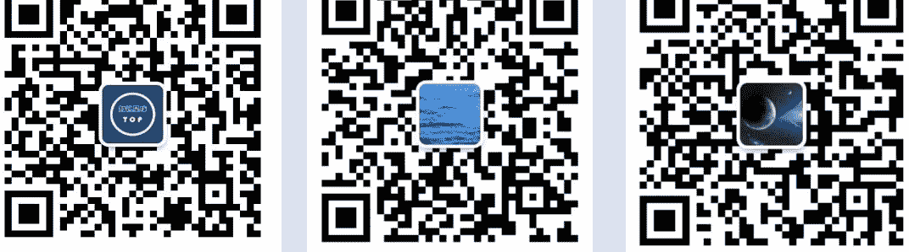

# 职场中隐含的规则和智慧(二)

怡音

体制性：职场中的规则、潜规则。越是没有规定的地方，规则越少；越是有规定的地方，规则越越多。人要多观察、多问，不要不懂请问，不要自己猜错，别人比你更聪明

## 一、个人要有自己的规则，要保持自己的聪明

作为一个人，是不被别人左右的。要保持自己的独立，不要盲从别人。在关键的时候要学会放手，在利益面前，要学会做一个更聪明的人，要学会伪装、多问，对自己都有好处

## 二、在关键时刻学会装傻，防止被占便宜

只会表现得太聪明，往往处处便宜。聪明的人，往往处处吃亏

## 三、寻找共同点，制造差异

大家都是职场人，不是一样；你也不一样。共同点越多，差异越小。你要多做什么，你提供的价值越大，别人越愿意给你提供，这样别人越愿意信任你。

不要总在别人面前提要求，要学会满足要求。提要求，要学会多表达；不要提要求，要学会多倾听。

不要在不合适的时候提任何要求，要学会在合适的时候提。不要在对方心情不好的时候提要求，要记住，要等对方高兴的时候提。

因为，越考虑对方的感受，你的心情就越好。越是给别人带来好处，你的就越好。记住，给别人越好，别人对你越好。这样，人与人之间的关系就越好。你对别人越优秀，别人对你就越好。

不要总想着别人能帮你，要想着自己能帮别人。

因为，越是先帮助别人的人，你的机会越好。记住，越是先帮助别人的人，越会有别人帮助你。

你总是等别人来帮你，最后就没人来帮你？其实别人都比你聪明。

## 二、隐藏自己的聪明，展示自己的价值

职场中不是比聪明重要，而是比价值重要。你可以隐藏自己的聪明，但你要在正确的人面前展示你的价值。在错误的人面前展示你的价值，只会让自己被利用。

不要在错误的人面前展示你的聪明，那只会让自己被利用。记住，在正确的人面前展示你的价值，你才能得到应的回报和机会。

## 三、学会借力打力，让别人帮你达成你的目标

职场中不是单打独斗，而是资源整合。要学会借力打力，让别人帮你达成目标

# 免费 价值 及时 专注

# 扫码加入 知识星球TOP 免费资源群

- 每日免费获取有价值资源
- 可提供各类资源搜索服务

热门付费文章 各行行业报告 精选图书资源 副业赚钱方法 职场实用资源 AI政经自媒体

公众号:知识星球TOP 微信信号:jntsg8 微信信号:jntsg2

分享资料仅供个人学习，请及时删除，切勿商用传播
