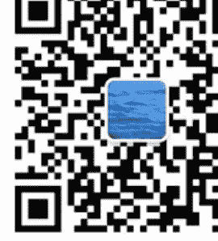
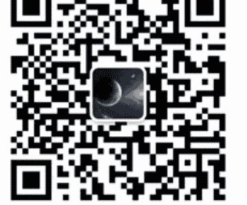

# U君
来自 藏8小时之外

## 提问
来一桶

U君：U君先生好：针对哔哩哔哩里的长视频内容转换成文字，有啥办法不？

U君：有两个思路：
- 1. 把视频下载下来，然后拖入剪映，然后自动生成字幕，最终将字幕单独保存下来，后缀修改成txt。
- 2. 利用AI平台的“工作流”功能，可以直接提取部分网站的视频文案内容。

2025/4/20 10:00

| 扫码加入 知识星球TOP 免费资源群 |
| :--- |
| 每日免费获取高价值资源 |
| 可提供优质资源服务 |
| 热门文章 | 各行业报告 |
| 精选图书资源 | 职业兼职方法 |
| 职场实用资源 | AI自媒体 | |

# U君
来自 赢在8小时之外

## 提问
匿名用户：U君，如果遇到情绪波动怎么办？有一些创伤事件，经常会发生记忆闪回，不分时间、地点。有时甚至会莫名流泪

U君:这些都是人之常情，不用太担心。只要生命里的大部分时间不被负面情绪笼罩，那就不用太在意。

2025/4/20 09:59
赢在8小时之外
U君 创建 600+ 人都在这里交流

微信号：jntsg8
加微信免费进资料群
微信号：jntsg2

# U君
来自 赢在8小时之外

## 提问

守链：U君，如果已经有一个音频，有什么软件能扫描后识别它的哪几分钟有人物在说话？

U君:把音频拖入剪映或者audition，直接可以看到音频波浪线，跟心电图差不多差不多。没有人说话的地方是平的，有人说话就会有上下波动。

2025/4/20 00:02

# 赢在8小时之外
U君 创建 600+ 人都在这里交流

微信扫码查看原文

## U君的主题
2025/04/19 23:47

美国和京东开始互较了，亚马逊要抢购，京东要搞外卖。这件事利好两个群体：
- 1. 大消费者。因为中国京东竞争，价格就会越便宜。
- 2. 持有“中德互联”基金的（原文“金人”应为“基金”），因为亚马逊和京东都属于中德的核心股份，能够应对它的冲击。

另外，我在年前以前会买中德互联这只基金了吗，你知道指的是什么吗？
因为中德里面的每家公司都有活跃用户，而且基本上都是跟着美国大平台、产品或者销售，做的是惠及民生的事。

所以，如果让我选一只基金，我肯定不会考虑什么金融、医药、光伏、优矿、建筑、新能源、人工智能之类的东西。如果我们将来的明年再次飙起，可能也得中德德面的公司。
(不推荐大家盲入，因为这只基金很容易暴跌，我写这些只是想表达自己的想法，不一定客观客观)

豆豆
doubao.com
中德互联10ETF作者 > 关注我私信领取...

以京东中德互联50ETF为准，截至2025年4月22日，前十大权重股占比比例如下：
- 1. 讯控股: 31.13%
- 2. 阿里: 18.57%
- 3. 亚马逊-W: 10.90%
- 4. 小米京东-W: 7.12%（注：OCR识别有误，结合上下文推断）
- 5. 携程集团-S: 3.36%
- 6. 京东集团-S: 4.06%
- 7. 网易-S: 2.22%
- 8. 百度-S: 2.76%
- 9. 快手-W: 1.47%

中德互联的波动可能随着时间变化不同，你可以关注相关基金报告公告，获取最新的基金信息。

豆豆
doubao.com
深度思考 AI帮生成

亚马逊和京东在即时外卖领域开展了激烈竞争，谁能胜？

## 即时外卖
- 亚马逊：4月15日宣布即时外卖“疯跑”，上线24小时，日均订单突破3万单，利润高达万美元。
- 京东：4月15日宣布“自选外卖”业务已进入国内，未来将投入10亿，预计持续增长。同时京东决定骑手补贴，提升配送速度。
- 亚马逊：2月12日推出“000亿美金新品品牌”，骑手无佣金由京东承担，平均配送快30分钟。

豆豆
doubao.com
深度思考 AI帮生成

活跃在8小时之外

U君
在8小时之外
## 提问
晨予：U君，每天都要盯着屏幕工作。请问盯多久休息比较合适？

U君：要选择一块好的屏幕，比如苹果、三星（尽量在这三个里面选）。如果近视的话，要配一副防光的眼镜。椅子不能太舒服，坐久了站起来。如果有条件，一块智能手表也可以，有那种提醒，检测你坐久了每半小时、一小时就会震动你，活动一下。手表方面，苹果做得最好的，其他的都很差劲。包括我现在用的三星，我也觉得跟苹果差很大（当然价格也差很多）。

2025/4/19 10:53
赢在8小时之外
U君 创建 600+ 人都在这里交流

# U君
赢在8小时之外
## 提问
匿名用户：U君，职业发展中期想让自己更加系统一点，是不是进大公司更好呢？职业发展后期想让自己更多的选择，又要做哪些准备？

U君：怎么操作能把“大钱”搞到手，你就朝哪个方向发展？不要总是被成长、学习、发展这些词汇蒙蔽眼睛，你需要的是把公司账上的钱和市场上的钱缴到自己的口袋里。要变现公司的股票，要么通过投资给自己分钱，要么要求公司给自己高额工资……只要你不是公司的一手或者核心股东，你都要随时做好准备。所以，一方面你要把钱搞到手；另一方面你要找好下家。做到上面准备之后，你再去考虑“职业发展”这件事。

2025/4/18 17:31
赢在8小时之外
U君 创建 600+ 人都在这里交流

# U君
在8小时之外
## U君的主题
2025/4/18 15:54

成长最快的方式是研究赚钱，而不是持续学习。赚钱的本质是收钱，也不是持续学习。所以，如果你加了我的知识星球，我希望你第一时间观察“公众号引流-知识星球成交”这个变现路径，看看你能否得到启发，甚至可以直接模仿。这比什么营销课程、写作课程要鲜活多了，因为你是亲历者，是亲身入局者，你的体验应该是最好的。有些人整天学习这个、学习那个，5年过去了、10年也过去了，他还是没有收钱的勇气，始终跨不过那道坎。

50
赢在8小时之外
U君 创建 600+ 人都在这里交流

# U君
赢在8小时之外
## 提问
白树：U君，以前会把好事发到朋友圈吗？最近越来越不喜欢发朋友圈，因为会被别人会炫耀，或者嫉妒，甚至带来负能量。

U君：朋友圈跟年龄有很大的关系。年轻的时候，经历丰富，中年之后自然就不太活跃了。当然，做事业的人另外情况，这种人适合多发朋友圈。

2025/4/18 12:12

# U君
赢在8小时之外
## 提问
娜妍：U君你好，请问加入了怎么看不了呢？

U君：您好，可以一看您付费的那篇文章，里面写的很详细。如果不符合您的要求，可以申请全额退款。

2025/4/17 20:46

# U君
赢在8小时之外
## 提问
白树：U君，怎么看山西强奸案呢？我发现这类事情尤其是涉及到离婚、彩礼等敏感问题时，视角不一样。

U君：这种民间普通案件，而且还在全网发酵，我相信法院的判决是公正的。

2025/4/17 20:44

| 扫码加入 知识星球 免费资源群 |
| :--- |
| 每日免费获取高价值资源 | 可提供优质资源服务 |
| 热门文章 | 各行业报告 |
| 精选图书资源 | 职业避坑方法 |
| 职场实用资源 | AI自媒体 |

# U君
藏8小时之外
## U君的主题
2025/4/17 17:41

然后当天把它转化成一篇文章，最好不要积。90
赢在8小时之外
U君 创建 600+ 人都在这里交流

# U君
赢在8小时之外
## 提问
守链：U君，冰红茶算不算健康？是否比橙汁好得多？

U君：如果含糖和添加剂，就尽量少喝。这种带味的饮料适合给那些长期体力、长期出汗的人补充电解质。

2025/4/17 14:38
赢在8小时之外
U君 创建 600+ 人都在这里交流

# U君
赢在8小时之外
## 提问
幻君：U君，知乎最近开始推流量了吗？好久没更，发现往期的文章有些开始起步了。

U君：最近我的知乎曝光量很大，每天一两万。可能是系统开始活跃了，开始激励了。至于是不是推流，不好说。

2025/4/17 12:20
赢在8小时之外
U君 创建 600+ 人都在这里交流

# U君
赢在8小时之外
## U君的主题
2025/4/17 10:23

中德互联的波动可能随着时间变化不同，你可以关注相关基金报告公告，获取最新的基金信息。

豆豆
doubao.com
深度思考 AI帮生成

亚马逊和京东在即时外卖领域开展了激烈竞争，谁能胜？

## 即时外卖
- 亚马逊：4月15日宣布即时外卖“疯跑”，上线24小时，日均订单突破3万单，利润高达万美元。
- 京东：4月15日宣布“自选外卖”业务已进入国内，未来将投入10亿，预计持续增长。同时京东决定骑手补贴，提升配送速度。
- 亚马逊：2月12日推出“000亿美金新品品牌”，骑手无佣金由京东承担，平均配送快30分钟。

豆豆
doubao.com
深度思考 AI帮生成

活跃在8小时之外

U君
在8小时之外
## 提问
匿名用户：U君，平时在接触陌生人时，总是无意识的说很多个人信息，如何克制这种冲动？

U君：你已经意识到这种事情的弊端，是好事，是觉醒的第一步。下次有这种冲动，可以咽回去。重复几次就会养成习惯。

2025/4/16 21:09

# U君
赢在8小时之外
## 提问
晨予：U君，每天都要盯着屏幕工作。请问盯多久休息比较合适？

U君：要选择一块好的屏幕，比如苹果、三星（尽量在这三个里面选）。如果近视的话，要配一副防光的眼镜。椅子不能太舒服，坐久了站起来。如果有条件，一块智能手表也可以，有那种提醒，检测你坐久了每半小时、一小时就会震动你，活动一下。手表方面，苹果做得最好的，其他的都很差劲。包括我现在用的三星，我也觉得跟苹果差很大（当然价格也差很多）。

2025/4/19 10:53
