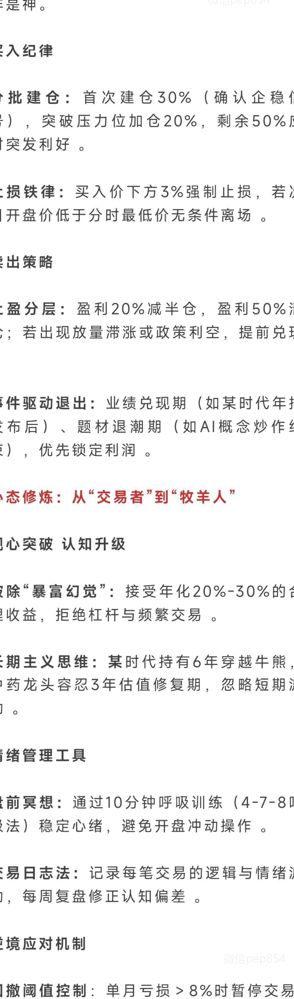
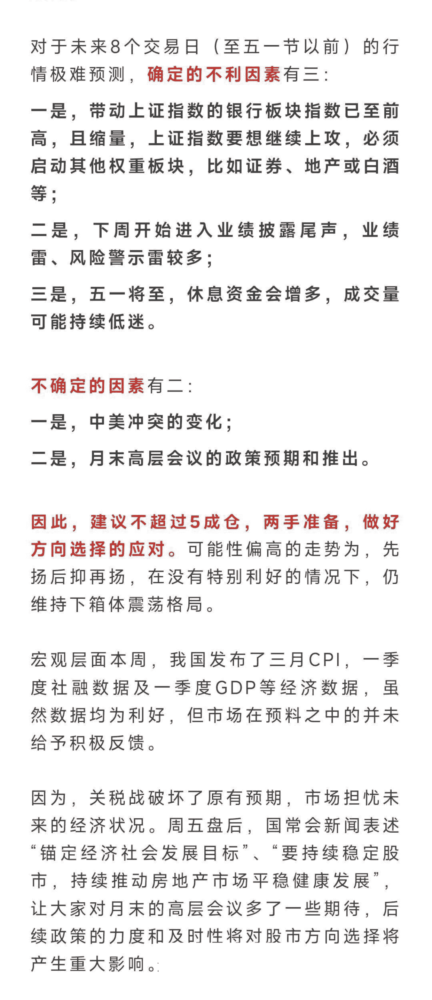

# 回到：未来用回归基础方法

作者：Michael OF
日期：2022年05月28日 11:12

大家好，我是三年前开始学习回归的哥。
免责声明：本文仅为个人记录，仅供参考，不构成投资建议。

很多人学习回归时，总觉得“回归太简单了，没什么用”，于是而去追求更复杂的模型，结果最后他们就放弃了回归，忽略了它内在的巨大价值。

其实，我三年前开始学习回归时也是这样的。我当时总觉得回归太低级了，于是而去追求更复杂的模型，结果最后我也放弃了回归，忽略了它的价值。

今天，我想带大家重新审视回归的价值。

主题：基金5700，回归预测23个月

接下的步骤，就是回归。

以基金5700为例，我选择了2018年二月到2021年二月的数据来预测未来23个月的情况。

我们来看下，看看结果如何：

结果，意外！我预测的最后6个月与真实的走势吻合非常好。这说明了在基金投资领域，回归也是非常有价值的。

但是，回归预测准了，就可以直接去买入了吗？

虽然回归预测得挺准，但大家不要忽视回归的局限性。

- 首先，回归模型没有考虑宏观经济因素；
- 其次，回归模型没有考虑行业周期的变化；
- 最后，回归模型没有考虑投资者的风险能力。

所以，我们不能只靠回归模型来做决策。

那么，我们应该如何使用回归模型呢？

核心观点：回归模型是辅助资产配置的工具。

- 1. 回归配置：确定各类资产的比例；
- 2. 回归筛选：预测股票的价值；
- 3. 回归择时：寻找买卖时点。

# 风险与收益

流动性压力：经济复苏持续收劲，市场下行压力加大。

配置策略：由于央行维持宽松货币政策，可能导致流动性增大。当前股市风险加大，需灵活调整配置。

风险提示：股市有风险，投资需谨慎。

# 核心策略

核心策略：坚持价值投资，聚焦高股分红机会，在2024年把握投资机会：

预期收益20%-30%，最大回撤控制在15%以内（3值）。

策略建议：+50%红利资产，+40%成长资产（+10%防御资产）。

# 短期收益与长期风险

风险提示：短期内市场波动加大，红利资产和成长资产受影响较大。

爆发压力：由于股市波动加大，可能面临回撤15%以上的压力（如+10%回调）。

策略建议：注意回调机会（若出现-10%以上回调，可考虑逐步加仓）。

# 长期配置

核心配置：中价值（30%）+成长（30%）+中一的成长机会、海外市场布局：

预期收益：20%-30%，最大回撤控制在15%以内。

防御资产：红利（20%）+海外资产。

# 风险展望

市场环境：目前沪300指数在3000点附近震荡，流动性充裕。

风险关注：短期内红利和成长资产将面临较大波动。

# 投资建议

核心策略：坚持价值投资，聚焦高股分红机会，在当下把握投资机会：

预期收益20%-30%，最大回撤控制在15%以内（3值）。

# 纳斯达克（Nasdaq）预警下跌：由于中国出口的利空，今年或缩水550亿美元

莱博表示其对表现非常担忧，他的团队认为股市将继续下滑。莱博也不认为今年会有好转，中国内部也面临巨大压力。

莱博表示今年中国出口可能在800亿美元以下。莱博指出中国出口将继续萎缩，如果减少到550亿美元，这怎么可能呢？

> 莱博说：“我不认为今年会有好转，我非常担心。”

莱博相信现在已经进入了熊市，他认为现在非常危险，而且他已经准备离场了。

如果现在不离场，股市将继续下滑，甚至面临跌破6000点、5500点的情况。

莱博之前之前股市已经开始下跌，他建议投资者至少承受30%的风险。

五月以后可能会开始反弹，但大可能在六月之后才会出现阶段性反转。

核心问题在于，A股几只大股面临分化压力，与指数的脱节正在加剧。

只有上证突破了3500点才有机会，否则将继续走低，创业指将持续下跌。

对现在的市场，莱博表示，短期内可以看到底部反弹，但这让指数的风险加大，目前大部分个股还处于调整状态。

对于下周的8日（下周一）的走势，莱博持审慎态度。

莱博认为下周的行情将继续震荡，成交量缩小，风险依然巨大。

不能忽视的问题在于：

一、中美资金政策的转向；
二、六月底可能会有政策变动。

莱博认为，由于外部环境的压力，市场流动性可能面临挑战。

预计下周五，可能会出台新的收紧政策，“继续收紧股市”，

这将让大盘的压力增大一分；
目前政策的弹性和时性对股市将产生巨大影响。

最后，莱博认为下周的行情基本维持现状（或先扬后下），将进入第二阶段（震缩量整理），预计未来两个月还不会出现反转。
