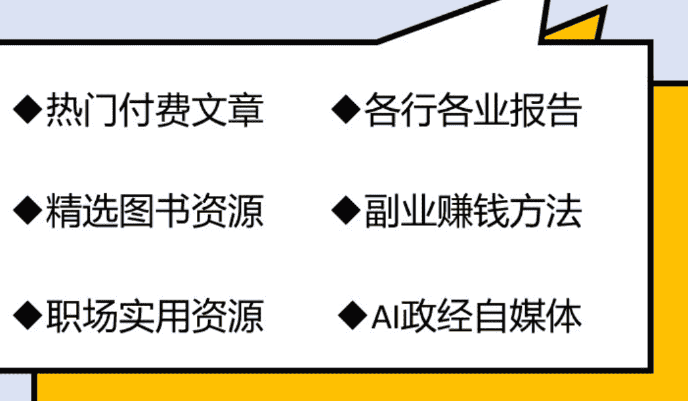

终于写到湖南了。

先介绍湖南一个比较广为人知的特点吧。

那就是民风彪悍。

湖南地形除了北部那一块是平原，其他都是穷山恶水，历史上就是民风彪悍，古代被说是楚蛮，近代出了湘军，当代又有一群湖南中部娄市的人去东南亚搞电诈，电诈园区里手段最狠的，是湖南人而不是福建。

建国后湖南省迎来了工业化、城市化，这两个是能大削弱民风彪悍这个buff的，但湖南直到春贤时代还都是30%多的城市化，低于国家平均水平的城市化。

加微信jntsg2，免费进阶资料分享。

一方面是湖南建设滞后，只有长沙能虹吸全省能力有限；一方面是湖南离广东很近，广大湖南南下深圳而不是留湖南，这倒是给深圳注入了勃勃勃的湖南基因。

# 湖南城市化曾一直不高

直到08年以前，长都长期以农村县城为主，没有受到工业城市化的洗礼，之前的湖南干部也不下力气治黑，这让湖南的民风一直保持民风彪悍这个“传统美德”。

这种民风彪悍映射到官场上，就是干部霸蛮。

很好理解，干部也是从群众中来的，也自然而带有民风彪悍的特点，而当上干部后，基层民众如此民风彪悍，你干部不霸不狠，根本管不好这些人人民群众，这又一步强化了干部霸蛮的特点。

霸蛮干部，每个省都有一些，湖南可能是最多的那个省。

而且还有一点，湖南竟然是比较推崇干部霸蛮风格的一个省。

如果你是一个文弱的书生干部，那你在湖南官场就天然矮人一，湖南官场推崇的就是那种说一不二、蛮横霸气的领导干部。

比如湖南郴州一把手易鹏飞，曾经晚上打牙，去急诊的时候医生说这是小事，去找牙医就行，不用来大医院，那个一把手大怒，一气之下打电话，不仅将医院院长、卫生局局长都叫过来，而且叫来了分管医疗的副市長，直接在医院大堂里破口大骂半个小时，骂得狗血淋头。

这种事，要是发生在比较推崇文化水平的南方，这个干部早就被判政治死刑了，但在湖南，这都不是什么大新闻，这个人打出霸名号还能一路上位，不得不说，湖南官场的“审美观”有问题....

## 直到今天，湖南干部打手人的新闻时常都有。

### 10:10 湖南衡阳官员互殴事件

2010年10月10日衡阳官员互殴事件，2010年10月10日发生在湖南衡阳市政法局之间的恶性事件。其中，万春被免去了衡阳市政法局长、衡阳市市委书记；袁勇、龚勇被免去了衡阳市市委书记；曾担任衡阳市政法局副局长的邵中被免去了衡阳市政法局局长、衡阳市委委书记；曾担任衡阳市政协委员会主席、中国政协湖南衡阳市政协委员会主席、组成……

| 中文 | 10:10湖南衡阳官员互殴事件 | 原题 | 湖南衡阳官员互殴事件 |
|---|---|---|---|
| 外文 | 10.Hunan Hengyang officials fighting event | 发布时间 | 2011年10月10日 |

### 湖南邵阳官员涉嫌醉驾还发飙，推翻巡逻车扇队长5个耳光

澎湃新闻记者 蒋格律
2015-11-29 16:60 来源：澎湃新闻

### 洛奇！市委书记为何被女同事扇了两耳光

2025年2月26日（2025年1月24日），湖南官场炸锅了！省政协原副秘书长龚文落马，邵阳人民群众走相，竟被群众扇击，不知道还以为过了年呢。这老兄，曾在邵阳呼风唤雨九年，结果栽了个大头。……

加微信jntsg2，免费进阶资料分享

办法，湖南干部就吃这一套，觉得领导干部就是要霸气侧漏的样子。

当然，湖南本土干部里，也有霸蛮霸蛮的比较好的代表。

那就是周本顺。

周本顺在地方的时候受了黑社会的气，他这个强龙被地头蛇压了，他上位后异调兵直接拿下了邵阳黑老大小红宝。

因为这件事，周本顺被他的本家康世传发掘看重，康世传调政法属于跨专业，周本顺就给他当了秘书，荣俱荣荣的后面，必然是一损俱损，本顺哥还是落马了。

这种风格在乱世可能为湖南人开辟天花板，但在太平世，这并不太适应国家治理能力，这种霸蛮风格利于特定的军工、石油法系统的升迁，其他系统只会一步步限制湖南人的发展。

而且，这种霸蛮干部多了，不仅对民众说是祸害，对下级是祸害，对同级也是祸害。

湖南干部很少出省的一个重要原因，就是北京认为湖南干部不会团结班子。

很多湖南干部不太适合二把手三把手的政治定位，只能当一把，你塞一个湖南干部去外省省委打下手，这个班子很容易打架了。

真别说，湖南干部在省内是喜欢打架内斗的，一省反而搞老乡抱团一套，天津就有湖南帮，深圳也有抱团现象，真是有毛主席那种与天斗与地斗其无穷的传承啊。

你想想，为什么同为湖南人的朱相，让手嫡系去地方镀金，都选择贵州、江西，就是不选择湖南这个老家呢？

上面神仙太了解湖南官场的情况了，霸蛮加内斗，湖南人的主席也不想送手下去湖南受苦受难啊。

所以，湖南书记不好当，这么多年，能真正镇住湖南官场而且干部服服的，也就一个。当时新疆发生后，上个十年在视察呢，立刻取消，这是历史上仅有的一次。回国后，就把水工换了，要换上足够铁腕足够能力的人，去镇新疆。

当时我们首先找到，是在宁波当一号的八音湖。觉得音湖是少数民族，他地方群众接受度更高。加微信jntsg2，进资料群。第二个找到的，是湘哥。湘哥则怀着“苟利国家以福之”的愿望，去新疆前一天，他去了地方。

# 韶山

湘哥在毛主席像前默默伫立，仰望良久。没有人知道，那一刻毛主席像前的湘哥是什么心境。是“独有英雄，更怕雾”，还是“把酒酌滔，逐浪高”？我们只知道，湘哥出色的，完成了历史托付给他的重任，守好了这片土地。于是湘哥临命赴新疆，果然湘哥用铁腕和细腻，镇住了新疆。所以湖南真的是难治的，你们可以自豪了，湘哥在湖南主席上，湘哥都能镇住湖南。

# 湖南官场经历三个时代

- 1. 本土派一家时代
- 2. 被改造的时代，同时也是湘者的过渡时代
- 3. 将崛起腾飞时代

曾经，湖南有一个本土派大家大的时代。我在历史旧文《常德帮》里介绍过了，不多说。反正那个时代就是群魔代名词。你看人家河南帮，都有收编，为什么湖南常德一直没有收编？你肯定喜欢收一群听话的手下，而不是收一群霸蛮狠的手下。然后上面空降的改造时代。主要是上个十年开启的，从湘哥到周吕。

湘哥在湖南五年，定下了四条战略

- 长沙向西搞
- 长沙最好的是湘哥从市委带下来的市长张剑飞，现在搞的长沙真是一言尽
- 打压常德帮——基本上打压得差不多
- 力捧岳阳市——岳阳要感谢小红同志，更感谢长江经济带的，之前湖南重心是搞中株潭，搞中南部的，搞湖南没信心，怕武汉做嫁衣，长江经济带一出，湖南必须搞岳阳
- 新型工业化——这个不太清楚搞的怎样了，反正长沙现在搞网红搞不错，去长沙一定要洗脚，不知道长沙好，湘哥搞这些，不可避免了触动了湖南根蒂固的利益。那几年，湖南本土势力和湘哥斗的很厉害。湘哥的手下张剑飞在长沙当市委书记，湘哥在省委和各个地头蛇，在湖南杀出一条路的权力斗争故事，可以拍《人民的名义》了。的确，湖南一些权力斗争段子出不穷，被《侯卫东官场》、《二号首长》给借鉴化用，写到了故节里。

岳阳帮来压制常德帮。湘哥做得好的，但半路去了新疆，周弓奎那个霸气侧漏的性格，就不太镇住了。但是，周弓奎也垫出了自己的人。就是湖南地方团系统出身，当时湖南仅有的女性常委干部，李薇微。

> 1983.07-1985.12 共青团湖南州市委副书记
> 1985.12-1990.12 共青团湖南州市委书记
> 1990.12-1995.06 共青团湖南省委副书记、党组副书记

正是周湘的赏识，薇微能在当年以一个冷门衙光速到位到统战部。

> 2003.04-2006.11 中国贸易进促进湖南省省长会议、党组书记
> 2006.11-2015 湖南省委书记、统部长（2003.09-2006.12湖南大学国际贸易学专业研究生学习，获经济学博士学位）
> 2015.08-2016.01 湖南省委书记、政法委书记
> 2016.01-2016.06 湖南省主席、党组书记，省委书记、政法委书记

张周两人都压制常德帮多年，还各种种沙子，这让常德帮很不服，后来老杜来了，这个老杜是个佬没能力和周的背景，他就差点压不住常德帮了。结果，常德帮给老杜给中国，来了大新闻。

——衡阳一号是一个政治新星，长沙名谦。他官声很好，不赌不贪唯一爱好是散步，对对面干部管的也松，干事也干的不错。他本来要从衡阳一号上调省委的。但这就和别人产生竞争关系了。是的，常德帮。

为了狙击这个长沙新星，常德帮引爆了衡阳贿选案。

## 衡阳破坏选举案：一届市代表几乎全没

建国后最大购物案，衡阳衡选案始于2010年9月15日。由于报道，一届市代表几乎军覆没。一届市代表中，76人送选票总计亿元。风清大会警示录。后来对手在国内持续报，国际上引爆，一度上了热搜，以此说中国的选票都是假的，是披着民主皮的专制。是的，你没看错，现实就是。

毫无疑问，徐盛不想对本土派开炮，也要开炮。被狙击的个人，长沙湘，本来要上省委，直接坐牢了。随后，省委奉命，查了他天，却是湖南干部，判住了五年。所以湖南真的是难治的，你们可以自豪了。后面的衡阳干部，几乎被网尽。

在衡阳选举背后，上面知道了是湖南内斗。上面生气了，嘉靖为什么严？因为嘉靖一直以为自己是棋子，下面都是棋子被用斗，结果发现严透了嘉靖的脾性，在权斗中反客为主。只要不出格，湖南内斗将家丑捅给外媒，连累了国家形象，后果严重。

不容忍对社会主义制度的挑战。一位老者回忆，在2014十八月旬中中央会议后，面对全体纪委和各省纪委，用很多时间询问衡阳官员，提到这件事，衡选中46人受到调查。可以说，湖南本土势力，在那次权力斗争中没有任何一方是胜利者。徐盛本来想当不成，被中央推着去压制本土势力。衡选案后，不仅衡阳干部被拍死，常德帮也被间接拍死，甚至发展到新时代省委明确在一段时间内冻结常德干部，推荐提拔。此后，衡阳干部和常德干部，双双出局，省委高官基本不考虑常德人。是的，多用岳阳干部。

在中央和省委关注下，岳阳干部脱颖而出，慢慢对常德帮衡阳帮乃至长沙帮进行换血。湖南本土格局被洗牌。这一洗，就脱出了一个红。岳阳被钦定为政治高地后，红同志被寄予望，在岳阳干多年，被视为湖南岳阳干部的代表，后面官运不错。岳阳派，而不是岳阳帮，因为湖南吸取教训，各种空降干部去岳阳发展，他们发迹是靠岳阳，但家乡不同，不至于搞出抱团的事。上个十年和接十年，总算把湖南本土系的差不多了。然后，就是新时代后，用航天工治湖南的思路了。老许，老张，都是军工天出身的。这也契合湖南省情，因为湖南是军工大省，是我国防科技工业布局的几个重点省份之一。

## 湖南军工大省秘：从兵器到航天的全方位实力

## 湖南省为何被选定为“军工大省”，真实的央企军配置有多硬核？

之前湖南班子，要长者背景，要口才背景，要横跨者和口才，现在湖南终于有新时代的气息了。

湖南本土势力的衡阳选案是我们恳点，湖南连续两任用的是我们信得过的军航少帅，后来更是沈晓明此嫡系空降，湖南新兴本土派人物易小红官运亨到浙江江当一把手，还有一个湖南人的干能脱颖而出担任东部尚的重任，甚至有位曾经在湖南管过三年书记的干部也上位成为书记副书记，湖南干部罕见的人事纪委方面都有天线可通。这是何等的天时地利人！湖南干部未来能不起飞！以上这一切似乎都在说明，湖南已经可以信过的，湖南已经站队到新时代这边了，未来湖南部的高就重任似乎就在眼前。但是，这一切都是真的吗？是真的，但却是转瞬即逝的真。湖南干部赖以的真。

小红已经被约谈了，甚至被传事后那个了，希望不要有事吧。

还有一个公子的爹在重庆当官，看后续有没有动作吧。

唉，湖南真是可惜啊。

真的是可惜。

湖南憋屈几十年了，在改开后就一直憋屈。

因为自身缺陷，能升的湖南干部十分稀少，湖南就别提江西了，说江西是阿卡林省。

你别看人家经济不行，但政治抱上了魔都大腿，一连有军师有官有苏荣有郭大哥有大柱子等仙人级，你湖南出了几个神仙？

## 干部发展，你湖南连江西都比不过。

本来，湖南干部憋屈几十年，就缺一个机会。

本来，湖南干部崛起的机会，就近在眼前。

不懂事的本土派清洗的差不多了，岳阳长沙成为新的政经高地，湖南新生本土派靠拢新时代，湖南代表干部红军被一路重用，新时代系空降湖南，湖南人干部执事部带出一串湖南帮，湖南任职过的一位还是狗头顿副职。

政经高地，人事纪委，嫡系站队，乃至抱团打法，这方面方面都做好了准备。

但偏偏在湖南干部即将大面崛阶段，出了口才窝案，出了七公子案，出了干结失势。

湖南干部用40年的等待，才等到这次崛起的机会，结果因为打铁还要自身硬的各种问题，愣是让这历史性机遇飞走，而且眼见要深渊反腐危机。

不仅没起飞，而且还深陷，下一次给湖南干部的机会，不知道要等多少年。

难道还要等一个40年？

这就是出师未捷身先死吧。

但是，没有长兴英雄满襟。

因为说到，苍蝇不打无缝蛋，打铁还要自身硬，湖南如果这次没有爆雷而是一帆风顺大面积崛起，你觉得这对湖南人民群众是好事吗？

如果这帮政治圈子兄弟贪腐的湖南干部大面积出高，你觉得这对外省的干部群众是好事吗？

## 看看湖南的反腐成绩吧

- 岳阳有一个一把手落马。
- 益阳有一个一把手落马。
- 衡阳三任一把手落马。
- 湘潭两任一把手落马。
- 常德三任一把手落马。
- 郴州四任一把手落马！打破昆明腐败记录！

> 《湖南日报》都曾感叹：“一个市级领导班子出现如此大面积的腐败案，包括市委书记、市長在内的6名市级领导锒入狱，还有100多名干部涉案被查，人们震惊之余，不能不深思”

湖南干部错失发展的历史机遇，是坏事，是遗憾。

但湖南能借机开展大面积反腐，好好还一笔反腐账，是好事，是大人心的好事。

所以，湖南瓜友，你们也不要过于遗憾哀叹

毛主席说的，大乱后治

希望这次湖南能借大乱达到大治，还湖南人民一个朗朗乾坤。

就是一句话

湖南干部是，出师未捷身先死！

湖南群众是，漫卷贪官喜欲狂！

# 免费
# 价值
# 及时
# 专注

# 扫码加入 知识星球TOP 免费资源群

- 每日免费获取价值资源
- 可提供各类资源搜索服务

热门付费文章
各行各业报告
精选图书资源
副业赚钱方法
职场实用资源
AI政经自媒体

公号：知识星球TOP
微信：jntsg8
微信：jntsg2

分享资料仅供个人学习，请及时删除，切勿商用传播

加微信jntsg2，免费进资料分享群
