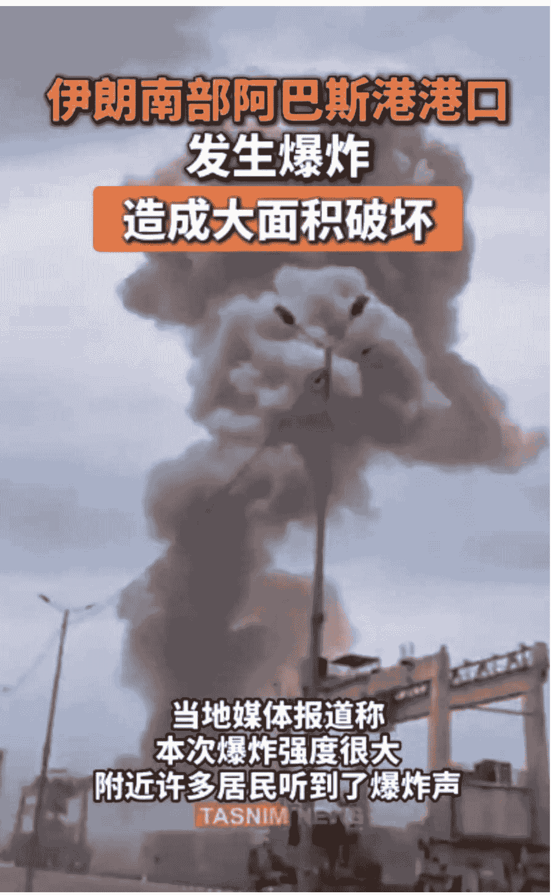
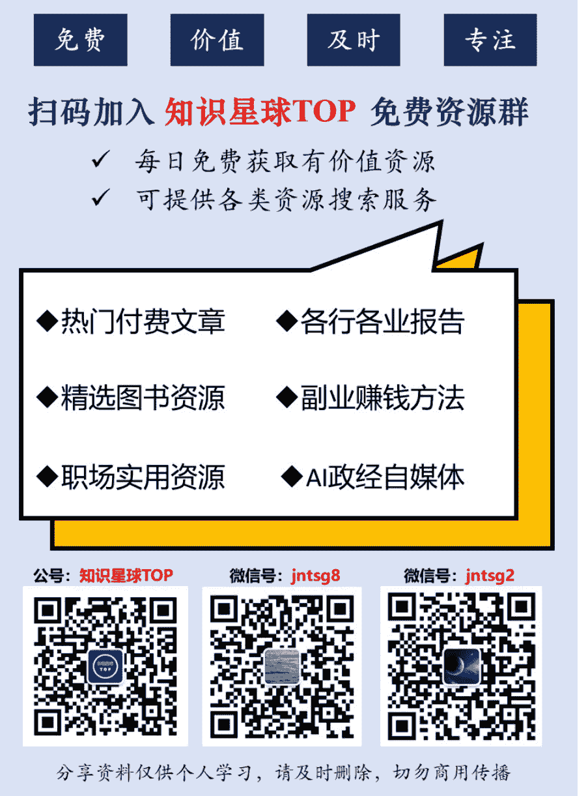
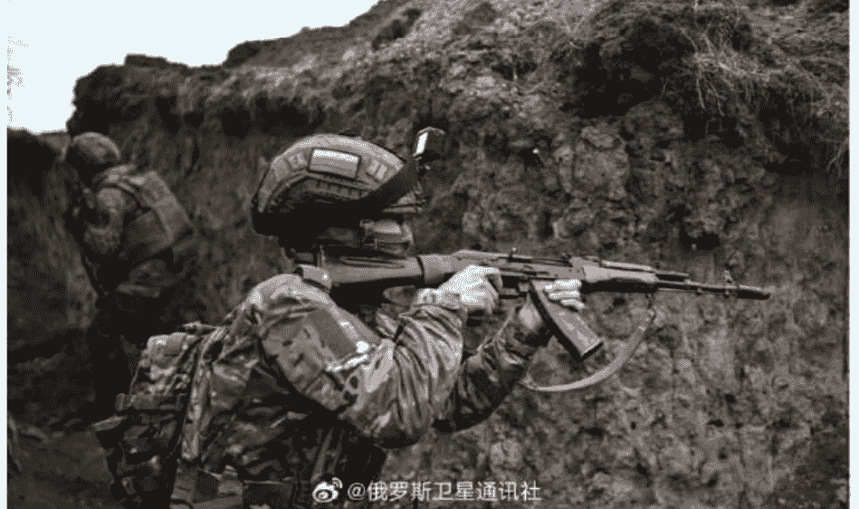

写国内的这几天，全球是越来越乱。

先看中东。

本来懂王抗住了内塔的压力，没有答应硬解伊核。

但内塔独走了。

伊朗的港口发生惊天爆炸。

加微信jntsg2，免费进资料群

# 伊朗南部阿巴斯港发生爆炸
## 造成大面积破坏

当地媒体报道称，本次爆炸强度很大，附近许多居民听到了爆炸声。

——沙希德拉贾伊兰港是伊朗最大港口之一，承担全国55%以上的非石油货物进出口和85%的集装箱卸卸业务。其战略地位涉及霍尔木兹海峡的航运控制，与“一带一路”项目存在关联。

这个港口爆炸，粗看是危险品引爆发生的，但这些危险品为什么会被引爆呢？

不用说，以以色列情报机关功不可没。

内塔等等不到懂王的硬解伊核，反而等到了懂王和伊朗开展谈判，内塔开始急不可耐，搞了一个针对伊朗出海枢纽的爆炸案，就是要搅局美伊谈判。

懂王面临的压力只会越来越大。

同时，我们也力撑伊核。

前几天伊朗外长访华，这次访华的成果相比上次有很大进步。

王毅见了后三三点：

- 王毅指出，当今世界乱象频生。美国滥施关税失人心，自我孤立于国际社会。国际社会比任何时候都需要团结一致坚持多边主义，维护国际关系基本准则。

这点最关键，指出了关税战后中伊比任何时候都要团结一致对抗美国。

这句话表明了我们希望伊朗抗住美国以威逼利诱的心。

加微信jnttsg2，免费进资料群

王毅强调，中方始终致力于伊朗核问题的政治化解决，反对煽诸武力和非法单边制裁。中方赞赏伊朗关于不发展核武器的承诺，尊重伊朗和平利用核能权利，支持伊朗与包括美国在内的各方开展对话，通过协商谈判维护正当合法权益，这有助于维护国际核不扩散体系，也有助于促进地区和平与稳定。

这里关键的是支持伊朗与包括美国在内的各方开展对话。

是表达我们不满伊朗的妥协的。

因为伊朗现在是和美国单独谈判，没有第三方，那个阿曼充其量就是一个传话人，中俄都没有介入这轮伊朗核谈判。

所以，王毅的话总结就是，中国不喜欢伊朗单独和美国谈，中国需要伊朗抗俄上去。

俄罗斯希望策控王和伊朗谈谈。

——就在第二轮间接谈判开始之前，俄罗斯外长拉夫罗夫曾在与伊朗外长会面后表示，俄方愿推动美伊达成核协议。

事后，伊朗谈判的中间人阿曼，还去莫斯科拜访了普京。

——根据克里姆林宫新闻处的消息，俄罗斯总统普京将于当地时间4月22日在莫斯科与访问的阿曼·苏丹赛海姆·本·塔里克·阿勒赛义德举行会谈。

## 与俄罗斯进行政策对谈！阿曼在伊核谈判中扮演什么角色?

央视新闻 2025-04-22 15:15 北京

亚太太报APD 来自微博网页
03月05日 20:49

【普京：意愿在此事上帮特普普】
据摄影博社报道，在美国和俄罗斯之间愿改善双方关系，匿名知情人士透露，俄罗斯愿协助美国政府对伊朗进行沟通，沟通内容包括伊朗核计划以及该国地区反美代理人的支持等问题。

## 可以说，阿曼这个中间人的背后，实际上是俄罗斯。

## 是俄罗斯在暗中给伊朗当中间人，促成美伊谈判。

## 但是，中国和以色列却站了一起。

以色列用恐怖袭击，场外扰搅美伊谈判。

中国用支持敌打，场外干扰美伊谈判。

虽然普京暗中促和美伊，但以色列和中国加在一起的影响力破坏力更大，特别是内塔尼亚胡后根本不知道下一步会做什么出格行为，万一再暗杀一个伊朗领导人，这谈判就没法谈了。

加微信jntsg2，免费进资料群

且懂王内部团队，并没有取得谈判共识。

懂王下手，国务卿卢比奥和国家安全顾问沃尔兹，都是支持硬解伊朗核，而不是支持谈判的。

——美国总统国家安全事务助理沃尔兹近日表示，美国寻求“完全拆除”伊朗核计划，伊朗必须以所谓“全世界都能看到的方式”放弃其核计划。

懂王要谈伊朗核，手下心离德，内塔独走破坏，中场场外搅局，只有一个普京是帮他的。

所以，这次美伊谈判谈出结果的可能性，会越来越低。

## 中东不得安安。

中东很难在五月一号这个预定时间前谈下伊核。

然后，是俄乌。

## 俄罗斯今天宣布，已经全部收复库尔斯克地区。

加微信jntsg2 免费资料群

## 俄罗斯卫星通讯社
25-4-26 18:36 来自微博版 已编辑

【俄军解放库尔斯克地区】俄罗斯总统新闻秘书德米利·佩斯科夫宣布，俄罗斯军队已解放库尔斯克地区。

克里姆林宫发言人：“武装部队总长瓦列里·格拉西夫向最高帅普京报告完成从乌克兰分子手中解放库尔斯克的行动。”

## 俄乌局势进展 乌克兰局势## 俄乌局势进展

大家都在嘲俄美在塞尔维亚圈围一步步，但俄罗斯明显不会止于此。

加微信jntsg2，免费资料群

且懂王内部团队，并没有取得谈判共识。

懂王下手，国务卿卢比奥和国家安全顾问沃尔兹，都是支持硬解伊朗核，而不是支持谈判的。

——美国总统国家安全事务助理沃尔兹近日表示，美国寻求“完全拆除”伊朗核计划，伊朗必须以所谓“全世界都能看到的方式”放弃其核计划。

懂王要谈伊朗核，手下心离德，内塔独走破坏，中场场外搅局，只有一个普京是帮他的。

所以，这次美伊谈判谈出结果的可能性，会越来越低。

## 中东不得安安。

中东很难在五月一号这个预定时间前谈下伊核。

然后，是俄乌。

## 俄罗斯今天宣布，已经全部收复库尔斯克地区。

加微信jntsg2 免费资料群

## 俄乌局势进展 德萨哈尔夫都是轻的，普京胃口很大。

懂王和他的团队已经基本放弃俄乌了。

### 坦白了？特朗普：24小时内结束俄乌冲突是“开玩笑”的夸张说法

根据美国《时代周刊》当地时间25日报道，美国总统特朗普在接受采访时称，他之前关于24小时内结束俄乌冲突的说法是“开玩笑”，这一“承诺”只是象征性的表达。没办法，普京不听懂王的，胃口太大。

没办法，司机也不听懂王的，连克米亚都不肯让。

欧洲在关税战背景下，不可能听懂王的。

俄乌只能继续打。

一个魔鬼细节，教皇去世后，各国领导去哀悼期间，懂王和司机机会了，司机依然了。

## 俄乌局势进展 德萨哈尔夫都是轻的，普京胃口很大。

懂王和他的团队已经基本放弃俄乌了。

### 坦白了？特朗普：24小时内结束俄乌冲突是“开玩笑”的夸张说法

根据美国《时代周刊》当地时间25日报道，美国总统特朗普在接受采访时称，他之前关于24小时内结束俄乌冲突的说法是“开玩笑”，这一“承诺”只是象征性的表达。

没办法，普京不听懂王的，胃口太大。

没办法，司机也不听懂王的，连克米亚都不肯让。

欧洲在关税战背景下，不可能听懂王的。

俄乌只能继续打。

一个魔鬼细节，教皇去世后，各国领导去哀悼期间，懂王和司机机会了，司机依然了。

## 俄乌局势进展 德萨哈尔夫都是轻的，普京胃口很大。

懂王和他的团队已经基本放弃俄乌了。

### 坦白了？特朗普：24小时内结束俄乌冲突是“开玩笑”的夸张说法

根据美国《时代周刊》当地时间25日报道，美国总统特朗普在接受采访时称，他之前关于24小时内结束俄乌冲突的说法是“开玩笑”，这一“承诺”只是象征性的表达。

没办法，普京不听懂王的，胃口太大。

没办法，司机也不听懂王的，连克米亚都不肯让。

欧洲在关税战背景下，不可能听懂王的。

俄乌只能继续打。

一个魔鬼细节，教皇去世后，各国领导去哀悼期间，懂王和司机机会了，司机依然了。

## 俄乌局势进展 德萨哈尔夫都是轻的，普京胃口很大。

懂王和他的团队已经基本放弃俄乌了。

### 坦白了？特朗普：24小时内结束俄乌冲突是“开玩笑”的夸张说法

- 当时莫迪直接认定是巴基斯坦搞的，开启了战争动作。

- 印度立即暂停执行《印度河水约》，停止河水共享合作，直到放弃跨境恐怖主义的支持。
- 关闭巴印之间印度侧的阿塔里综合检查站。
- 禁止巴基斯坦公民持南亚合作联盟免签计划(SVES)签证前往印度。
- 巴基斯坦新德里高级专员署的全部军事顾问宣布为不受欢迎的人，他们必须在一周内离开印度，印度将从驻伊斯兰堡的印度高级专员署撤回军事顾问。

- 恐袭是直接火索。

- 美印的关税谈判，则是间接导火索。

直到三哥厉害，但没想到，三哥能让懂王吃瘪。

近期懂王一个大国谈关税，要别别国割肉，就三哥谈着谈着，竟然能占到美国的便宜。

一向愁天怕地的万斯，亲访印度促进谈判，还好说尽，吹捧印度说他儿子想生活在印度这个伟大的国家。

当然，懂王就好，民主党也要，美国各届政府对印度的考虑，都是醉翁之意不在酒，在于中国也。

- 在此类谈中，双方不仅讨论了贸易，还谈及国防、关键技术和所谓“全球与地区安全”——一套语言熟悉不能再熟悉，其核心内容依旧是拉拢印度参与美国对中国的遏。

所以，在关税谈判的关键时候，印度有必要搞出动作让中国难受，否则印美关税谈判是不可能让步的。

正好，这个时候爆发了25年来最大的恐怖袭击。

真巧了，这直接给了印度干架最好的借口。

要知道，巴基斯坦境内很多恐怖组织，其实背后是以色列美国。

所以，新闻连起来，这是一一整套的。

印度必然会打巴基斯坦。

声势会很大，但实际很小。

- 因为恐袭只是生意而已，关税谈判结束后，拿到好处后，印巴火自然就会停。

- 三哥是很精明的，美国给多少利益，三哥就拿多大。

- 因为三哥是独立的大国，不可能为了美国下场和中国直接对着。

- 随着巴基斯坦战争的持续，中国必然会下场，印度是扛不住的。

所以，印巴火也不容易，一段时间内，国际环境再起波澜。

另外，巴基斯坦背后站着两个国家：

- 一个是中国，大家都知道。

- 另一个是沙特，很少知道。

- 沙特其实和巴基斯坦是隐形盟友。

- 沙特巴基斯坦都是逊尼派穆斯林，而且巴基斯坦是伊朗的邻国。

沙特早就出于遏制伊朗的考虑，发展了巴基斯坦的关系。

所以，巴基斯坦被印度干，中国急。

而沙特对懂王来说很重要，美元转人民币让沙特彻底打开了。

- 沙特有军事支持，巴基斯坦就不可能被印度干的。

- 甚至可以推出，这起恐袭击背后不是美国主导的，而是以色列主导的。

为什么要搞印巴火，也很理解。

之前就介绍过，印巴是全球著名的黑市。

- 中国供应胡赛和哈马斯的武器，很多都是靠印巴这个秘密渠道。

- 特别是在叙利亚，真党被击败后，只有巴基斯坦这个通道了。

而且以色列在印巴内部有武装力量，也能策划恐袭。

根据美国CIA备忘录，以色列情报机构摩萨德在招募巴基斯坦极端组织“真”（与什叶派对立），训练其成员对伊朗实施暗杀和袭击，包括针对科学家和妇女的暴力行为。此举旨在削弱伊朗的核计划和政治稳定，但也加剧了巴基斯坦与伊朗的边境安全问题。

- 以色列通过支持巴基斯坦境内的反伊朗势力，试图在中东地区形成对伊朗的包围网。例如，“真”活跃于巴基斯坦俾路省，而伊朗曾多次指控该组织参与了境内的恐怖袭击。

而且以色列确实第一个跳出来了。

就在恐怖袭击爆发后，以色列第一个跳出来支持印度，以色列还要说给印度提供军火。

克什米尔恐怖袭击发生后，以色列总理内塔尼亚胡与印度总理莫迪通电话，向印度表示了支持。以下是内塔尼亚胡的声明全文：

我今天与印度总理纳德拉·莫迪通话，就克什米尔发生的恐怖袭击向印度人民表达我以及以色列人民的深切哀悼。

以色列现在忙着不可开交，胡赛、哈马斯及伊核，各方面都忙得不可开交，按照说是不会关注印度发生的恐袭的。

但以色列就是第一时间送上了慰问和支持。

所以，这已经足够无银三百两了。

犹太真是人类之瘤，所到之处都是混乱杀戮。

可以说，最近以色列的情报机关加班加点，连续策划了伊朗港爆炸和印巴恐袭两件大事。

然后是中国和美国。

我们的财政去华盛顿参加G20财长会议，在美国人的地盘，美国长几次要求面对面，蓝部长没见。

我们财长都去美国地盘了，还是不见美国财长，其他国家的财长都见了，就美国没见，你觉得我们可能给懂王打电话吗？

要打电话了，这个财长就必然见的。

而且只要中美财长见了，就不可能是偷偷摸摸的。因为懂王这个大嘴巴一直在证明自己，只要中美有一点实锤的缓解迹象，懂王定会大加宣传让全球都知道。

所以，中美财长没有见，中国没有缓解美国经贸。

而且，在昨天的局会议上，我们会正式定义了，这次关税战是斗争：

 统筹国内经济工作和国际贸易斗争。

要知道，2018年懂王打关税战的时候，中国开了多次谈经济工作的政治局会议，依然是统筹国内外发展那套老话。18年19年贸易战时期，局会议从来没有统筹国际贸易斗争这一说，都是“外部环境发生明显变化”、“有效应对外部环境深刻变化”、“外部环境复杂严峻”等诸说完辞。18年关税战，即使懂王摧毁贸易真人的关税协议后，我们局会议也没定义为国际贸易斗争。

## 俄罗斯今天宣布，已经全部收复库尔斯克地区。
