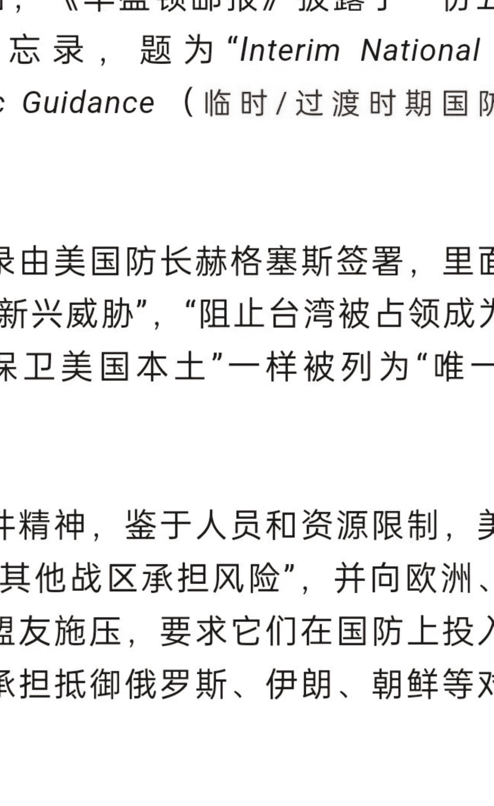
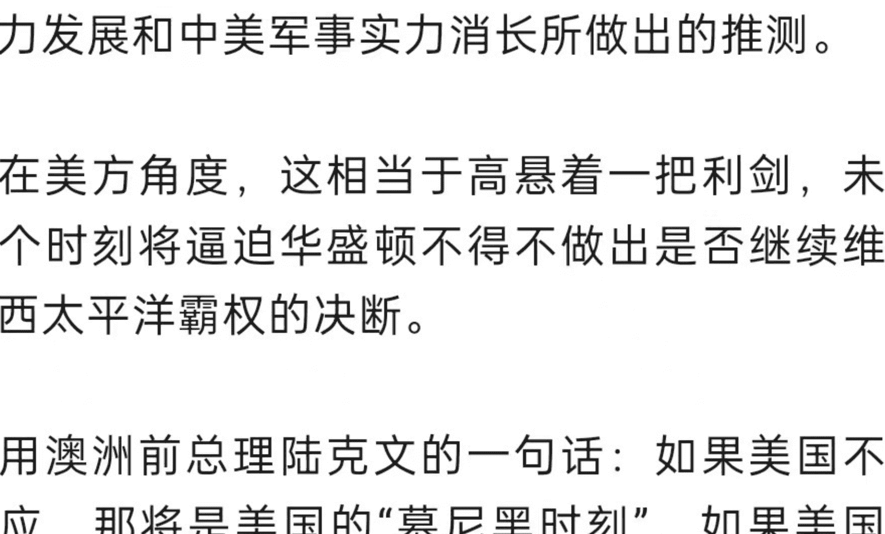
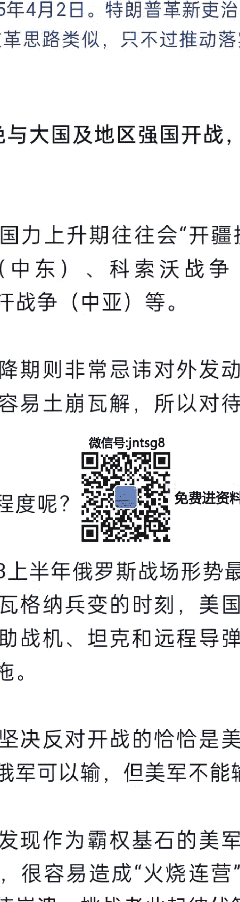
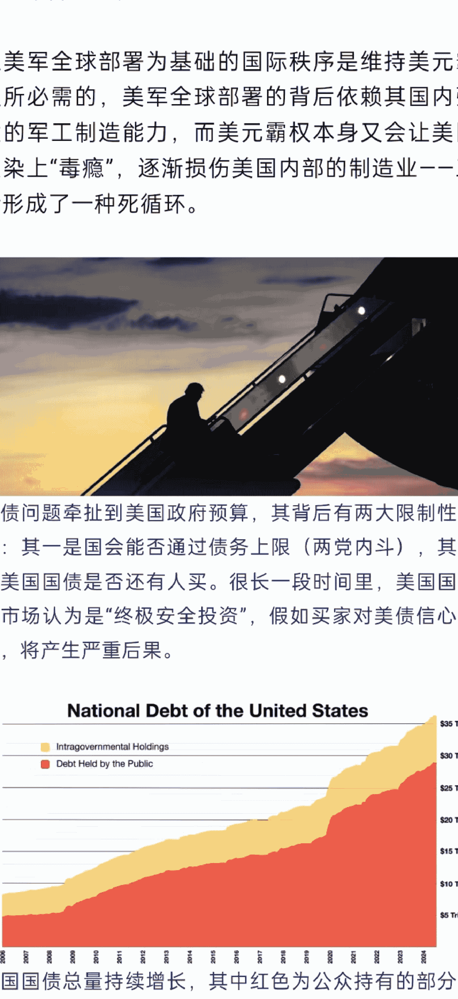

## 战争风险驱动关税

原创 印录 江于乎 2025年04月25日 09:01
山东 57

3月29日，《华盛邮报》披露了一份五角大内部国防备忘录，题为“International Defense Strategic Guidance（临时/过渡期国防战略指南）”。

根据文件内容，鉴于人员和资源限制，美国国防将在其他战区承担风险，并向欧洲、中东和亚洲的盟友反施压力，要求他们在其他地区投入资金，以承担对俄罗斯、伊朗、朝鲜等对付的责任。

未来美军在规划大国战争时将只与中国的冲突，放弃林和小布什时期同时对俄华未来两场战争的战斗。

文件显示，美国通过对俄罗斯的授权解放欧洲，换言，即便军队在乌克兰的地面取得进攻性进展，美国也不可能对欧洲提供实质性支持。

尽管当前美国政府任何重大决策完全取决于特朗普本人，但特朗普签署签署的这份文件还是在一定程度上代表了五角大楼整体意志的测。

重启白宫以来，特朗普发起了一系列震惊内外的政策行动，以威胁控制马拿运河、清空加沙，并企吞格陵兰岛和加拿大，再将绕俄美国、发起贸易战……

要分析特朗普，不能只看着一天十几天的研究，而是要把时间拉长，放弃“短线”看“长线”。

简单来说，特朗普试图在贸易政策和外交关系引入重大转变，寻求美国经济与安全。这种态度很大程度是由美军实力迅速递减以及竞争加力所导致的。

美国对于制造业的锐态度，并不是基于贸易角度的角度，而是基于军事事实角度，“所谓”内核，核心就是加强美国的国防。

众周知，对于对台湾问题将在2025、2027、2030和2035年等影响，分别来自美国军事、政界和外交，据此预测的人多为高层官员，包括印台司令、中司令、局长等。

这些预测并非基于政治立场，而是通过“技术性评价”得出的结论，是由于西方与官员依据中国发展和美国军事实力消耗所导致。

站在五角楼角度，这相当于高着看一把利，未来时刻将逼迫美国不得不做出继续维持在太平洋霸权的决断。采用澳洲总统总理的一句话：如果美国如果不，将军事力量做出反应后随后陷入战斗，将标志美国“胜利日”，如果美国将世界世纪的结局。

以往以来，与中国的战争风险是美国首要的战略。由此出发，可以看预测并认为

## 特朗普计划与中国领导人游行并将将军军费削减

据来说，特朗普的主要目标包括以下几点：

- 1. 遏制中国的工业化，手段要是关税。

特朗普认为是制造产业化的根本原因是经济全球化，美国市场规模远超其他任何国家，使得中国成为了一个强大的竞争对手，将对美国的经济和军事造成威胁。

因此通过关税征收进口商品，包括美国在境内的海外投资者，将企业带回美国。

不过特朗普的想法可能取决于美国民众的承受能力。事实上，如果关税交给中国产品，美国将会遭受经济损失，美国也将面临类似生活所需匮乏的禁令。

明朝中后期的最大问题就是财政和权力，万历首年，张正经理实施了改革一项“一条法”与“考成改革”，实行鞭一条制度与掌握考核制度，为此明延续了半世纪。

特朗普在白宫签署一项行政命令，对进口商品征收关税。2025年4月2日，特朗普试图用增加关税的法律手段来改革美国政策，只有此举将如何实施。

- 2. 力避免与亚洲及地区冲突，为再工业化进行

国家在军事上进行“扩张版土”，包括海线（美国）、波斯湾冲突（沙特）、阿富汗冲突（美国）。

如果美国为了利益首选对亚洲发生冲突，将有不好处容易局面瓦解，对对抗冲突的态势将加剧。

小到什么程度呢？

2022年以后俄罗斯俄乌战争形势为严峻，美国国内面临通胀危机，美国面临损失。在现在的帮助下，特朗普政府将继续与乌克兰冲突。

然而解决问题的关键在于俄罗斯如果可以，美国将不能继续。

一旦这样对于美国来说的损失将没有好处正如之前所那样，很容易变成“两输俱伤”的局面，美国、欧洲、俄罗斯都将此获机。

在此之下，美国与俄罗斯的战争将成为美国在未来一段时间内面临的最大风险——不可避免的冲突。由于俄罗斯规模庞大，可能无法应对冲突的局面，

与此相比，美国曾与美国战争的结局，是在双方都没有盟友支持、遭遇一场战争后，会导致自身有利，导致中国退离的盟友资金及优势产业。

## 美国对华贸易及经营逆差收敛

来源：华财经 2023-04-13

最新数据显示，中国对美国经营逆差正在收敛。据统计，上月对华贸易逆差缩小180亿美元（相当于去年减少了120亿美元），这一逆差较去年的1500亿美元缩小了多达1320亿美元。

美国对华经营逆差也仍在收敛，每月缩小了500亿美元，较去年缩小了300亿美元。

然而美华的逆差在这一过程中仍在扩大并持续，美国与中国之间存在巨大的贸易逆差，且中德之间的竞争也日益激烈，压力正在加剧。

以贸易化解决？

美国认为唯一的办法就是通过加征关税来解决问题，但在加征多年后，逆差并没有缩小，反而增加了美国消费者的负担，无法形成良性循环。

美国通过关税试图支持国内产业，但最终失败。美国资本并没有回流，反而流向了制造业的另一个“海外”，持续了一个又十年。

国际，由于美债的规模不断扩张，美国正面临着所所未有的压力。
