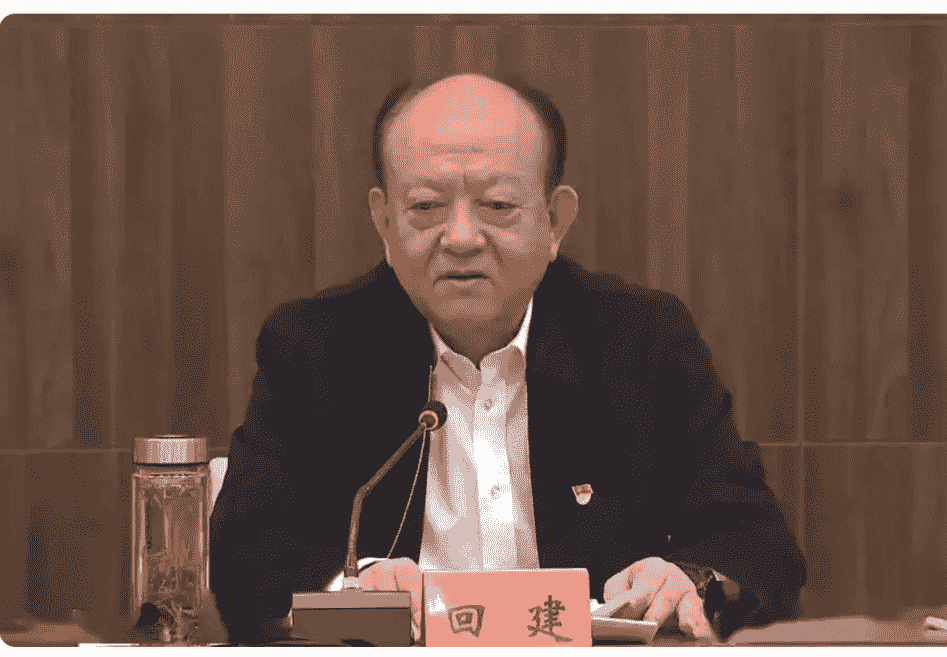

<!-- no content -->[/content]”，处理如下：

[content]<!-- no content -->

河北有个副县长，也是走这个后门，不过他是从银行系统跳到行政系统。

## 回振彪从银行副行长到常务副县长，可能未违规，但普通人做不到

| 2022.07--2023.03 | 河北银行邯分行党委委员、副行长 |
| 2023.03-- | 威县县委常委、常务副县长[1] |

加微信jntsg2，免费进资料群

现在网传回振彪跟回建是父子关系，而回建是河北人大经费委主任，曾经做过河北组织部常务部长，官方对这一信息尚未确认。

虽然这个口子背后需要的能量很高，已经不是县城罗门这类科级处干部能走走的，需要在省一级有关关系的政治家族，才能走通这个国企后门。

打通环节越多，打通难度越越高。

因为在行政系统内解决层级问题很难，涉及不同部门的轮岗培训，涉及不同地方，需要打通的环节很多杂，而且在这个过程中子弟容易出错。

加微信ntsg2，免费进资料群

而在国内解决层级问题更简单，只要该家族对这个国企系统有影响力就能让子弟在国企解决对应级别，然后搞定省委组织部这个关节，家族子弟就能外放出副县长、县长了。

打通环节越少，打通难度就越低。

国企这个只要打通两个环节就行，当然这两个环节含金量很高，特别是省委组织部这一环节，直接排除了各个县城地市级的婆罗门家族，这的确需要省级婆罗门才有这个能量。

但是性价比也很高啊，这些省级婆罗门家族，让子弟走这条门等于走仕途快车道，年纪轻轻直接副县长、县长的。

所以国企这个口还是得严起来。

加微信jnttsg2，免费进资料群

这是时代需要加强的地方。

第二个需要加强的地方，就是教育界和医疗界。

董小姐事件出来的就是这类娄罗门的玩法。

这类家族的能量和影响力，止于特定的系统，出了这个系统就不管用了。

他们让子弟继续深耕该系统，不管高校任职还是医院就业，都是合情合理的最大化家族利用价值的。

而且这类系统没有公务员系统那样严防死守，没有考虑进入。

就搞出了4+4这类暗箱操作，什么学艺术的都能搞定一个医学博士证明然后去三甲医院了。

加微信jntg2，免费进资料群

这个漏洞就很大了，因为不仅医疗界，还有教育界，不仅医院还有各大高校。

各种暗箱操作可以是四面透风。

这类漏洞太多了，要用机制建设——修起来就需要大面积深入调研了。

而教育界医疗界又大董小姐类的婆罗门家族了。

新时代需要补上这两类漏洞。

一个国企的漏洞。

一个教育界学界的漏洞。

不然各类婆罗门家族贪婪的不只是平民子弟上升空间，还将蚕食中国的国运。

对此，尽管补充一个历史典故。

那就是关东相关关西出将这句话。

这句话不陌生吧。

说是秦汉时代，函谷关以东的中原地区出书人出做宰相的。函谷关这边的关西地区包括山西，出打仗当将军的。

关东各地的世家子弟喜欢读书，经书传家，几乎垄断了行政系统。

关西的世家子弟喜欢打仗，武备传家，技术垄断了军事系统。

关东出相是有水分的。

因为文化这事，你分不出是谁第一是第二，秦汉代又没有科举制没有考试，都是德高望重的人说哪个年轻人厉害害，哪个年轻人就身价倍增。

所以关东出相这个秦汉传统，在三国直接演变成九品中正制，在南北朝直接演变成世家门阀。

直到四个大将将军将门阀世家杀干净了，宋代的科举制才有落地的土壤。

天公大将军，黄巾军张角大起义，杀一批门阀世家。

宇宙大将军，南北朝侯景，南下破梁，杀一批门阀世家。

天柱大将军，北魏尔朱荣，淮阴之变，杀一批门阀世家。

加微信jntsg2，免费进资料群

冲天大将军，唐末黄巢，起义屠杀，再杀一批门阀世家。

四位将军接二连三的杀杀杀，终于把这帮门阀世家杀差不多了。

到了宋代终于没有这些门阀世家这类大地主了，中国也顺应生产力迎来了自耕农小地主的时代，科举制才终于有彻底地打通平民子弟上升空间的可能性。

没办法，关东出门，世家垄断行政领域，这个文化的确实太难以量化了，太容易暗箱操作导致垄断。

但是，关西出将不一样。
