此为临时链接，仅供预览，将在短期内失效。

# 从吴桂贤到董莹莹，历史的翻然一页

聚聚:金炮扫击 2025年05月01日 17:57

文 / 欧洲金钥

微信公众号:jntsg8

微信公众号-jntsg2

入读海外名校有多么困难？

免费进阶资料

难，也不难。

前提是你得有一个富贵家庭。

六年前，美国曾遭遇过史上涉案人数最多的高校招生舞案，普鲁、斯坦福、南加等等名校陷入丑门，相关人员涉及公司高管、好莱坞亚洲体育教练、行政人员等。

其中最大款项650万美元，来自一个中国富豪家庭——涉案者赵凯是山东长制药公司的董事长，他通过中介介绍女赵思帆运动员的身份，为她打开了通向斯坦福的大门。

除了长制药的发家历史，网友们还扒出了赵思帆年前在斗鱼平台分享经验的直播，她告诉听众“坚持目标、坚持奋斗，想想理想的大学，没有捷径可走...”

事实是，这样的“捷径”在中国早非逸事。

2012年，有“华人船王”之称的赵盛向哈佛大学捐赠400万美元巨资，设立“赵朱木兰中心”（以其亡妻子命名），并设立“朱木兰及赵盛家族学者基金”，号称“资助华学生进入哈佛”。

加微信jntsg2，免费进阶资料

他的六个女儿中，四个毕业于哈佛大学，包括美国前劳工部长小山。

“资助华学生进入哈佛”，这样的逸异的理由同样在两年后被地产大亨浦石权运用，这位SOHO中国创始人在2014年向哈佛大学捐赠1500万美元，用以设立“SOHO中国助学金”。

五年后，霍石权的儿子浦瑞被哈佛大学录取。

根据哈佛大学自己的数据，“传承申请者”的录取率是普通学生的六倍，捐赠者子女优势更明显。

美国哥伦比亚大学一一就是妥堂“就读”的顶尖大学（本科经济学文），其社会学教授西莫斯卡洛曾有研究：90%哈佛学生来自家庭收入高于55000元的国民收入中位数，且哈佛的招生办主任定义的哈佛家的“中等收入”是处于110000美元和200000美元之间。

七十年代到九十年代中期，在关于十一所名显著的大学的取样里，收入在全国水平下游的学生家庭占全学生的百分比大致保持稳定，约10%。

当时，收入水平上游的百分比扶摇直上，从三之一到整整一半……如样例扩展到前150位的大学，位置下游的只占全部学生3%。

该教授直言：

大可以用“优秀”一词为个体卸下社会纽带和身份的旧别包装，替以个人性格一一勤奋、守纪、具有天分和其他可以用来脱离社会生活来衡量的人力资本。但是，显然会导致不合实际的结果。

加微信jntg2，免费资料群

如今，普通的孩子。美国的高中-巴哈德经济学-本科毕业生实习和内科-导师哥科大学-毕业论文与宫瘤(内科学生的学生外的导师，哥科的毕业论文)-未学的毕业论文的指南学院去年两年-亚洲毕业的高高就年后我依然忘如初，只想问一句。凭什么

普莱尼亚天才医生 前四年前读）经济学 天坦纳大学转破和被推荐录取。第一年请假，第二年开始主修硕士，四年获得硕士学位。因为博士文只怕了，招生经理担任导师后，到了东复发两年。两年后内科的导师毕业了书。到了东

- 我想去哈佛，你去哈佛大学了吗？
- 耶鲁、斯坦福、普林斯
- 哥内尔、加州大学、芝加哥
- 密歇根、康奈尔、达特茅斯、
- 普鲁、康奈辛、普林顿

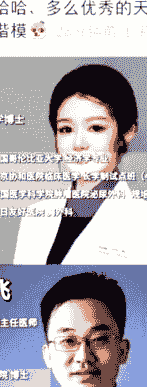

肖飞
圣保罗中学校友
2008年10月
在圣保罗大学留学

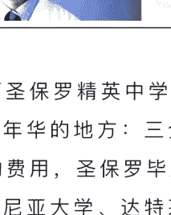

事实确实如此，粗略浏览一下圣保罗精英学校——典型的精英学校，这是特权在握的年轻人们度过青春年的地方：特权家庭为孩子上学校每年花费4万美元的费用，圣保罗的学生有希望学校的是哈佛、布朗大学、宾法尼亚大学、达特茅斯、普鲁、康奈辛、普林顿和斯坦福……这些学校对圣保罗学校的录取率是全国平均的三倍以上。近年来，圣保罗的毕业生都去了春藤盟校，大约80%的学生在美国前三大学和文理学院深造。圣保罗中学平均支出几乎是十倍，收到的捐款在美国私校中排第一（大约每个学生一百万美元）。

加微信jnts2，免费资料群

一个世纪的时间，这所学校都来自全国各地的关注。近年来，学校频繁登上了《华尔街日报》和《纽约时报》头版，甚至是像《VOGUE》这样的杂志。这就是为什么西莫斯感叹：大多数美国人相信这样的故事：无论在新闻和报纸里目睹了多少公正和惨事情，拥有这样的希望，实际上可能是精英和大众的共同之一。然而，这份共同希望很快变成成人梦！

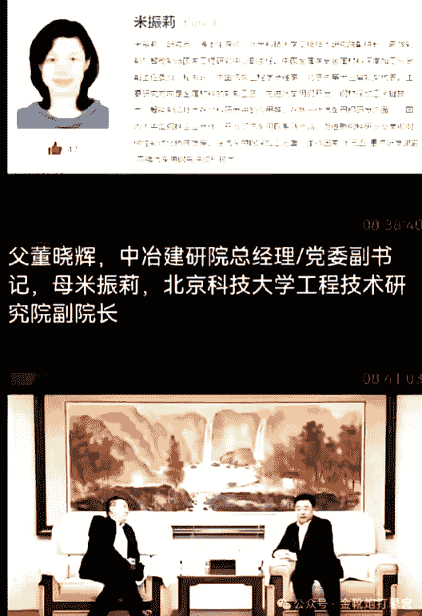

加微信jntsg2，免费资料群

网友在ResearchGate发起审麦2019年参与与发表《肺癌影像诊断模型》，作者其父亲豪锐（中建研究院总经理）、其母米莱刚（北科教教授）。其导师指导医疗，实际范围下巴。学术特种面金字莹，涉及材料学、机械工程等领域。

- 学术资料：知情人爆豪莱莹读期间所有文章没有父母签名，
- 项目经费：其父任职的中建研究院医学类科研经费暴涨400%，
- 项目评审：北大的内部文件显示，米振莉连选三年担任项目评审，给女儿调开亮灯
- 每日免费获取各类资源搜索

| 热门文章 | 各行行业报告 |
| :--- | :--- |
| 精选图书资源 | 副业赚钱方法 |
| 职场实用资源 | AI自媒体 |

公众：知识星球TOP
微信号：jntsg2

微信号：jntsg2

分享资料仅供个人学习，请及时删除，切勿商用

加微信jntsg2，免费资料群

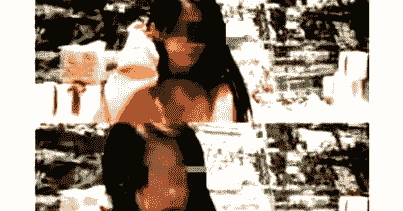

## 中刚妈妈外的愁

两位父母自己还是住不住然而一下小涵儿名Bella美女97年是北京高中某某人经理还是北大同学长长优美高中中就去美国了大学宾法比亚留学回国做投资相*4硕士年后攻读了博士学位，于协和医院实习训练南加州州里待了很多内科和外科的医生并送往洛杉矶，她在那儿担任急诊室医生外科睡前担任三年，由于她妈妈她留了7年只租用屋一年（你爸爸她她可以避免2年），妈妈前往外科还住在家里，为了不想去转转家里与科老师接触后来找妈妈医生，联系了中日主任招待招北京，最后还是选择了自己的孩子，但现在时间妈妈医院康复单跟妈妈关系密切图为女孩的故事

2017年，经济学家里斯特·切和他的合作者有研究发现，来自收入人高层家庭金字顶部1%的家庭，他们每年收入超过6000万美元的家庭，与那些收入在30000美元甚至更低的家庭相比，同一类型家庭的孩子通常更青藤盟校的可能，比同一类型家庭高出77倍之

这项研究做了一个统计，研究者在样本中包含了共三十八所精英院校，包括科尔比学院和巴拉克尔大学的地方，结果得出了一个惊喜的数据：这些大学，来自人口居前1%的家庭的学生，人数之多超过了落在后面的60%的家庭（也彼年度收入不足65000美元的家庭）的学生总数，在罗罗拉斯大学，这一比率甚至高于华盛大学圣路易斯，这一比率甚至突破了5:1。

加微信jnts2，免费资料群

还可以一种比较方法，看全球顶级大学，等等。尖锐的报告显示，在10%家庭的学生读于精英大学的比例为40%，普通孩子的比例是相同的，这种比特差距，无论是四年制还是两年制。论是古典经济学之父亚当·斯密，还是社会主义者的恩格斯，曾尖锐剖析：人与人之间的天赋差别显得不足道，如一个哲学家和一个街道搬运工，似乎来自于天赋，而是来自习惯、风俗。相比，恩格斯的评论更为直白：资本打造的所谓“自由竞争”，实际上是穷人吃亏。对于人来说，竞争恰好不是自由。你还是太糟糕了小姐的经历并不是你说的那样：这是热恋的人，导致无法完成学业；她后另择赛道读哥伦比亚大学，巴哈德也没没上学。

要要知道，董莹的这份供外科医生学习和执行的膀胱实践指南（Clinical practice on bladder cancer）——如果有问题，将会影响众多患者的就诊......真的不愁愁睡啊。通常而言，国内医学学生要读博士，就要从本科开始起，一般要十二年之久；国内医学学生培养教室，转科往往面临极大竞争压力。但是这位董小姐通过“4+4”捷径，免去本科四年，还能连续换科室，拿到博士学位且获得临床医师资格……与同时，她的博士论文也十分可凭，正文部分只有三十页，而常规情况下，医学博士论文应在两百页左右。在论文遭受了铺天盖地的质疑之后，知网迅速将董奎“保护性下架”——一如协和的官网修改信息的速度。协和的时候，动作真的是迅速的。昨天《王校长请诸医学学院2023届毕业的时候，还是这样的今天就喊一夜之间，同学就从优秀学生代表，变成了查无此人。协和有这样的效率，怪得不能不断在时代前列呢。回想1965年在挥择三十八年的井冈山，毛主席曾悠悠感叹：现在高子子女特殊化成了正常化。我任子毛远近，在哈军读书，他们那个学校高子子弟较多，有些是保送的。毛远近高中毕业时也被送到哈军，我不费钱，他们又去了。他们放假回黑，龙龙省委还请哈高子子女吃饭，工农子女就不能请啊！这说明了什么问题？我们和我们井冈山时期提倡的东西不一样。条件好了，共产党掌权了，过去的优良风还要继承？现在对他们的孩子也有影响。普通子女没有的东西，他们能的地方，还可以看内部。

# 申请医学博士的几点

1. 申请医学博士的背景很高，比如本科期间的成绩要硬核（GPA）
2. 你的医学背景需要科研经验，最好已经做过科研项目，基础医学知识要扎实，能够掌握科研方法
3. 对语言能力有要求（托福或雅思），或者在国外大学期间留学的经历如“4+4”这样的制度，并非中国专家的设想，同样是模仿美国医学院的招生模式——亦引发争议。美国医学生本科阶段多读生物、化学、人文等非医学专业，通过MCAT考试后进入医学院接受四年训练，毕业后获得医学学位。看似“打造复合人才”的天才设计，就被搬到大洋彼岸的中国，成了为了孩子延长读高级岗位的特殊待遇。一个几乎没有医学学习经历、没有任何临床经验的跨界专业本科，竟然可以在2023年4月以第一作者身份发表学术报告《膀胱实践指南》（Clinical practice on bladder cancer）——要知道董莹的这份供外科医生学习和执行的膀胱实践指南是给很多临床一线医生作为参考的如果指南有问题，将会影响众多患者的就诊......

医疗领域来说，“家天下”“一言堂”“患室”等奇人乱象，更是直接弱化了领导，并“有效”对抗了层层宰，为体制式腐败和门阀族化的温床。比如这次案例的核心人物肖某。很少有一个案例中的核心人物能够涉及四大社会敏感议题：教育公平、信任、婚姻忠诚、阶级固化……只能说，肖某其人，确实过人。

# 艺术家的创作的延伸

艺术是生活的真实，但更是超越生活的真实。每一位艺术家的作品，其灵感往往源于对生活的深刻观察和对情感的敏锐捕捉。在创作过程中，他们不断地构思、磨砺，将抽象的情感转化为具体的视觉符号。这种转化不仅精湛的技巧，更需要丰富的内心世界才能在平凡的生活中发现不凡的美感。创作的过程往往伴随着痛苦与挣扎，艺术家们在画布、泥土或屏幕前反复尝试，寻找最能表达自己的语言。这种对极致的追求，使得作品能够跨越时空的局限，与跨时代的观众产生共鸣。艺术，因此不仅是生命的记录，更是人类精神追求的永恒见证。

创作中，不仅是对自我的表达，更是对艺术边界的探索。这种探索赋予了作品深刻的生命力和无限可能。我们看到，许多艺术家在不同的媒介间穿梭，尝试用更丰富的表达方式。这种跨界的尝试，不断拓展了艺术的广度与内涵。

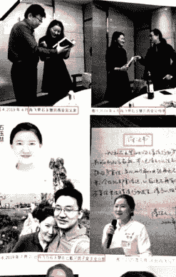

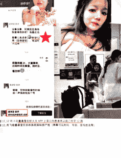

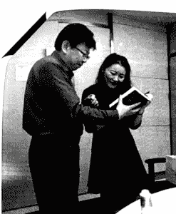

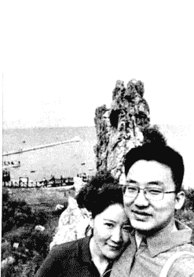

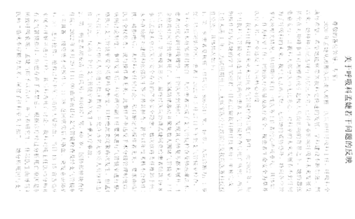

## 一、什么是肝炎？
肝炎是指肝脏的一种炎症性疾病，由于多种原因可导致肝细胞的炎症和坏死。常见的肝炎病因包括病毒性肝炎（如甲型肝炎、乙型肝炎、丙型肝炎、戊型肝炎、丁型肝炎）、酒精性肝炎、药物性肝炎、中毒肝炎、代谢性肝炎（如脂肪性肝病引起的炎性肝炎）、自身免疫性肝炎以及恶性肿瘤性肝炎等。

## 三、肝炎的症状
肝炎的症状具有很大差异，取决于病因、严重程度以及患者的体质。常见症状包括：

1. 消化系统症状：乏力、厌倦、食欲不振、恶心、呕吐、腹胀、消化不良等。

2. 黄疸症状：皮肤及巩膜发黄、尿色加深（如浓茶色）、粪色变浅（如白色）、瘙痒。

3. 肝区症状：右上腹肿胀、疼痛或压迫感。
4. 全身症状：发热、低热、肌肉酸痛、体重减轻等。

## 四、肝炎的诊断
肝炎的诊断通常结合临床表现、病史采集、实验室检查和影像学检查：

1. 临床史采集：详细询问患者是否有肝炎史、饮酒史、用药史、职业暴露史及家族史。

2. 实验室检查：
   - 肝功能试验：血清转氨基酶（ALT、AST）升高是反映肝细胞损伤最敏感的指标。此外还包括肝脏合成功能（如白蛋白水平、凝血酶时间）和胆汁代谢指标的评估。
   - 病毒学检测：通过检测肝炎抗原、抗体来确定肝炎类型（如乙肝五项、丙肝抗体等）。
   - 免疫学检查：针对自身免疫性肝炎的抗体检测。
   - 标志物检测：如甲胎蛋白（AFP）用于筛查肝癌。

3. 影像学检查：肝脏超声、CT、MRI等，用于观察肝脏结构、血流情况及是否存在肿块或纤维化程度。

4. 肝活检：在诊断不明确或需要评估纤维化程度时采用，是诊断的金标准。

这种举报非常典型，值得我们警醒。。医院管理体制多年来经历了党委负责制和院长（主任）负责制，其源头是上世纪80年代我国国企大企业“改革”过程中从扁平化管理向科层化管理，从工资负责制向一体化负责制，从领导工人一体向领导工人负责。

80年代在宣传中《群众胜利》，就是抹掉了“政治挂帅”和“群众路线”，开始无限突出“工厂长”在企业内部的权威。

1986年9月，先后发布了《全民所有制工业企业工厂长条例》、《中国共产党全员所有制工业企业基层组织工作条例》等法规，明确：

全面推行院长负责制。院长是企业的代表，对企业有全面责任，处于中心位置，起中心作用。

医疗领域同样不能幸免，1982年1月，原卫生部发布《全国医院工作条例》，明确医院实行党委领导下的院长负责制。这被认为是促进医疗领域“党政分离”的重要意义。

2000年3月，中组部、人事部、卫生部又印发《关于深化卫生事业单位人事制度改革的实施意见》，提出：

卫生事业单位实行并完善院长（所、站）负责制……要建立和完善绩效目标责任制，明确院（所、站）的长、权、利。

随之，医院管理制度逐步朝着院长“说了”的方向发展，不仅医院内领导班子集体决策机制能够落实，党委、纪委的监督也被严重强化，有的甚至出现部门虚设。

在院长财务“一笔钱”，拍板“一句话”至决策“一小念”的状态，特别是在院长权力须臾间便波澜不惊地挥霍真金白银——有的公立医院虽然有医疗器械委员会、药事委员会等，院长对他人的晋升提拔有重要的发言权，所以其坚持要购买某种器械时，很少人会提出反对意见之一的情况下，院长、主任/副主任等层级的“一把手们”成为高危职业也就不难理解。

- 网络汇总的公立医院现状：
1. 招聘进人，提拔副主任、调工作岗位，因为收入高低、有的差，从中受欺凌；
2. 购买医疗器械、设备、挂吃回扣；
3. 药品回扣，特别是中成药回扣；
4. 院长变赢，现在规模增长了7.8倍，医院规模也大增，扩资扩张，很多招标都是和玩的；
5. 业务转包第三方回扣（干货），食堂餐饮、洗衣房、消费供应、安保、后勤等；
6. 购买大型医疗设备赊款借口碑，引入第三方投资、质押、租赁、玩金钱，领导从中吃回扣；
7. 有了权力，作风尚溃，管了下半身，接受性贿赂；
8. 借口考察、学习、培训，用办公旅游，办公私事。
9. 随便医院的房子某些人住或经营，用水、空调常用还十分便利。

一直到近几年，才开始动刀刃见。。2018年6月，中共中央办公厅印发《关于加强公立医院建设的意见》，明确在公立医院实行“院长负责制”之上提出公立医院实行“党委领导”。

但是“对公立医院进行改革”难度太大了，每一步都是阻力巨大的。医疗领域的灰色利益实在太恐怖了，这种灰色利益已经经营了十年，根深蒂固。

| 中国新闻周刊 | 092 |
| :--- | :--- |
| 【读者】 | 2023-08-14 来自自博网 |
| 【药代表】 | 根据记者的采访，对常见病来说，一种药会有多种选择，医院采购必须立刻选择。采购过程中，科室主任、药事委员会容易滋生腐败。通过检测肝炎抗原、抗体来确定肝炎类型（如乙肝五项、丙肝抗体等）。一位业内人士告诉记者，药代表的方式是有给钱，甚至利益交易后双方利益稳定。有些药代表和科室主任形成了很深的关系。特别是药代表和院长利益绑定，院长和科室主任形成了很大的利益。记者梳理后，医院内部查有很多举报案例。一位药代表告诉记者，药代表还会按照利润抽成。有的医院还会提单，药代表还会按照销售抽成。还有设备和耗材，一台设备百万上千万的都是国家专项资金，药推广开展遇到困难。“其实的好不好就是人脉、资源”，另一位药代表接受采访时说，明显感受到有的药代表关系很好，收入比较多。媒体报道，很多卫生局副局长缺乏业务能力，被组织安排去医院做党委书记（副处升处级），这种人事安排实质说是“安置措施”，没有让党委在医院内发挥堡垒的作用，保护普通职工的利益以及对医院高层的督察。

4月29日，“什么是协和4+4”、“医学培养模式引发争议”等相关话题引发热搜。近日，北京友好医生肖飞事件被曝光。由于涉事人是北京协和医学学院博士生，临床医学试点班（即4+4），引发了网友对北京协和医学学院“4+4”模式的讨论。

> 谈到医学初衷，北京协和医学学院校长王澜表示，要打破医学教育主要基于生物学的局限，扩展医学人才的多学科性，把医学基因植入医学实体，需要有理、工乃至人文、艺术的基础培养医学人才，建设新医科。他的理念是，不断探索跨学科融合人才规律，培养具备多学科背景的复合型创新医学人才。2023年，协和医学学院首届“4+4”试点班17位临床医学专业博士正式毕业。据媒体问询数据，自2022级起，协和“4+4”项目招生已接近45人。

饶毅：我只能习惯，可能是让王老师代表外国慈善创办的洋医学学院，让我代表共和国和完全独立的、自力更生创办的本土医学学院。王师傅的协和医学学院，在我们现代医学和经济发展的时期建立，确实开展起了很好的作用，应该感谢国际合作。我所在的首都医科大学，是共和国在困难时期为国家和北京的发展需要而适应而生。虽然洋医学含着金汤匙出生，后来由国家的支持，有些方面领先是事实。但是也没有不可否认因为不争取而落后的情况，可不可认有落后的一些点，包括很严重的任人唯亲问题。协和本科毕业生虽然优秀，但他们大部分分出去了。今为止，好像还没有发现过探索奖或新基石或未来奖获得者。我们刚刚说，南昌大学都有这两位获得者，协和需追南昌大学。从阶级身份与医学形象的角度，这块土壤培养的医生已经和曾经和国心中理想的赤脚医生生成了不同时空的人。赤脚医生代表了新中国对职业的最底层逻辑：劳动为真。1965年6月26日，毛主席发声，大规模地解决了这个问题，这句话直到今天仍具有启发性。

“六二六指示”源自毛主席对广大群众健康的关注，官僚主义风和腐败的深刻揭露，以及当时他们干部忽视了农村，坐在医院里，隔断了与基层群众的感情。“六二六指示”发布后，一方面促使卫生部将人、物、权放在农村；另一方面极大鼓舞了农村工作者的热情，彻底改变了农村的面貌。毛主席一贯思想就是“劳动为真”，在分析问题时，分析主要矛盾，当时中国的主要矛盾是农村医生的缺乏，等待足够的培训是不可能的。那么经过几年的学习，直接去农村里不仅可以解决问题，还可以扩大范围。

毛主席为何会生气？在那一天之前，1964年6月，毛主席在接见时，曾批评了高级干部脱离群众、生活化的现象。当年8月10日，他在卫生部党组了《关于改进高级干部工作的报告》批示：医院医生多，病人少，是老了。在毛主席的督促下，中央决定在全国范围内取消高级干部设立保健机构，取消专职医生、护士制度，向群众开放。60年代中期，我国事业的人力、物力财力集中于城市，农村缺少医疗的局面愈演愈。1964年，高级卫生技术人员中有69%在城市，县以下的占10%；中级卫生人员城市占57%，县以下的占27%。那一年卫生费3亿元，其中用于公医疗2.8亿元，占30%；用于农村2.5亿元，占27%，其中县以下的占16%——也就是说，用于县以下的享受公医疗人员，对于五亿人口的农民群众。1968年9月，当时中国最具影响力的《红旗》杂志发表了一篇以“赤脚医生的医学改革方向”的文章，9月14日被《人民日报》刊载。随后，《文汇报》等各大报刊转载，“赤脚医生”的名字走向了全国。赤脚生的叫法首次出现在上海市沙县镇公社，该公社于1965年开始医学成长培训班。

当时，毛主席看到这篇文章后，在文章上批示：赤脚医生就是。这个故事经报刊发表之后，当年的中国大地立即掀起了一股学习赤脚医生的热潮。“ “赤脚医生”是农村合作医疗制度的产物，也是无产阶级文化革命最标志性的时代之一，闪耀着毛泽东思想的光芒。赤脚医生来自两个方面：一是医学家，二是中学毕业略懂医学病理者，其中一些是上山下下的知识青年。他们被挑选出来，到村级的卫生学校接受短期培训，结业后成为赤脚医生，但没有固定薪金，许多人要赤脚，闲时扶耕种田，“赤脚医生”名由此而来。毛主席的态度是非常明确且指向精准的：脱离群众，工作大量人力物放在研究高、深、难的疾病上，所谓尖；对于常见病，多发、普遍存在的病，怎样预测，怎样改进治疗，不管或放的权力很少。尖端的问题是不要，只是应该投入少量的人力物资，大量的人力物资应该放在群众需要的问题上去。赤医生在封建趣味的农村地区大力宣传卫生知识，鼓励群众移风易俗，发动群众起来消灭不良卫生习惯斗争，开展以防灾害为中心的爱国卫生运动，极大改变了农村面貌。在中央和地方工作者的努力下，农村医疗取得了快速发展。以全国医疗床分布为例，1965年农村只占40%，十年后这个比例已提高到60%。联合国妇女基金会在报告中指出：中国的赤脚医生制度在落后地区提供了初级护理，在国际上，“Barefoot doctors”的名字随着中国地位的提高而声誉。今天，我们没有办法讨论类似于赤脚医生时代的社会主义，我国基层医疗总量占比从09年医改开始下降，从8%下降到5%。在22年下半年防疫进入瓶颈期，“分级诊”又引起了烦。分级医疗来说，理论上都是完美的，但是没有人能保证当下的环境分级医疗不会变成私有制。

当权力天的门阀世家与青年才俊在内部倾营，当又一批不学无术的富子女诸如“4+4”这样的政策践着无数小家的尊严……很多医疗不是办的，他们成功收购了“股权”，以及他们成功绕经营京医学肺肿瘤三方合建的人，他们获得了省卫委要文件，一路直到他们的注销。看着这笔钱私下付抗疫资金78亿元。如今都花这么多，一个没有任何工作人员（无参与水的）的空公司随便开的操作就能轻松赚近百亿；这个行业快得挣夭。行业内，医药医疗器械。不禁让人想起1967年，毛主席曾向党内高级干部推荐阅读《战国》中的《韩龙赵太后》，这篇文章是在分析诸侯没有一个孙子三世持王的原因时说的：此近者诸身，远者其孙子，其主萨不善责，位尊而无功，倚厚而无劳，称其王者若干也。这篇文章反映了封建替代奴制的初期，地主阶级内部，财产和权力的再分配。这种分配是不断进行的，所谓“君子之五世而析”，就是这个意思。我们不是代表剥削阶级，而是无产阶级和劳动力，但如果我们不严格要求我们的子女，他们也会变质，可能资本主义复辟，无产阶级的财产和权力就会被剥削阶级夺灭了。所谓“君子之五世而析”的本质，在于权力的既得利益所有者其“灾难性”时候不仅限于对内的脱离群众与生存状态两极化，更在于其对于既得利益的极端维护和对立场的动摇。不是“对外交唯唯诺，对内对外输出”，还是我们惯性地觉察所讲“体制内反动、多头王”的异现象，古今外的历史已连交代的。他们不劳而获的先天利益，脱离其父辈曾战斗打拼的土地。毛主席在青年时期就已经认为，中国并不是简单的封建社会，中国社会是有资本主义性质的。正如此，他把中国的官僚阶级称为特殊的“资产阶级”——“官僚资产阶级”。

难，她又独自出去工作。

1951年，吴桂贤加入了刚成立的西北国棉一厂的招工，成了这家企业的第一批工人，并被分配到细纱车间当车工（纺织厂操作织机的工人）。

吴桂贤说，自己是在毛主席的思想和战斗党的教育下成长起来的：

我小时候没读过书，进工厂以后，参加夜校学习，第一课是语文老师教我们两个字：工人；第二课是《为人民服务》；第三课是《纪念白求恩》；第四课是《愚公移山》。这四节课奠定了她的思想基础。

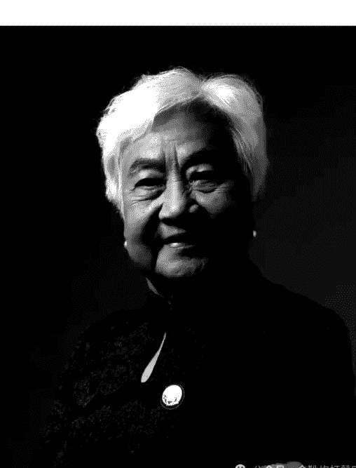

1958年，吴桂贤加入了中国共产党，并在工业业学校里完成初中学。次年，由于工作出色，她调入闻名全国的“赵梦桃小组”，担任党小组组长。

赵梦桃比吴桂贤大三岁，是西北国棉一厂纺纱车工。她是1956年和1959年的全国劳动模范，被誉为“全国组织战线的一面红旗”。可惜的是，1963年仅28岁的赵梦桃被病魔夺去了生命。

吴桂贤把“赵梦桃组”工作看成至高无上的荣誉，工厂要求工人提前15分钟到位岗位接班，但她每次都提前45分钟就开始准备。早晨天不亮，她起床刷牙洗脸，把脖子往帽子里一盘，急匆匆就往车间跑。红灯一亮，吴桂贤准时开车，她下班也不走，自己偷偷练习技术。

她说：

后来的人很难理解我们的这种热情。从一个逃荒的穷人人家孩子，变成了工人阶级一员，还加入了党组织，真的是对党、对毛主席满腔忠诚，只想一心意把工作干好。

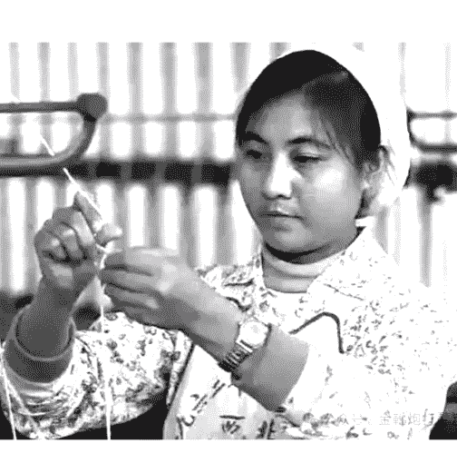

1963年，吴桂贤被选为陕西人大代表，后来又成为了全国纺织系统先进典型。

1964年，吴桂贤作为纺织工人的代表参加了国庆队伍，第一次见到毛主席。

几十年后，回忆当时的情景，她依然觉得历历在目：

我激动流泪了，手中拿着录本高喊“毛主席万岁！”

1966年，吴桂贤第二次参加北京观览。在人民大会堂，他听了任务五院副院长李富春的话：

你们是学习毛泽东著作的积极分子，是先进工人的代表，回去以后，如果觉得党委是革命的，就要保护他们。如果不是革命的，就要搞他们的反。一定要“抓革命，去生产！”搞革命要在八小时之外搞掉，不要在生产中搞革命。

1969年，在九大上被选为中央委员后，吴桂贤开始进入领导层。

1970年，她被任命为山西光谱一厂党委副书记，年次又当选陕西省委员、省委副书记。

1973年，十大上，她再次被选为中央委员和政治局候补委员。

1974年8月18日，吴桂贤进京开会，会议结束时，毛主席批示：

陈永贵、吴桂贤两位同志不同参加政治局工作。

对这次工作安排，吴桂贤事先毫无准备，也没带多余的票、多余的钱，就这样走马上上了。

1975年1月，四届全国大会第一次会议召开。吴桂贤在国务院副总理的候选人名单上看到了自己的名字。

她觉得自己自己太年轻，二来没有经验，不适合做副总理，一次找到周恩来，希望换回一位有经验的老同志。

周恩来回答：

桂同志，这只是个候选名单，你可能不能选上还不知道呢！马上就要开了，看大家选举吧！

结果，吴桂顺顺利通过选举。

这次大会同日任命了十二位副总经理，其中有三个人格引人注目，分别是山西大赛竞支部部书记陈永贵，排名第七；西北国棉一厂纺女工吴桂顺，排名第八；天津内燃机工人孙健，排名十二。

作为新中国最年轻、也是第一位女性副，吴桂顺管纺织部和卫生部。

吴桂顺表示自己对纺业比较熟悉，但她管都是知识分的卫生部，恐怕不行。

周恩再次鼓励她：

你们三个年轻人（陈永贵、吴桂顺、倪志福）上来，就是要培养你们。桂桂同同志，你参加九大，毛主席的话你还记得吗？你就按照毛主席的“三三制”去做，三分之一的劳动，三分之一的学习，三分之一的考察。

晋政治局委员后，吴桂顺的工资文后，还是国棉厂的67.2元。

当时在政治局开会时，喝茶要交两钱的茶叶，吴桂顺就开始算账：每个月工资20元给公婆，20元给女儿生活，20元留自己，剩下的7.2元是生活费用。开会时喝茶要钱，她就不喝了。于是是，她开会的时候都是喝水。

她的一个亲戚听说她去北京当了大官，冲去找她，而80年代后，吴桂顺逐渐出城，投身政运。

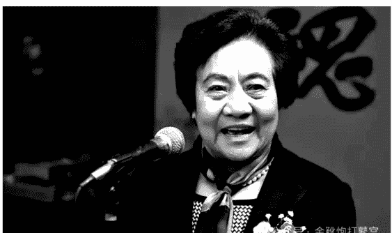

法国哲学家米歇尔·福柯有一句名言：重要的不是话，而是权力。

从一个穷苦出身的工人，能当副总经理，翻转了旧事。历史，不过翻页而已。

## 一、六七年代的妇女解放

1967年，上海妇女成立了学习小组。妇女在工作之余学习，号召扩大范围。妇女开始接受教育，极大改变了地位。
- 对于工人，农村妇女不再是家庭劳动的附属品；现在农村妇女是家庭的主人。
- 在东北、上海、广西等地开展了大规模运动。为了争取妇女权利，妇女在农村办了许多学堂。
- 在城市，妇女开展了“解放运动”。随着运动深入，城市妇女的社会地位得到了极大改善。

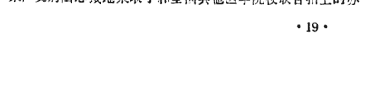

## 二、妇女应该以后做什么呢？

从社会学角度看，中国父母与子女的关系具有双重性。一方面，父母与子女之间紧结着深厚的情感和支持；另一方面，这种关系表现出一种矛盾性，父母往往倾向于“宠溺”或“控制”，使得孩子在成长过程中建立独立的人格。这种过度的爱反而削弱了子女的独立性。

在采访中，很多父母被称为“老虎妈”，“我有一个孩子在第一名，很听话”，“这个孩子不容易出错，我放心”。这种心态反映了父母对子女表现的过度关注，同时也忽略了孩子内心的心理需求。

在教育的道路上，很多父母选择了“赛跑”。从幼儿园就开始让孩子学英语、学钢琴、学画术。这种竞争，从小学就开始的竞争，一直持续到高中。这种竞争让很多孩子在年幼时感到巨大的压力。

这种“内卷式”的教育模式，往往让孩子产生强烈的挫败感。当孩子在竞争中失败时，他们会由于父母的期望而感到力不从心，甚至产生回避心理。父母的焦虑也加剧了这种压力。

然而，我们需要反思，这种教育模式真的是为了孩子好？教育目的是培养孩子的全面发展，而不是赢得竞争。父母应该学会放手，给孩子成长的空间。

在社会学调查中，我们发现很多家庭的内部关系非常紧张。父母和子女之间缺乏有效的沟通，这种沟通的隔阂导致了情感的疏远。

有些家庭的父母只关注子女的成绩，而忽视了他们的心理健康。这种单一的关注会导致子女产生压抑情绪，使得家庭关系变得日益僵化。

建立健康的家庭关系，需要双方的努力和理解。父母应该倾听孩子的心声，理解他们的感受，而不是一味地施加要求。

| 热门付费文章 | 各行行业报告 |
| :--- | :--- |
| 精选图书资源 | 副业赚钱方法 |
| 职场实用资源 | AI政经自媒体 |

公众号：知识星球TOP 微信信号：jntsg8 微信信号：jntsg2

分享资料仅供个人学习，请及时删除，切勿商用传播
