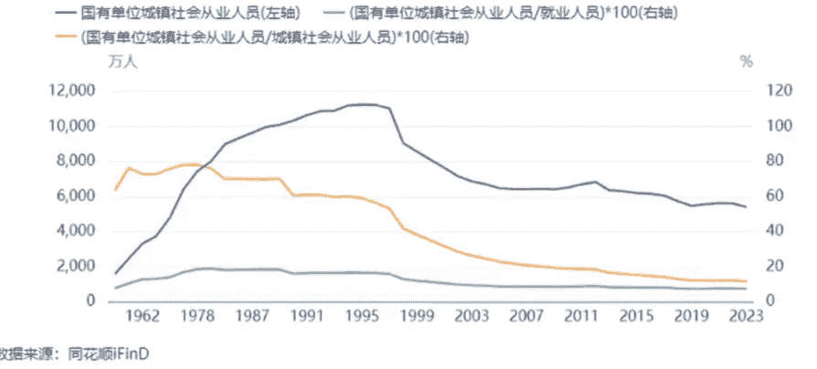
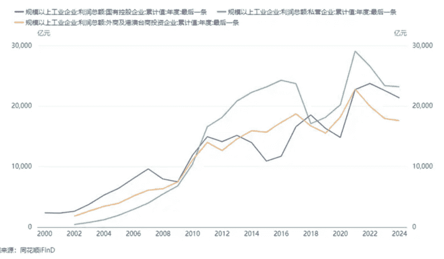
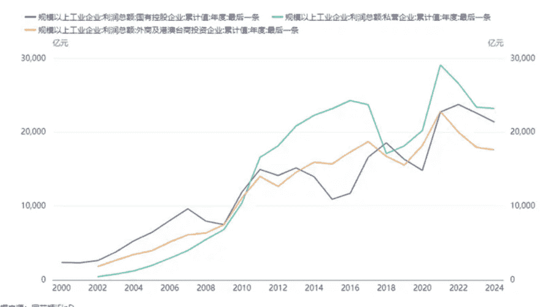
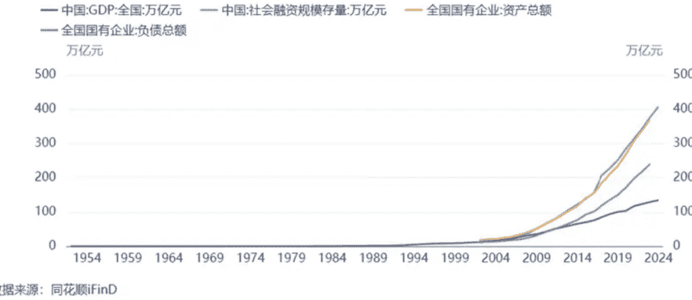
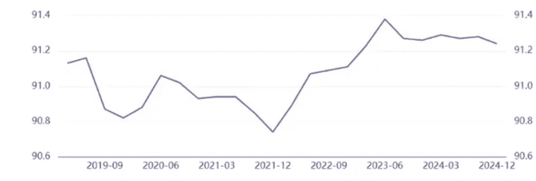
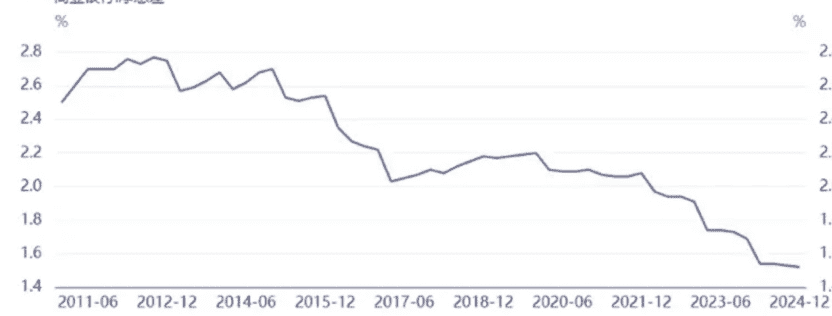
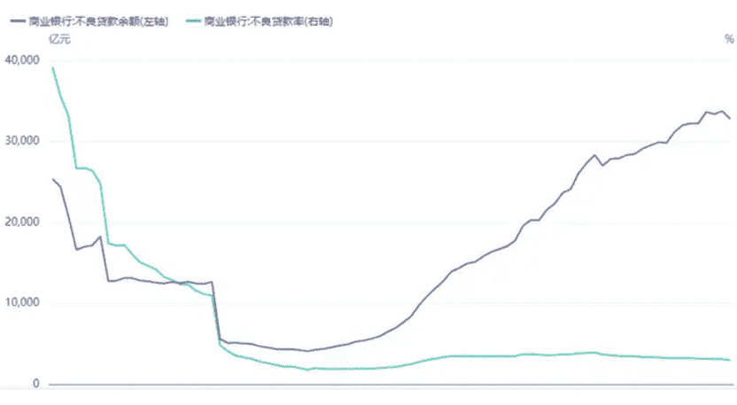

# 今天看到了一些有意思的数据观点。

南天野隼 关注
知乎经济与管理领域成长力分析师

130 人赞了这回回答

我喜欢通过数据分析逻辑，就是为什么在1978年改革开放到现在47年了，民营企业的地位依然稳固，需要特别保护，就跟宠物一样。

# 文章延长，主要是数据图。更多文章

# 扫码加入 星球TOP 免费资源群

- 每日免费获取高价值资源
- 可提供各类资源搜索服务

| 免费 | 热门付费文章 ◆各行业报告 |
| :--- | :--- |
| 价值 | 精选书籍资源 ◆副业赚钱方法 |
| 及时 | 职场实用资源 ◆AI自媒体 |

分享资料仅供个人学习，请及时删除，切勿商用传播

# 太长也可以不看过了，我后面总结。

加微信jntsg2，免费进资料群

## 1、国有单位的就业持续下行

国有单位城镇社会从业人员*1996年见顶，达到11244万人，然后长周期下行，2023年为5400万人，腰折了。

国有单位城镇社会从业人员占就业比例占城镇社会从业人员比例上升到1978年见顶，然后长周期下行，2023年，前者为7.29%，后者为11.88%。

此，发展这么多年，绝大多数就业是由民营企业贡献的，虽然民营企业名声不好，但确实有实实的就业数据支撑，就业人员尤信得，涉及气运争夺，玄乎率。

加微信jntsg2，免费进资料群

# 2、核心工业领域，营企利润总额周期上行，一枝独秀

2008年之前，国有控股企业一枝独秀，营企业处于势底，2009年之后，营企业跟开挂一般，一枝独秀，长周期上行，2018年开启的第一轮贸易战的影响很快修复，2024年是最快修复。

到2024年，营企业的利润总额已经超过国有企业，国有企业只能依赖原材料和能源企业创造利润能够与营企外资三分天下，但天平持续向营企业倾斜。

加微信jntsg2，免费进资料群

# 3、核心领域，民营企业利润总额周期上行，一枝独秀

2008年之前，国有控股企业一枝独秀，民营企业垫底，2009年之后，民营企业跟开挂一般，一独秀，周期上行，2018年开启的第一轮贸易战的影响很快恢复，2024年也是最快恢复。

到2024年，民营企业的利润总额已经超过国有，有企业只能依赖原材料和能源创造利润能够与民营外资三分五分，但天平持续向民营企业倾斜。

加微信jntsg2，免费进资料群

# 4、国有资产和债务快速膨胀，资产收益率持续下降

2023年，全国国有企业资产371.90万亿元，负债总额240.90万亿元，资产负债率64.8%。

2024年社储存量408.34万亿，政府债务81.09万亿，住户贷款82.84万亿，剩余244.41万亿由企业单位债务组成，预计国债务在140万亿以上，是社胀的大头。

国有企业资产报酬率从2008年以来持续下降。

国有企业债务压力大，资产收益率持续下滑，2023年是拐点，利润总额直接下降，接下来的概率加速下行。

加微信jntsg2，免费进资料群

# 5、金融企业也面临危机

金融机构负债/金融企业资产*100
- 金融机构负债/金融企业资产*100

数据来源：同花顺

金融企业主要是国有企业，但未纳入国有企业，金融企业包括银行、证券、保险三类，2024年12月，金融资产495.59万亿，负债452.17万亿，权益43.42万亿，资产负债率为91.24%。

- 商业银行净利润年度最高（左侧）
- 商业银行净利润年度最高（右侧）

数据来源：同花顺

商业银行净利润率情况，持续下，到2024年，下降到0.6%。

商业银行净利润长期上行，到2023年见顶，达到238万亿，开始下降，2024年，商业银行净利润232万亿。

2019年银行、证券、保险三大行业净利润情况，净利润总额为299万亿，银行占比83%，保险业31亿，证券123亿。

按2019年银行净利润占比，2024年，金融业约28万亿左右。

加微信jntsg2，免费进资料群

## 商业银行净利润

数据来源：同花顺

这是商业银行的净利润长期行，已经突破了《商业审慎评估办法》中提出的1.8%的临界值，现在是15.2%。

加微信jntsg2，免费进资料群

商业银行不良贷款持续增高，2024年达到328万亿，不良贷款率没有明显增长，2024年12月是1.5%。

根据社服数据，2024年贷款规模133万亿，2023年是110万亿，增长21.2%。

如果加上贷款规模数据，2024年不良贷款达到461万亿，不良贷款率达到21%，这也是为什么要不断用国债补充银行资本，实在是造血能力已经不足了。

从以上种种情况分析，在利率持续维持的情况下，各种金融资产萎缩的情况下，商业银行的资产质量持续损，面临下行的趋势。民营企业地位的变化自然从经济上到政治，开始要求更大的权力，经济改革开放的过程中，政治改革却滞后于经济改革。所以经济改革之后就是政治改革，但是这些变化在某些个人眼里是动摇国本，又要扶持，国进民退，然后各种打压。既然经济改革与政治改革不匹配，差异回去，这样就匹配了。新法的实行有没有可能改变这种局面，涉及权力的制衡，这一切问题的根源。

# 总结就是——

# 为什么1978年改革开放到现在47年了，民营企业的地位依然稳固，需要特别保护？

## 1、国有单位的就业持续下行

## 2、核心工业领域，民营企业利润总额长周期上行，一枝独秀

加微信jntsg2，免费进资料群

## 3、国有企业资产和债务快速膨胀，资产收益率持续下行

## 4、主要是国企的金融企业也面临危机

民营企业并不是发展的好，恰恰相反，是发展的很好，在就业人口和利润总量等等方面都超越了国企。民企超越国企并不是好事，因为民企必然会从经济走到政治，开始在政治上要求匹配自身地位的权力，所谓经济改革之后就是政治改革，而改革开放的过程中，政治改革严重滞后于经济改革。民企要求匹配自身地位的政治权力这点并没有得到回应而被暴锤，而且随着经济下行地方政府远洋捕捞严重，部分民企被吃。这两者加在一起，导致了民企的整体悲观和消极心态，所以现在依然要保护民企。这里就引发了一系列问题。

# 就是标题的国家资源给资本对应的权力吗？给不给？给多少？怎么给？

首先要搞清楚的就是给不给这个首要问题。这个问题显而易见——如果中国要实现伟大复兴，就必须给。原因很简单，民企在产业升级提供就业和海外开拓等方面，作用都大于乃至甚至超过国企。单纯靠国企一条腿走路，我们实现不了伟大复兴。

要实现伟大复兴，就要继续做大。而社会规律就是经济实力越强，必然会追求对应的权力。如果你不给民企政治保障和地位，就实现伟大复兴。

所以逻辑就是中国要实现伟大复兴——只有给民企，才能跑起来。

又要扶持银行资本，给不给。说给银行更大权力，当然，反对的人很多人。

加微信jntsg2，免费进资料群

## 商业银行分维度

- 产业类型
- 行业属性

现在，让我们细聊。

### 第一个维度，是产业类型角度。加微信jntsg2，免费进资料群

可以分为：中小企业、垄断巨头、金融资本。金融资本主要是国有企业，面对中小企业和群众十分强势，但对地方政府和国企却十分弱势。

新闻对比：银行操作失误导致群众少取钱，多年后银行账户被掏空，家属上诉不用想，枉用都没有，银行根本不罚。但银行操作失误多给群众钱，群众不还，银行反手直接起诉拿到钱。对中小企业则是晴天伞下雨伞，上面令银行钱流到中小企业里，死活留不到，反而是国企不管经营差都能贷款，有的国企脆弱当中间商从银行借钱然后放贷给民企。银行对地方政府更是弱势到不能再弱了，贵州欠钱还不起，银行乖乖，要么利息少要么展期。明显不合理，这十分扭曲，导致了一系列动乱和金融风险。金融派多次说改革银行，就是改革银行这种扭曲的权力地位。银行对群众中小企业不能这么高在上，王采取的是普惠金融改革方法，老二号采取的是互联网金融改革方法用蚂蚁金服当平台，一个成功还在路上，一个则宣告失败。银行对国央企的几乎无限贷款，这篇文章很大，涉及国央企改革是非常复杂的，现在没有多少改革办法。银行在地方政府那里如奴才一般，没有独立性，政府各种花样搞地方融资平台银行无条件配合，这是地方债问题严重的重要原因，这涉及中国财税改革的高度，这篇文章更大，目前也是没有办法。还有央行和财政部的拆藩内耗严重，拖累中国宏观调控，这又涉及到中国金融财税的顶层设计，需要搞国家部委机关改革。所以你说给银行更大权力其实不严谨。这不是给权力这么简单的，是某些地方权力过大需要平衡，有些地方权力过小需要加强，是很复杂精细的改革工程。

然后是中小企业资本。中小企业资本的政治地位也十分扭曲，需要增加减减。中小企业面对工人是十分强势的。加微信jntsg2，免费进资料群

中国劳动法形同虚设，每种996没人管，甚至欠工资让员工倒款上班的都有，你是打工人你敢讨薪？地方政府偏向中小企业给了恶意克薪的定义。中小企业面对地方政府其实是不错的，有个潜规则就是中小企业的税收是睁眼闭一只，严格按照法律的话，所有的中小企业都是逃税的，但中央政府放水养鱼，因为中小企业是就业的大头，中小企业崩了就业就崩了。但是中小企业面对地方政府却是弱势的。这种地方级干部搞的小企业太了。

## 中小企业分维度

- 产业类型
- 行业属性

可以分为：实业资本、金融资本、中小企业、垄断资本。

根据成都市人力资源和社会局调查数据，大型企业劳动报酬占成本比为8.4%，最低；微企业劳动报酬占成本比为14.9%，最高；中型企业和小型企业劳动报酬占成本比分别为10.8%、9.7%，均高于大型企业。中小企业的成本大头是原材料成本，是大企业的压榨成本和风险转移，是地方政府各部门的打点费。一句白话，大部分中小企业不会因为工资加班就死掉，如果大企业再晚几个月回款，那这些中小企业离死不远了，这个时候要是地方政府再上门查环保，那这企业可以直接关门了。然后是垄断资本，垄断巨头以资本为主。加微信jntsg2，免费进资料群

## 互联网资本分对象

互联网资本的政治地位和权力更是扭曲的。这分几个对象：

- 打工人
- 中小企业
- 中央政府
- 地方政府
- 国外环境

### 1、互联网巨头资本对打工人异常强势且花样百出。

中小企业最怕打工人加班减薪，互联网资本玩的更骚招是：有一招海量招聘。互联网发展初期程序员是紧缺的，新发展起来的互联网巨头，为了扼杀追赶的中小企业，也为了和同行巨头军备竞赛，就各种海量招聘。加微信jntsg2，免费进资料群明明不需要这么多人，不必给这么多届生工资，非要招非要给，因为这样搞了后，中小互联网企业的发家就急剧困难，招不到足够的人给不出高的薪水，大大抬高了中小企业崛起的难度，同时也让抢不到足够的程序员人才。看起来打工人是赚了啊，在哪打工不是打工啊，在大厂打工还能拿高薪和镀金。错，因为这是个回旋镖。互联网巨头疯狂的人才军备赛，导致社会对互联网专业的高度追捧，大家都在卷。

## 3、地方政府对巨头资本垄断资本，十分客气友好，乃至不讲底线

这就是中小资本享受不到的待遇了。

地方政府对他们是吃吃喝喝拿钱。

但地方政府对巨头资本却一反常态。

这个从地方财政角度很好解释，而且互联网巨头几乎掌握了大部分舆论权，并且因为体量嗓大，成为民营经济的代表性人物。

地方政府对互联网巨头不好，在舆论上就等于和整个民营企业界为敌。

友好客气就行了，但不要南山必胜那个地步。

那个都是地方政府为了讨好巨头资本而扭曲司法权了，属于权力滥用了。

腾讯、华为、比亚亚迪的深圳，有司法滥用的乱象。

特斯拉于上海，有舆论维护和打压其他车企业的乱象。

世界五百强的紫金矿业于福建上杭，电池龙头宁德时代于福建宁德，这些更是当地土皇帝般的存在。

你不用担心地方政府对这些巨头资本不友好，你得担心地方政府太友了。

友好过分，导致各种权力滥用的现象。

## 4、互联网巨头和中央政府，却关系紧张

告诉你一个事实。

垄断资本和互联网巨头资本不满的对象，不是地方政府，而是中央政府。

没办法，谁叫中国是社会主义国家呢。

你看腾讯，在深圳多牛逼，但是一个部委就敢出文挖腾讯的游戏业务。

你看阿里，在杭州多牛逼，但是国家认真起来马云直接接半死活。

中国各地巨头资本对当地的地方政府的影响力，已经太大了，大到地方行政权力滥用司法乱象的地步，大到需要中央政府下场逼制趋势的地步。

巨头资本对中央政府的影响力，却十分小，甚至不匹配他们的经济实力。

巨头资本所谓的要权，无非就是找中央政府要权。

但明明，巨头资本是少数，广大中小企业资本是大多数。

偏偏，巨头资本掌握了最大的舆论权，他们将自己等同民营经济的代表，不给权就是国进民退。

这是中央政府难以拿捏政策分寸的主要问题。

## 5、巨头资本在海外市场的待遇，吃瘪受挫

这个视角，估计没人想过。

我举美国资本的例子你就懂了。

中国巨头资本说：我在海外发展的挺好啊，我背靠中国大国很好啊。

# 美国巨头资本说：你算什么过的好，你知道我当年是怎么过的吗？

南美洲是我美国资本的后花园，我在南美直接搞奴隶制庄园搞蔗糖等产业，在巴西直接搞各种矿产当矿主，赚翻了——你中国资本能让中国在东南亚帮你这像搞吗？

欧洲市场不用我去费力气竞争，我美国巨头资本直接让白宫搞马歇尔计划重建欧洲，直接让我美国资本凌驾于欧洲资本之上——你中国一个TikTok在美国都被被打压，连正常的生存都做不到。

美国对我们美国资本在全球的开拓真的是好的，中国对你中国资本走出去做了多大贡献？

是的，这涉及到一个最高级维度的了。

从历史得出的，帝国主义是资本主义的最高形式，因为帝国主义的本质是垄断资本有了对国家的巨大影响，在垄断资本推动下欧美国家纷纷开启帝国主义模式经济殖民全球。

# 但是中国社会主义国家，中国内生的垄断资本无法拥有对中国顶层决策的巨大影响力。

垄断资本的天性就是增值，一个有中国市场的增值空间是有有限的，全球市场才是发展的天花板，中国垄断资本需要走出去，需要开拓全球，而且是去落后国家降维打击通吃一切，但中国垄断资本影响不了决策层，而且中国决策还抱着和平发展的思路没有持创业。

这导致中国垄断资本其实并没有得到中国中央政府多少的好处。

所以你看到，腾讯本来靠吃鸡手游通杀印度市场，结果印度莫迪禁了手游，腾讯没处。

所以你看到，中国巨头出海之路坎坷，特别是互联网巨头和电车巨头难以出海，就是在中国市场彻底卷死。

所以你看到，华为在被锤之前一直说自己是国际企业，被各种吹捧。

所以你看到，今日头条将TikTok剥离出来，要全球化。

所以你看到，本来发家的珠三角，非要去新加坡装成国际企业。

如果中国是美国那样的世界地位，如果中国能像美国一样扶持全球，这些中国企业会羞自己是中国企业吗？

这就是最大矛盾。

垄断资本和地方政府没有矛盾，但是垄断资本和中央政府有矛盾。

所以垄断资本的确没有力，虽然有美欧的经济实力和战斗力，但没有对应的政治影响力。

中国垄断资本要是给力的话，早成帝国主义国家了，早把东南亚当后花园送割了。

下面是一段拟人的对话：

中国垄断资本直接开头说：“我是资本，是资本天然追求增值，我只谈这点。要影响中国顶层决策的政治地位，在国内市场开放或者其他领域的准入，让我在国内市场更好的增值。要出去开拓全球市场，完成资本增值。你以为我想在国内内卷啊？你以为我不想出去吃大肉！我明明能打欧美资本，为什么我出不去？”

中国摇摇头：“我是社会主义不是帝国主义，垄断资本不代表所有资本，其他领域准入要么涉及民生要么涉及国企，不太好。而且你们已经在地方政府那里享受常规待遇了，所以我很难再在中央政府给你常规待遇了。”

# 中国垄断资本：“国内不行，那海外呢？”

中国一摊手：“我搞的是人类共同体啊，你们出海杀全球，这个吃相太看了，估计不太合适吧，而且美国还在霸主的位置上呢，你再忍忍吧，等我把美国愁死了。”

中国垄断资本冷笑一声说道：“垄断资本并非偶然，因为垄断资本是生产力发展到一定阶段的必然，你没能力发展不到垄断资本这个阶段呢。而你中央政府对我垄断资本感觉头疼吧，其实很简单，无非是国内为了国企民生舍得放更多蛋糕给我们吃，还有海外又无力扶持我们开拓。可是你要知道，我是天性追求增值的资本，民族复兴对我没有什么本质上的吸引力，同样的，共同富裕我也没有根本上的排斥，因为我是资本我只追求增值，能增值就有伟大复兴就有共同富裕，没有增值，一切都免谈。对了，你知道日本资本为什么背弃日本母国而甘心和美国混的原因吗？”

中国挺感兴趣的问题：“哦?为什么？”

中国垄断资本冷冷的说：“日本国内市场更小，日本资本要出海增值，但日本非正常国家没有国际席位，更没有全球武保障，提供不了日本资本出海增值的保证。之前日本资本靠着美国市场的接纳所以发展发展迅速，但后面美国不愿意了。”

中国脸色一沉，冷冷问道：“你想说的到底是什么？”

中国垄断资本也一摊手说道：“资本有国界，但资本没有国界，各路资本都不是天然固定的民族资本，民族的旗帜只能凝聚人心于一时。随着中国市场的内卷和老龄化，中国市场对资本的增值迟早到天花板，何况中国经济蛋糕天然要分一半给你的国企央企，我们只赚剩下的一半，到时候，中国资本的民族属性只会日渐消退。日本垄断资本就这样抛弃了它的日本母国和日本人民，中国不能在内外作出改变的话，中国垄断资本也早会抛弃中国母国和中国人的……”

中国略一沉吟，然后说道：“给我一些时间解决吧，不过你说错了，我感觉到最头疼的，并不是你垄断资本。”

中国垄断资本愕然：“怎么可能？不是我是谁？”

中国一字一句的缓说：“它的名字，叫中国权贵资本……”
